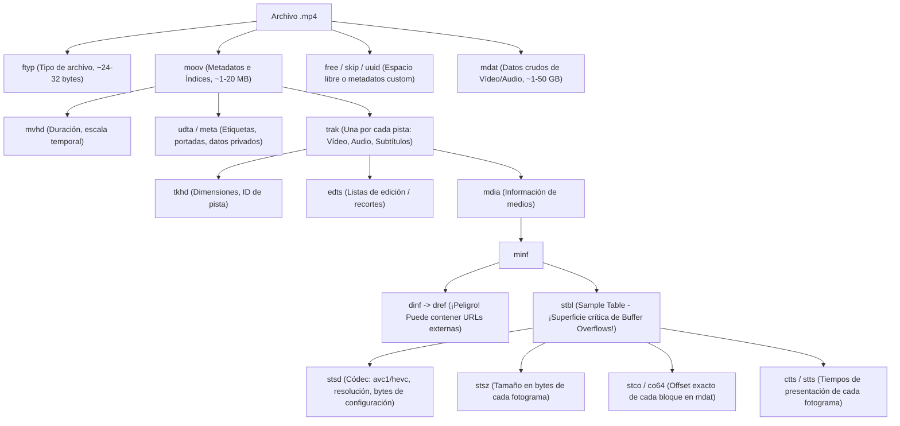
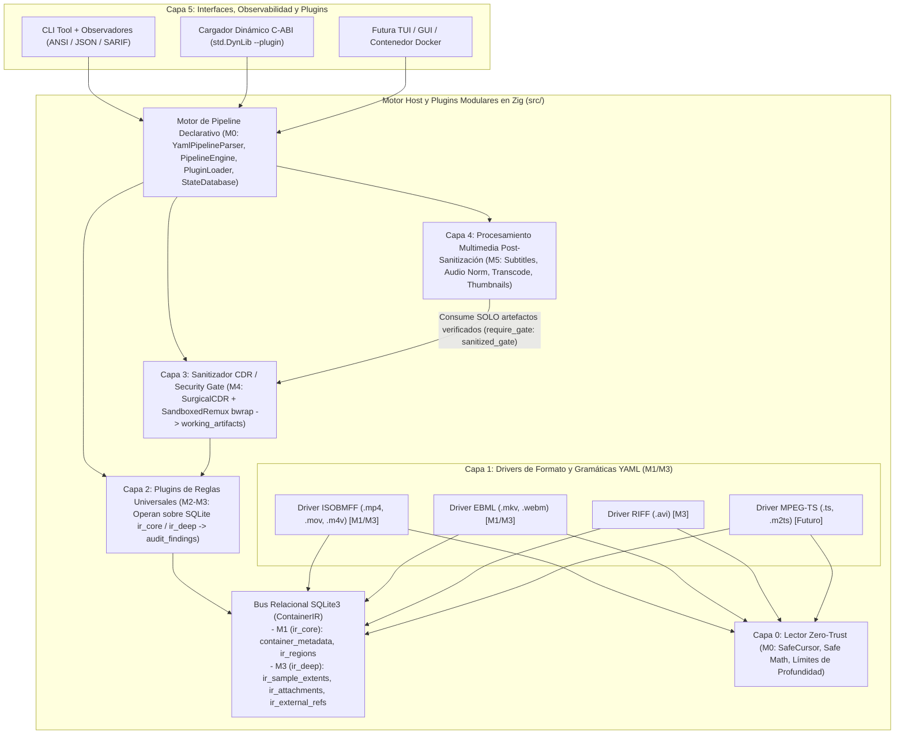
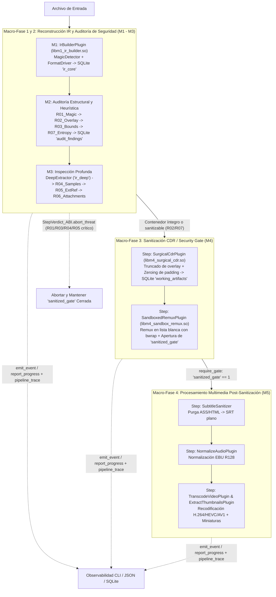

# Arquitectura y Hoja de Ruta: `vidsec` (Suite de Auditoría y Sanitización de Vídeo en Zig)

## 1. Fundamentos: ¿Cómo es un vídeo por dentro? (Para empezar desde cero)

Antes de diseñar las capas del software, conviene entender un concepto clave: **`.mp4` y `.mkv` no son formatos de compresión de vídeo (eso son `H.264`, `HEVC` o `AV1`), sino contenedores (cajas jerárquicas)**.

Un contenedor de vídeo funciona exactamente igual que un árbol de directorios o un documento XML binario:

### A) El formato MP4 / MOV (`ISOBMFF` - ISO Base Media File Format)
Todo archivo MP4 es una secuencia de **cajas (*boxes* o *atoms*)**, una detrás de otra, y algunas cajas contienen sub-cajas dentro:
- Cada caja empieza con una cabecera mínima de **8 bytes**:
  - `size` (`uint32` Big-Endian): Cuántos bytes mide la caja completa (incluyendo la cabecera). *Nota: si `size == 1`, el tamaño real es un `uint64` en los 8 bytes siguientes (`largesize`), usado cuando el vídeo supera los 4 GB.*
  - `type` (`[4]u8` ASCII, llamado *FourCC*): El nombre de la caja, por ejemplo `"ftyp"`, `"moov"`, `"mdat"`.
- **Las 3 cajas principales de la raíz:**
  1. `ftyp` (*File Type*): Los primeros bytes del archivo. Dice qué dialecto MP4 es (`isom`, `mp42`, `qt  `).
  2. `moov` (*Movie Box*): **El "cerebro" del archivo (y donde residen el 90% de los exploits de demuxer).** No contiene fotogramas de vídeo, sino un árbol de sub-cajas con los metadatos, pistas (`trak`) y las **tablas de índices (`stbl`)** que le dicen al reproductor en qué byte exacto del archivo está cada fotograma (`stco`/`co64`) y cuánto mide (`stsz`).
  3. `mdat` (*Media Data*): El bloque gigante (99% del peso del archivo, varios GB) con los fotogramas comprimidos de vídeo y audio en crudo.



### B) El formato MKV / WebM (`Matroska` sobre `EBML`)
Matroska es el equivalente a un XML binario llamado **EBML (*Extensible Binary Meta Language*)**:
- Cada elemento tiene el formato `[ID: VINT][Tamaño: VINT][Datos o Sub-elementos]`.
- Un **VINT (*Variable Size Integer*)** usa los bits `0` iniciales del primer byte para indicar cuántos bytes mide el número (de 1 a 8 bytes).
- Sus secciones clave bajo la raíz (`Segment`) son: `SeekHead`, `Info`, `Tracks` (definición de pistas), **`Attachments` (archivos adjuntos como fuentes `.ttf`/`.otf` o binarios arbitrarios)**, `Chapters` y `Cluster` (los bloques de vídeo/audio).

### C) ¿Y el resto de formatos de vídeo? Las 4 grandes familias estructurales
Aunque existen decenas de extensiones de archivo, **el 99,9% de los contenedores de vídeo del mundo pertenecen a solo 4 familias estructurales**:

| Familia Estructural | Formatos que la usan | Cómo se codifica cada bloque | ¿Es un árbol TLV (`Tipo-Longitud-Valor`)? |
| :--- | :--- | :--- | :---: |
| **1. Cajas Big-Endian (`ISOBMFF`)** | `.mp4`, `.mov`, `.m4v`, `.3gp` | `[Size: u32/u64 BE][FourCC: 4B][Datos/Hijos]` | **Sí** |
| **2. Árbol Binario Variable (`EBML`)** | `.mkv`, `.webm` *(WebM es un subconjunto de MKV)* | `[ID: VINT][Size: VINT][Datos/Hijos]` | **Sí** |
| **3. Chunks Little-Endian (`RIFF` / `ASF`)** | `.avi`, `.webp`, `.wmv`, `.asf` | `[FourCC o GUID][Size: u32/u64 LE][Datos/Hijos]` | **Sí** |
| **4. Flujo de paquetes fijos (`MPEG-TS`)** | `.ts`, `.m2ts`, `.mts` (Blu-ray, IPTV, Streaming) | Secuencia plana de paquetes de `188 bytes` que empiezan por `0x47` (`Sync Byte` + `PID`) | **No** (es un flujo continuo de paquetes) |

> [!TIP]
> **Conclusión clave de diseño:**
> Los formatos de las familias 1, 2 y 3 (`.mp4`, `.mov`, `.mkv`, `.webm`, `.avi`, `.wmv`) **son estructuralmente isomorfos**: todos son árboles de regiones `[Identificador + Tamaño Declarado + Contenido/Hijos]`. Solo cambia *cómo se leen los primeros bytes de cada cabecera*.

---

## 2. Solución Arquitectónica Multi-Formato: El Patrón Compilador (`Drivers` $\rightarrow$ `IR` $\rightarrow$ `Reglas`)

Para poder añadir formatos en el futuro sin tocar las reglas de auditoría ni la interfaz, aplicamos el mismo patrón que usan los compiladores modernos (`LLVM`) o `FFmpeg` (`libavformat`): **desacoplar los lectores de formato de las reglas mediante una Representación Intermedia Unificada (`ContainerIR`)**.



### ¿Cómo funciona la Representación Intermedia (`ContainerIR`) sobre SQLite y Zig?

Cada driver de formato (`isobmff.zig`, `ebml.zig`, `riff.zig`) lee las cabeceras nativas de su formato (guiado por los diccionarios declarativos `configs/formats/*.yaml`) y **vuelca lo que ve en 4 tablas universales dentro de la base de datos SQLite compartida (`*sqlite3`)**, divididas en dos dominios de esquema (`"ir_core"` en `M1` e `"ir_deep"` en `M3`):

```zig
/// 1. Dominio "ir_core" (M1 - tabla SQLite `ir_regions`):
///    Cualquier caja MP4, elemento EBML (MKV) o chunk RIFF (AVI) se inserta a partir de esta estructura:
pub const GenericRegion = struct {
    tag_name: []const u8,              // Ej: "moov", "stsz" (MP4) | "18538067", "EC" (MKV) | "LIST:movi" (AVI)
    symbolic_name: []const u8,         // Ej: "MovieBox", "SampleSizeBox", "Segment", "Void", "AviMovieDataList"
    role: RegionRole,                  // .container | .index_table | .media_payload | .metadata | .attachment | .padding | .external_ref | .codec_config | .unknown
    header_offset: u64,                // Byte donde empieza la cabecera
    payload_offset: u64,               // Byte donde empiezan los datos
    declared_payload_size: u64,        // Tamaño de payload que afirma tener según el archivo
    parent_limit: u64,                 // Límite legal máximo permitido por su nodo padre
    depth: u8,                         // Nivel de anidamiento (máx. 32)
    is_truncated_or_overflow: bool = false, // true si payload_offset + declared_payload_size supera parent_limit o desborda u64
};
```

Y en la fase de inspección profunda (**dominio `"ir_deep"` en `M3`**), `vidsec.m3.deep_extractor` proyecta las tablas de índices, huecos de `mdat`, configuraciones de códec, adjuntos y referencias externas a cinco tablas SQLite adicionales:
- **`ir_sample_extents`**: `(sample_id, track_id, source_tag, target_offset, sample_size, end_offset, has_arith_overflow)` — extraída desde `stco`/`co64`+`stsz` en MP4, `Cues` en MKV o `idx1` en AVI (con coalescencia de muestras contiguas).
- **`ir_unreferenced_slack`**: `(slack_id, parent_region_id, region_tag, start_offset, end_offset, byte_size)` — rangos de bytes dentro de `mdat`/`LIST:movi`/`Cluster` que ninguna muestra de audio o vídeo referencia.
- **`ir_codec_configs`**: `(config_id, track_id, codec_tag, container_width, container_height, bitstream_width, bitstream_height, is_header_malformed, file_offset)` — coherencia entre las dimensiones declaradas en la pista (`tkhd`/`strh`) y la cabecera del códec (`avcC`/`hvcC` SPS, `strf`).
- **`ir_attachments`**: `(attachment_id, filename, mime_type, file_offset, byte_size, magic_hex)` — archivos incrustados (fuentes `.ttf`/`.otf` en MKV, portadas, binarios) junto con sus primeros 16 bytes reales en hexadecimal.
- **`ir_external_refs`**: `(ref_id, source_tag, uri, file_offset)` — referencias de red o rutas externas (`dref` en MP4, `NextFilename` en MKV).

### ¿Qué ganamos con este diseño?

1. **Las reglas de seguridad son 100% agnósticas del formato (Consultas SQL Parametrizadas):**
   - La regla **`R03_BoundsAnomaly`** simplemente consulta `SELECT ... FROM ir_regions WHERE is_truncated_or_overflow = 1`. Le da exactamente igual si la región vino de un átomo `moov` de MP4, de un `Cluster` de MKV o de un `LIST` de AVI.
   - La regla **`R04_SampleTableOverflow`** verifica mediante una consulta cruzada entre `ir_sample_extents` e `ir_regions` que todo frame caiga dentro de una región con `role = 'media_payload'` (`mdat` en MP4, `Cluster` en MKV, `LIST:movi` en AVI).
   - La regla **`R02_TrailingData`** compara `highest_root_end_offset` en `container_metadata` frente al `file_size` real del archivo en disco (detectando payloads de *file pumping* u *overlays* al final del contenedor).
2. **Añadir un formato nuevo es escribir un único driver aislado (`FormatDriver`) y su gramática YAML:**
   - Con el driver **ISOBMFF** (`src/m1_parsers/drivers/isobmff.zig`) cubres automáticamente `.mp4`, `.mov`, `.m4v` y `.3gp`.
   - Con el driver **EBML** (`src/m1_parsers/drivers/ebml.zig`) cubres automáticamente `.mkv` y `.webm`.
   - Con el driver **RIFF** (`src/m1_parsers/drivers/riff.zig`) cubres `.avi` sin tocar ni una línea de los plugins de reglas (`M2`/`M3`), ni del sanitizador (`M4`), ni de la CLI (`M0`).

### Detalle de cada capa

#### Capa 0: Ingesta y Cursor Seguro (`src/core/io_cursor.zig`)
- **Objetivo:** Leer cabeceras de archivos de hasta 100 GB **sin cargar el archivo en memoria RAM** (haciendo `seek` sobre los bloques `mdat`/`Cluster` gigantes y leyendo solo las cabeceras y ventanas de muestreo).
- **Garantías de seguridad:**
  - Todas las sumas de desplazamientos usan `std.math.add(u64, offset, size)` para capturar intentos de *integer overflow* antes de mover el puntero de lectura.
  - Mantiene una pila de límites de padres (`limit_stack: [32]u64`): ningún elemento hijo puede declarar un tamaño que sobrepase el final de su caja padre.
  - Límite estricto de profundidad de anidamiento (`MAX_DEPTH = 32`) para evitar ataques de desbordamiento de pila (*stack overflow*) mediante cajas infinitamente anidadas.

#### Capa 1: Drivers de Formato y Dominio SQLite `"ir_core"` (`src/core/ir_types.zig`, `src/m1_parsers/`)
- **Objetivo:** Cada driver (`isobmff.zig`, `ebml.zig`, `riff.zig`) navega la codificación binaria propia de su formato y vuelca cada bloque en `container_metadata` e `ir_regions` mediante `IrSqlWriter` dentro de una única transacción SQLite (`BEGIN IMMEDIATE` ... `COMMIT`).
- **Diseño:** Los drivers **no opinan** si algo es malicioso; solo traducen de bytes específicos del formato a las tablas relacionales del `ContainerIR`.

#### Capa 2: Plugins de Auditoría y Validaciones Universales (`src/m2_audit/` y `src/m3_deep/`)
Aquí viven los plugins de seguridad independientes que consultan las tablas SQLite generadas por `M1` y `M3` y registran sus hallazgos en la tabla `audit_findings` (dominio `"audit_findings"`, con `severity`: `0 = info`, `1 = warning`, `2 = critical`):
1. **Regla de Suplantación y Poliglotos (`R01_MagicMismatch` - `vidsec.m2.r01_magic`):** Consulta `container_metadata` y detecta si el archivo tiene extensión de vídeo pero empieza por `MZ` (ejecutable Windows PE), `ELF`, `Mach-O`, `#!`, `ZIP/RAR`, o si es un manifiesto de texto (`.m3u8`/`.asx`) renombrado, devolviendo `StepVerdict_ABI.abort_threat`.
2. **Regla de Datos Ocultos / Overlay (`R02_TrailingData` - `vidsec.m2.r02_overlay`):** Comprueba en `container_metadata` si `highest_root_end_offset < file_size` (detectando ejecutables o datos de *file pumping* pegados tras la última caja raíz en cualquier formato).
3. **Regla de Integridad Aritmética y Truncado (`R03_BoundsAnomaly` - `vidsec.m2.r03_bounds`):** Consulta `ir_regions WHERE is_truncated_or_overflow = 1` buscando regiones cuyo tamaño declarado desborde o supere el `parent_limit` de su nodo padre.
4. **Regla de Coherencia Cruzada de Índices vs Datos (`R04_SampleTableOverflow` - `vidsec.m3.r04_samples`):**
   - Verifica mediante consulta SQL cruzada entre `ir_sample_extents` e `ir_regions` que ninguna muestra apunte fuera de las regiones marcadas con `role = 'media_payload'` (`mdat` en MP4, `Cluster` en MKV, `LIST:movi` en AVI).
5. **Regla de Referencias de Red Externas (`R05_ExternalDataRef` - `vidsec.m3.r05_extref`):** Inspecciona `ir_external_refs` (alimentada por átomos `dref` en MP4, `NextFilename` en MKV, etc.) y alerta ante cualquier URI externa (`http://`, `https://`, `file://`, `\\smb\`, `../`).
6. **Regla de Adjuntos y Fuentes Incrustadas (`R06_EmbeddedAttachments` - `vidsec.m3.r06_attachments`):** Inspecciona `ir_attachments` (nombre, MIME type, tamaño y `magic_hex`) y alerta si hay fuentes tipográficas (`.ttf`/`.otf`) o ejecutables/archivos comprimidos ocultos dentro del contenedor.
7. **Regla de Regiones Opacas / Padding Sospechoso y Escáner de Firmas (`R07_SuspiciousPadding` - `vidsec.m2.r07_entropy`):** Analiza las regiones con `role IN ('padding', 'unknown')` (`free`/`skip`/`uuid` en MP4, `Void` en MKV, `JUNK` en AVI) combinando entropía de Shannon ($H(X) \ge 7.2$ bits/byte) y búsqueda selectiva de firmas binarias (`SignatureScanner`: `MZ`, `ELF`, `Go buildinf:`, scripts) para cazar payloads incluso si el atacante añade ceros para reducir la entropía media.
8. **Regla de Espacio Muerto en `mdat` (`R08_UnreferencedMediaSlack` - `vidsec.m3.r08_media_slack`):** Inspecciona `ir_unreferenced_slack` para detectar *file pumping* o malware oculto **dentro** de `mdat`/`LIST:movi` en zonas que ninguna entrada de `stco`/`stsz` referencia.
9. **Regla de Coherencia de Cabeceras de Códec (`R09_CodecConfigMismatch` - `vidsec.m3.r09_codec_config`):** Inspecciona `ir_codec_configs` y alerta si la resolución del SPS (`avcC`/`hvcC`/`strf`) difiere de la cabecera de pista (`tkhd`/`strh`) o está truncada (prevención de *Heap Overflows* tipo *Stagefright*).
10. **Regla de Solapamiento de Muestras (`R10_SampleOverlap` - `vidsec.m3.r10_sample_overlap`):** Detecta mediante función ventana SQL (`LAG`) si distintos extents de muestras apuntan al mismo rango de bytes en `mdat` (bombas de descompresión multimedia).

#### Capa 3: Sanitización / CDR, Carving Forense y Compuerta `"sanitized_gate"` (`src/m4_cdr/`)
Actúa como la **compuerta de seguridad (*Security Gate*)** antes de cualquier procesamiento multimedia posterior y gestiona el dominio SQLite `"working_artifacts"` (`working_artifacts` + `quarantined_payloads`):
- **Carving Forense Automático a Cuarentena (`quarantine_dir`):** Antes de neutralizar un *overlay* (`R02`), un bloque de *padding* sospechoso (`R07`) o un hueco huérfano en `mdat` (`R08`), `vidsec.m4.surgical_cdr` recorta el bloque malicioso a un archivo `.bin` aislado en cuarentena y registra su `SHA-256` y coordenadas originales en la tabla `quarantined_payloads`.
- **Modo Quirúrgico Nativo (`vidsec.m4.surgical_cdr`):** Verifica primero que no existan amenazas estructurales incorregibles (`R01`, `R03`, `R04`, `R05`, `R09`, `R10` críticos). Clona el contenedor truncando físicamente cualquier *overlay* posterior a `highest_root_end_offset` y sobrescribe con `0x00` tanto el payload de todas las regiones `role = 'padding'` como los huecos `ir_unreferenced_slack` dentro de `mdat`, sin alterar los offsets de `stco`/`co64`.
- **Modo Reconstrucción en Sandbox (`vidsec.m4.sandbox_remux`):** Invoca `ffmpeg` (encapsulado opcionalmente en `bubblewrap` sin red `--unshare-net`) mapeando exclusivamente los flujos elementales de vídeo y audio (`-map 0:v:0 -map 0:a? -dn -map_metadata -1 -map_chapters -1 -c copy`), purgando fuentes adjuntas, capítulos y tablas sobrantes.
- Al certificar el archivo limpio (con su hash `SHA-256` en `working_artifacts`), abre la compuerta `"sanitized_gate"` en la tabla `pipeline_gates`.

#### Capa 4: Procesamiento Multimedia Post-Sanitización (`src/m5_processors/`)
Protegida en `pipeline.yaml` mediante `require_gate: "sanitized_gate"`, esta capa nunca lee el archivo de entrada original: cada plugin adquiere el último eslabón verificado en la tabla SQLite `working_artifacts` (verificando su tamaño y `SHA-256` contra ataques *TOCTOU*) y registra el nuevo artefacto generado:
- **Higiene de Subtítulos (`vidsec.m5.sanitize_subtitles`):** Purga etiquetas de estilo ASS/SSA (`{\...}`) y tags HTML (`<script>`, ``, `<font>`), produciendo subtítulos `.srt` en texto plano estricto.
- **Normalización de Audio (`vidsec.m5.normalize_audio`):** Normalización de sonoridad `EBU R128` (`loudnorm`) y recodificación de audio.
- **Transformación de Vídeo (`vidsec.m5.transcode_video`):** Transcodificación con parámetros validados en lista blanca (`libx264`, `libx265`, `libsvtav1`, `crf 0..51`).
- **Extracción de Derivados (`vidsec.m5.extract_thumbnails`):** Generación de miniaturas y exportación final trazable.

#### Capa 5: CLI, Observabilidad y Despliegue (`src/main.zig`, `Dockerfile`)
- Monitorización en tiempo real de cada etapa y sub-etapa del pipeline (`emit_event` y `report_progress` en `PipelineContext_ABI`) y registro de tiempos/veredictos en la tabla SQLite `pipeline_trace`.
- Empaquetado en `Dockerfile` multi-stage sin privilegios (`USER vidsec`) con plugins `.so` montados en modo solo lectura (`0555`).

---

## 2.5. El Motor de Pipeline Declarativo, C-ABI y Contratos de Esquema SQLite en Zig

Para que `vidsec` sea a la vez una **herramienta de seguridad** y un **motor de procesamiento multimedia extensible**, el corazón del sistema (`M0`) es **100% agnóstico del dominio**: lee `configs/pipeline.yaml`, carga los plugins `.so` declarados con `std.DynLib` y coordina el árbol de ejecución sobre SQLite.

### A) Pipeline Jerárquico de Macro-Fases (Reconstrucción $\rightarrow$ Auditoría $\rightarrow$ Sanitización CDR $\rightarrow$ Procesamiento)
Cada fase es un grupo jerárquico (`StageGroup`) en `configs/pipeline.yaml`. Si un plugin de seguridad detecta que el archivo es malware (por ejemplo, `R01_MagicMismatch` ante un `.exe` camuflado), devuelve `StepVerdict_ABI.abort_threat`, corta el circuito (*short-circuit*) e impide que se abra `"sanitized_gate"`:



### B) Sideloading de Plugins Externos (`std.DynLib`), Bus SQLite y Versionado en 3 Niveles (`src/core/plugin_abi.zig`)
Todos los plugins (`M1` a `M5`) se comunican con el motor (`M0`) exclusivamente a través de la C-ABI estable definida en `src/core/plugin_abi.zig`, compartiendo la conexión `*sqlite3` activa:

1. **Contrato C-ABI (`callconv(.C)` + `extern struct`) con Matriz de Compatibilidad en 3 Niveles:**
   Para permitir que un plugin estable (como `M1` en versión `1.0.0`) trabaje sin problemas junto a plugins que evolucionan rápido (como `M2` en versión `5.2.0`), `VidsecPluginABI` separa la versión binaria del host (`Nivel 1`), la versión SemVer del plugin (`Nivel 2`) y los contratos de esquemas SQLite por dominio (`Nivel 3`):
   ```zig
   pub const SchemaContract_ABI = extern struct {
       domain: [*:0]const u8,      // Ej: "ir_core", "ir_deep", "audit_findings", "working_artifacts"
       version: u32,               // Ej: 1 -> M0 carga configs/schemas/<domain>_v1.sql bajo demanda
       writable: bool = false,     // false = solo SELECT; true = habilita INSERT/UPDATE en sqlite3_set_authorizer
   };

   pub const PluginDependency_ABI = extern struct {
       plugin_id: [*:0]const u8,   // Hard Dependency: plugin que DEBE ejecutarse antes en el pipeline
       min_version: SemVer_ABI,
   };

   pub const StepVerdict_ABI = enum(u32) {
       proceed = 0,
       skip_group = 1,
       abort_threat = 2,
       step_error = 3,
   };

   pub const VidsecPluginABI = extern struct {
       abi_version: u32 = 1,                                      // Nivel 1: Versión binaria del host M0
       plugin_id: [*:0]const u8,
       plugin_version: SemVer_ABI,                                // Nivel 2: Versión SemVer propia del plugin
       requires_schemas_ptr: ?[*]const SchemaContract_ABI = null, // Nivel 3A: Bancos SQLite (.sql) que M0 mapea al cargar
       requires_schemas_len: usize = 0,
       requires_plugins_ptr: ?[*]const PluginDependency_ABI = null, // Nivel 3B: Hard Dependencies (o null si es autónomo)
       requires_plugins_len: usize = 0,
       execute_step: *const fn (ctx: *PipelineContext_ABI) callconv(.C) StepVerdict_ABI,
   };
   ```
2. **Aprovisionamiento de Bancos SQLite Estilo *Memory Bank Controller* y Validación Pre-Flight (`ADR-006`):**
   > [!CAUTION]
   > Antes de procesar un solo byte del vídeo, `PluginLoader` verifica que ningún archivo `.so` tenga permisos de escritura para terceros (`mode & 0o022 == 0`), aprovisiona en SQLite únicamente los bancos `configs/schemas/<domain>_v<version>.sql` solicitados en `requires_schemas_ptr` (evitando errores de tabla inexistente si se omiten plugins opcionales), y comprueba que todas las *Hard Dependencies* (`requires_plugins_ptr`) aparezcan antes en `pipeline.yaml`.

---

## 3. Hoja de Ruta para Agentes (`Spec-Driven Development`: Hitos `M0` a `M5`)

Para que cualquier modelo de lenguaje avanzado (Gemini, Claude, etc.) pueda implementar el proyecto en Zig **sin perder contexto ni romper contratos entre fases**, la implementación se divide en **6 especificaciones modulares e independientes (`M0` – `M5`)**.

> [!IMPORTANT]
> **Aislamiento del Chasis (`M0`) frente al Dominio (`M1`–`M5`):**
> El hito **`M0`** construye el motor declarativo del pipeline (`SafeCursor`, `StateDatabase`, `YamlPipelineParser`, `PluginLoader`, `PipelineEngine` y `src/core/plugin_abi.zig`). De este modo, **los hitos `M1` a `M5` nunca modifican el motor de ejecución**: únicamente compilan nuevos plugins `.so` que crean o consultan sus dominios de tablas en SQLite (`*sqlite3`).

| Hito | Archivo de Especificación | Nombre del Hito | Alcance Exacto y Objetivos de Implementación | Entregable Verificable (`zig build test`) |
| :---: | :--- | :--- | :--- | :--- |
| **`M0`** | [`specs/M0_pipeline_engine.md`](file:///home/ubuntu/.gemini/antigravity/scratch/vidsec/specs/M0_pipeline_engine.md) | **Chasis Declarativo YAML, Bus SQLite Agnóstico y Cargador de Plugins (`C-ABI`)** | 1. Implementar `SafeCursor` (`src/core/io_cursor.zig`) con aritmética segura (`std.math.add`) y pila `limit_stack: [32]u64`.<br/>2. Definir la C-ABI en `src/core/plugin_abi.zig` (`PipelineContext_ABI`, `VidsecPluginABI`, `SchemaContract_ABI`).<br/>3. Implementar `StateDatabase` (`src/core/database.zig`) con el esquema `configs/schema_m0.sql` (`run_metadata`, `schema_registry`, `pipeline_gates`, `pipeline_trace`).<br/>4. Implementar `YamlPipelineParser`, `PluginLoader` (con validación pre-flight en 3 niveles) y `PipelineEngine`. | Tests de límites en `SafeCursor`, validación pre-flight de `SchemaContract_ABI` (aprobación con SemVer dispares y rechazo por `error.SchemaVersionMismatchBetweenPlugins`) y bloqueo de grupos con `require_gate` (`error.PipelineGateLocked`). |
| **`M1`** | [`specs/M1_container_ir_and_walkers.md`](file:///home/ubuntu/.gemini/antigravity/scratch/vidsec/specs/M1_container_ir_and_walkers.md) | **Reconstrucción del `ContainerIR` en SQLite (`"ir_core"`), Gramáticas YAML y Walkers (`ISOBMFF` + `EBML`)** | 1. Definir los tipos base en `src/core/ir_types.zig` (`MagicKind`, `FormatKind`, `RegionRole`, `GenericRegion`, `DriverError`).<br/>2. Implementar `IrSqlWriter` (`src/m1_parsers/ir_sql_writer.zig`) que crea el dominio SQLite **`"ir_core"` (`v1`)** (`container_metadata` e `ir_regions`) e inserta en lote bajo transacción `BEGIN IMMEDIATE`.<br/>3. Implementar `MagicDetector`, `FormatGrammar` (`configs/formats/*.yaml`), `IsobmffDriver` (`.mp4`/`.mov`) y `EbmlDriver` (`.mkv`/`.webm` con `@clz` para `VINT`) en `vidsec.m1.ir_builder`. | Volcado determinista en SQLite (`ir_regions` y `container_metadata`) para vectores `.mp4` y `.mkv` en memoria, más marcado de `is_truncated_or_overflow = 1` ante cajas que exceden `parent_limit`. |
| **`M2`** | [`specs/M2_structural_and_heuristic_audit.md`](file:///home/ubuntu/.gemini/antigravity/scratch/vidsec/specs/M2_structural_and_heuristic_audit.md) | **Sub-Pipeline de Auditoría Estructural y Heurística (`R01`, `R02`, `R03`, `R07` + Firmas) sobre SQLite** | 1. Crear el dominio SQLite **`"audit_findings"` (`v1`)** mediante `FindingsSqlHelper` (`src/m2_audit/findings_sql.zig`).<br/>2. Implementar los plugins `vidsec.m2.r01_magic` (`R01_MagicMismatch`), `vidsec.m2.r02_overlay` (`R02_TrailingData`) y `vidsec.m2.r03_bounds` (`R03_BoundsAnomaly`).<br/>3. Implementar `ShannonEntropy` (`computeWindowEntropy`), `SignatureScanner` (`scanWindowForSignatures`: `MZ`, `ELF`, `Go buildinf:`, scripts) y el plugin `vidsec.m2.r07_entropy` (`R07_SuspiciousPadding`) para detectar tanto payloads cifrados como binarios ocultos con relleno de ceros en cajas `free`, `skip`, `uuid`, `Void` o `JUNK`. | Cortocircuito (`abort_threat`) ante un ejecutable `MZ` camuflado (`R01`), detección de *overlay* tras `mdat` (`R02`) y detección de entropía $H(X) = 8.0$ bits/byte o firmas en una caja `free` (`R07`) con `0` falsos positivos en cajas rellenas de `0x00`. |
| **`M3`** | [`specs/M3_deep_integrity_and_riff.md`](file:///home/ubuntu/.gemini/antigravity/scratch/vidsec/specs/M3_deep_integrity_and_riff.md) | **Inspección Profunda (`"ir_deep"`), Reglas `R04`–`R06` / `R08`–`R10` y 3er Driver (`RIFF / AVI`)** | 1. Implementar `DeepExtractorPlugin` (`vidsec.m3.deep_extractor`) que produce el dominio SQLite **`"ir_deep"` (`v1`)**: `ir_sample_extents` (con coalescencia de muestras contiguas), `ir_unreferenced_slack`, `ir_codec_configs`, `ir_attachments` e `ir_external_refs`.<br/>2. Implementar las 6 reglas profundas: `R04_SampleTableOverflow`, `R05_ExternalDataRef`, `R06_EmbeddedAttachments`, `R08_UnreferencedMediaSlack` (espacio muerto en `mdat`), `R09_CodecConfigMismatch` (`tkhd` vs SPS `avcC`/`hvcC`) y `R10_SampleOverlap` (`LAG` SQL).<br/>3. Implementar `RiffDriver` (`src/m1_parsers/drivers/riff.zig` + `configs/formats/riff.yaml`) para contenedores `.avi` Little-Endian. | Detección de punteros `stco` fuera de `mdat` (`R04`), alerta SSRF en `dref` (`R05`), fuentes `.ttf` en MKV (`R06`), *slack space* con `Go buildinf:` dentro de `mdat` (`R08`), discrepancia de resolución SPS (`R09`), solapamiento de frames (`R10`) y parseo `.avi`. |
| **`M4`** | [`specs/M4_cdr_sanitizer_gate.md`](file:///home/ubuntu/.gemini/antigravity/scratch/vidsec/specs/M4_cdr_sanitizer_gate.md) | **Sanitizador CDR, Carving Forense (`"working_artifacts"`), Remux Aislado y Compuerta (`sanitized_gate`)** | 1. Crear el dominio SQLite **`"working_artifacts"` (`v1`)** (`working_artifacts` + `quarantined_payloads`) con trazabilidad `SHA-256`.<br/>2. Implementar `SurgicalCdrPlugin` (`vidsec.m4.surgical_cdr`): bloquea archivos con hallazgos `R01`/`R03`/`R04`/`R05`/`R09`/`R10` críticos; en contenedores recuperables extrae a cuarentena (`quarantined_payloads`) los bloques sospechosos (`R02`/`R07`/`R08`), trunca *overlays* en `highest_root_end_offset`, sobrescribe con `0x00` las regiones `role = 'padding'` y `ir_unreferenced_slack`, y abre `"sanitized_gate"`.<br/>3. Implementar `SandboxedRemuxPlugin` (`vidsec.m4.sandbox_remux`) con `bwrap` + `ffmpeg` en lista blanca. | Extracción forense a cuarentena (`.bin` con `SHA-256`) y neutralización de un MP4 con *overlay*, caja `free` maliciosa y *slack* en `mdat`, verificando apertura de `"sanitized_gate"` y bloqueo ante amenazas críticas. |
| **`M5`** | [`specs/M5_post_sanitization_processing.md`](file:///home/ubuntu/.gemini/antigravity/scratch/vidsec/specs/M5_post_sanitization_processing.md) | **Pipeline de Procesamiento Multimedia Post-Sanitización y Contenedor Docker** | 1. Implementar `ArtifactChainManager` (`src/m5_processors/artifact_chain.zig`) que adquiere el último artefacto sanitizado de `working_artifacts` verificando su `SHA-256` (anti-*TOCTOU*).<br/>2. Implementar los plugins `vidsec.m5.sanitize_subtitles` (`stripAssAndHtmlTags`), `vidsec.m5.normalize_audio` (EBU R128), `vidsec.m5.transcode_video` (lista blanca de códecs/CRF) y `vidsec.m5.extract_thumbnails`.<br/>3. Crear el `Dockerfile` multi-stage de producción (`builder` con `zig build test` + `runtime` sin privilegios). | Purga de etiquetas ASS/HTML en subtítulos, encadenamiento verificable en `working_artifacts` con detección de alteración `error.ArtifactHashMismatch` y test de integración completo `M0` $\rightarrow$ `M5`. |

---

## 4. Organización del Directorio de Especificaciones (`/home/ubuntu/.gemini/antigravity/scratch/vidsec`)

Toda la documentación arquitectónica y las especificaciones individuales por hito residen en `/home/ubuntu/.gemini/antigravity/scratch/vidsec/` siguiendo esta estructura:

```text
/home/ubuntu/.gemini/antigravity/scratch/vidsec/
├── AGENTS.md                                    # Directivas globales e invariantes de seguridad para agentes (Zig 0.13/0.14 + SQLite3)
├── arquitectura_video_shield.md                 # Este documento maestro (visión global y contratos transversales)
├── ADR/                                         # Architecture Decision Records (Documentación en inglés de decisiones de diseño)
│   ├── ADR-001_relational_sqlite_state_bus_and_ir.md
│   ├── ADR-002_c_abi_plugin_sideloading_and_three_tier_versioning.md
│   ├── ADR-003_capability_based_sqlite_authorizer_firewall.md
│   ├── ADR-004_zero_copy_cow_cloning_and_sparse_hole_punching_cdr.md
│   ├── ADR-005_unprivileged_self_sandboxing_landlock_and_bwrap.md
│   └── ADR-006_on_demand_ddl_banks_and_hard_plugin_dependencies.md
├── future/                                      # Especificaciones en inglés de características futuras post-M5
│   ├── F01_hybrid_static_dynamic_plugin_compilation.md
│   ├── F02_sqlite_forensic_report_exporter_plugin.md
│   └── F03_conditional_dag_routing_and_circuit_breakers.md
├── rules/                                       # Informes técnicos autocontenidos en inglés de las 10 reglas (R01 a R10)
│   ├── R01_magic_mismatch.md
│   ├── R02_trailing_data_overlay.md
│   ├── R03_bounds_anomaly.md
│   ├── R04_sample_table_overflow.md
│   ├── R05_external_data_reference.md
│   ├── R06_embedded_attachments.md
│   ├── R07_suspicious_padding_entropy.md
│   ├── R08_unreferenced_media_slack.md
│   ├── R09_codec_config_mismatch.md
│   └── R10_sample_overlap.md
└── specs/
    ├── MILESTONE_TEMPLATE.md                    # Plantilla estándar obligatoria (UML + Contratos Zig + Esquemas SQLite)
    ├── M0_pipeline_engine.md                    # Chasis YAML, Bus SQLite con Authorizer, PluginLoader C-ABI 3 niveles, SafeCursor
    ├── M1_container_ir_and_walkers.md           # Esquema "ir_core", Gramáticas YAML de formato, Walkers ISOBMFF & EBML
    ├── M2_structural_and_heuristic_audit.md     # Esquema "audit_findings", Reglas R01, R02, R03 y R07 (Entropía + Firmas)
    ├── M3_deep_integrity_and_riff.md            # Esquema "ir_deep", Reglas R04..R06 / R08..R10 + Driver RIFF (AVI)
    ├── M4_cdr_sanitizer_gate.md                 # Esquema "working_artifacts" + Cuarentena, Hole Punching CDR, Remux bwrap
    └── M5_post_sanitization_processing.md       # Cadena de post-procesamiento multimedia (SRT, Audio, Vídeo, Thumbnails) + Dockerfile
```
