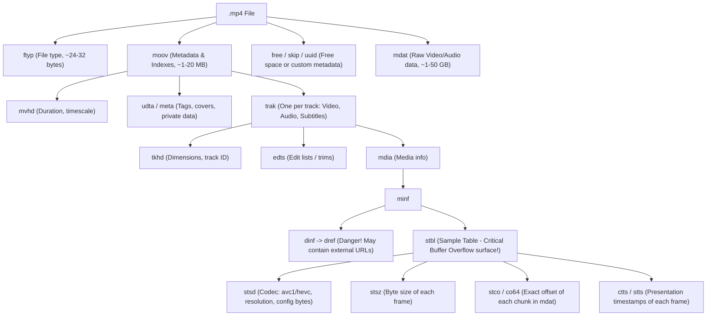
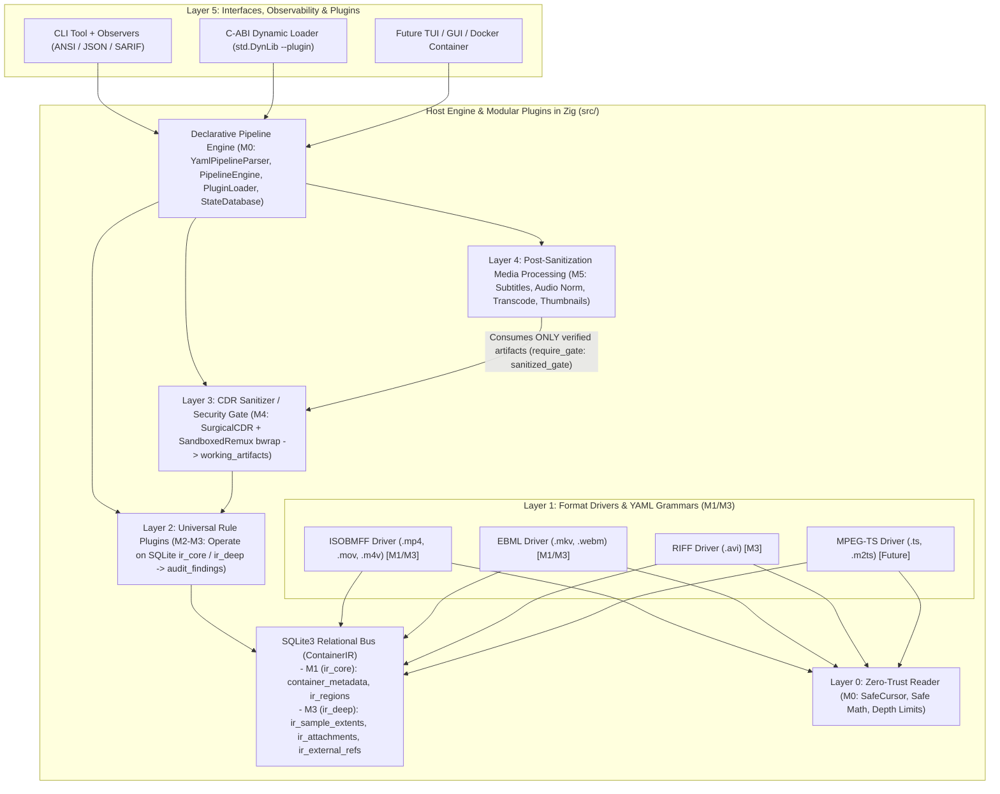
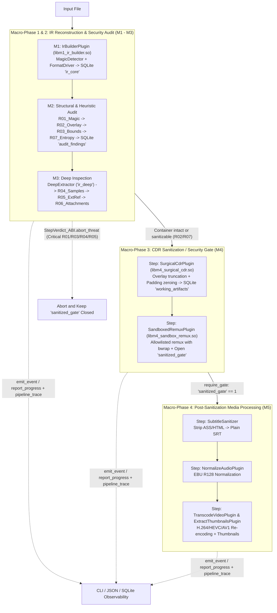

# Architecture and Roadmap: `vidsec` (Video Audit & Sanitization Suite in Zig)

## 1. Fundamentals: What Does a Video Look Like Inside? (Starting from Scratch)

Before designing the software layers, it helps to understand a key concept: **`.mp4` and `.mkv` are not video compression formats (those are `H.264`, `HEVC`, or `AV1`), but rather containers (hierarchical boxes)**.

A video container works just like a directory tree or a binary XML document:

### A) The MP4 / MOV Format (`ISOBMFF` - ISO Base Media File Format)
Every MP4 file is a sequence of **boxes (or atoms)**, one after another, and some boxes contain sub-boxes inside:
- Each box starts with a minimum **8-byte** header:
  - `size` (`uint32` Big-Endian): How many bytes the entire box spans (including the header). *Note: if `size == 1`, the actual size is a `uint64` in the following 8 bytes (`largesize`), used when the video exceeds 4 GB.*
  - `type` (`[4]u8` ASCII, called *FourCC*): The box name, for example `"ftyp"`, `"moov"`, `"mdat"`.
- **The 3 main root boxes:**
  1. `ftyp` (*File Type*): The first bytes of the file. Declares which MP4 dialect it is (`isom`, `mp42`, `qt  `).
  2. `moov` (*Movie Box*): **The "brain" of the file (and where 90% of demuxer exploits live).** It does not contain video frames, but a tree of sub-boxes with metadata, tracks (`trak`), and the **index tables (`stbl`)** that tell the player at which exact byte of the file each frame sits (`stco`/`co64`) and how big it is (`stsz`).
  3. `mdat` (*Media Data*): The giant block (99% of file weight, several GB) holding the raw compressed video and audio frames.



### B) The MKV / WebM Format (`Matroska` over `EBML`)
Matroska is the equivalent of a binary XML called **EBML (*Extensible Binary Meta Language*)**:
- Each element has the format `[ID: VINT][Size: VINT][Data or Sub-elements]`.
- A **VINT (*Variable Size Integer*)** uses the leading `0` bits of the first byte to indicate how many bytes the number spans (1 to 8 bytes).
- Its key sections under the root (`Segment`) are: `SeekHead`, `Info`, `Tracks` (track definitions), **`Attachments` (attached files such as `.ttf`/`.otf` fonts or arbitrary binaries)**, `Chapters`, and `Cluster` (video/audio blocks).

### C) What About the Rest of Video Formats? The 4 Major Structural Families
Although dozens of file extensions exist, **99.9% of the world's video containers belong to just 4 structural families**:

| Structural Family | Formats Using It | How Each Block Is Encoded | Is It a TLV (`Type-Length-Value`) Tree? |
| :--- | :--- | :--- | :---: |
| **1. Big-Endian Boxes (`ISOBMFF`)** | `.mp4`, `.mov`, `.m4v`, `.3gp` | `[Size: u32/u64 BE][FourCC: 4B][Data/Children]` | **Yes** |
| **2. Variable Binary Tree (`EBML`)** | `.mkv`, `.webm` *(WebM is a subset of MKV)* | `[ID: VINT][Size: VINT][Data/Children]` | **Yes** |
| **3. Little-Endian Chunks (`RIFF` / `ASF`)** | `.avi`, `.webp`, `.wmv`, `.asf` | `[FourCC or GUID][Size: u32/u64 LE][Data/Children]` | **Yes** |
| **4. Fixed Packet Stream (`MPEG-TS`)** | `.ts`, `.m2ts`, `.mts` (Blu-ray, IPTV, Streaming) | Flat sequence of `188-byte` packets starting with `0x47` (`Sync Byte` + `PID`) | **No** (continuous packet stream) |

> [!TIP]
> **Key design takeaway:**
> Formats in families 1, 2, and 3 (`.mp4`, `.mov`, `.mkv`, `.webm`, `.avi`, `.wmv`) **are structurally isomorphic**: all of them are trees of `[Identifier + Declared Size + Content/Children]` regions. Only *how the first bytes of each header are read* changes.

---

## 2. Multi-Format Architectural Solution: The Compiler Pattern (`Drivers` $\rightarrow$ `IR` $\rightarrow$ `Rules`)

To add new formats in the future without touching audit rules or the UI, we apply the same pattern used by modern compilers (`LLVM`) or `FFmpeg` (`libavformat`): **decouple format readers from rules via a unified Intermediate Representation (`ContainerIR`)**.



### How Does the Intermediate Representation (`ContainerIR`) Work on SQLite and Zig?

Each format driver (`isobmff.zig`, `ebml.zig`, `riff.zig`) reads the native headers of its format (guided by the declarative dictionaries `configs/formats/*.yaml`) and **dumps what it sees into universal tables inside the shared SQLite database (`*sqlite3`)**, split into two schema domains (`"ir_core"` in `M1` and `"ir_deep"` in `M3`):

```zig
/// 1. Domain "ir_core" (M1 - SQLite table `ir_regions`):
///    Every MP4 box, EBML element (MKV), or RIFF chunk (AVI) is inserted from this struct:
pub const GenericRegion = struct {
    tag_name: []const u8,              // E.g.: "moov", "stsz" (MP4) | "18538067", "EC" (MKV) | "LIST:movi" (AVI)
    symbolic_name: []const u8,         // E.g.: "MovieBox", "SampleSizeBox", "Segment", "Void", "AviMovieDataList"
    role: RegionRole,                  // .container | .index_table | .media_payload | .metadata | .attachment | .padding | .external_ref | .codec_config | .unknown
    header_offset: u64,                // Byte where the header starts
    payload_offset: u64,               // Byte where the payload starts
    declared_payload_size: u64,        // Payload size claimed by the file
    parent_limit: u64,                 // Maximum legal limit allowed by its parent node
    depth: u8,                         // Nesting level (max. 32)
    is_truncated_or_overflow: bool = false, // true if payload_offset + declared_payload_size exceeds parent_limit or overflows u64
};
```

And in the deep inspection phase (**`"ir_deep"` domain in `M3`**), `vidsec.m3.deep_extractor` projects index tables, `mdat` gaps, codec configurations, attachments, and external references into five additional SQLite tables:
- **`ir_sample_extents`**: `(sample_id, track_id, source_tag, target_offset, sample_size, end_offset, has_arith_overflow)` — extracted from `stco`/`co64`+`stsz` in MP4, `Cues` in MKV, or `idx1` in AVI (with contiguous sample coalescing).
- **`ir_unreferenced_slack`**: `(slack_id, parent_region_id, region_tag, start_offset, end_offset, byte_size)` — byte ranges inside `mdat`/`LIST:movi`/`Cluster` not referenced by any audio or video sample.
- **`ir_codec_configs`**: `(config_id, track_id, codec_tag, container_width, container_height, bitstream_width, bitstream_height, is_header_malformed, file_offset)` — consistency between dimensions declared in the track (`tkhd`/`strh`) and the codec header (`avcC`/`hvcC` SPS, `strf`).
- **`ir_attachments`**: `(attachment_id, filename, mime_type, file_offset, byte_size, magic_hex)` — embedded files (`.ttf`/`.otf` fonts in MKV, covers, binaries) along with their actual first 16 bytes in hex.
- **`ir_external_refs`**: `(ref_id, source_tag, uri, file_offset)` — network references or external paths (`dref` in MP4, `NextFilename` in MKV).

### What Do We Gain from This Design?

1. **Security rules are 100% format-agnostic (Parameterized SQL Queries):**
   - Rule **`R03_BoundsAnomaly`** simply queries `SELECT ... FROM ir_regions WHERE is_truncated_or_overflow = 1`. It does not care whether the region came from an MP4 `moov` atom, an MKV `Cluster`, or an AVI `LIST`.
   - Rule **`R04_SampleTableOverflow`** verifies via a cross-table query between `ir_sample_extents` and `ir_regions` that every frame falls inside a region with `role = 'media_payload'` (`mdat` in MP4, `Cluster` in MKV, `LIST:movi` in AVI).
   - Rule **`R02_TrailingData`** compares `highest_root_end_offset` in `container_metadata` against the actual `file_size` on disk (detecting *file pumping* payloads or *overlays* at the end of the container).
2. **Adding a new format means writing a single isolated driver (`FormatDriver`) and its YAML grammar:**
   - With the **ISOBMFF** driver (`src/m1_parsers/drivers/isobmff.zig`) you automatically cover `.mp4`, `.mov`, `.m4v`, and `.3gp`.
   - With the **EBML** driver (`src/m1_parsers/drivers/ebml.zig`) you automatically cover `.mkv` and `.webm`.
   - With the **RIFF** driver (`src/m1_parsers/drivers/riff.zig`) you cover `.avi` without touching a single line of the rule plugins (`M2`/`M3`), the sanitizer (`M4`), or the CLI (`M0`).

### Layer Details

#### Layer 0: Ingestion and Safe Cursor (`src/core/io_cursor.zig`)
- **Goal:** Read headers of files up to 100 GB **without loading the file into RAM** (seeking past giant `mdat`/`Cluster` blocks and reading only headers and sampling windows).
- **Safety guarantees:**
  - All offset additions use `std.math.add(u64, offset, size)` to catch *integer overflow* attempts before moving the read pointer.
  - Maintains a parent limit stack (`limit_stack: [32]u64`): no child element can declare a size that exceeds the end of its parent box.
  - Strict nesting depth limit (`MAX_DEPTH = 32`) to prevent *stack overflow* attacks via infinitely nested boxes.

#### Layer 1: Format Drivers and `"ir_core"` SQLite Domain (`src/core/ir_types.zig`, `src/m1_parsers/`)
- **Goal:** Each driver (`isobmff.zig`, `ebml.zig`, `riff.zig`) walks its format's native binary encoding and dumps each block into `container_metadata` and `ir_regions` via `IrSqlWriter` inside a single SQLite transaction (`BEGIN IMMEDIATE` ... `COMMIT`).
- **Design:** Drivers **never judge** whether something is malicious; they only translate format-specific bytes into the relational tables of `ContainerIR`.

#### Layer 2: Audit Plugins and Universal Validations (`src/m2_audit/` and `src/m3_deep/`)
Independent security plugins live here, querying the SQLite tables generated by `M1` and `M3` and recording findings in `audit_findings` (`"audit_findings"` domain, with `severity`: `0 = info`, `1 = warning`, `2 = critical`):
1. **Spoofing & Polyglot Rule (`R01_MagicMismatch` - `vidsec.m2.r01_magic`):** Queries `container_metadata` and detects if the file has a video extension but starts with `MZ` (Windows PE executable), `ELF`, `Mach-O`, `#!`, `ZIP/RAR`, or is a renamed text manifest (`.m3u8`/`.asx`), returning `StepVerdict_ABI.abort_threat`.
2. **Hidden Data / Overlay Rule (`R02_TrailingData` - `vidsec.m2.r02_overlay`):** Checks in `container_metadata` whether `highest_root_end_offset < file_size` (detecting executables or *file pumping* data appended after the last root box in any format).
3. **Arithmetic & Truncation Integrity Rule (`R03_BoundsAnomaly` - `vidsec.m2.r03_bounds`):** Queries `ir_regions WHERE is_truncated_or_overflow = 1` looking for regions whose declared size overflows or exceeds their parent node's `parent_limit`.
4. **Index vs. Data Cross-Consistency Rule (`R04_SampleTableOverflow` - `vidsec.m3.r04_samples`):**
   - Verifies via cross-table SQL query between `ir_sample_extents` and `ir_regions` that no sample points outside regions marked `role = 'media_payload'` (`mdat` in MP4, `Cluster` in MKV, `LIST:movi` in AVI).
5. **External Network Reference Rule (`R05_ExternalDataRef` - `vidsec.m3.r05_extref`):** Inspects `ir_external_refs` (populated from `dref` atoms in MP4, `NextFilename` in MKV, etc.) and alerts on any external URI (`http://`, `https://`, `file://`, `\\smb\`, `../`).
6. **Embedded Attachments & Fonts Rule (`R06_EmbeddedAttachments` - `vidsec.m3.r06_attachments`):** Inspects `ir_attachments` (filename, MIME type, size, and `magic_hex`) and alerts on embedded fonts (`.ttf`/`.otf`) or hidden executables/archives inside the container.
7. **Opaque Regions / Suspicious Padding & Signature Scanner (`R07_SuspiciousPadding` - `vidsec.m2.r07_entropy`):** Analyzes regions with `role IN ('padding', 'unknown')` (`free`/`skip`/`uuid` in MP4, `Void` in MKV, `JUNK` in AVI) combining Shannon entropy ($H(X) \ge 7.2$ bits/byte) and selective binary signature scanning (`SignatureScanner`: `MZ`, `ELF`, `Go buildinf:`, scripts) to catch payloads even when an attacker pads with zeroes to lower average entropy.
8. **Unreferenced `mdat` Slack Rule (`R08_UnreferencedMediaSlack` - `vidsec.m3.r08_media_slack`):** Inspects `ir_unreferenced_slack` to detect *file pumping* or malware hidden **inside** `mdat`/`LIST:movi` in regions not referenced by any `stco`/`stsz` entry.
9. **Codec Header Consistency Rule (`R09_CodecConfigMismatch` - `vidsec.m3.r09_codec_config`):** Inspects `ir_codec_configs` and alerts if the SPS resolution (`avcC`/`hvcC`/`strf`) differs from the track header (`tkhd`/`strh`) or is truncated (preventing *Stagefright*-style *Heap Overflows*).
10. **Sample Overlap Rule (`R10_SampleOverlap` - `vidsec.m3.r10_sample_overlap`):** Detects via SQL window function (`LAG`) whether distinct sample extents point to overlapping byte ranges in `mdat` (media decompression bombs).

#### Layer 3: Sanitization / CDR, Forensic Carving, and `"sanitized_gate"` (`src/m4_cdr/`)
Acts as the **Security Gate** before any downstream media processing and manages the `"working_artifacts"` SQLite domain (`working_artifacts` + `quarantined_payloads`):
- **Automatic Forensic Carving to Quarantine (`quarantine_dir`):** Before neutralizing an *overlay* (`R02`), a suspicious *padding* block (`R07`), or an orphan gap in `mdat` (`R08`), `vidsec.m4.surgical_cdr` carves the malicious block into an isolated `.bin` file in quarantine and records its `SHA-256` and original coordinates in `quarantined_payloads`.
- **Native Surgical Mode (`vidsec.m4.surgical_cdr`):** First verifies there are no unrecoverable structural threats (critical `R01`, `R03`, `R04`, `R05`, `R09`, `R10`). Clones the container by physically truncating any *overlay* past `highest_root_end_offset` and overwriting with `0x00` both the payload of all `role = 'padding'` regions and `ir_unreferenced_slack` gaps inside `mdat`, without altering `stco`/`co64` offsets.
- **Sandboxed Reconstruction Mode (`vidsec.m4.sandbox_remux`):** Invokes `ffmpeg` (optionally wrapped in `bubblewrap` without network `--unshare-net`) mapping exclusively elementary video and audio streams (`-map 0:v:0 -map 0:a? -dn -map_metadata -1 -map_chapters -1 -c copy`), stripping attached fonts, chapters, and extraneous tables.
- Upon certifying the clean file (with its `SHA-256` hash in `working_artifacts`), opens the `"sanitized_gate"` in `pipeline_gates`.

#### Layer 4: Post-Sanitization Media Processing (`src/m5_processors/`)
Protected in `pipeline.yaml` by `require_gate: "sanitized_gate"`, this layer never reads the original input file: each plugin acquires the latest verified link in `working_artifacts` (verifying its size and `SHA-256` against *TOCTOU* attacks) and registers the newly generated artifact:
- **Subtitle Hygiene (`vidsec.m5.sanitize_subtitles`):** Strips ASS/SSA style tags (`{\...}`) and HTML tags (`<script>`, ``, `<font>`), producing strict plain-text `.srt` subtitles.
- **Audio Normalization (`vidsec.m5.normalize_audio`):** `EBU R128` loudness normalization (`loudnorm`) and audio re-encoding.
- **Video Transformation (`vidsec.m5.transcode_video`):** Transcoding with allowlisted parameters (`libx264`, `libx265`, `libsvtav1`, `crf 0..51`).
- **Derivative Extraction (`vidsec.m5.extract_thumbnails`):** Thumbnail generation and traceable final export.

#### Layer 5: CLI, Observability, and Deployment (`src/main.zig`, `Dockerfile`)
- Real-time monitoring of each pipeline stage and sub-stage (`emit_event` and `report_progress` in `PipelineContext_ABI`) and recording of timings/verdicts in the `pipeline_trace` SQLite table.
- Packaged in an unprivileged multi-stage `Dockerfile` (`USER vidsec`) with `.so` plugins mounted read-only (`0555`).

---

## 2.5. The Declarative Pipeline Engine, C-ABI, and SQLite Schema Contracts in Zig

For `vidsec` to be both a **security tool** and an **extensible media processing engine**, the system core (`M0`) is **100% domain-agnostic**: it reads `configs/pipeline.yaml`, loads the declared `.so` plugins via `std.DynLib`, and coordinates the execution tree over SQLite.

### A) Hierarchical Macro-Phase Pipeline (Reconstruction $\rightarrow$ Audit $\rightarrow$ CDR Sanitization $\rightarrow$ Processing)
Each phase is a hierarchical group (`StageGroup`) in `configs/pipeline.yaml`. If a security plugin detects malware (e.g., `R01_MagicMismatch` on a disguised `.exe`), it returns `StepVerdict_ABI.abort_threat`, short-circuits execution, and prevents `"sanitized_gate"` from opening:



### B) External Plugin Sideloading (`std.DynLib`), SQLite Bus, and 3-Tier Versioning (`src/core/plugin_abi.zig`)
All plugins (`M1` through `M5`) communicate with the engine (`M0`) exclusively through the stable C-ABI defined in `src/core/plugin_abi.zig`, sharing the active `*sqlite3` connection:

1. **C-ABI Contract (`callconv(.C)` + `extern struct`) with 3-Tier Compatibility Matrix:**
   To allow a stable plugin (such as `M1` at version `1.0.0`) to work seamlessly alongside fast-evolving plugins (such as `M2` at version `5.2.0`), `VidsecPluginABI` separates the host binary version (`Tier 1`), the plugin's SemVer (`Tier 2`), and per-domain SQLite schema contracts (`Tier 3`):
   ```zig
   pub const SchemaContract_ABI = extern struct {
       domain: [*:0]const u8,      // E.g.: "ir_core", "ir_deep", "audit_findings", "working_artifacts"
       version: u32,               // E.g.: 1 -> M0 loads configs/schemas/<domain>_v1.sql on demand
       writable: bool = false,     // false = SELECT only; true = enables INSERT/UPDATE in sqlite3_set_authorizer
   };

   pub const PluginDependency_ABI = extern struct {
       plugin_id: [*:0]const u8,   // Hard Dependency: plugin that MUST execute earlier in the pipeline
       min_version: SemVer_ABI,
   };

   pub const StepVerdict_ABI = enum(u32) {
       proceed = 0,
       skip_group = 1,
       abort_threat = 2,
       step_error = 3,
   };

   pub const VidsecPluginABI = extern struct {
       abi_version: u32 = 1,                                      // Tier 1: M0 host binary version
       plugin_id: [*:0]const u8,
       plugin_version: SemVer_ABI,                                // Tier 2: Plugin's own SemVer
       requires_schemas_ptr: ?[*]const SchemaContract_ABI = null, // Tier 3A: SQLite banks (.sql) mapped by M0 on load
       requires_schemas_len: usize = 0,
       requires_plugins_ptr: ?[*]const PluginDependency_ABI = null, // Tier 3B: Hard Dependencies (or null if standalone)
       requires_plugins_len: usize = 0,
       execute_step: *const fn (ctx: *PipelineContext_ABI) callconv(.C) StepVerdict_ABI,
   };
   ```
2. **Memory-Bank-Controller-Style SQLite Bank Provisioning and Pre-Flight Validation (`ADR-006`):**
   > [!CAUTION]
   > Before processing a single byte of the video, `PluginLoader` verifies that no `.so` file has group/other write permissions (`mode & 0o022 == 0`), provisions in SQLite only the `configs/schemas/<domain>_v<version>.sql` banks requested in `requires_schemas_ptr` (avoiding missing-table errors when optional plugins are omitted), and checks that all *Hard Dependencies* (`requires_plugins_ptr`) appear earlier in `pipeline.yaml`.

---

## 3. Agent Roadmap (`Spec-Driven Development`: Milestones `M0` to `M5`)

So that any advanced language model (Gemini, Claude, etc.) can implement the project in Zig **without losing context or breaking contracts across phases**, the implementation is divided into **6 modular, independent specifications (`M0` – `M5`)**.

> [!IMPORTANT]
> **Chassis (`M0`) vs. Domain (`M1`–`M5`) Isolation:**
> Milestone **`M0`** builds the declarative pipeline engine (`SafeCursor`, `StateDatabase`, `YamlPipelineParser`, `PluginLoader`, `PipelineEngine`, and `src/core/plugin_abi.zig`). Thus, **milestones `M1` through `M5` never modify the execution engine**: they only compile new `.so` plugins that create or query their own table domains in SQLite (`*sqlite3`).

| Milestone | Specification File | Milestone Name | Exact Scope & Implementation Objectives | Verifiable Deliverable (`zig build test`) |
| :---: | :--- | :--- | :--- | :--- |
| **`M0`** | [`specs/M0_pipeline_engine.md`](./specs/M0_pipeline_engine.md) | **Declarative YAML Chassis, Agnostic SQLite Bus, and Plugin Loader (`C-ABI`)** | 1. Implement `SafeCursor` (`src/core/io_cursor.zig`) with safe arithmetic (`std.math.add`) and `limit_stack: [32]u64`.<br/>2. Define the C-ABI in `src/core/plugin_abi.zig` (`PipelineContext_ABI`, `VidsecPluginABI`, `SchemaContract_ABI`).<br/>3. Implement `StateDatabase` (`src/core/database.zig`) with schema `configs/schema_m0.sql` (`run_metadata`, `schema_registry`, `pipeline_gates`, `pipeline_trace`).<br/>4. Implement `YamlPipelineParser`, `PluginLoader` (with 3-tier pre-flight validation), and `PipelineEngine`. | Boundary tests on `SafeCursor`, pre-flight validation of `SchemaContract_ABI` (approval with mismatched SemVers and rejection with `error.SchemaVersionMismatchBetweenPlugins`), and group locking with `require_gate` (`error.PipelineGateLocked`). |
| **`M1`** | [`specs/M1_container_ir_and_walkers.md`](./specs/M1_container_ir_and_walkers.md) | **`ContainerIR` Reconstruction in SQLite (`"ir_core"`), YAML Grammars, and Walkers (`ISOBMFF` + `EBML`)** | 1. Define base types in `src/core/ir_types.zig` (`MagicKind`, `FormatKind`, `RegionRole`, `GenericRegion`, `DriverError`).<br/>2. Implement `IrSqlWriter` (`src/m1_parsers/ir_sql_writer.zig`) creating the SQLite domain **`"ir_core"` (`v1`)** (`container_metadata` and `ir_regions`) and batch-inserting under `BEGIN IMMEDIATE`.<br/>3. Implement `MagicDetector`, `FormatGrammar` (`configs/formats/*.yaml`), `IsobmffDriver` (`.mp4`/`.mov`), and `EbmlDriver` (`.mkv`/`.webm` with `@clz` for `VINT`) in `vidsec.m1.ir_builder`. | Deterministic SQLite dump (`ir_regions` and `container_metadata`) for in-memory `.mp4` and `.mkv` vectors, plus flagging `is_truncated_or_overflow = 1` on boxes exceeding `parent_limit`. |
| **`M2`** | [`specs/M2_structural_and_heuristic_audit.md`](./specs/M2_structural_and_heuristic_audit.md) | **Structural & Heuristic Audit Sub-Pipeline (`R01`, `R02`, `R03`, `R07` + Signatures) over SQLite** | 1. Create the SQLite domain **`"audit_findings"` (`v1`)** via `FindingsSqlHelper` (`src/m2_audit/findings_sql.zig`).<br/>2. Implement plugins `vidsec.m2.r01_magic` (`R01_MagicMismatch`), `vidsec.m2.r02_overlay` (`R02_TrailingData`), and `vidsec.m2.r03_bounds` (`R03_BoundsAnomaly`).<br/>3. Implement `ShannonEntropy` (`computeWindowEntropy`), `SignatureScanner` (`scanWindowForSignatures`: `MZ`, `ELF`, `Go buildinf:`, scripts), and plugin `vidsec.m2.r07_entropy` (`R07_SuspiciousPadding`) to detect both encrypted payloads and zero-padded hidden binaries in `free`, `skip`, `uuid`, `Void`, or `JUNK` boxes. | Short-circuit (`abort_threat`) on a disguised `MZ` executable (`R01`), detection of *overlay* after `mdat` (`R02`), and detection of entropy $H(X) = 8.0$ bits/byte or signatures in a `free` box (`R07`) with `0` false positives on `0x00`-filled boxes. |
| **`M3`** | [`specs/M3_deep_integrity_and_riff.md`](./specs/M3_deep_integrity_and_riff.md) | **Deep Inspection (`"ir_deep"`), Rules `R04`–`R06` / `R08`–`R10`, and 3rd Driver (`RIFF / AVI`)** | 1. Implement `DeepExtractorPlugin` (`vidsec.m3.deep_extractor`) producing the SQLite domain **`"ir_deep"` (`v1`)**: `ir_sample_extents` (with contiguous sample coalescing), `ir_unreferenced_slack`, `ir_codec_configs`, `ir_attachments`, and `ir_external_refs`.<br/>2. Implement the 6 deep rules: `R04_SampleTableOverflow`, `R05_ExternalDataRef`, `R06_EmbeddedAttachments`, `R08_UnreferencedMediaSlack` (dead space in `mdat`), `R09_CodecConfigMismatch` (`tkhd` vs SPS `avcC`/`hvcC`), and `R10_SampleOverlap` (SQL `LAG`).<br/>3. Implement `RiffDriver` (`src/m1_parsers/drivers/riff.zig` + `configs/formats/riff.yaml`) for Little-Endian `.avi` containers. | Detection of `stco` pointers outside `mdat` (`R04`), SSRF alert in `dref` (`R05`), `.ttf` fonts in MKV (`R06`), *slack space* with `Go buildinf:` inside `mdat` (`R08`), SPS resolution mismatch (`R09`), frame overlap (`R10`), and `.avi` parsing. |
| **`M4`** | [`specs/M4_cdr_sanitizer_gate.md`](./specs/M4_cdr_sanitizer_gate.md) | **CDR Sanitizer, Forensic Carving (`"working_artifacts"`), Isolated Remux, and Gate (`sanitized_gate`)** | 1. Create the SQLite domain **`"working_artifacts"` (`v1`)** (`working_artifacts` + `quarantined_payloads`) with `SHA-256` traceability.<br/>2. Implement `SurgicalCdrPlugin` (`vidsec.m4.surgical_cdr`): blocks files with critical `R01`/`R03`/`R04`/`R05`/`R09`/`R10` findings; on recoverable containers carves suspicious blocks (`R02`/`R07`/`R08`) to quarantine (`quarantined_payloads`), truncates *overlays* at `highest_root_end_offset`, overwrites `role = 'padding'` and `ir_unreferenced_slack` regions with `0x00`, and opens `"sanitized_gate"`.<br/>3. Implement `SandboxedRemuxPlugin` (`vidsec.m4.sandbox_remux`) with `bwrap` + allowlisted `ffmpeg`. | Forensic extraction to quarantine (`.bin` with `SHA-256`) and neutralization of an MP4 with *overlay*, malicious `free` box, and *slack* in `mdat`, verifying opening of `"sanitized_gate"` and blocking on critical threats. |
| **`M5`** | [`specs/M5_post_sanitization_processing.md`](./specs/M5_post_sanitization_processing.md) | **Post-Sanitization Media Processing Pipeline and Docker Container** | 1. Implement `ArtifactChainManager` (`src/m5_processors/artifact_chain.zig`) acquiring the latest sanitized artifact from `working_artifacts` while verifying its `SHA-256` (anti-*TOCTOU*).<br/>2. Implement plugins `vidsec.m5.sanitize_subtitles` (`stripAssAndHtmlTags`), `vidsec.m5.normalize_audio` (EBU R128), `vidsec.m5.transcode_video` (codec/CRF allowlist), and `vidsec.m5.extract_thumbnails`.<br/>3. Create the production multi-stage `Dockerfile` (`builder` with `zig build test` + unprivileged `runtime`). | Stripping ASS/HTML tags in subtitles, verifiable chaining in `working_artifacts` with tampering detection `error.ArtifactHashMismatch`, and full `M0` $\rightarrow$ `M5` integration test. |

---

## 4. Specification Directory Organization (`docs/v1/`)

All architectural documentation and per-milestone specifications reside in `docs/v1/` following this structure:

```text
docs/v1/
├── AGENTS.md                                    # Global directives and safety invariants for agents (Zig 0.13/0.14 + SQLite3)
├── arquitectura_video_shield.md                 # This master document (global vision and cross-cutting contracts)
├── ADR/                                         # Architecture Decision Records (design decisions)
│   ├── ADR-001_relational_sqlite_state_bus_and_ir.md
│   ├── ADR-002_c_abi_plugin_sideloading_and_three_tier_versioning.md
│   ├── ADR-003_capability_based_sqlite_authorizer_firewall.md
│   ├── ADR-004_zero_copy_cow_cloning_and_sparse_hole_punching_cdr.md
│   ├── ADR-005_unprivileged_self_sandboxing_landlock_and_bwrap.md
│   └── ADR-006_on_demand_ddl_banks_and_hard_plugin_dependencies.md
├── future/                                      # Specifications for post-M5 future features
│   ├── F01_hybrid_static_dynamic_plugin_compilation.md
│   ├── F02_sqlite_forensic_report_exporter_plugin.md
│   └── F03_conditional_dag_routing_and_circuit_breakers.md
├── rules/                                       # Self-contained technical reports for the 10 rules (R01 to R10)
│   ├── R01_magic_mismatch.md
│   ├── R02_trailing_data_overlay.md
│   ├── R03_bounds_anomaly.md
│   ├── R04_sample_table_overflow.md
│   ├── R05_external_data_reference.md
│   ├── R06_embedded_attachments.md
│   ├── R07_suspicious_padding_entropy.md
│   ├── R08_unreferenced_media_slack.md
│   ├── R09_codec_config_mismatch.md
│   └── R10_sample_overlap.md
└── specs/
    ├── MILESTONE_TEMPLATE.md                    # Mandatory standard template (UML + Zig Contracts + SQLite Schemas)
    ├── M0_pipeline_engine.md                    # YAML Chassis, SQLite Bus with Authorizer, 3-Tier C-ABI PluginLoader, SafeCursor
    ├── M1_container_ir_and_walkers.md           # "ir_core" Schema, YAML Format Grammars, ISOBMFF & EBML Walkers
    ├── M2_structural_and_heuristic_audit.md     # "audit_findings" Schema, Rules R01, R02, R03, and R07 (Entropy + Signatures)
    ├── M3_deep_integrity_and_riff.md            # "ir_deep" Schema, Rules R04..R06 / R08..R10 + RIFF (AVI) Driver
    ├── M4_cdr_sanitizer_gate.md                 # "working_artifacts" + Quarantine Schema, Hole Punching CDR, bwrap Remux
    └── M5_post_sanitization_processing.md       # Media Post-Processing Chain (SRT, Audio, Video, Thumbnails) + Dockerfile
```
