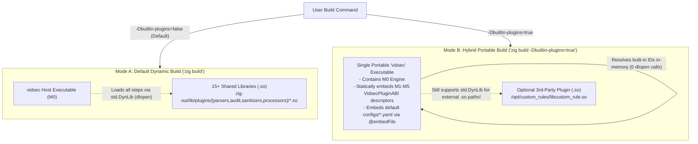
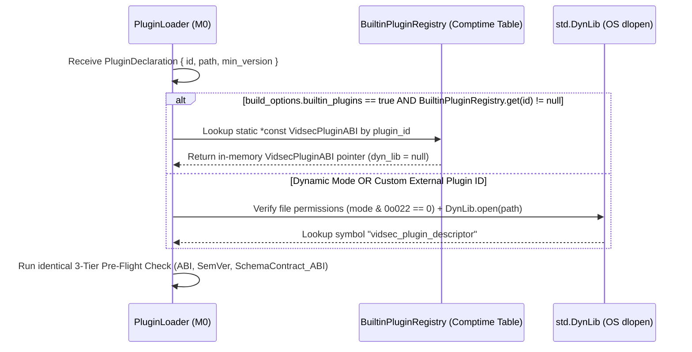

# Future Feature Specification: Hybrid Static-Dynamic Plugin Compilation Mode (`-Dbuiltin-plugins`)

- **Target Milestone:** Post-`M5` Enhancement
- **Component Scope:** `build.zig`, `src/core/plugin_loader.zig`, and `src/core/builtin_registry.zig`
- **Status:** Planned Future Feature

---

## 1. Motivation and Operational Use Cases

By default, `vidsec` compiles its domain modules (`M1` parsers, `M2`–`M3` audit rules, `M4` CDR sanitizers, and `M5` media processors) as independent shared libraries (`.so` / `.dll` / `.dylib`) under `zig-out/lib/plugins/`. This dynamic architecture excels in server deployments where individual detection rules or processors are updated or hot-reloaded without recompiling the core binary.

However, two operational scenarios benefit from a **single, zero-dependency portable executable** that still retains the ability to sideload external `.so` plugins on demand:
1. **Incident Response and Forensic Triage ("Drop-and-Run"):** Security analysts investigating a compromised host or air-gapped environment prefer copying a single standalone `vidsec` binary rather than distributing a directory tree of 15+ `.so` files and YAML grammar files.
2. **Simplified CI/CD Distribution:** Distributing a single statically bundled binary for standard rules while allowing enterprise users to pass custom `--plugin ./my_custom_rule.so` modules at runtime.

Because every official plugin in `M1`–`M5` already conforms to the exact same `VidsecPluginABI` struct, **both modes can be supported from the exact same source code without external build generators (like CMake) using Zig's native `build.zig` options**.

---

## 2. Architectural Design



---

## 3. Native Implementation in `build.zig` (No CMake Required)

Zig's `std.Build` system natively provides compile-time configuration flags (`b.option`) and generated option modules (`b.addOptions`), completely eliminating the need for external `CMake` or `Makefile` wrappers:

```zig
// Proposed addition in build.zig:
pub fn build(b: *std.Build) void {
    const target = b.standardTargetOptions(.{});
    const optimize = b.standardOptimizeOption(.{});

    // 1. Expose CLI build flag: `zig build -Dbuiltin-plugins=true`
    const builtin_plugins = b.option(
        bool,
        "builtin-plugins",
        "Bundle M1-M5 plugins and default YAML grammars directly into the vidsec executable",
    ) orelse false;

    const build_options = b.addOptions();
    build_options.addOption(bool, "builtin_plugins", builtin_plugins);

    const exe = b.addExecutable(.{
        .name = "vidsec",
        .root_source_file = b.path("src/main.zig"),
        .target = target,
        .optimize = optimize,
    });
    exe.root_module.addOptions("build_options", build_options);
    exe.linkSystemLibrary("sqlite3");
    exe.linkLibC();

    if (!builtin_plugins) {
        // Default Mode: Compile M1-M5 as separate .so artifacts in zig-out/lib/plugins/
        buildSharedPlugins(b, target, optimize);
    }
}
```

---

## 4. Dual-Resolution Dispatch in `PluginLoader`

When `PluginLoader.loadDeclaredPlugin(spec)` is invoked during pre-flight initialization:



### Embedded Default Grammars (`@embedFile`)
In hybrid mode (`-Dbuiltin-plugins=true`), if no external `--config` directory is present on disk, `FormatGrammar` and `YamlPipelineParser` can fall back to compile-time embedded strings via Zig's `@embedFile("configs/formats/isobmff.yaml")`, making the binary 100% self-contained on a bare Linux host that only has `libsqlite3.so` installed.
