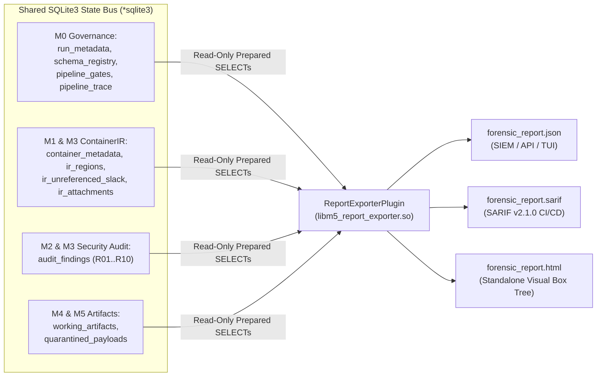

# Future Feature Specification: Native SQLite Forensic Report Exporter Plugin (`JSON`, `SARIF`, and `HTML`)

- **Target Milestone:** Post-`M5` Enhancement
- **Component Scope:** `src/m5_processors/report_exporter.zig` (`libm5_report_exporter.so`)
- **Status:** Planned Future Feature

---

## 1. Motivation and Architectural Fit

Because every stage of the `vidsec` pipeline (`M0` through `M5`) writes its structured telemetry, container hierarchy, security findings, quarantined malware metadata, and sanitized file hashes into the shared **SQLite3 relational state bus (`*sqlite3`)**, generating comprehensive forensic reports requires **zero changes to the core engine (`M0`) or existing audit plugins (`M1`–`M4`)**.

Instead, report generation can be implemented as a **standard, optional pipeline step plugin (`vidsec.m5.report_exporter`)** placed at the end of `pipeline.yaml` (or triggered via an `always_run` post-execution hook) that queries the SQLite database and serializes the results into industry-standard formats:
1. **Structured `JSON` Report:** Complete machine-readable dump for SIEM ingestion (Elastic, Splunk, Chronicle), automated malware sandboxes, or a future GUI/TUI frontend.
2. **OASIS `SARIF v2.1.0` (*Static Analysis Results Interchange Format*):** Standard security report format supported natively by GitHub Code Scanning, GitLab Security Dashboards, and CI/CD pipelines.
3. **Self-Contained Forensic `HTML` Report:** Single-file interactive visual report (with zero external CSS/JS dependencies) displaying the container box tree, entropy heatmaps, audit findings, and quarantined payload hashes.

---

## 2. Plugin Contract and SQLite Schema Dependencies

The exporter plugin operates strictly as a **read-only consumer** of the existing SQLite schema domains:

```zig
const required_schemas = [_]abi.SchemaContract_ABI{
    .{ .domain = "ir_core", .version = 1, .writable = false },
    .{ .domain = "ir_deep", .version = 1, .writable = false },
    .{ .domain = "audit_findings", .version = 1, .writable = false },
    .{ .domain = "working_artifacts", .version = 1, .writable = false },
};

export const vidsec_plugin_descriptor = abi.VidsecPluginABI{
    .abi_version = abi.VIDSEC_ABI_VERSION,
    .plugin_id = "vidsec.m5.report_exporter",
    .plugin_version = .{ .major = 1, .minor = 0, .patch = 0 },
    .requires_schemas_ptr = &required_schemas,
    .requires_schemas_len = required_schemas.len,
    .requires_plugins_ptr = null,
    .requires_plugins_len = 0,
    .execute_step = &ReportExporterPlugin.execute,
};
```

---

## 3. Data Aggregation Architecture Over SQLite



---

## 4. SQL Queries and Output Schemas

### 4.1. Consolidated Forensic `JSON` Structure
By executing five fast prepared `SELECT` statements over `:memory:` SQLite, the plugin emits a unified JSON document:
```json
{
  "run_metadata": {
    "input_path": "/samples/suspicious_video.mp4",
    "file_size": 1400000000,
    "true_magic": "isobmff_mp4_mov",
    "detected_format": "isobmff",
    "highest_root_end_offset": 2100000,
    "sanitized_gate_open": true
  },
  "audit_findings": [
    {
      "rule_id": "R02",
      "severity": "critical",
      "file_offset": 2100000,
      "region_tag": "overlay",
      "measured_value": 7.98,
      "message": "Trailing overlay detected with PE/Go signature and high entropy"
    }
  ],
  "quarantined_payloads": [
    {
      "source_rule_id": "R02",
      "region_tag": "overlay",
      "original_offset": 2100000,
      "byte_size": 1397900000,
      "sha256_hex": "e3b0c44298fc1c149afbf4c8996fb92427ae41e4649b934ca495991b7852b855",
      "quarantine_file_path": "/tmp/vidsec_quarantine/carved_R02_2100000.bin"
    }
  ],
  "working_artifacts": [
    {
      "artifact_id": 1,
      "step_name": "SurgicalZeroAndTruncate",
      "file_path": "/tmp/vidsec_work/clean_step1.mp4",
      "byte_size": 2100000,
      "sha256_hex": "8f434346648f6b96df89dda901c5176b10a6d83961dd3c1ac88b59b2dc327aa4",
      "zeroed_regions_count": 1,
      "truncated_bytes": 1397900000
    }
  ],
  "pipeline_trace": [
    { "node_name": "BuildContainerIR", "plugin_id": "vidsec.m1.ir_builder", "elapsed_ns": 412000, "verdict": "proceed" }
  ]
}
```

### 4.2. Mapping `audit_findings` to `SARIF v2.1.0`
In SARIF mode (`format: "sarif"`), each row in `audit_findings` maps to a SARIF `result` object where `locations[0].physicalLocation` uses `artifactLocation.uri` (`input_path`) and `region.byteOffset` (`file_offset`):
- `severity == 2 (critical)` $\rightarrow$ SARIF `"level": "error"`
- `severity == 1 (warning)` $\rightarrow$ SARIF `"level": "warning"`
- `severity == 0 (info)` $\rightarrow$ SARIF `"level": "note"`

---

## 5. Declarative Configuration in `configs/pipeline.yaml`

```yaml
plugins:
  - id: "vidsec.m5.report_exporter"
    path: "./zig-out/lib/plugins/processors/libm5_report_exporter.so"

# Can be placed at the end of the pipeline to export telemetry regardless of whether M5 transcoding was enabled:
- step: "ExportForensicReport"
  plugin: "vidsec.m5.report_exporter"
  params:
    formats: "json,sarif"
    output_dir: "/tmp/vidsec_reports"
    include_full_ir_tree: "false"
```
