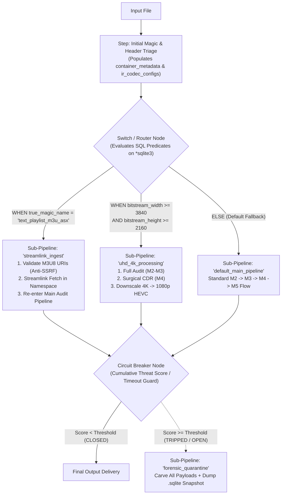

# Future Feature Specification: Conditional DAG Routing, Multi-Pipeline Dispatch, and Circuit Breakers (Pentaho/Kettle-Style Orchestration)

- **Target Milestone:** Post-`M5` Architectural Evolution
- **Component Scope:** `src/core/engine.zig`, `src/core/yaml_config.zig`, and `configs/pipeline.yaml`
- **Status:** Planned Future Feature

---

## 1. Motivation and Conceptual Model

In the baseline `M0`–`M5` architecture, `PipelineNode` is a single hierarchical tree (`StageGroup` and `LeafStep`) with linear execution and binary gates (`require_gate: "sanitized_gate"`). While a linear tree is ideal for the standard `Parse -> Audit -> CDR -> Process` workflow, advanced media ingestion platforms require **dynamic decision-making, conditional branching (*Switch/Case*), and stateful Circuit Breakers**—analogous to job orchestration engines like **Pentaho Data Integration (Kettle)** or **Apache Airflow**, applied to binary media security and processing.

### Key Operational Scenarios
1. **Format-Specific Sub-Pipeline Routing (e.g., `.m3u8` HLS Manifests vs. Binary Containers):**
   - If the initial magic/triage step detects that the input is an HLS `.m3u8` playlist (`true_magic_name == 'text_playlist_m3u_asx'`), rather than rejecting it as a non-binary container, a **Router Node** redirects execution to an isolated `streamlink_acquisition_pipeline` (which validates segment URIs against SSRF rules, downloads segments inside a restricted network namespace, and remuxes them into a local `.mp4`) before handing the resulting artifact to the main security pipeline.
2. **Attribute-Driven Media Routing (Resolution / Codec / Bitrate Branching):**
   - After `M1`/`M3` populate the container's metadata and codec dimensions in SQLite (`ir_codec_configs`), a conditional branch inspects the video resolution:
     - Videos with `container_width >= 3840` (4K UHD) are routed to a dedicated `uhd_hevc_downscale_pipeline`.
     - Audio-only containers are routed to an `audio_normalization_only_pipeline`.
     - All other containers proceed through the `default_main_pipeline`.
3. **Resilience and Threat-Score Circuit Breakers:**
   - **Threat-Score Circuit Breaker:** Instead of binary pass/fail on individual warnings, if the cumulative heuristic risk score across multiple low/medium findings exceeds a threshold, the circuit breaker trips and diverts the file to a `deep_forensic_quarantine_pipeline`.
   - **Operational Subprocess Circuit Breaker:** In long-running or batch deployments, if an external tool (`streamlink` or `ffmpeg`) experiences repeated timeouts (`Half-Open` / `Open` state), the circuit breaker temporarily disables the expensive transcoding branch and falls back to surgical-only CDR.

---

## 2. Architectural Design: SQL-Predicated DAG Router Over SQLite

Because all intermediate state (`container_metadata`, `ir_regions`, `ir_codec_configs`, `audit_findings`, `working_artifacts`) already resides in the shared **`:memory:` SQLite3 database (`*sqlite3`)**, implementing a Pentaho-style conditional router requires **zero custom expression-language parsers**.

Every routing condition or circuit-breaker trip rule in `pipeline.yaml` is evaluated as a **read-only, single-value SQL query (`SELECT 1 WHERE ...`) against the active `*sqlite3` state bus**:



---

## 3. Proposed Evolution of `PipelineNode` in `src/core/engine.zig`

To support multi-pipeline routing without breaking existing `leaf` (`StepInterface`) or `group` (`StageGroup`) nodes, `PipelineNode` is extended with two new union variants (`router` and `circuit_breaker`):

```zig
pub const PipelineNode = union(enum) {
    leaf: StepInterface,
    group: StageGroup,
    router: ConditionalRouter,
    circuit_breaker: CircuitBreakerNode,

    pub const ConditionalRouter = struct {
        name: []const u8,
        cases: []const RouteCase,
        default_pipeline: []const u8, // Target sub-pipeline name if no SQL predicate matches

        pub const RouteCase = struct {
            name: []const u8,
            /// Read-only SQL predicate evaluated against ctx.sqlite_db.
            /// If the query returns a row with column[0] != 0, this route is taken.
            sql_predicate: [:0]const u8,
            target_pipeline: []const u8,
        };
    };

    pub const CircuitBreakerNode = struct {
        name: []const u8,
        /// SQL query returning 1 if the circuit should trip (e.g. cumulative risk score or error count)
        trip_sql_predicate: [:0]const u8,
        max_consecutive_failures: u32 = 3,
        cooldown_ms: u64 = 30_000,
        on_open_pipeline: []const u8,     // Fallback/Quarantine sub-pipeline when tripped
        on_closed_pipeline: []const u8,   // Normal sub-pipeline when healthy
    };
};
```

### Security Invariant on Routing Predicates
During the pre-flight check, `PipelineEngine` compiles all `sql_predicate` strings with `sqlite3_prepare_v2` while a strict **Read-Only Authorizer (`SQLITE_SELECT` only)** is active. This guarantees that routing expressions in `pipeline.yaml` are syntactically valid at startup and can never mutate database state.

---

## 4. Declarative Multi-Pipeline Syntax in `configs/pipeline.yaml`

```yaml
# Named Sub-Pipelines (Pentaho Transformation / Job style):
pipelines:
  entry_dispatcher:
    steps:
      - step: "InitialProbeAndIR"
        plugin: "vidsec.m1.ir_builder"
      - step: "DeepHeaderExtract"
        plugin: "vidsec.m3.deep_extractor"

      - router: "ContentAndResolutionRouter"
        cases:
          - when_name: "HLS_Streamlink_Branch"
            sql: "SELECT 1 FROM container_metadata WHERE true_magic_name = 'text_playlist_m3u_asx'"
            goto_pipeline: "streamlink_ingest_pipeline"

          - when_name: "UHD_4K_Video_Branch"
            sql: "SELECT 1 FROM ir_codec_configs WHERE bitstream_width >= 3840 AND bitstream_height >= 2160"
            goto_pipeline: "uhd_4k_pipeline"

        default_pipeline: "main_security_pipeline"

  streamlink_ingest_pipeline:
    steps:
      - step: "ValidateManifestUrls"
        plugin: "vidsec.custom.m3u8_ssrf_guard"
      - step: "AcquireStreamSegments"
        plugin: "vidsec.custom.streamlink_fetcher"
      - goto_pipeline: "main_security_pipeline"

  uhd_4k_pipeline:
    steps:
      - include_pipeline: "main_security_pipeline"
      - step: "Downscale4KTo1080p"
        plugin: "vidsec.m5.transcode_video"
        params:
          scale: "1920:1080"
          codec: "libx265"

  main_security_pipeline:
    steps:
      - group: "AuditStage"
        policy: "run_all"
        steps:
          - step: "OverlayCheck"
            plugin: "vidsec.m2.r02_overlay"
          - step: "EntropyCheck"
            plugin: "vidsec.m2.r07_entropy"

      - circuit_breaker: "CumulativeThreatBreaker"
        trip_sql: "SELECT 1 FROM audit_findings GROUP BY 1 HAVING SUM(severity * 10 + measured_value) >= 25.0"
        on_open_pipeline: "forensic_quarantine_pipeline"
        on_closed_pipeline: "cdr_and_standard_processing"
```

---

## 5. Cycle Detection and Pre-Flight DAG Verification

Introducing `goto_pipeline` and `router` transforms the execution model from a simple Tree into a **Directed Acyclic Graph (DAG)** (or a bounded state machine when `streamlink_ingest_pipeline` feeds back into `main_security_pipeline`). To prevent infinite routing loops:
1. **Static Cycle Check in Pre-Flight:** `YamlPipelineParser` runs Tarjan's / Kahn's topological sort over the `pipelines` graph at startup, rejecting unguarded cycles with `error.PipelineGraphCycleDetected`.
2. **Runtime Hop Limit (`MAX_PIPELINE_HOPS = 16`):** `PipelineEngine` maintains a `hop_count: u8` counter recorded in `pipeline_trace`, aborting execution deterministically if a run exceeds 16 sub-pipeline transitions.
