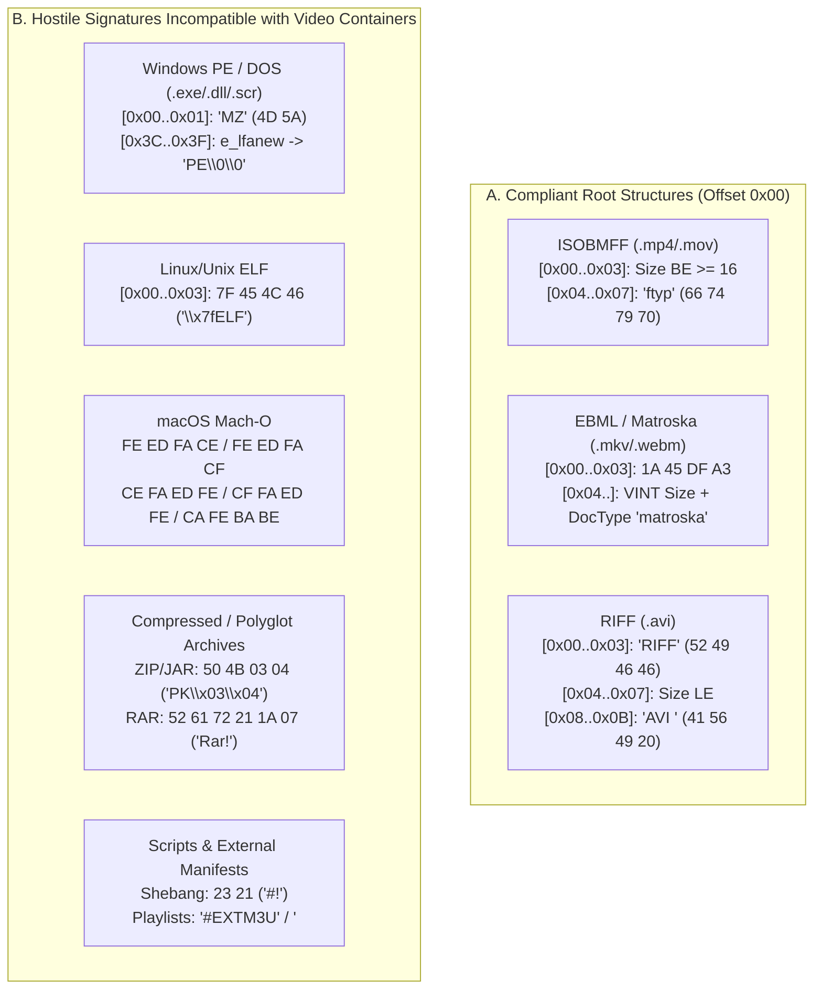
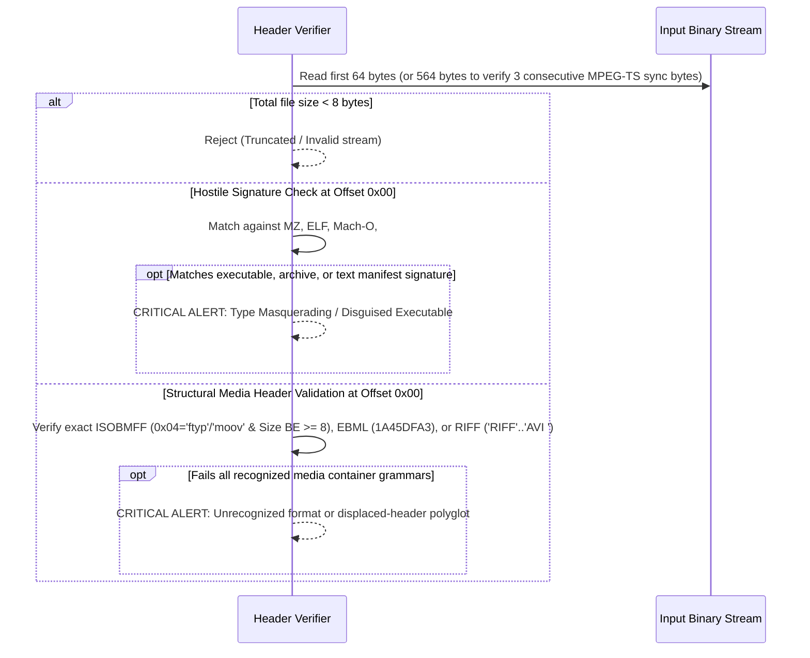

# Technical Detection Report: Magic Header Mismatch and Polyglot Media Containers

## 1. Executive Summary and Threat Landscape

Operating systems, web browsers, and media ingestion pipelines frequently rely on file extensions (`.mp4`, `.mov`, `.mkv`, `.webm`, `.avi`) or sender-supplied HTTP `Content-Type` headers for initial classification. However, operating system loaders, command interpreters, and archive extractors dispatch files strictly based on their **initial physical bytes (*Magic Bytes* or file signatures)**.

This discrepancy enables two high-severity attack vectors:
1. **Direct Type Masquerading (`MITRE ATT&CK T1036`):** A native executable (`Windows PE/COFF`, `Linux/Unix ELF`, `macOS Mach-O`), an interpreted script (`#!`), or an archive is renamed with a video extension to bypass perimeter filters or deceive automated ingestion workflows.
2. **Polyglot / Chameleon Files (`CWE-434` / `CWE-436`):** Because certain media demuxers scan forward past unrecognized leading bytes to locate a container header, a single binary file can be constructed to function simultaneously as a valid executable or archive (`ZIP`/`JAR`/`RAR`) and a playable video container.

---

## 2. Grounding in Official Format Specifications

Every major multimedia container family strictly mandates the binary structure that must reside at physical byte offset `0x00`:

### 2.1. ISO Base Media File Format (`ISO/IEC 14496-12` — MP4, MOV, M4V, 3GP)
According to Clause 4.2 (*Object Structure*) and Clause 4.3 (*File Type Box*) of `ISO/IEC 14496-12`:
- Every stream begins with a length-prefixed `Box` consisting of a 32-bit unsigned Big-Endian integer (`size`) followed by a four-character printable ASCII code (`type`, within `0x20..0x7E`).
- Bytes `4..8` (`0x04..0x07`) must contain a valid root-level FourCC identifier: typically `ftyp` (`0x66 0x74 0x79 0x70`), or in legacy QuickTime and fragmented streams `moov`, `mdat`, `wide`, `free`, `skip`, `styp`, or `pdin`.
- For an `ftyp` box, the 32-bit `size` field at bytes `0..4` must be $\ge 16$ bytes (8-byte header + 4-byte `major_brand` + 4-byte `minor_version`) and a multiple of 4 bytes.

### 2.2. Extensible Binary Meta Language and Matroska (`IETF RFC 8794` — MKV, WebM)
According to Section 8.1 of `RFC 8794` (*EBML Header*):
- Every valid EBML document must begin at byte offset `0x00` with the 4-octet Variable-Size Integer (*VINT*) Element ID for the `EBML` master element:
  $$\text{Bytes } 0..4 = \mathtt{0x1A\ 0x45\ 0xDF\ 0xA3}$$
- This is immediately followed by the VINT data length and child header elements such as `DocType` (`0x42 0x82`), whose ASCII payload must equal `"matroska"` or `"webm"`.

### 2.3. Resource Interchange File Format (`Microsoft/IBM RIFF Specification` — AVI)
According to the `RIFF` and *OpenDML AVI File Format Extensions* specifications:
- Bytes `0..4` (`0x00..0x03`) must contain the ASCII signature `"RIFF"` (`0x52 0x49 0x46 0x46`) or `"RIFX"`.
- Bytes `4..8` contain the 32-bit Little-Endian chunk size.
- Bytes `8..12` (`0x08..0x0B`) contain the *Form Type*, which for AVI video streams must be `"AVI "` (`0x41 0x56 0x49 0x20`) or `"AVIX"`.

### 2.4. MPEG-2 Transport Stream (`ISO/IEC 13818-1` — TS, M2TS)
According to Section 2.4.3.2 of `ISO/IEC 13818-1`:
- The stream consists of fixed-length packets of `188` bytes (or `192` bytes in `M2TS` with a 4-byte leading timestamp).
- Every packet must begin with the synchronization byte `sync_byte = 0x47` (`'G'`), repeating periodically at offsets $k \times 188$ (for $k = 0, 1, 2, 3, \dots$).

---

## 3. Binary Anatomy: Valid Container vs. Masquerading / Polyglot Payload

### The Displaced-Header Polyglot Vector in `ISOBMFF`
Lenient media demuxers often scan the first several kilobytes of a file if `"ftyp"` is not found at offset `0x04`. Attackers exploit this tolerance by placing a valid `MZ` executable header or shell script at offset `0x00` and embedding an MP4 header further into the file. Under strict `ISO/IEC 14496-12` compliance, any byte preceding the first root box at offset `0x00` violates the container grammar and must be rejected.

---

## 4. Binary Signature Inspection Catalog

The following table defines the canonical byte sequences used to distinguish compliant media containers from hostile payloads within the first 64 bytes:

| Category | Format / Threat | Exact Offset | Hexadecimal Sequence (*Magic Bytes*) | ASCII Representation |
| :--- | :--- | :---: | :--- | :--- |
| **Valid Media** | `ISOBMFF` (`MP4`/`MOV`) | `0x04` | `66 74 79 70` / `6D 6F 6F 76` / `77 69 64 65` | `"ftyp"`, `"moov"`, `"wide"` |
| **Valid Media** | `EBML` (`MKV`/`WebM`) | `0x00` | `1A 45 DF A3` | `.\x45\xDF\xA3` |
| **Valid Media** | `RIFF` (`AVI`) | `0x00` & `0x08` | `52 49 46 46` ... `41 56 49 20` | `"RIFF" ... "AVI "` |
| **Valid Media** | `MPEG-TS` | `0x00`, `0xBC`, `0x178` | `47` ... `47` ... `47` | `'G'` every 188 bytes |
| **Hostile Executable** | Windows `PE/MZ` | `0x00` | `4D 5A` | `"MZ"` |
| **Hostile Executable** | Linux/BSD `ELF` | `0x00` | `7F 45 4C 46` | `"\x7FELF"` |
| **Hostile Executable** | Apple `Mach-O` (32/64/Fat) | `0x00` | `FE ED FA CE` / `FE ED FA CF` / `CF FA ED FE` / `CA FE BA BE` | Binary |
| **Script / Shell** | Unix *Shebang* | `0x00` | `23 21` | `"#!"` |
| **Archive / Package** | `ZIP` / `JAR` / `DOCX` / `APK` | `0x00` | `50 4B 03 04` or `50 4B 05 06` | `"PK\x03\x04"` |
| **Archive / Package** | `RAR` (v4 / v5) | `0x00` | `52 61 72 21 1A 07` | `"Rar!\x1A\x07"` |
| **Network Manifest** | `HLS M3U8` / `ASX` (SSRF) | `0x00` | `23 45 58 54 4D 33 55` / `3C 41 53 58` | `"#EXTM3U"` / `"<ASX"` |

---

## 5. Algorithmic Verification Methodology

### Security Implementation Invariants
1. **Hostile-First Evaluation Order:** Checks for executable and archive signatures (`MZ`, `ELF`, `Mach-O`, `#!`, `PK`) at offset `0x00` must execute **before** inspecting offset `0x04` for ISOBMFF box tags. If a file starts with `"MZ"` (`0x4D 0x5A`), even if bytes `4..8` happen to spell `"free"`, it must be classified unconditionally as a `PE/MZ` executable.
2. **Zero Tolerance for Displaced Headers (*No Forward Scanning*):** The verifier must never scan forward past offset `0x00` to locate `"ftyp"` or `0x1A45DFA3`. Enforcing strict anchor alignment at byte `0` neutralizes prepend-style polyglots by design.
3. **Immediate Short-Circuit (*Fail-Fast*):** Upon detecting a signature mismatch, the file must never be passed to downstream demuxers or media decoders.
