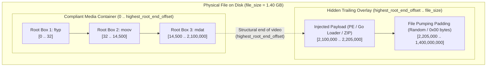
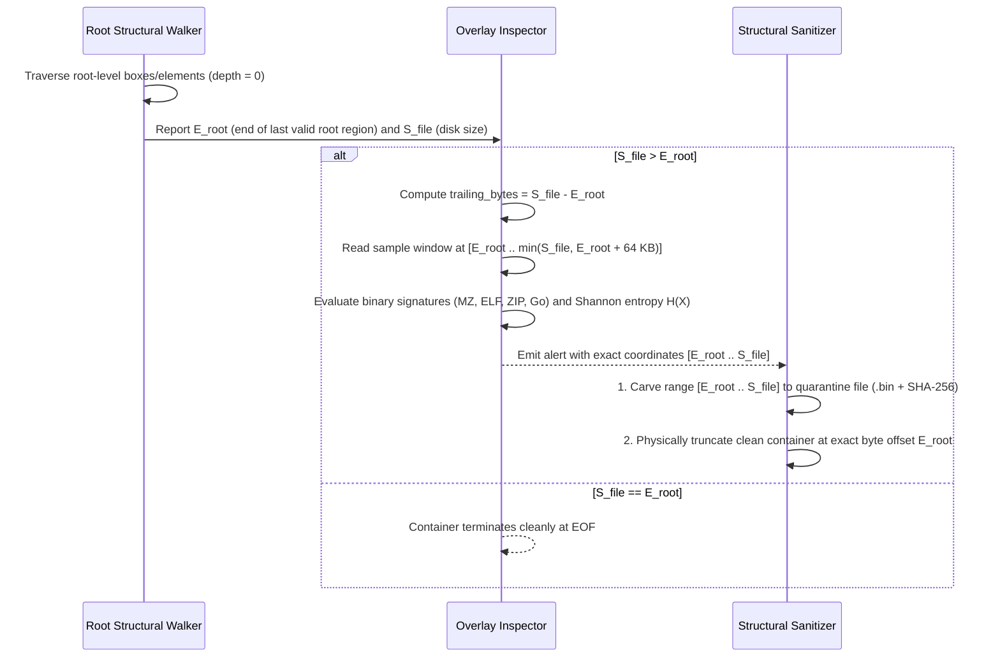

# Technical Detection Report: Trailing Data Overlays and Binary File Pumping in Media Containers

## 1. Executive Summary and Threat Landscape

Most multimedia container formats explicitly declare the byte length of their root-level structures. Once a media demuxer finishes reading the last declared root box or segment, playback concludes and **any additional bytes present up to the physical End-Of-File (`EOF`) on disk are silently ignored**.

Adversaries systematically abuse this post-container region—known in digital forensics as a **Trailing Overlay**—for three primary purposes:
1. **Staged Malware Smuggling (`MITRE ATT&CK T1027`):** A completely valid, playable video file has an encrypted executable, shellcode, or Command-and-Control (`C2`) payload appended after the final root container box. A secondary loader reads the video file, seeks to the exact byte where the legitimate container ends, and extracts or executes the appended payload in memory.
2. **Binary Padding / File Pumping (`MITRE ATT&CK T1027.001`):** Many endpoint detection engines and automated sandboxes bypass files that exceed a predefined size threshold (e.g., $> 100\text{ MB}$ or $> 1\text{ GB}$) due to time and memory constraints. Malware authors append hundreds of megabytes or gigabytes of pseudo-random bytes or zeroes after a tiny payload to evade inspection.
3. **Append Polyglots (`CWE-436`):** Formats such as `ZIP` (`PK\x05\x06` *End of Central Directory*) are parsed backward from the end of the file, whereas video containers are parsed forward from the beginning. Concatenating a `ZIP` or `JAR` archive to the end of an `.mp4` or `.mkv` yields a dual-valid file that plays as a video and extracts as an archive.

---

## 2. Grounding in Official Format Specifications

### 2.1. ISO Base Media File Format (`ISO/IEC 14496-12` — MP4, MOV)
According to Clause 4.2 of `ISO/IEC 14496-12`:
- An ISOBMFF file consists solely of a contiguous sequence of root-level boxes ($B_1, B_2, \dots, B_n$).
- If each root box $B_i$ starts at $\text{offset}_i$ and declares a total byte length $\text{size}_i$ (where $\text{offset}_1 = 0$ and $\text{offset}_{i+1} = \text{offset}_i + \text{size}_i$), the exact legal boundary of the container is:
  $$\text{End}_{\text{container}} = \sum_{i=1}^{n} \text{size}_i$$
- Unless the final box explicitly declares `size == 0` (indicating that the box extends to `EOF`), **no bytes are permitted** beyond $\text{End}_{\text{container}}$.

### 2.2. Extensible Binary Meta Language and Matroska (`IETF RFC 8794` — MKV, WebM)
According to `RFC 8794` and the Matroska specification:
- A Matroska file comprises two root-level (`depth = 0`) elements: the `EBML` Header (`0x1A45DFA3`) and the root `Segment` (`0x18538067`).
- Except in live-streaming contexts where `Segment` uses an `Unknown-Size` VINT (all data bits set to `1`), stored Matroska files declare an exact byte length ($\text{PayloadSize}_{\text{Segment}}$).
- Consequently, the file must terminate at:
  $$\text{End}_{\text{container}} = \text{PayloadOffset}_{\text{Segment}} + \text{PayloadSize}_{\text{Segment}}$$

### 2.3. Resource Interchange File Format (`Microsoft/IBM RIFF Specification` — AVI)
According to the `RIFF` specification:
- The root `"RIFF"` header at offset `0x00` declares a 32-bit Little-Endian `chunk_size` at bytes `4..8`.
- The total legitimate size of a standard RIFF container is exactly $8 + \text{chunk\_size}$ (or the sum of contiguous root `"RIFF:AVI "` and `"RIFF:AVIX"` chunks in *OpenDML* files exceeding 2 GB). Any data following the final root chunk constitutes a non-compliant overlay.

---

## 3. Binary Anatomy of a Trailing Overlay Attack

### Why Standard Media Players Fail to Alert
When a demuxer iterates over root-level boxes (`depth = 0`), once it finishes parsing `mdat` at byte `2,100,000`, it either stops because both `moov` and `mdat` have been located, or it attempts to read the next 8 bytes as a trailing box header. If the injected bytes at offset `2,100,000` do not form a recognized FourCC or declare an invalid size, most players silently terminate the demuxing loop without surfacing an error, allowing the video to play seamlessly while carrying gigabytes of hidden payload.

---

## 4. Mathematical Formulation and Classification Criteria

Let $S_{\text{file}}$ be the physical file size reported by the filesystem (`stat`), and let $E_{\text{root}}$ be the ending byte offset of the last structurally valid root-level (`depth = 0`) region:

$$\Delta_{\text{trailing}} = S_{\text{file}} - E_{\text{root}}$$

Whenever $E_{\text{root}} > 0$ and $\Delta_{\text{trailing}} > 0$, an unreferenced trailing region exists in the interval $[E_{\text{root}}, S_{\text{file}})$. To differentiate benign block-alignment padding (some legacy hardware encoders append 1 to 8 null bytes) from malicious injection, the initial window $[E_{\text{root}}, \min(S_{\text{file}}, E_{\text{root}} + 65536))$ is inspected:

| Detected Condition in $[E_{\text{root}}, S_{\text{file}})$ | Severity Classification | Forensic Interpretation |
| :--- | :---: | :--- |
| $\Delta_{\text{trailing}} \le 16\text{ bytes}$ and all bytes equal `0x00` | **Informational / Benign** | Legacy encoder word/block alignment padding. |
| Presence of executable or archive signatures (`MZ`, `\x7FELF`, `PK\x03\x04`, `PK\x05\x06`, `Rar!`, `\xFF Go buildinf:`) | **Critical (`Severity 2`)** | Appended executable, dropper, or polyglot archive. |
| $\Delta_{\text{trailing}} > 1024\text{ bytes}$ or Shannon entropy $H(X) \ge 7.2\text{ bits/byte}$ | **Critical (`Severity 2`)** | Encrypted payload, shellcode, or randomized file pumping. |
| $0 < \Delta_{\text{trailing}} \le 1024\text{ bytes}$ containing non-null bytes without known executable signatures | **Warning (`Severity 1`)** | Out-of-spec trailing data that must be truncated during sanitization. |

---

## 5. Algorithmic Verification and Lossless Neutralization

### Lossless Truncation Property
Because no compliant internal sample index (`stco`/`co64` in MP4, `Cues` in MKV, or `idx1` in AVI) may reference bytes beyond the media payload regions (`mdat`/`Cluster`/`movi`), and those regions terminate at or before $E_{\text{root}}$, **truncating the file at byte $E_{\text{root}}$ removes 100% of the trailing overlay without altering a single frame or invalidating any internal chunk offset**.
