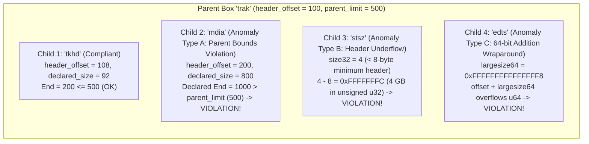
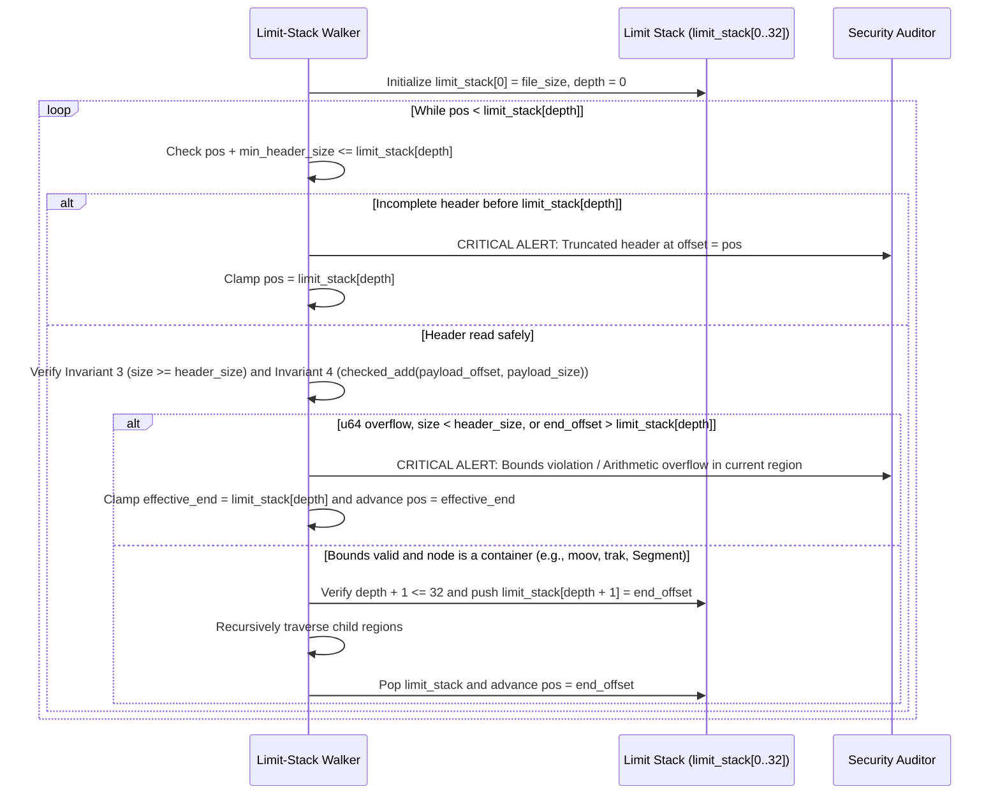

# Technical Detection Report: Hierarchical Bounds Anomalies and Arithmetic Overflow in Media Containers

## 1. Executive Summary and Threat Landscape

Modern multimedia containers (`ISOBMFF`, `EBML/Matroska`, `RIFF/AVI`) are organized as hierarchical trees of nested **Type-Length-Value (TLV)** blocks. Each parent container declares its total byte length, and its payload houses child elements that declare their own respective lengths.

One of the most heavily exploited vulnerability classes across media frameworks (`FFmpeg`, Android `libstagefright`, `GStreamer`, `QuickTime`, `VLC`) involves **crafting child block length fields that exceed their parent container's boundary, surpass the physical End-Of-File (`EOF`), or trigger integer overflow/underflow when combined with current stream offsets**.

These structural anomalies directly enable:
- **Heap-Based Buffer Overflow (`CWE-122` / `CWE-787`):** A parser allocates a heap buffer sized according to the parent box's declared length, but a child parsing loop copies more bytes than the parent buffer can hold based on an oversized child length field.
- **Integer Overflow or Underflow (`CWE-190` / `CWE-191`):** A box declares a size such as `0xFFFFFFFFFFFFFFFF` (or a size smaller than its own header, e.g., `size = 4`), causing `payload_size = declared_size - header_size` or `end_offset = current_offset + declared_size` to wrap around in 32-bit or 64-bit modular arithmetic and bypass bounds checks.
- **Out-of-Bounds Read (`CWE-125`) and Stack Exhaustion (`CWE-400`):** Deeply nested container trees (thousands of levels of recursive boxes) designed to exhaust the call stack of recursive parsers.

---

## 2. Grounding in Official Format Specifications

### 2.1. ISO Base Media File Format (`ISO/IEC 14496-12` — MP4, MOV)
According to Clause 4.2 of `ISO/IEC 14496-12`:
- A standard box has a header of $H = 8\text{ bytes}$ (`size: u32 BE`, `type: [4]u8`).
- If `size == 1`, the box uses a 64-bit extended size field (`largesize: u64 BE`), making the header $H = 16\text{ bytes}$ (and if `type == "uuid"`, an additional 16-byte user UUID follows, yielding $H = 24$ or $32\text{ bytes}$).
- **Minimum Valid Size Constraint:** Every `size` value (other than `size == 0`, which is only valid at root level to indicate "to end of file") **must be greater than or equal to its own header size** ($\text{size} \ge H$). A value such as `size = 2` or `size = 7` on an 8-byte header is strictly illegal and specifically targets unsigned integer underflow in $\text{payload\_size} = \text{size} - 8$.
- **Hierarchical Containment Constraint:** The sum of the sizes of all direct child boxes within a container box (`moov`, `trak`, `mdia`, `minf`, `stbl`, `edts`, `dinf`) must equal and never exceed the boundary of the parent box.

### 2.2. Extensible Binary Meta Language (`IETF RFC 8794` — MKV, WebM)
According to Sections 6 and 7 of `RFC 8794`:
- Every element is encoded as `[Element ID (VINT: 1..4B)][Data Size (VINT: 1..8B)][Data]`.
- Unlike ISOBMFF, the EBML `Data Size` field specifies **the exact payload length** ($P$), excluding the header.
- No child element inside a `Master` element (`Segment`, `Tracks`, `TrackEntry`, `Cluster`, `Attachments`) may extend beyond the end offset of its enclosing `Master` element.

### 2.3. Resource Interchange File Format (`Microsoft/IBM RIFF Specification` — AVI)
According to the `RIFF` specification:
- Every chunk begins with an 8-byte header (`[FourCC: 4B][chunk_size: u32 LE]`), where `chunk_size` represents the payload length.
- No child chunk or `"LIST"` sub-tree may declare a `chunk_size` such that $\text{payload\_offset} + \text{chunk\_size}$ exceeds the boundary of its enclosing `"LIST"` or `"RIFF"` container.

---

## 3. Classic Arithmetic and Hierarchical Exploitation Vectors



### Anatomy of the Unsigned Integer Underflow Bug (`size < 8` in ISOBMFF)
In vulnerable C/C++ demuxers, the following pattern has been responsible for numerous remote code execution CVEs:
```c
// VULNERABLE C PATTERN (Illustrative of historical demuxer CVEs):
uint32_t box_size = read_u32_be(stream);
uint32_t fourcc   = read_u32_be(stream);
uint32_t payload_size = box_size - 8; // If box_size == 4, payload_size wraps to 4,294,967,292!
read_bytes(stream, heap_buf, payload_size); // Corrupts the heap
```

---

## 4. Mathematical Invariants for Safe Validation

To audit any node $N$ at nesting depth $d \in [0, D_{\max}]$ (where $D_{\max} = 32$ enforces a hard ceiling against recursion bombs), let $L_{\text{parent}}$ denote the upper byte boundary imposed by its parent node (with $L_{\text{root}} = S_{\text{file}}$ at $d = 0$):

1. **Maximum Nesting Depth Invariant:**
   $$d \le D_{\max} = 32$$
2. **Complete Header Containment Invariant:**
   If the node begins at $O_{\text{hdr}}$ and its header measures $H$ bytes, checked addition must satisfy:
   $$O_{\text{payload}} = O_{\text{hdr}} \oplus_{\text{safe}} H \le L_{\text{parent}}$$
3. **Non-Underflow Header Invariant (ISOBMFF):**
   Where the format includes the header in the declared size $S_{\text{total}}$, it must strictly satisfy:
   $$S_{\text{total}} \ge H \implies P_{\text{declared}} = S_{\text{total}} - H$$
4. **Parent Containment and Non-Overflow Invariant:**
   The declared ending offset $E_{\text{declared}}$ is computed using overflow-checked 64-bit addition:
   $$E_{\text{declared}} = O_{\text{payload}} \oplus_{\text{safe}} P_{\text{declared}}$$
   The node is structurally valid **if and only if** the addition does not overflow $2^{64}-1$ and:
   $$E_{\text{declared}} \le L_{\text{parent}}$$

---

## 5. Algorithmic Verification with a Bounded Limit Stack



### Handling Policy for Bounds Anomalies
Unlike trailing padding, a hierarchical bounds violation or arithmetic wraparound indicates that **the container's structural tree is corrupted or deliberately weaponized to exploit a parser**. Any file triggering this rule must be flagged with critical severity and **rejected prior to surgical sanitization**, as downstream box coordinates can no longer be trusted.
