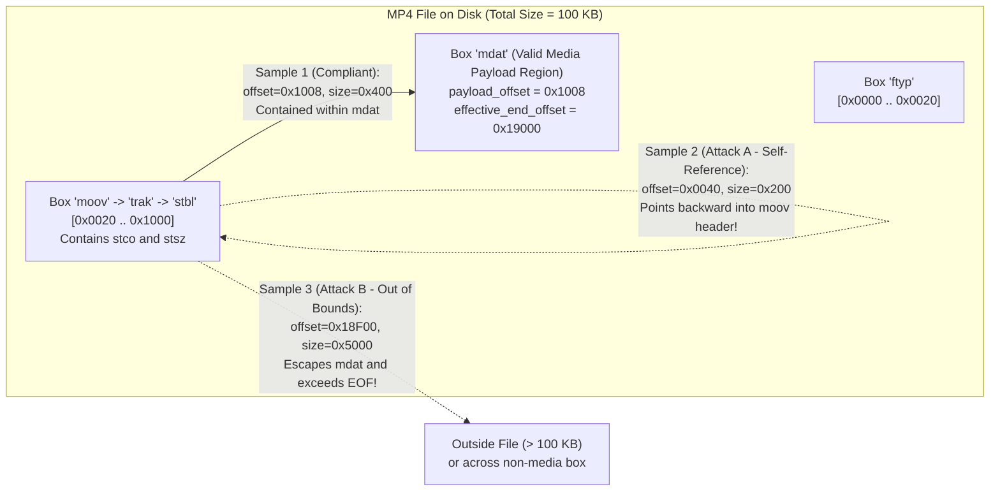
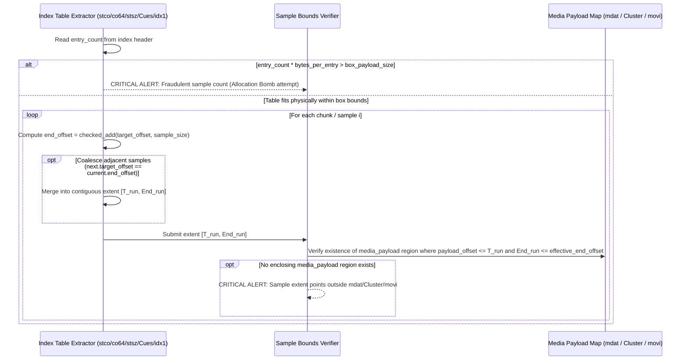

# Technical Detection Report: Sample Table Pointer Overflow Outside Media Payload Regions

## 1. Executive Summary and Threat Landscape

In modern multimedia containers, metadata headers and index tables are physically decoupled from compressed video and audio bitstreams. To decode frame $k$, the media player queries a **sample index table** that resolves a physical byte range in the file: $(\text{offset}_k, \text{size}_k)$—instructing the demuxer to *"seek to byte $\text{offset}_k$ and read $\text{size}_k$ bytes into the elementary stream decoder"*.

A sophisticated attack vector involves crafting a container whose box headers are hierarchically well-formed (passing structural header checks), but whose **sample index tables contain pointers $\text{offset}_k$ or lengths $\text{size}_k$ that point outside the legitimate media data regions (`mdat`, `Cluster`, or `movi`)**:
1. **Out-of-Bounds File Seek / Read (`CWE-125`):** Triggers out-of-bounds memory reads in demuxers that memory-map (`mmap`) the input file without validating every individual sample extent against the file boundary.
2. **Arithmetic Wraparound on `offset + size` (`CWE-190`):** Setting `chunk_offset = 0xFFFFFF00` and `sample_size = 0x200` causes 32-bit or 64-bit addition to wrap around when evaluating `offset + size <= file_size`, bypassing naive boundary checks.
3. **Header Self-Referencing / Type Confusion:** Pointing sample offsets backward into the metadata boxes (`moov` or `ftyp`), forcing video/audio decoders (`H.264`, `HEVC`, `AAC`) to parse container structures as compressed elementary bitstreams.
4. **Counter-Based Allocation Bombs (`CWE-789`):** Declaring `entry_count = 0xFFFFFFFF` ($4.29 \times 10^9$ samples) inside a small index box to trigger an unguarded `malloc(entry_count * sizeof(sample_t))` crash before reading a single frame.

---

## 2. Grounding in Official Format Specifications

### 2.1. ISO Base Media File Format (`ISO/IEC 14496-12` — `stbl` Tables vs. `mdat`)
According to Clause 8.7 (*Sample Tables*) of `ISO/IEC 14496-12`, the physical byte location of every sample within a track (`trak` $\rightarrow$ `mdia` $\rightarrow$ `minf` $\rightarrow$ `stbl`) is derived by joining three mandatory tables:
1. **`stco` (*Chunk Offset Box*, 32-bit) or `co64` (*64-bit Chunk Offset Box*):**
   - Contains `entry_count` (`u32 BE`) followed by an array of absolute file offsets ($\text{chunk\_offset}_c$) pointing to the start of each *chunk* (a contiguous run of samples).
   - **Standard Mandate (Clause 8.7.5.1):** Offsets in `stco`/`co64` are absolute file offsets, not relative to any box, and **must point into media data boxes (`mdat` or `imda`), never into metadata boxes (`moov`, `ftyp`, etc.)**.
2. **`stsc` (*Sample To Chunk Box*):**
   - Maps how many consecutive samples belong to each chunk via `(first_chunk, samples_per_chunk, sample_description_index)` triplets.
3. **`stsz` (*Sample Size Box*) or `stz2` (*Compact Sample Size Box*):**
   - Defines either a constant `sample_size` ($> 0$ when all samples have identical byte length) or an array of `sample_count` 32-bit integers specifying each sample's individual byte size $\text{size}_s$.

For a chunk $c$ containing samples $s \in [s_{\text{start}}, s_{\text{end}}]$, the exact physical byte interval occupied by that chunk is:
$$\left[ \text{chunk\_offset}_c,\ \text{chunk\_offset}_c + \sum_{s = s_{\text{start}}}^{s_{\text{end}}} \text{size}_s \right)$$
In a compliant self-contained file, this interval must be **strictly contained** within the payload of a valid `mdat` box (`[payload_offset, effective_end_offset]`).

### 2.2. Matroska (`IETF RFC 8794` / Matroska Spec — `Cues` vs. `Cluster`)
- The `Cues` element (`0x1C53BB6B`) provides seek indexing via `CuePoint` $\rightarrow$ `CueTrackPositions` $\rightarrow$ `CueClusterPosition` (`0xF1`).
- Every resolved offset $\text{SegmentPayloadOffset} + \text{CueClusterPosition}$ must point to a valid `Cluster` (`0x1F43B675`) region within the enclosing `Segment`.

### 2.3. Resource Interchange File Format (`AVI` — `idx1` Index vs. `LIST:movi`)
- In AVI containers, the `idx1` (*AVI Old Index*) chunk stores 16-byte index entries (`dwChunkId`, `dwFlags`, `dwOffset`, `dwSize`).
- Every sample interval $[\text{dwOffset}, \text{dwOffset} + \text{dwSize}]$ must reside strictly within the payload bounds of the `LIST:movi` media data region.

---

## 3. Attack Vector Diagram: `stco` / `stsz` Pointers Escaping `mdat`

---

## 4. Formal Integrity Conditions

Let $\mathcal{M} = \{ [P_m, E_m] \}_{m=1}^{K}$ be the set of byte intervals corresponding to the payload of all legitimate media data regions in the container (`mdat` in ISOBMFF, `Cluster` in Matroska, `LIST:movi` in AVI).

For every extracted sample table:

### 4.1. Physical Table Capacity Invariant (Anti-DoS)
Before allocating memory or iterating over `entry_count` declared in an index box (`stsz`, `stco`, `co64`, `stsc`, `idx1`), let $B_{\text{entry}}$ be the byte size of each table record ($4$ bytes in `stco`/`stsz`, $8$ bytes in `co64`, $12$ bytes in `stsc`, $16$ bytes in `idx1`) and $P_{\text{box}}$ be the actual remaining byte length of the index box payload:
$$\text{entry\_count} \otimes_{\text{safe}} B_{\text{entry}} \le P_{\text{box}}$$
If this inequality fails (e.g., `entry_count = 0xFFFFFFFF` inside a 64-byte box), the table is fraudulent and a critical alert is raised immediately without executing the loop.

### 4.2. Geometric Sample Containment Invariant
For every sample or contiguous sample run $i$ with starting offset $T_i = \text{target\_offset}_i$ and byte length $S_i = \text{sample\_size}_i$:
1. The checked sum $End_i = T_i \oplus_{\text{safe}} S_i$ **must not overflow** a 64-bit unsigned integer.
2. There must exist at least one media payload region $m \in \mathcal{M}$ such that the interval $[T_i, End_i]$ is completely enclosed within $[P_m, E_m]$:
   $$\exists m \in \mathcal{M} \quad \text{such that} \quad P_m \le T_i \quad \land \quad End_i \le E_m$$

---

## 5. Algorithmic Verification Methodology

### Mathematical Equivalence of Contiguous Sample Coalescing
Because every media payload region $m \in \mathcal{M}$ is a continuous interval $[P_m, E_m]$ (a convex set over $\mathbb{N}$), two adjacent samples $[A, B]$ and $[B, C]$ are contained within $[P_m, E_m]$ **if and only if** their merged interval $[A, C]$ satisfies $P_m \le A \land C \le E_m$. Coalescing contiguous runs in streaming order reduces millions of individual frames to a small set of extents while preserving 100% mathematical precision.
