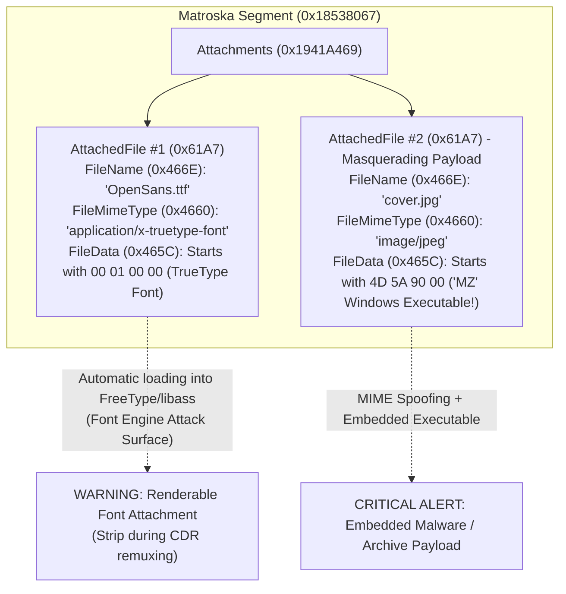
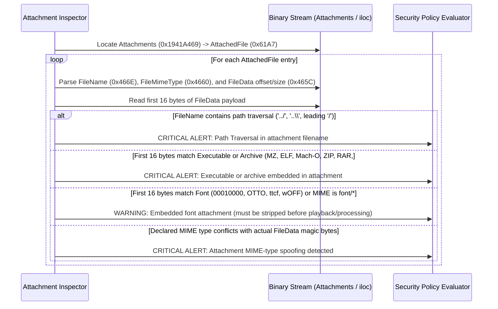

# Technical Detection Report: Embedded Attachments, Malicious Fonts, and Arbitrary Binary Payloads in Media Containers

## 1. Executive Summary and Threat Landscape

Certain multimedia container specifications—most notably **Matroska (`.mkv`)** and **ISOBMFF/QuickTime (`.mp4`/`.mov` metadata items)**—provide native mechanisms to bundle arbitrary external files inside the video container itself. While originally designed to package custom TrueType/OpenType fonts (`.ttf`/`.otf`) for styled `ASS`/`SSA` subtitles or cover art images (`.jpg`/`.png`), these attachment slots impose **no structural restriction on the type or content of the embedded binary data**.

This capability creates two major attack surfaces:
1. **Font Parser Exploitation (`CWE-119` / `CWE-787` in `FreeType`, `HarfBuzz`, `CoreText`, `DirectWrite`):** When a media player or subtitle renderer encounters an `.mkv` file containing styled subtitles and an attached `.ttf` or `.otf` font, it automatically loads the untrusted font binary into the host's font rasterization engine **without user interaction**. Font engines execute complex bytecode interpreters (such as TrueType Hinting VM instructions) and have historically suffered from critical remote code execution and privilege escalation vulnerabilities.
2. **Malware Staging and Arbitrary Binary Smuggling (`MITRE ATT&CK T1027`):** Attackers embed Windows `PE` executables (`.exe`/`.dll`), `ELF` binaries, `ZIP`/`RAR` archives, or encrypted payloads inside `AttachedFile` elements, often disguising them with benign MIME types such as `image/jpeg` or `application/x-truetype-font`.

---

## 2. Grounding in Official Format Specifications

### 2.1. Matroska Specification (`IETF RFC 8794` / `draft-ietf-cellar-matroska` — `Attachments`)
Under the root `Segment` (`0x18538067`), Matroska defines the top-level master element `Attachments` (`0x1941A469`), which contains one or more `AttachedFile` (`0x61A7`) master elements. Each `AttachedFile` contains the following child elements:

| Element Name | EBML ID (Hex) | Data Type | Specification Description |
| :--- | :---: | :---: | :--- |
| `FileDescription` | `0x467E` | UTF-8 String | Optional human-readable description of the attached file. |
| `FileName` | `0x466E` | UTF-8 String | Filename associated with the attached binary stream (e.g., `"sub_font.ttf"`). |
| `FileMimeType` | `0x4660` | ASCII String | Declared MIME type of the attachment (e.g., `"font/ttf"`, `"image/png"`). |
| `FileData` | `0x465C` | Binary (`BLOB`) | The raw binary payload of the embedded file. |
| `FileUID` | `0x46AE` | Unsigned Int | Unique identifier used by tracks to reference the attachment. |

### 2.2. ISO Base Media File Format (`ISO/IEC 14496-12` — `meta`, `iloc`, `idat`, and `covr`)
In `ISO/IEC 14496-12` (Clause 8.11 *Metadata Structure*), files may embed arbitrary binary items inside a `meta` box (`MetaBox`) via `iinf` (*Item Information Box*), `iloc` (*Item Location Box*), and `idat` (*Item Data Box*), or within iTunes/QuickTime `udta` $\rightarrow$ `meta` $\rightarrow$ `ilst` $\rightarrow$ `covr` cover art atoms.

---

## 3. Binary Anatomy: Declared MIME Type vs. True Payload Magic Bytes

---

## 4. Inspection Matrix: Magic Signatures Inside `FileData`

Because both `FileName` (`0x466E`) and `FileMimeType` (`0x4660`) are controlled by the file creator, security verification must inspect the **first 16 physical bytes of `FileData` (`0x465C`)** alongside filename safety rules:

| True Binary Signature in `FileData` (Hex) | Format Identified | Severity Classification | Security Rationale & Required Action |
| :--- | :--- | :---: | :--- |
| `4D 5A ...` (`"MZ"`) | Windows `PE` Executable / DLL | **Critical (`Severity 2`)** | Executable binary smuggled inside media container. |
| `7F 45 4C 46` (`"\x7FELF"`) | Linux/Unix `ELF` Binary | **Critical (`Severity 2`)** | Native executable embedded in attachment slot. |
| `FE ED FA CE` / `CF FA ED FE` / `CA FE BA BE` | macOS `Mach-O` Binary | **Critical (`Severity 2`)** | Native executable embedded in attachment slot. |
| `50 4B 03 04` / `52 61 72 21` | `ZIP` / `JAR` / `RAR` Archive | **Critical (`Severity 2`)** | Nested archive smuggling arbitrary files inside video. |
| `23 21` (`"#!"`) or `<script` | Shell / Web Script | **Critical (`Severity 2`)** | Executable script embedded as attachment. |
| `FileName` contains `../`, `..\`, or `/` | Path Traversal in `FileName` | **Critical (`Severity 2`)** | Targets arbitrary file overwrite when extracting attachments (`CWE-22`). |
| `00 01 00 00` / `4F 54 54 4F` (`"OTTO"`) / `74 74 63 66` (`"ttcf"`) | TrueType (`.ttf`) / OpenType (`.otf`) Font | **Warning (`Severity 1`)** | Exposes `FreeType`/`HarfBuzz` font rasterizer; must be purged during sanitization. |
| `FF D8 FF` (`JPEG`) / `89 50 4E 47` (`PNG`) matching `image/*` MIME | Static Cover Art Image | **Informational (`Severity 0`)** | Benign cover art (still stripped in strict video/audio-only remuxing). |

---

## 5. Algorithmic Verification Methodology

