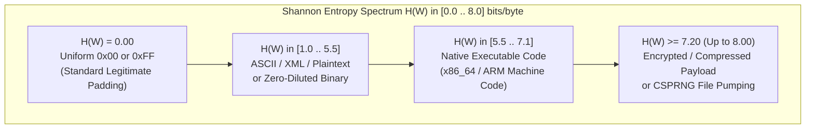
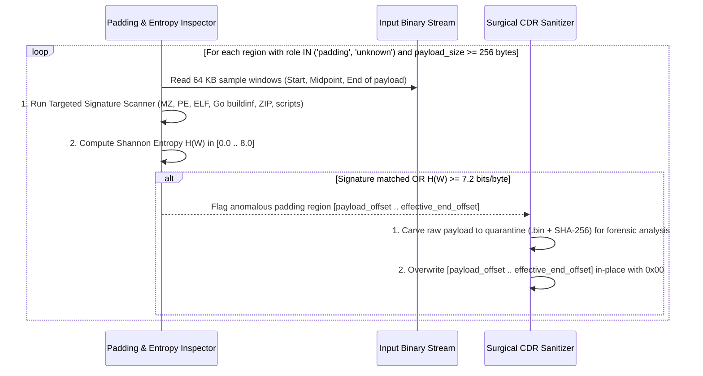

# Technical Detection Report: Shannon Entropy Anomalies and Hidden Signatures in Container Padding Regions

## 1. Executive Summary and Threat Landscape

Every major multimedia container specification defines dedicated **padding or free-space structures** (`free`, `skip`, `wide`, and custom `uuid` boxes in `ISOBMFF`; `Void` elements in `EBML/Matroska`; `JUNK` chunks in `RIFF/AVI`). In legitimate media production, these regions allow muxers and video editors to reserve header space or align media clusters to disk sector boundaries without rewriting multi-gigabyte files. By specification, **media players must completely ignore the byte contents of padding regions**.

Adversaries exploit these opaque regions as covert storage channels within otherwise valid video files:
1. **Encrypted Staged Payloads and Shellcode Smuggling (`MITRE ATT&CK T1027`):** An attacker places an encrypted stage-2 payload, shellcode, or configuration blob inside a `free`, `uuid`, `Void`, or `JUNK` block. Because the region is properly declared in the container's box headers, the file size matches the container boundary (evading trailing-overlay checks) and the video plays without error.
2. **Randomized File Pumping Inside Valid Boxes (`MITRE ATT&CK T1027.001`):** To inflate a 100 KB malware loader to 1.4 GB and bypass size-limited antivirus scanners, attackers embed a massive `free`, `Void`, or `JUNK` block filled with pseudo-random bytes alongside a small `MZ`/`ELF`/Go payload.
3. **Zero-Padded Entropy Evasion (*Low-Entropy Smuggling*):** Aware that security tools measure Shannon entropy, an attacker may place a 100 KB unencrypted binary (such as a Go or PE loader) inside a 100 MB `free` box filled mostly with `0x00` bytes so that the average entropy of the box remains near zero. Combining **windowed Shannon entropy analysis** with **targeted binary signature scanning** defeats both encrypted and unencrypted smuggling techniques.

---

## 2. Grounding in Official Format Specifications

### 2.1. ISO Base Media File Format (`ISO/IEC 14496-12` — `free`, `skip`, and `uuid`)
- **Clause 8.1.2 (*Free Space Box — `free` and `skip`*):** The contents of a `free` or `skip` box are uninterpreted filler. Legitimate muxers (`FFmpeg`, `GPAC`, `Apple CoreMedia`) initialize `free`/`skip` payloads with constant `0x00` bytes.
- **Clause 4.2 (*User-Defined Extended Type — `uuid`*):** Boxes with `type == "uuid"` followed by a 16-byte UUID allow arbitrary vendor extensions. While specific standardized UUIDs exist (e.g., XMP metadata or fragmented MP4 PSSH/encryption boxes), unknown or oversized `uuid` boxes provide an opaque container for arbitrary payloads.

### 2.2. Extensible Binary Meta Language (`IETF RFC 8794` — `Void` Element `0xEC`)
- **Section 11.3.2 (*Void Element*):** The `Void` element (`Element ID = 0xEC`) is used to overwrite damaged data or reserve space within a `Master` element so that future metadata updates do not require shifting subsequent `Cluster` offsets. Compliant writers fill `Void` elements with `0x00` bytes.

### 2.3. Resource Interchange File Format (`Microsoft/IBM RIFF Specification` — `JUNK` and `PAD `)
- In `RIFF/AVI` containers, `JUNK` (`0x4A 0x55 0x4E 0x4B`) and `PAD ` chunks align data structures to 2 KB CD-ROM or disk sector boundaries. Their contents are ignored by all AVI parsers and are legitimately filled with `0x00`.

---

## 3. Mathematical Formulation: Windowed Shannon Entropy $H(X)$

For any discrete byte window $W = (b_1, b_2, \dots, b_N)$ of length $N$ bytes, let $c(v)$ denote the frequency count of byte value $v \in \{0, 1, \dots, 255\}$ in $W$, and let $P(v) = \frac{c(v)}{N}$ be its empirical probability. The **Shannon Entropy** $H(W)$ in bits per byte is defined as:

$$H(W) = -\sum_{\substack{v=0 \\ c(v) > 0}}^{255} P(v) \log_2 P(v) \quad \in [0.0,\ 8.0]$$

### Entropy Spectrum in Padding Regions

---

## 4. Dual-Layer Inspection: Windowed Entropy + Targeted Signature Scanning

To prevent both high-entropy encrypted smuggling and low-entropy zero-diluted smuggling without reading gigabytes of data into RAM, inspection operates over **bounded 64 KB sampling windows** at the start, middle, and end of every padding or unknown region whose payload size exceeds $256\text{ bytes}$:

| Detection Layer | Trigger Condition on Padding / Unknown Region | Severity Classification | Forensic Meaning |
| :--- | :--- | :---: | :--- |
| **Layer 1: Targeted Signature Match** | Window contains executable, runtime, or archive markers (`"MZ"`, `"PE\0\0"`, `"This program cannot be run"`, `"\x7FELF"`, `"\xFF Go buildinf:"`, `"runtime.main"`, `"PK\x03\x04"`, `"Rar!"`, `"powershell"`) | **Critical (`Severity 2`)** | Unencrypted executable or loader (e.g., Go/PE malware) hidden inside padding box. |
| **Layer 2: High Windowed Entropy** | Maximum window entropy $\max_k H(W_k) \ge 7.20\text{ bits/byte}$ | **Warning (`Severity 1`)** or **Critical (`Severity 2`)** | Encrypted payload, compressed archive, or pseudo-random file pumping inside padding. |
| **Layer 3: Oversized Non-Zero Padding** | Region size $> 1\text{ MB}$ with $H(W) > 0.1\text{ bits/byte}$ (non-zero filler) | **Warning (`Severity 1`)** | Anomalous non-zero data inside a region that should only contain `0x00` alignment bytes. |
| **Baseline: Compliant Padding** | All sampled windows contain uniform `0x00` ($H(W) = 0.0$) | **Clean (`0 Alerts`)** | Standard specification-compliant padding. |

---

## 5. Algorithmic Verification and In-Place Surgical Zeroing

### In-Place Neutralization Guarantee
When a `free`, `skip`, `Void`, or `JUNK` region is neutralized by overwriting its payload interval `[payload_offset, effective_end_offset)` with `0x00` while preserving its 8-byte header (`[header_offset, payload_offset)`), **the total byte length of the region remains unchanged**. Consequently, every downstream box and every sample offset in `stco`/`co64`/`Cues`/`idx1` remains 100% valid without requiring index recalculation.
