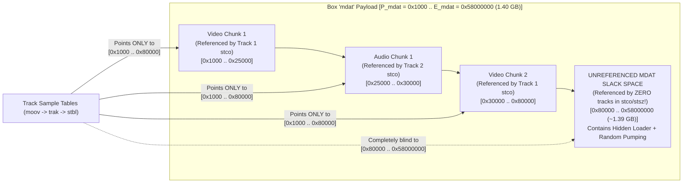
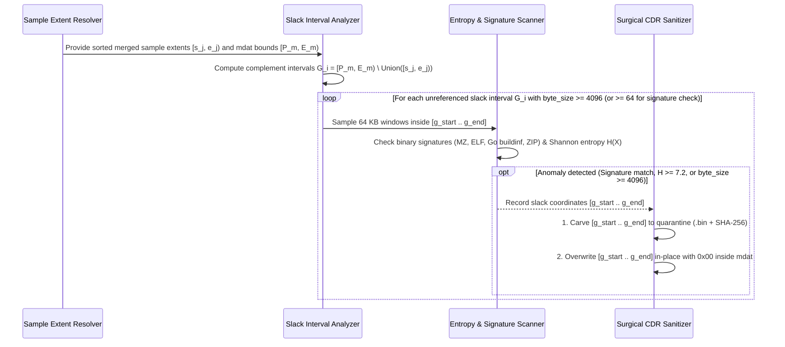

# Technical Detection Report: Unreferenced Media Slack Space Inside Payload Containers

## 1. Executive Summary and Threat Landscape

A sophisticated adversary seeking to embed a large malicious payload or inflate a file via *file pumping* (`MITRE ATT&CK T1027.001`) can bypass both **trailing-overlay detection** (by keeping all injected bytes inside the container's final box) and **padding-box inspection** (by avoiding `free`, `Void`, or `JUNK` boxes altogether).

Instead, the attacker places the malicious executable and hundreds of megabytes of randomized padding **directly inside the legitimate media payload container (`mdat` in MP4/MOV, `LIST:movi` in AVI, or `Cluster` in MKV)**, while configuring the track sample tables (`stco`/`co64` and `stsz`) to reference only the legitimate video and audio frames at the beginning of `mdat`.

Because media demuxers during playback **only seek to and decode the exact byte ranges listed in the sample index tables**, any byte range inside `mdat` that is not referenced by at least one track sample—referred to as **Unreferenced Media Slack Space**—is completely invisible to the video decoder yet physically carried inside the media payload box.

---

## 2. Grounding in Official Format Specifications

### 2.1. ISO Base Media File Format (`ISO/IEC 14496-12` — `mdat` vs. `stbl` Coverage)
According to Clause 8.1.1 (*Media Data Box — `mdat`*) and Clause 8.7 (*Sample Tables*) of `ISO/IEC 14496-12`:
- The `mdat` box is an unstructured byte array whose payload spans the interval $[P_{\text{mdat}}, E_{\text{mdat}})$.
- Every active track $t \in \{1, \dots, T\}$ defines a set of sample extents $\mathcal{S}_t = \{ [a_{t,i}, b_{t,i}) \}$ derived from `stco`/`co64`, `stsc`, and `stsz`.
- In a clean container generated by a compliant muxer, the union of all sample extents across all tracks:
  $$\mathcal{U} = \bigcup_{t=1}^{T} \bigcup_{i} [a_{t,i}, b_{t,i})$$
  covers the `mdat` payload $[P_{\text{mdat}}, E_{\text{mdat}})$ tightly, leaving at most minor interleaving alignment gaps (typically $\le 16\text{ bytes}$).

### 2.2. Resource Interchange File Format (`RIFF/AVI` — `LIST:movi` vs. `idx1`)
- In an AVI container, all audio/video chunks (`00dc`, `00db`, `01wb`) reside inside the `LIST:movi` payload $[P_{\text{movi}}, E_{\text{movi}})$ and are indexed by `idx1`. Any unindexed gap or trailing tail inside `LIST:movi` beyond the last valid media chunk constitutes unreferenced media slack.

---

## 3. Binary Anatomy: Hidden Payload in `mdat` Slack Space

### Why Traditional Structural Checks Miss This Vector
1. **No Trailing Overlay:** `mdat` is a valid root box whose declared size reaches the exact end of the 1.40 GB file ($E_{\text{root}} = S_{\text{file}}$).
2. **No `free`/`Void` Box Used:** The file contains zero `free` or `skip` boxes.
3. **All `stco` Pointers Are In-Bounds:** Every sample in `stco`/`stsz` lies within $[0x1000, 0x80000] \subset [P_{\text{mdat}}, E_{\text{mdat}})$.
Only by computing the **set difference** between the `mdat` interval and the union of all sample extents $\mathcal{U}$ does the 1.39 GB hidden region surface.

---

## 4. Mathematical Formulation of Unreferenced Slack Intervals

Let $M = [P_m, E_m)$ be a media payload region (`mdat` or `LIST:movi`), and let $I_1, I_2, \dots, I_k$ be the sorted, merged (non-overlapping) sample extents contained within $M$, where $I_j = [s_j, e_j)$ and $P_m \le s_1 < e_1 \le s_2 < e_2 \le \dots \le e_k \le E_m$.

The **Unreferenced Media Slack Set** $\mathcal{G}(M) = M \setminus \bigcup_{j=1}^{k} I_j$ consists of up to $k + 1$ disjoint gap intervals:
1. **Leading Slack:** $[P_m, s_1)$ if $s_1 > P_m$.
2. **Inter-Sample Gaps:** $[e_j, s_{j+1})$ for each $j \in \{1, \dots, k-1\}$ where $s_{j+1} > e_j$.
3. **Trailing Media Slack:** $[e_k, E_m)$ if $E_m > e_k$ (or the entire $[P_m, E_m)$ if $k = 0$).

The total unreferenced byte count inside $M$ is:
$$\text{SlackBytes}(M) = (E_m - P_m) - \sum_{j=1}^{k} (e_j - s_j)$$

### Classification Thresholds for Unreferenced Slack Intervals $G = [g_{\text{start}}, g_{\text{end}})$

| Condition on Slack Interval $G \in \mathcal{G}(M)$ | Severity Classification | Forensic Interpretation |
| :--- | :---: | :--- |
| $\text{len}(G) \ge 64\text{ bytes}$ and contains binary signatures (`MZ`, `PE\0\0`, `\x7FELF`, `\xFF Go buildinf:`, `PK\x03\x04`, `Rar!`) | **Critical (`Severity 2`)** | Malware executable or archive hidden inside unreferenced `mdat` space. |
| $\text{len}(G) \ge 4096\text{ bytes}$ and windowed Shannon entropy $H(G) \ge 7.20\text{ bits/byte}$ | **Critical (`Severity 2`)** | Encrypted payload or randomized *file pumping* smuggled inside `mdat`. |
| $\text{len}(G) \ge 4096\text{ bytes}$ with low entropy ($H(G) < 7.20$) and no executable signatures | **Warning (`Severity 1`)** | Unreferenced dead space inside `mdat` (must be zeroed out during sanitization). |
| $\text{len}(G) < 4096\text{ bytes}$ and no executable signatures | **Informational / Benign** | Normal muxer alignment padding between interleaved chunks. |

---

## 5. Algorithmic Verification and In-Place Slack Neutralization

### Zero-Distortion In-Place Neutralization
Because by definition **no track in `stco`/`co64`/`stsz` references any byte within $G_i = [g_{\text{start}}, g_{\text{end}})$**, overwriting $G_i$ in-place with `0x00` inside `mdat` completely destroys any hidden payload while leaving 100% of the legitimate audio and video frames and their file offsets untouched.
