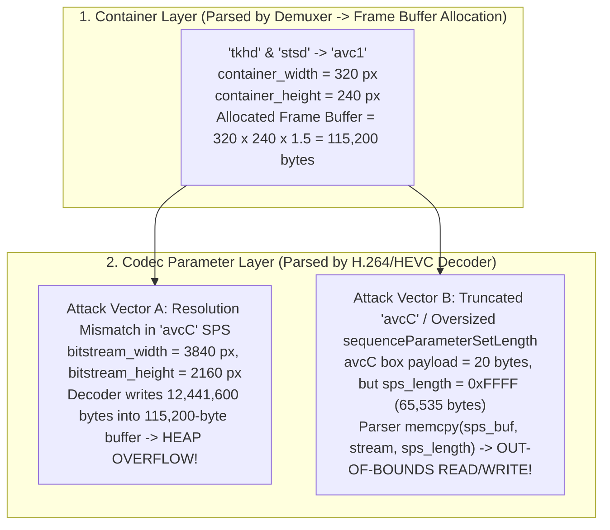
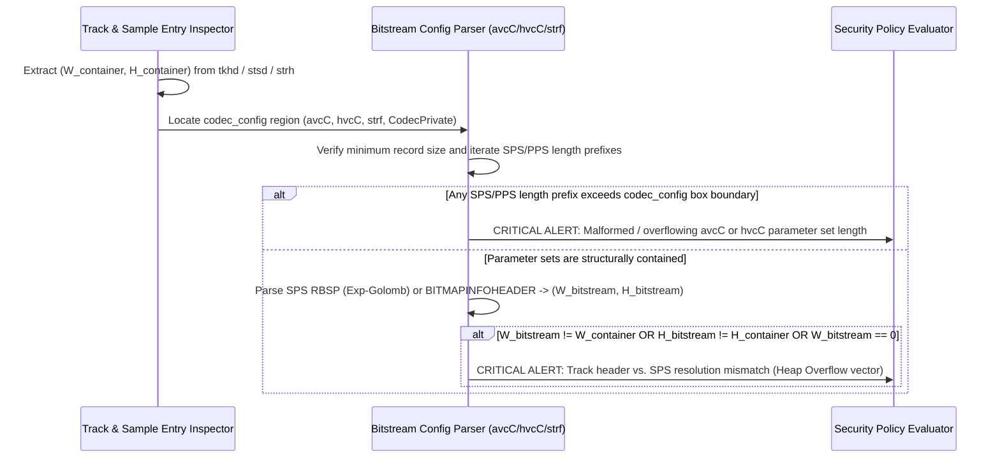

# Technical Detection Report: Dimension and Bitstream Configuration Mismatch Between Track Headers and Codec Parameter Sets

## 1. Executive Summary and Threat Landscape

In multimedia containers, video frame dimensions (width, height, bit depth, and chroma subsampling) are declared in **two separate layers**:
1. **The Container Track Header Layer** (`tkhd` and `stsd` visual sample entry in `ISOBMFF`; `TrackVideo` in `Matroska`; `AVISTREAMHEADER` in `RIFF/AVI`), which is parsed by the container demuxer.
2. **The Elementary Bitstream Configuration Layer** (`Sequence Parameter Set` or `SPS` inside `avcC` for H.264, `hvcC` for HEVC, `vpcC`/`av1C` for VP9/AV1, or `BITMAPINFOHEADER` in `strf`), which is parsed by the underlying hardware or software codec (`libavcodec`, `MediaCodec`, `VideoToolbox`).

A critical and recurring vulnerability pattern (`CWE-122` Heap-Based Buffer Overflow and `CWE-190` Integer Overflow) occurs when **a malicious file declares small dimensions in the container header (e.g., $320 \times 240$) so the player allocates a small frame buffer, while declaring much larger dimensions (e.g., $4096 \times 2160$) inside the codec's Sequence Parameter Set (`SPS`)**—or when the codec configuration box (`avcC`/`hvcC`) contains truncated length-prefix headers that drive the NAL unit parser out of bounds.

---

## 2. Grounding in Official Format Specifications

### 2.1. ISO Base Media File Format and NAL Unit Video (`ISO/IEC 14496-12` & `ISO/IEC 14496-15`)
1. **Track Header Box (`tkhd` — `ISO/IEC 14496-12` Clause 8.3.2):**
   - Stores display `width` and `height` as 16.16 fixed-point unsigned integers at the end of the `tkhd` box.
2. **Visual Sample Entry (`avc1`, `hvc1`, `hev1`, `vp09`, `av01` inside `stsd` — Clause 12.1.3):**
   - Contains 16-bit unsigned integer fields `width` and `height` representing the pixel resolution of the video stream.
3. **AVC Decoder Configuration Record (`avcC` — `ISO/IEC 14496-15` Clause 5.3.3.1):**
   - Minimum legal payload size is $7\text{ bytes}$:
     - `configurationVersion` (`1B`, must equal `1`).
     - `AVCProfileIndication`, `profile_compatibility`, `AVCLevelIndication` (`3B`).
     - `lengthSizeMinusOne` (`2 lower bits` of byte 4): defines the byte length of each NAL unit size prefix in `mdat` ($\text{NAL\_len\_bytes} = (\text{byte}_4 \ \& \ \mathtt{0x03}) + 1 \in \{1, 2, 4\}$; a value of `2` yielding 3-byte NAL lengths is non-standard and frequently mishandled).
     - `numOfSequenceParameterSets` (`5 lower bits` of byte 5), followed by `[sequenceParameterSetLength: u16 BE][SPS NAL Unit]` for each SPS.
   - Inside the H.264 SPS (`ITU-T H.264` Section 7.3.2.1.1), the Exp-Golomb fields `pic_width_in_mbs_minus1`, `pic_height_in_map_units_minus1`, and frame cropping offsets define the true decoded pixel resolution $(W_{\text{SPS}}, H_{\text{SPS}})$.
4. **HEVC Decoder Configuration Record (`hvcC` — `ISO/IEC 14496-15` Clause 8.3.3.1):**
   - Minimum legal payload size is $23\text{ bytes}$, containing `numOfArrays` (`1B`) followed by parameter set arrays (`VPS`, `SPS`, `PPS`), each prefixed by a 16-bit `nalUnitLength`.

### 2.2. RIFF/AVI (`strh` vs. `strf` `BITMAPINFOHEADER`)
- In AVI files, the stream header `strh` defines `rcFrame` (`left`, `top`, `right`, `bottom`), while the stream format chunk `strf` contains a 40-byte `BITMAPINFOHEADER` (`biWidth: i32 LE`, `biHeight: i32 LE`, `biBitCount: u16 LE`). Discrepancies between `strh` and `strf` or negative/overflowing `biWidth * biHeight` values are classic heap overflow triggers in legacy AVI parsers.

---

## 3. Binary Anatomy of a Resolution Mismatch & `avcC` Overflow Attack

---

## 4. Formal Validation Invariants

For every video track $t$ and its associated codec configuration block (`avcC`, `hvcC`, `vpcC`, `av1C`, `strf`, `CodecPrivate`):

### 4.1. Structural Integrity of the Decoder Configuration Record
1. **Minimum Header Size:**
   - For `avcC`: $P_{\text{declared}} \ge 7\text{ bytes}$ and `configurationVersion == 1`.
   - For `hvcC`: $P_{\text{declared}} \ge 23\text{ bytes}$.
   - For AVI `strf` (video): $P_{\text{declared}} \ge 40\text{ bytes}$ (`sizeof(BITMAPINFOHEADER)`).
2. **Parameter Set Length Containment:**
   For every SPS/PPS/VPS entry $j$ inside `avcC` or `hvcC` starting at offset $O_j$ with 16-bit Big-Endian length $L_j = \text{nalUnitLength}_j$:
   $$O_j \oplus_{\text{safe}} 2 \oplus_{\text{safe}} L_j \le E_{\text{config\_box}}$$
   Any entry where $O_j + 2 + L_j > E_{\text{config\_box}}$ is a truncated/overflowing parameter set (`is_header_malformed = 1`).

### 4.2. Cross-Layer Resolution Consistency Invariant
Let $(W_{\text{container}}, H_{\text{container}})$ be the pixel dimensions declared in the track/sample entry (`tkhd`/`stsd`/`strh`) and $(W_{\text{bitstream}}, H_{\text{bitstream}})$ be the decoded pixel dimensions extracted from the codec's `SPS` or `BITMAPINFOHEADER`:
1. Both dimensions must be strictly positive and bounded ($1 \le W, H \le 16384$, preventing 32-bit integer overflow when computing $W \times H \times 4$).
2. Whenever both layers declare non-zero dimensions, they must match:
   $$W_{\text{container}} = W_{\text{bitstream}} \quad \land \quad H_{\text{container}} = H_{\text{bitstream}}$$

---

## 5. Algorithmic Verification Methodology

