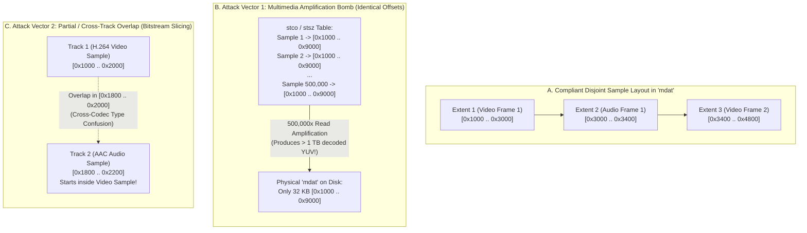
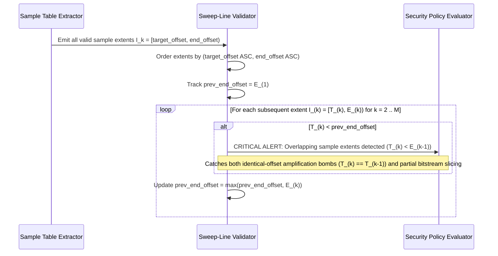

# Technical Detection Report: Sample Table Extent Overlap and Media Decompression Bombs

## 1. Executive Summary and Threat Landscape

In indexed multimedia containers (`ISOBMFF`, `Matroska`, `RIFF/AVI`), the sample index tables (`stco`/`co64` + `stsz`, `Cues`, `idx1`) map each logical frame $i$ to a physical byte interval $[T_i, E_i)$ inside the media payload region (`mdat`, `Cluster`, `LIST:movi`). In a compliant container produced by a standard encoder, **every compressed sample occupies a distinct, non-overlapping byte interval in the file**.

When a crafted container intentionally defines **overlapping sample intervals** ($[T_i, E_i) \cap [T_j, E_j) \neq \emptyset$ for $i \neq j$), it enables two severe classes of attacks:
1. **Multimedia Decompression / Amplification Bombs (`CWE-409` / `CWE-400`):** An attacker creates a tiny 500 KB video file containing a single compressed keyframe inside `mdat`, and populates `stco`/`stsz` with $1,000,000$ entries that all point to that exact same offset $T_0$. When a cloud transcoding worker, thumbnail generator, or media player processes the file, it decodes the same frame a million times, generating hundreds of gigabytes of uncompressed YUV video output, exhausting disk storage, CPU, and RAM.
2. **Unaligned Bitstream Slicing and Cross-Track Type Confusion (`CWE-843`):** A sample entry in an audio track (`AAC`/`Opus`) is pointed into the middle of a video sample (`H.264` NAL unit), or sample $i+1$ starts 3 bytes before the end of sample $i$. This feeds desynchronized, attacker-controlled byte sequences into hardware or software bitstream decoders, triggering parser state corruption.

---

## 2. Grounding in Official Format Specifications

### 2.1. ISO Base Media File Format (`ISO/IEC 14496-12` — Clause 8.7 *Sample Tables*)
According to Clause 8.7.4 (*Sample To Chunk Box — `stsc`*) and Clause 8.7.5 (*Chunk Offset Box — `stco`/`co64`*) of `ISO/IEC 14496-12`:
- Samples within a chunk are stored contiguously without overlap: sample $s+1$ begins at the exact byte offset where sample $s$ ends.
- Different chunks across the same track or across interleaved audio/video tracks represent disjoint sequences of samples stored in `mdat`.
- While the specification allows `edit lists` (`edts`/`elst`) at the presentation timeline layer to repeat a segment of video during playback, **physical chunks and sample byte ranges in `stco`/`stsz` must never partially overlap one another**.

### 2.2. RIFF/AVI (`idx1` Chunk Indexing)
- In the AVI `idx1` index, each entry points to a discrete `[FourCC: 4B][Size: 4B][Payload]` sub-chunk inside `LIST:movi`. Overlapping `idx1` entries either alias the same frame repeatedly (amplification bomb) or slice into the interior of another chunk's payload as a forged chunk header.

---

## 3. Binary Anatomy: Disjoint Compliant Samples vs. Overlapping Sample Attack

---

## 4. Mathematical Formulation of Interval Overlap Detection

Let $\mathcal{E} = \{ I_1, I_2, \dots, I_M \}$ be the collection of all resolved sample extents across all tracks in the container, where each extent $I_k = [T_k, E_k)$ is defined by its starting byte offset $T_k = \text{target\_offset}_k$ and ending byte offset $E_k = T_k + \text{sample\_size}_k$ (with $T_k < E_k$).

### 4.1. Linear-Logarithmic Sweep-Line Invariant ($O(M \log M)$)
If we sort the sequence of extents $\mathcal{E}$ in ascending lexicographical order by starting offset $T_k$ (and secondarily by $E_k$):
$$T_{(1)} \le T_{(2)} \le \dots \le T_{(M)}$$
then the entire set of $M$ intervals is pairwise disjoint **if and only if** every adjacent pair in the sorted sequence satisfies:

$$T_{(k)} \ge E_{(k-1)} \quad \forall k \in \{2, \dots, M\}$$

Conversely, an **Extent Overlap Violation** exists at index $k$ whenever:
$$T_{(k)} < E_{(k-1)}$$
with an overlap byte length of:
$$\Delta_{\text{overlap}} = \min\left(E_{(k)}, E_{(k-1)}\right) - T_{(k)} > 0$$

### 4.2. Amplification Factor Metric
Additionally, the global **Read Amplification Ratio** $R_{\text{amp}}$ across a media payload region of size $S_{\text{mdat}}$ is defined as:
$$R_{\text{amp}} = \frac{\sum_{k=1}^{M} (E_k - T_k)}{S_{\text{mdat}}}$$
In a strictly disjoint file, $R_{\text{amp}} \le 1.0$. Any file with $R_{\text{amp}} > 1.0$ contains overlapping sample reads, and $R_{\text{amp}} \gg 10.0$ indicates a multimedia decompression bomb.

---

## 5. Algorithmic Verification Methodology

### Handling Policy for Overlapping Sample Tables
Because sample overlap indicates either a deliberate resource-exhaustion bomb (`CWE-409`) or corrupted index tables that cannot be safely repaired in-place without re-indexing the bitstream, any container triggering this detection must be flagged with **Critical Severity (`Severity 2`)** and rejected before reaching any downstream media decoder or transcoder.
