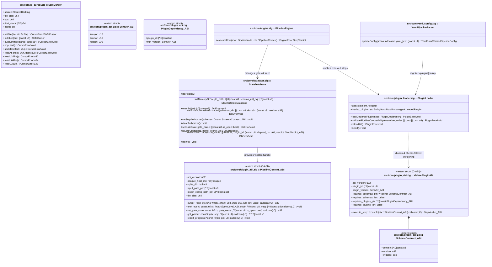
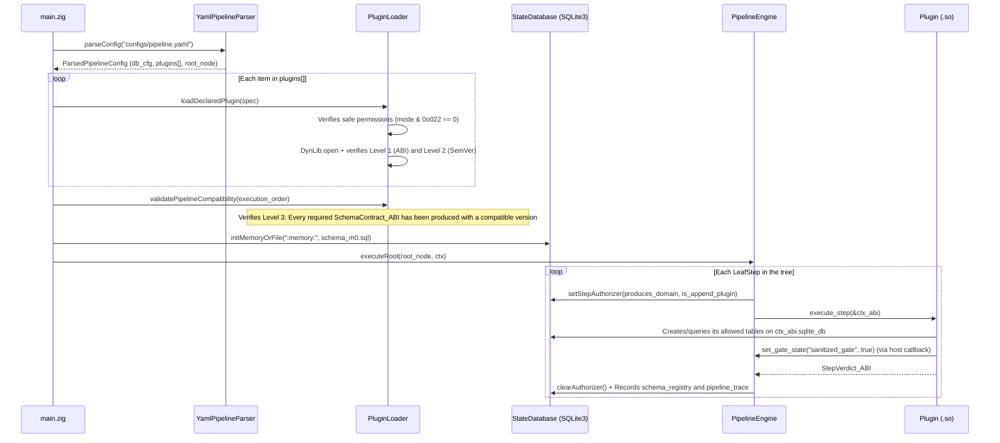

# Milestone M0 Specification: Declarative YAML Chassis, Agnostic SQLite Bus, and Versioned Plugin Loader (`C-ABI`)

> **Global Directives:** See [`../AGENTS.md`](../AGENTS.md) before implementing this milestone.

---

## 1. Functional Scope and Compatibility Contracts

### Milestone Objective
Build the **universal chassis, SQLite state bus, and declarative execution engine** of `vidsec`, **100% domain-agnostic** (it has no knowledge of video container concepts, audit findings, or transcoding). By the end of `M0`, the `vidsec` binary is able to:
1. Initialize a **SQLite3** database (`:memory:` by default or an on-disk file with `--save-db <path>`) by initially applying **Engine Governance Bank 0 (`configs/schemas/m0_engine_v1.sql`)**: `run_metadata`, `schema_registry`, `pipeline_gates`, and `pipeline_trace`.
2. Read **`configs/pipeline.yaml`**, which declares:
   - The `database:` block (SQLite configuration and `schemas_dir: "configs/schemas"` directory).
   - The `plugins:` array (explicit list of `.so`/`.dll` files to load, their optional SemVer version constraint, and their optional `config:` file).
   - The `pipeline:` tree (hierarchical `StageGroup` groups, `LeafStep` steps, failure policies, and named gates `open_gate_on_success` / `require_gate`).
3. Validate at startup (**Pre-Flight Compatibility Check & Schema Bank Provisioning**) the **3-Level Version and Dependency Matrix** (see [`ADR-006`](../ADR/ADR-006_on_demand_ddl_banks_and_hard_plugin_dependencies.md)):
   - **Level 1 (`abi_version`):** Binary compatibility of the `.so` with `PipelineContext_ABI` (`M0`).
   - **Level 2 (`plugin_version` SemVer + Hard Plugin Dependencies `requires_plugins`):** Compliance with the `min_version` / `max_version` range declared in `pipeline.yaml` and verification that every plugin required in `requires_plugins_ptr` (`PluginDependency_ABI`) appears earlier in the pipeline execution order (also allowing standalone plugins with `requires_plugins_len = 0` that operate directly on raw bytes).
   - **Level 3 (On-demand SQLite DDL Banks `requires_schemas`):** For each `SchemaContract_ABI` bank (`domain`, `version`, `writable`) requested by a loaded plugin, `M0` automatically loads and executes the physical DDL file `configs/schemas/<domain>_v<version>.sql` (if not yet registered in `schema_registry`), ensuring that tables always exist even if optional plugins are omitted.
4. Execute the pipeline tree by configuring the `sqlite3_set_authorizer` firewall at each step according to the `writable` permissions of the banks declared by the plugin, and providing the `*sqlite3` pointer, the `SafeCursor` reader, and the event channel.

---

## 2. Milestone UML Architecture (`classDiagram`)



---

## 3. Zig Type Contracts and SQLite Schema (`DDL / Queries`)

### 3.A. Public Zig Types, Errors, and Signatures (`src/core/plugin_abi.zig`)
> [!IMPORTANT]
> `M0` is completely agnostic to which tables milestones `M1`–`M5` use. Each plugin declares which SQLite DDL banks it needs mapped (`requires_schemas_ptr`, e.g. `"ir_core"` v1, `"audit_findings"` v1) and which *Hard Dependencies* on other plugins it requires (`requires_plugins_ptr`).

```zig
const std = @import("std");

pub const VIDSEC_ABI_VERSION: u32 = 1;
pub const VIDSEC_PLUGIN_SYMBOL_NAME = "vidsec_plugin_descriptor";

pub const sqlite3 = opaque {};

pub const SemVer_ABI = extern struct {
    major: u16,
    minor: u16,
    patch: u16,

    pub fn order(a: SemVer_ABI, b: SemVer_ABI) std.math.Order {
        if (a.major != b.major) return std.math.order(a.major, b.major);
        if (a.minor != b.minor) return std.math.order(a.minor, b.minor);
        return std.math.order(a.patch, b.patch);
    }
};

/// Defines a SQLite schema bank (configs/schemas/<domain>_v<version>.sql) required by the plugin.
pub const SchemaContract_ABI = extern struct {
    domain: [*:0]const u8,      // E.g., "ir_core", "ir_deep", "audit_findings", "working_artifacts"
    version: u32,               // E.g., 1 -> loads configs/schemas/<domain>_v1.sql
    writable: bool = false,     // false = SELECT only; true = allows INSERT/UPDATE in this bank
};

/// Defines a hard dependency (Hard Dependency) on an earlier plugin in the pipeline.
pub const PluginDependency_ABI = extern struct {
    plugin_id: [*:0]const u8,   // E.g., "vidsec.m1.ir_builder" or "vidsec.m3.deep_extractor"
    min_version: SemVer_ABI,
};

pub const EventLevel_ABI = enum(u32) {
    info = 0,
    warning = 1,
    critical = 2,
};

pub const StepVerdict_ABI = enum(u32) {
    proceed = 0,
    skip_group = 1,
    abort_threat = 2,
    step_error = 3,
};

pub const PipelineContext_ABI = extern struct {
    abi_version: u32 = VIDSEC_ABI_VERSION,
    opaque_host_ctx: *anyopaque,

    /// Active connection to the SQLite3 database shared among pipeline plugins.
    sqlite_db: *sqlite3,

    /// Input file path provided via CLI.
    input_path_ptr: [*:0]const u8,

    /// Optional path to the plugin-specific YAML configuration file (`config:` in pipeline.yaml).
    plugin_config_path_ptr: ?[*:0]const u8,

    file_size: u64,

    /// Reads `len` bytes from `offset` using the host's SafeCursor. Returns 0 on success, != 0 on error.
    cursor_read_at: *const fn (host_ctx: *anyopaque, offset: u64, dest_ptr: [*]u8, len: usize) callconv(.C) u32,

    /// Emits a real-time telemetry/alert event to the PipelineObserver (CLI / JSON Stream).
    emit_event: *const fn (
        host_ctx: *anyopaque,
        level: EventLevel_ABI,
        code: [*:0]const u8,
        message: [*:0]const u8,
    ) callconv(.C) void,

    /// Opens or closes a named gate in the `pipeline_gates` table of M0 (e.g. "sanitized_gate" = true).
    set_gate_state: *const fn (host_ctx: *anyopaque, gate_name: [*:0]const u8, is_open: bool) callconv(.C) u32,

    /// Retrieves an inline parameter configured in `params:` of the current step inside `pipeline.yaml`.
    get_param: *const fn (host_ctx: *anyopaque, key: [*:0]const u8) callconv(.C) ?[*:0]const u8,

    /// Reports progress percentage (0..100) to the PipelineObserver.
    report_progress: *const fn (host_ctx: *anyopaque, pct: u8) callconv(.C) void,
};

pub const VidsecPluginABI = extern struct {
    /// Level 1: Binary version of the C-ABI contract with the M0 engine (must be 1).
    abi_version: u32 = VIDSEC_ABI_VERSION,
    plugin_id: [*:0]const u8,

    /// Level 2: SemVer version of the `.so` binary itself (e.g. M1 = 1.0.0, M2 = 5.2.0).
    plugin_version: SemVer_ABI,

    /// Level 3A: SQLite schema banks (configs/schemas/<domain>_v<version>.sql) provisioned by M0 when loading the plugin:
    requires_schemas_ptr: ?[*]const SchemaContract_ABI = null,
    requires_schemas_len: usize = 0,

    /// Level 3B: Hard Dependencies (plugins that must execute earlier in pipeline.yaml):
    /// If null/0, the plugin is standalone (e.g. M1 or a direct analyzer over raw MP4 bytes).
    requires_plugins_ptr: ?[*]const PluginDependency_ABI = null,
    requires_plugins_len: usize = 0,

    execute_step: *const fn (ctx: *PipelineContext_ABI) callconv(.C) StepVerdict_ABI,
};
```

---

### 3.B. Exclusive `M0` SQLite Schema Contract (`configs/schema_m0.sql`)

`M0` only creates the 4 governance tables of the execution engine itself. Each subsequent milestone (`M1`–`M5`) will create its own domain tables and register them in `schema_registry`:

```sql
PRAGMA foreign_keys = ON;
PRAGMA busy_timeout = 5000;

-- 1. Metadata of the engine execution session
CREATE TABLE IF NOT EXISTS run_metadata (
    run_id INTEGER PRIMARY KEY CHECK (run_id = 1),
    input_path TEXT NOT NULL,
    file_size INTEGER NOT NULL,
    started_at_ns INTEGER NOT NULL
);

-- 2. Registry of active SQLite schema domains (populated as producer plugins execute)
CREATE TABLE IF NOT EXISTS schema_registry (
    schema_domain TEXT PRIMARY KEY,     -- E.g. "ir_core" (M1), "audit_findings" (M2), "ir_deep" (M3), "working_artifacts" (M4)
    schema_version INTEGER NOT NULL,
    producer_plugin_id TEXT NOT NULL,
    producer_plugin_version TEXT NOT NULL
);

-- 3. State of logical gates between stages (e.g. "sanitized_gate")
CREATE TABLE IF NOT EXISTS pipeline_gates (
    gate_name TEXT PRIMARY KEY,
    is_open INTEGER NOT NULL DEFAULT 0, -- 0 = closed (blocks groups with require_gate), 1 = open
    updated_by_step TEXT NOT NULL
);

-- 4. Telemetry and timing trace for each executed step
CREATE TABLE IF NOT EXISTS pipeline_trace (
    trace_id INTEGER PRIMARY KEY AUTOINCREMENT,
    node_name TEXT NOT NULL,
    plugin_id TEXT,
    plugin_version TEXT,
    elapsed_ns INTEGER NOT NULL,
    verdict INTEGER NOT NULL
);
```

---

## 4. Memory Model, Arenas, and SQLite Lifecycle

| Resource / Structure | Owner / Storage | Lifetime | Who Frees / Closes |
| :--- | :--- | :--- | :--- |
| Pipeline governance (`run_metadata`, `schema_registry`, `pipeline_gates`, `pipeline_trace`) | `sqlite3*` instance in `StateDatabase` | Entire pipeline execution on the current file. | `StateDatabase.deinit()` closes via `sqlite3_close_v2(db)`. |
| Declarative `PipelineNode` tree and `PluginDeclaration` declarations | `pipeline_arena` (backed by `gpa`) | From `pipeline.yaml` parsing until shutdown or `reloadAll()`. | `PipelineEngine` on exit or reload. |
| Dynamic libraries (`std.DynLib`) | `PluginLoader` (`gpa`) | While the plugin catalog is active. | `PluginLoader.deinit()` calls `dyn_lib.close()`. |

### Single Dynamic Linking Invariant for `libsqlite3` in `build.zig`
So that the `*sqlite3` pointer created by `StateDatabase` in `M0` can be safely operated on by any plugin loaded via `std.DynLib`, `build.zig` must define a common helper function (e.g. `linkSharedSqlite(compile_step: *std.Build.Step.Compile)`) that invokes `compile_step.linkSystemLibrary("sqlite3")` and `compile_step.linkLibC()`. **Statically compiling `sqlite3.c` into `.so` artifacts is prohibited**, avoiding duplicating SQLite's global state (mutexes and page cache) in the process.

### SQLite Capability Firewall (`sqlite3_set_authorizer` — See `ADR-003`) and Landlock Self-Isolation (`ADR-005`)
1. **Governance Table Protection (`setStepAuthorizer`):**
   - Before invoking `plugin.execute_step(&ctx_abi)`, `PipelineEngine` enables `sqlite3_set_authorizer` to prevent any plugin from modifying `M0`'s exclusive tables via direct SQL (`run_metadata`, `schema_registry`, `pipeline_gates`, `pipeline_trace` $\rightarrow$ returns `SQLITE_DENY` on `INSERT`/`UPDATE`/`DELETE`/`DROP`). Gate states may only be updated through the audited callback `ctx.set_gate_state`.
   - Likewise, if a plugin is not the producer of the `"ir_core"` domain, the authorizer denies any `UPDATE`/`DELETE`/`DROP` on `container_metadata` and `ir_regions`, guaranteeing the immutability of the `ContainerIR`.
2. **Unprivileged Confinement with Linux Landlock LSM (Optional / Graceful Fallback):**
   - Once the `.so` files are loaded in the *pre-flight check*, `M0` applies `prctl(PR_SET_NO_NEW_PRIVS, 1)` and, if the Linux kernel supports Landlock ($\ge 5.13$), restricts the paths accessible by the process to the input file (read-only), `/usr`, `/lib`, `configs/`, and the working/quarantine directories.

---

## 5. Algorithmic Flow (`sequenceDiagram`) and Per-Domain Version Validation

### 5.1. Pre-Flight Validation and SQLite Bank Provisioning Algorithm (`validatePipelineCompatibility`)
Before starting execution on the input file, `PluginLoader` traverses the sequence of steps declared in `pipeline.yaml`:
1. **Level 1 (`ABI`):** `descriptor.abi_version == 1`. Otherwise $\rightarrow$ `error.AbiVersionMismatch`.
2. **Level 2 (`Plugin SemVer`):** Verifies that `descriptor.plugin_version` is within `[min_version, max_version]` if declared in the YAML `plugins:` block. Otherwise $\rightarrow$ `error.PluginVersionOutOfBounds`.
3. **Level 3A (`On-Demand SQLite Bank Provisioning` — `SchemaContract_ABI`):**
   - For each bank `bank` in `descriptor.requires_schemas_ptr[0..descriptor.requires_schemas_len]`:
     - If `bank.domain` is not yet in `schema_registry`, `StateDatabase.ensureSchemaBankLoaded` loads `configs/schemas/{domain}_v{version}.sql`, executes it in SQLite, and registers `(domain, version)` in `schema_registry`.
     - If `bank.domain` was already loaded by an earlier plugin but with a `version != bank.version` $\rightarrow$ returns `error.SchemaVersionMismatchBetweenPlugins`.
     - If the bank's `.sql` file does not exist $\rightarrow$ returns `error.SchemaBankDdlNotFound`.
4. **Level 3B (`Hard Dependencies between Plugins` — `PluginDependency_ABI`):**
   - For each hard dependency `dep` in `descriptor.requires_plugins_ptr[0..descriptor.requires_plugins_len]`:
     - Checks that `dep.plugin_id` has appeared in an earlier step of the execution traversal and that its `plugin_version` is $\ge \text{dep.min\_version}$.
     - If it did not appear earlier $\rightarrow$ returns `error.MissingHardPluginDependency`.
   - Adds `(descriptor.plugin_id, descriptor.plugin_version)` to the `executed_plugins_so_far` set.

### 5.2. Sequence Diagram: Pre-Flight Check, Loading, and Execution against SQLite



### 5.3. Mandatory Edge Cases Table

| Component | Edge Case | Exact Required Behavior |
| :--- | :--- | :--- |
| `SafeCursor` | `pushLimit(size)` where `pos + size` overflows `u64` or exceeds `currentLimit()` | Return `error.IntegerOverflow` or `error.BoundsViolation` without altering `limit_stack`. |
| `PluginLoader` | A consumer plugin requires `domain = "ir_core"` version `2..2`, but the earlier producer declares version `1` | Abort during the *pre-flight check* with `error.SchemaVersionMismatchBetweenPlugins`. |
| `PluginLoader` | A consumer plugin requires `domain = "ir_core"` and no earlier step produces it | Abort during the *pre-flight check* with `error.MissingSchemaProducerBeforeConsumer`. |
| `PipelineEngine` | A `StageGroup` declares `require_gate: "sanitized_gate"`, but in `pipeline_gates` that gate does not exist or has `is_open = 0` | Abort entry into the group returning `error.PipelineGateLocked`. |
| `StateDatabase` (`Authorizer`) | A plugin attempts to execute via direct SQL `UPDATE pipeline_gates SET is_open = 1` or `DELETE FROM ir_regions` | `sqlite3_prepare_v2` fails with `SQLITE_AUTH` (`23`) thanks to the `sqlite3_set_authorizer` callback (`ADR-003`). |

---

## 6. Declaration in `configs/pipeline.yaml`

```yaml
database:
  mode: "memory"
  base_schema: "configs/schema_m0.sql"

plugins:
  - id: "vidsec.m1.ir_builder"
    path: "./zig-out/lib/plugins/parsers/libm1_ir_builder.so"
    min_version: "1.0.0"
    config: "configs/stages/m1_parsers.yaml"

  - id: "vidsec.m2.r01_magic"
    path: "./zig-out/lib/plugins/audit/libr01_magic.so"
    min_version: "1.0.0"

  - id: "vidsec.m4.surgical_cdr"
    path: "./zig-out/lib/plugins/sanitizers/libm4_surgical_cdr.so"

  - id: "vidsec.m5.normalize_audio"
    path: "./zig-out/lib/plugins/processors/libm5_audio.so"

pipeline:
  name: "vidsec_master_pipeline"
  policy: "run_all"
  steps:
    - group: "Phase1_Reconstruction"
      policy: "fail_fast_on_warning"
      steps:
        - step: "BuildContainerIR"
          plugin: "vidsec.m1.ir_builder"

    - group: "Phase2_SecurityAudit"
      policy: "run_all"
      steps:
        - step: "MagicMismatch"
          plugin: "vidsec.m2.r01_magic"

    - group: "Phase3_SanitizationGate"
      policy: "run_all"
      steps:
        - step: "SurgicalZeroAndTruncate"
          plugin: "vidsec.m4.surgical_cdr"

    - group: "Phase4_MediaProcessing"
      policy: "run_all"
      require_gate: "sanitized_gate"
      steps:
        - step: "NormalizeAudioEBU"
          plugin: "vidsec.m5.normalize_audio"
```

---

## 7. Raw Binary Vectors and Acceptance Test Suite (`zig build test`)

### Test 1: `SafeCursor` — Arithmetic Bounds and Depth Stack
- Verifies with the 16-byte vector `[_]u8{ 0x00, 0x00, 0x00, 0x10, 'f', 't', 'y', 'p', ... }` that `pushLimit` catches `error.BoundsViolation` and `error.IntegerOverflow`.

### Test 2: Pre-Flight Validation of SQLite Banks (`SchemaContract_ABI`) and Hard Dependencies (`PluginDependency_ABI`)
- **Case A (Compatible with disparate SemVer + Bank Provisioning):**
  - Mock Plugin A (`1.0.0`) declares `requires_schemas = &.{ .{ .domain = "mock_domain", .version = 1, .writable = true } }`.
  - Mock Plugin B (`5.4.0`) declares `requires_schemas = &.{ .{ .domain = "mock_domain", .version = 1, .writable = false } }` and `requires_plugins = &.{ .{ .plugin_id = "mock.plugin.a", .min_version = .{ .major = 1, .minor = 0, .patch = 0 } } }`.
  - Result: `validatePipelineCompatibility` loads `configs/schemas/mock_domain_v1.sql` once and approves the topology.
- **Case B (SQLite bank version clash or missing Hard Dependency):**
  - Mock Plugin B (`6.0.0`) requests `"mock_domain"` `version = 2` while Mock Plugin A (`1.0.0`) requested `version = 1` $\rightarrow$ `error.SchemaVersionMismatchBetweenPlugins`.
  - If Mock Plugin A is removed from the pipeline while Mock Plugin B keeps it in `requires_plugins` $\rightarrow$ `error.MissingHardPluginDependency`.

### Test 3: Named Gates in SQLite (`pipeline_gates` + `require_gate`) and `sqlite3_set_authorizer` Firewall (`ADR-003`)
- Executes a pipeline where a step opens `"test_gate"` via `ctx.set_gate_state(ctx, "test_gate", true)` and verifies that the next group with `require_gate: "test_gate"` executes; then repeats with `is_open = false` and verifies that it returns `error.PipelineGateLocked`.
- Verifies that if a plugin attempts to directly execute `sqlite3_exec(ctx.sqlite_db, "UPDATE pipeline_gates SET is_open = 1;", ...)` or `DROP TABLE run_metadata;`, SQLite rejects the statement with `SQLITE_AUTH` (`23`).
