# Especificación de Hito M1: Reconstrucción del `ContainerIR` en SQLite, Gramáticas YAML de Formato y Walkers (`ISOBMFF` + `EBML`)

> **Directivas Globales:** Ver [`../AGENTS.md`](../AGENTS.md) antes de implementar este hito.

---

## 1. Alcance Funcional y Contratos de Compatibilidad

### Objetivo del Hito
Implementar el subsistema de reconstrucción estructural multi-formato (`M1`), compilado como plugin dinámico bajo `zig-out/lib/plugins/parsers/libm1_ir_builder.so`. Su responsabilidad es:
1. Detectar la firma mágica real del archivo (`MagicKind`) en los primeros 64 bytes (`MZ`, `ELF`, `ISOBMFF`, `EBML`, `RIFF`, `MPEG_TS`, etc.).
2. Crear en la instancia `ctx.sqlite_db` las tablas del dominio de esquema **`"ir_core"` (`v1`)**: `container_metadata` e `ir_regions` con sus índices B-Tree.
3. Cargar las gramáticas declarativas de cada formato habilitado desde el archivo opcional `ctx.plugin_config_path_ptr` (`configs/stages/m1_parsers.yaml` $\rightarrow$ `configs/formats/isobmff.yaml` y `configs/formats/ebml.yaml`).
4. Recorrer sin copia en RAM el árbol de cajas/elementos de contenedores **MP4/MOV (`ISOBMFF`)** y **MKV/WebM (`EBML`)**, insertando cada región en `ir_regions` dentro de una única transacción SQLite (`BEGIN IMMEDIATE` ... `COMMIT`) usando una sentencia preparada reutilizable (`sqlite3_stmt`).

### Contrato de Versionado y Dependencias del Plugin (`VidsecPluginABI`)
```zig
const required_schemas = [_]abi.SchemaContract_ABI{
    .{ .domain = "ir_core", .version = 1, .writable = true }, // M0 carga configs/schemas/ir_core_v1.sql y habilita escritura
};

export const vidsec_plugin_descriptor = abi.VidsecPluginABI{
    .abi_version = abi.VIDSEC_ABI_VERSION, // 1
    .plugin_id = "vidsec.m1.ir_builder",
    .plugin_version = .{ .major = 1, .minor = 0, .patch = 0 },
    .requires_schemas_ptr = &required_schemas,
    .requires_schemas_len = required_schemas.len,
    .requires_plugins_ptr = null,          // Sin dependencias de plugins previos (Raíz de análisis)
    .requires_plugins_len = 0,
    .execute_step = &IrBuilderPlugin.execute,
};
```

---

## 2. Arquitectura UML del Hito (`classDiagram`)

```mermaid
classDiagram
    direction TB

    class VidsecPluginABI["src/core/plugin_abi.zig :: VidsecPluginABI"] {
        <<extern struct (C-ABI)>>
        +abi_version: u32
        +plugin_id: [*:0]const u8
        +plugin_version: SemVer_ABI
        +requires_schemas_ptr: ?[*]const SchemaContract_ABI
        +requires_schemas_len: usize
        +requires_plugins_ptr: ?[*]const PluginDependency_ABI
        +requires_plugins_len: usize
        +execute_step(ctx: *PipelineContext_ABI) callconv(.C) StepVerdict_ABI
    }

    class IrSqlWriter["src/m1_parsers/ir_sql_writer.zig :: IrSqlWriter"] {
        +db: *sqlite3
        +insert_region_stmt: *sqlite3_stmt
        +region_count: u32
        +highest_root_end_offset: u64
        +initSchemaAndBeginTx(db: *sqlite3) SqlError!IrSqlWriter
        +insertRegion(r: GenericRegion) SqlError!void
        +finalizeAndCommit(magic: MagicKind, fmt: FormatKind, file_size: u64) SqlError!void
        +rollbackAndDeinit() void
    }

    class FormatGrammar["src/m1_parsers/format_grammar.zig :: FormatGrammar"] {
        +format: FormatKind
        +rules: std.StringHashMapUnmanaged~TagRule~
        +loadFromYaml(alloc: Allocator, yaml_text: []const u8) !FormatGrammar
        +classifyTag(raw_tag: []const u8) TagRule
    }

    class FormatDriver["src/m1_parsers/driver.zig :: FormatDriver"] {
        <<interface>>
        +format: FormatKind
        +walkFn: *const fn(cursor: *SafeCursor, grammar: *const FormatGrammar, cfg: WalkLimits, writer: *IrSqlWriter) DriverError!void
    }

    class MagicDetector["src/m1_parsers/magic.zig :: MagicDetector"] {
        +detect(header_bytes: []const u8) MagicResult
    }

    class IsobmffDriver["src/m1_parsers/drivers/isobmff.zig :: IsobmffDriver"] {
        +walkBoxes(cursor: *SafeCursor, grammar: *const FormatGrammar, cfg: WalkLimits, writer: *IrSqlWriter) DriverError!void
    }

    class EbmlDriver["src/m1_parsers/drivers/ebml.zig :: EbmlDriver"] {
        +readVint(cursor: *SafeCursor, mask_length_bit: bool) DriverError!VintValue
        +walkElements(cursor: *SafeCursor, grammar: *const FormatGrammar, cfg: WalkLimits, writer: *IrSqlWriter) DriverError!void
    }

    class IrBuilderPlugin["src/m1_parsers/plugin_entry.zig :: IrBuilderPlugin"] {
        +execute(ctx: *PipelineContext_ABI) callconv(.C) StepVerdict_ABI
    }

    IrBuilderPlugin ..|> VidsecPluginABI : exports descriptor
    IrBuilderPlugin --> MagicDetector : probes first 64B
    IrBuilderPlugin --> FormatGrammar : loads formats/*.yaml
    IrBuilderPlugin --> IrSqlWriter : manages SQLite TX & prepared stmt
    IrBuilderPlugin --> FormatDriver : dispatches walker
    IsobmffDriver ..|> FormatDriver : implements
    EbmlDriver ..|> FormatDriver : implements
    IsobmffDriver --> IrSqlWriter : binds & steps ir_regions
    EbmlDriver --> IrSqlWriter : binds & steps ir_regions
```



---

## 3. Contratos de Tipos en Zig y Esquema SQLite (`DDL / Queries`)

### 3.A. Tipos, Errores y Estructuras en Zig (`src/core/ir_types.zig` y `src/m1_parsers/`)

```zig
const std = @import("std");

pub const IR_SCHEMA_VERSION: u32 = 1;

pub const MagicKind = enum(u8) {
    unknown = 0,
    isobmff_mp4_mov = 1,
    ebml_mkv_webm = 2,
    riff_avi_webp = 3,
    mpeg_ts = 4,
    // Firmas hostiles / suplantación (evaluadas por R01 en M2):
    pe_mz_executable = 10,
    elf_executable = 11,
    macho_executable = 12,
    script_shebang = 13,
    archive_zip_rar = 14,
    text_playlist_m3u_asx = 15,
};

pub const FormatKind = enum(u8) {
    unknown = 0,
    isobmff = 1,
    ebml = 2,
    riff = 3,
    mpeg_ts = 4,
};

pub const RegionRole = enum(u8) {
    container = 0,
    index_table = 1,
    media_payload = 2,
    metadata = 3,
    attachment = 4,
    padding = 5,
    external_ref = 6,
    codec_config = 7,
    unknown = 8,

    pub fn toText(self: RegionRole) [:0]const u8 {
        return switch (self) {
            .container => "container",
            .index_table => "index_table",
            .media_payload => "media_payload",
            .metadata => "metadata",
            .attachment => "attachment",
            .padding => "padding",
            .external_ref => "external_ref",
            .codec_config => "codec_config",
            .unknown => "unknown",
        };
    }
};

pub const GenericRegion = struct {
    tag_name: []const u8,
    symbolic_name: []const u8,
    role: RegionRole,
    header_offset: u64,
    payload_offset: u64,
    declared_payload_size: u64,
    parent_limit: u64,
    depth: u8,
    is_truncated_or_overflow: bool = false,
};

pub const DriverError = error{
    UnexpectedEof,
    IntegerOverflow,
    BoundsViolation,
    MaxDepthExceeded,
    MaxRegionsExceeded,
    InvalidVint,
    InvalidBoxSize,
    SqliteError,
    OutOfMemory,
};
```

---

### 3.B. Banco DDL SQLite `"ir_core"` (`configs/schemas/ir_core_v1.sql`)

Al cargarse `vidsec.m1.ir_builder` (o cualquier plugin que solicite el banco `"ir_core"` v1), `M0` aprovisiona las tablas de `configs/schemas/ir_core_v1.sql`.
> [!TIP]
> **Propiedad de *Nested Set* Natural (`ADR-006`):** En lugar de punteros recursivos `parent_region_id`, las coordenadas físicas `header_offset`, `payload_offset` y `effective_end_offset` actúan como un *Nested Set* natural: cualquier caja hija (`stco`, `stsz`, `tkhd`, `avcC`) pertenece a una pista `trak` si y solo si `child.header_offset >= trak.payload_offset AND child.effective_end_offset <= trak.effective_end_offset`.

```sql
-- 1. Cabecera global del contenedor analizado (1 única fila)
CREATE TABLE IF NOT EXISTS container_metadata (
    id INTEGER PRIMARY KEY CHECK (id = 1),
    true_magic INTEGER NOT NULL,                -- Enum MagicKind (ej. 1=isobmff, 10=pe_mz_executable)
    true_magic_name TEXT NOT NULL,              -- Ej. "isobmff_mp4_mov", "pe_mz_executable"
    detected_format INTEGER NOT NULL,           -- Enum FormatKind (0=unknown, 1=isobmff, 2=ebml, 3=riff)
    file_size INTEGER NOT NULL,
    highest_root_end_offset INTEGER NOT NULL,   -- Fin de la última región raíz (depth = 0) válida
    total_regions INTEGER NOT NULL
);

-- 2. Árbol universal de regiones/cajas/elementos (ISOBMFF, EBML, RIFF)
CREATE TABLE IF NOT EXISTS ir_regions (
    region_id INTEGER PRIMARY KEY AUTOINCREMENT,
    tag_name TEXT NOT NULL,                     -- Ej. "moov", "stsz" (MP4) | "18538067", "EC" (MKV)
    symbolic_name TEXT NOT NULL,                -- Ej. "MovieBox", "SampleSizeBox", "Segment", "Void"
    role TEXT NOT NULL,                         -- "container", "index_table", "media_payload", "padding", etc.
    header_offset INTEGER NOT NULL,
    payload_offset INTEGER NOT NULL,
    declared_payload_size INTEGER NOT NULL,
    effective_end_offset INTEGER NOT NULL,      -- min(payload_offset + declared_payload_size, parent_limit)
    parent_limit INTEGER NOT NULL,
    depth INTEGER NOT NULL,
    is_truncated_or_overflow INTEGER NOT NULL   -- 0 = íntegro, 1 = desborda parent_limit / EOF / u64
);

-- Índices B-Tree para acelerar las consultas de M2, M3 y M4 en archivos grandes:
CREATE INDEX IF NOT EXISTS idx_regions_role ON ir_regions(role);
CREATE INDEX IF NOT EXISTS idx_regions_overflow ON ir_regions(is_truncated_or_overflow) WHERE is_truncated_or_overflow = 1;
CREATE INDEX IF NOT EXISTS idx_regions_media_bounds ON ir_regions(payload_offset, effective_end_offset) WHERE role = 'media_payload';
```

#### Sentencia Preparada de Inserción Masiva en `M1` (`IrSqlWriter.insertRegion`)
```sql
INSERT INTO ir_regions (
    tag_name, symbolic_name, role,
    header_offset, payload_offset, declared_payload_size,
    effective_end_offset, parent_limit, depth, is_truncated_or_overflow
) VALUES (?1, ?2, ?3, ?4, ?5, ?6, ?7, ?8, ?9, ?10);
```

---

## 4. Modelo de Memoria, Arenas y Transacciones SQLite

| Recurso / Estructura | Propietario / Almacenamiento | Tiempo de Vida (Lifetime) | Quién libera / cierra |
| :--- | :--- | :--- | :--- |
| Regiones del contenedor (`ir_regions`) y metadatos (`container_metadata`) | Tablas SQLite en `ctx.sqlite_db` | Toda la ejecución del pipeline sobre el archivo actual. | `StateDatabase.deinit()` en el motor `M0`. |
| Sentencia preparada `insert_region_stmt` (`*sqlite3_stmt`) | `IrSqlWriter` | Mientras dura `IrBuilderPlugin.execute`. | `sqlite3_finalize(stmt)` en `finalizeAndCommit()` o `rollbackAndDeinit()`. |
| Diccionarios YAML (`FormatGrammar`) | `ArenaAllocator` local dentro de `IrBuilderPlugin.execute` | Solo durante `IrBuilderPlugin.execute`. | `defer local_arena.deinit()`. |

### Invariantes de Rendimiento y Seguridad en SQLite
- **Transacción Única e Índices Diferidos por Contenedor:**
  1. `IrSqlWriter.initSchemaAndBeginTx` ejecuta `BEGIN IMMEDIATE TRANSACTION;` y crea las tablas `container_metadata` e `ir_regions` (sin índices aún).
  2. Durante el recorrido del árbol, reutiliza el mismo `*sqlite3_stmt` llamando a `sqlite3_bind_*` $\rightarrow$ `sqlite3_step` $\rightarrow$ `sqlite3_reset` $\rightarrow$ `sqlite3_clear_bindings`.
  3. Al finalizar el recorrido en `finalizeAndCommit`, crea los índices B-Tree (`idx_regions_role`, `idx_regions_overflow`, `idx_regions_media_bounds`), inserta la fila resumen en `container_metadata` y ejecuta `COMMIT;`. Construir los índices al final evita rebalancear el B-Tree en cada `INSERT` y permite volcar 100.000 regiones en `:memory:` en menos de 15 ms con huella de RAM constante.
- **Límites Duros contra DoS:**
  - `max_depth: u8 = 32`
  - `max_regions: u32 = 250_000` (si se supera, se hace `ROLLBACK` o commit parcial con hallazgo crítico y se devuelve `StepVerdict_ABI.abort_threat`).

---

## 5. Flujo Algorítmico (`sequenceDiagram`) y Casos Borde

### 5.1. Secuencia de Reconstrucción en SQLite


### 5.2. Reglas de Recorrido Binario (`IsobmffDriver` y `EbmlDriver`)
1. **`IsobmffDriver` (`.mp4`, `.mov`, `.m4v`):**
   - Soporta `size32 == 1` (`largesize` 64 bits, cabecera de 16B), `size32 == 0` (hasta `currentLimit()`), y `FullBox` (`fullbox_skip_bytes = 4` en cajas como `meta` según `isobmff.yaml`).
   - Si `size32 > 1 and size32 < 8` o si `payload_offset + declared_payload_size > cursor.currentLimit()`, inserta la fila en `ir_regions` con `is_truncated_or_overflow = 1` y `effective_end_offset = cursor.currentLimit()`, y avanza el cursor a `cursor.currentLimit()` sin abortar el proceso.
2. **`EbmlDriver` (`.mkv`, `.webm`):**
   - Decodifica `VINT` usando `@clz(b0) + 1`.
   - En `Element ID` conserva el bit marcador y formatea en Hex mayúsculas (`"1A45DFA3"`, `"18538067"`, `"EC"`).
   - En `Data Size` limpia el bit marcador; si todos los bits de datos son `1` (*Unknown-Size*), toma como límite `cursor.currentLimit()`.

---

## 6. Declaración en `pipeline.yaml` y Gramáticas de Formato (`configs/formats/*.yaml`)

### 6.1. Configuración Opcional del Plugin (`configs/stages/m1_parsers.yaml`)
Referenciado en el bloque `plugins:` de `configs/pipeline.yaml` mediante `config: "configs/stages/m1_parsers.yaml"`:
```yaml
enabled_formats: "isobmff,ebml"
format_spec_isobmff: "configs/formats/isobmff.yaml"
format_spec_ebml: "configs/formats/ebml.yaml"
```
*(Los diccionarios `configs/formats/isobmff.yaml` y `configs/formats/ebml.yaml` mantienen el catálogo declarativo `tag` $\rightarrow$ `name`, `role`, `container`, `fullbox_skip`).*

---

## 7. Vectores Binarios en Crudo y Suite de Tests de Aceptación (`zig build test`)

### Test 1: Reconstrucción de `ISOBMFF` (`.mp4`) y Consulta SQL en `ir_regions`
```zig
test "M1.1: IsobmffDriver populates ir_regions and container_metadata in SQLite" {
    const mp4_bytes = [_]u8{
        // ftyp (size = 16, role = metadata)
        0x00, 0x00, 0x00, 0x10, 'f', 't', 'y', 'p', 'i', 's', 'o', 'm', 0x00, 0x00, 0x02, 0x00,
        // moov (size = 32, role = container)
        0x00, 0x00, 0x00, 0x20, 'm', 'o', 'o', 'v',
        //   stsz (size = 16, depth = 1, role = index_table)
        0x00, 0x00, 0x00, 0x10, 's', 't', 's', 'z', 0x00, 0x00, 0x00, 0x00, 0x00, 0x00, 0x00, 0x00,
        //   free (size = 8, depth = 1, role = padding)
        0x00, 0x00, 0x00, 0x08, 'f', 'r', 'e', 'e',
        // mdat (size = 16, role = media_payload)
        0x00, 0x00, 0x00, 0x10, 'm', 'd', 'a', 't', 0xDE, 0xAD, 0xBE, 0xEF, 0xCA, 0xFE, 0xBA, 0xBE,
    };
    // Consultas SQL de verificación sobre ctx.sqlite_db:
    // 1. SELECT true_magic_name, highest_root_end_offset, total_regions FROM container_metadata WHERE id = 1;
    //    -> ("isobmff_mp4_mov", 64, 5)
    // 2. SELECT COUNT(*) FROM ir_regions WHERE depth = 1 AND role = 'padding' AND tag_name = 'free';
    //    -> 1
    // 3. SELECT schema_version FROM schema_registry WHERE schema_domain = 'ir_core';
    //    -> 1
}
```

### Test 2: Reconstrucción de `EBML` (`.mkv`) en SQLite
```zig
test "M1.2: EbmlDriver decodes VINTs and populates ir_regions in SQLite" {
    const mkv_bytes = [_]u8{
        // EBMLHeader: ID=1A45DFA3, Size=0x84 (4B) -> DocType: ID=4282, Size=0x81 (1B), 'm'
        0x1A, 0x45, 0xDF, 0xA3, 0x84, 0x42, 0x82, 0x81, 'm',
        // Segment: ID=18538067, Size=0x90 (16B) -> Void (EC, 4B) + Cluster (1F43B675, 5B)
        0x18, 0x53, 0x80, 0x67, 0x90,
        0xEC, 0x84, 0x00, 0x00, 0x00, 0x00,
        0x1F, 0x43, 0xB6, 0x75, 0x85, 0xAA, 0xBB, 0xCC, 0xDD, 0xEE,
    };
    // Consulta SQL de verificación:
    // SELECT tag_name, role, depth FROM ir_regions ORDER BY region_id ASC;
    // -> ("1A45DFA3","container",0), ("4282","metadata",1), ("18538067","container",0), ("EC","padding",1), ("1F43B675","media_payload",1)
}
```

### Test 3: Registro de Desbordamiento (`is_truncated_or_overflow = 1`) en SQLite
```zig
test "M1.3: Overflowing child box is recorded in ir_regions with is_truncated_or_overflow = 1" {
    const malformed_mp4 = [_]u8{
        0x00, 0x00, 0x00, 0x10, 'm', 'o', 'o', 'v',
        0x00, 0x00, 0x27, 0x0F, 's', 't', 's', 'z', // declara 9999 bytes dentro de un padre de 16 bytes
    };
    // Consulta SQL de verificación:
    // SELECT tag_name, declared_payload_size, parent_limit, is_truncated_or_overflow
    // FROM ir_regions WHERE is_truncated_or_overflow = 1;
    // -> ("stsz", 9991, 16, 1)
}
```
