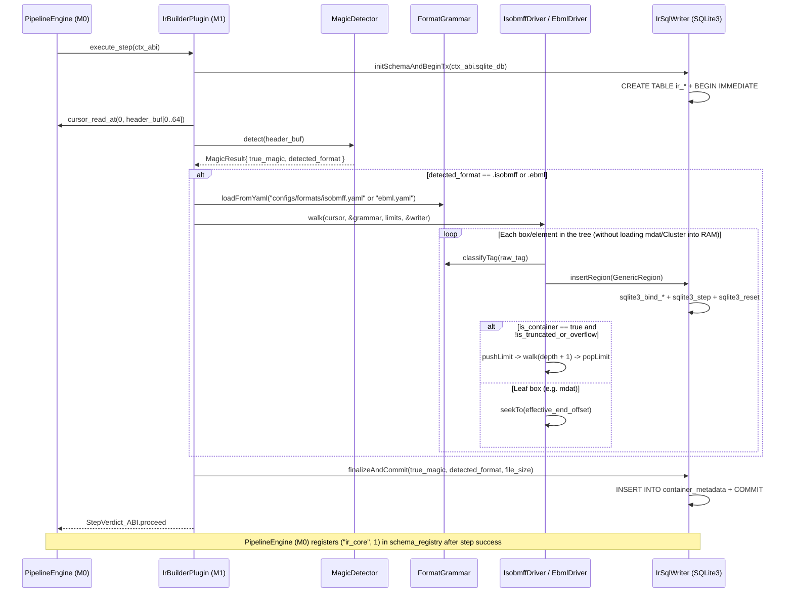

# Milestone M1 Specification: `ContainerIR` Reconstruction in SQLite, YAML Format Grammars, and Walkers (`ISOBMFF` + `EBML`)

> **Global Directives:** See [`../AGENTS.md`](../AGENTS.md) before implementing this milestone.

---

## 1. Functional Scope and Compatibility Contracts

### Milestone Objective
Implement the multi-format structural reconstruction subsystem (`M1`), compiled as a dynamic plugin under `zig-out/lib/plugins/parsers/libm1_ir_builder.so`. Its responsibilities are:
1. Detect the true magic signature of the file (`MagicKind`) in the first 64 bytes (`MZ`, `ELF`, `ISOBMFF`, `EBML`, `RIFF`, `MPEG_TS`, etc.).
2. Create in the `ctx.sqlite_db` instance the tables of the **`"ir_core"` (`v1`)** schema domain: `container_metadata` and `ir_regions` with their B-Tree indexes.
3. Load the declarative grammars for each enabled format from the optional `ctx.plugin_config_path_ptr` file (`configs/stages/m1_parsers.yaml` $\rightarrow$ `configs/formats/isobmff.yaml` and `configs/formats/ebml.yaml`).
4. Walk the box/element tree of **MP4/MOV (`ISOBMFF`)** and **MKV/WebM (`EBML`)** containers without copying into RAM, inserting each region into `ir_regions` within a single SQLite transaction (`BEGIN IMMEDIATE` ... `COMMIT`) using a reusable prepared statement (`sqlite3_stmt`).

### Plugin Versioning and Dependency Contract (`VidsecPluginABI`)
```zig
const required_schemas = [_]abi.SchemaContract_ABI{
    .{ .domain = "ir_core", .version = 1, .writable = true }, // M0 loads configs/schemas/ir_core_v1.sql and enables writing
};

export const vidsec_plugin_descriptor = abi.VidsecPluginABI{
    .abi_version = abi.VIDSEC_ABI_VERSION, // 1
    .plugin_id = "vidsec.m1.ir_builder",
    .plugin_version = .{ .major = 1, .minor = 0, .patch = 0 },
    .requires_schemas_ptr = &required_schemas,
    .requires_schemas_len = required_schemas.len,
    .requires_plugins_ptr = null,          // No prior plugin dependencies (Analysis root)
    .requires_plugins_len = 0,
    .execute_step = &IrBuilderPlugin.execute,
};
```

---

## 2. Milestone UML Architecture (`classDiagram`)


---

## 3. Zig Type Contracts and SQLite Schema (`DDL / Queries`)

### 3.A. Zig Types, Errors, and Structures (`src/core/ir_types.zig` and `src/m1_parsers/`)

```zig
const std = @import("std");

pub const IR_SCHEMA_VERSION: u32 = 1;

pub const MagicKind = enum(u8) {
    unknown = 0,
    isobmff_mp4_mov = 1,
    ebml_mkv_webm = 2,
    riff_avi_webp = 3,
    mpeg_ts = 4,
    // Hostile / spoofing signatures (evaluated by R01 in M2):
    pe_mz_executable = 10,
    elf_executable = 11,
    macho_executable = 12,
    script_shebang = 13,
    archive_zip_rar = 14,
    text_playlist_m3u_asx = 15,
};

pub const FormatKind = enum(u8) {
    unknown = 0,
    isobmff = 1,
    ebml = 2,
    riff = 3,
    mpeg_ts = 4,
};

pub const RegionRole = enum(u8) {
    container = 0,
    index_table = 1,
    media_payload = 2,
    metadata = 3,
    attachment = 4,
    padding = 5,
    external_ref = 6,
    codec_config = 7,
    unknown = 8,

    pub fn toText(self: RegionRole) [:0]const u8 {
        return switch (self) {
            .container => "container",
            .index_table => "index_table",
            .media_payload => "media_payload",
            .metadata => "metadata",
            .attachment => "attachment",
            .padding => "padding",
            .external_ref => "external_ref",
            .codec_config => "codec_config",
            .unknown => "unknown",
        };
    }
};

pub const GenericRegion = struct {
    tag_name: []const u8,
    symbolic_name: []const u8,
    role: RegionRole,
    header_offset: u64,
    payload_offset: u64,
    declared_payload_size: u64,
    parent_limit: u64,
    depth: u8,
    is_truncated_or_overflow: bool = false,
};

pub const DriverError = error{
    UnexpectedEof,
    IntegerOverflow,
    BoundsViolation,
    MaxDepthExceeded,
    MaxRegionsExceeded,
    InvalidVint,
    InvalidBoxSize,
    SqliteError,
    OutOfMemory,
};
```

---

### 3.B. SQLite DDL Bank `"ir_core"` (`configs/schemas/ir_core_v1.sql`)

When `vidsec.m1.ir_builder` (or any plugin requesting the `"ir_core"` v1 bank) is loaded, `M0` provisions the tables from `configs/schemas/ir_core_v1.sql`.
> [!TIP]
> **Natural *Nested Set* Property (`ADR-006`):** Instead of recursive `parent_region_id` pointers, the physical coordinates `header_offset`, `payload_offset`, and `effective_end_offset` act as a natural *Nested Set*: any child box (`stco`, `stsz`, `tkhd`, `avcC`) belongs to a `trak` track if and only if `child.header_offset >= trak.payload_offset AND child.effective_end_offset <= trak.effective_end_offset`.

```sql
-- 1. Global header of the analyzed container (1 single row)
CREATE TABLE IF NOT EXISTS container_metadata (
    id INTEGER PRIMARY KEY CHECK (id = 1),
    true_magic INTEGER NOT NULL,                -- MagicKind enum (e.g. 1=isobmff, 10=pe_mz_executable)
    true_magic_name TEXT NOT NULL,              -- E.g. "isobmff_mp4_mov", "pe_mz_executable"
    detected_format INTEGER NOT NULL,           -- FormatKind enum (0=unknown, 1=isobmff, 2=ebml, 3=riff)
    file_size INTEGER NOT NULL,
    highest_root_end_offset INTEGER NOT NULL,   -- End of the last valid root region (depth = 0)
    total_regions INTEGER NOT NULL
);

-- 2. Universal tree of regions/boxes/elements (ISOBMFF, EBML, RIFF)
CREATE TABLE IF NOT EXISTS ir_regions (
    region_id INTEGER PRIMARY KEY AUTOINCREMENT,
    tag_name TEXT NOT NULL,                     -- E.g. "moov", "stsz" (MP4) | "18538067", "EC" (MKV)
    symbolic_name TEXT NOT NULL,                -- E.g. "MovieBox", "SampleSizeBox", "Segment", "Void"
    role TEXT NOT NULL,                         -- "container", "index_table", "media_payload", "padding", etc.
    header_offset INTEGER NOT NULL,
    payload_offset INTEGER NOT NULL,
    declared_payload_size INTEGER NOT NULL,
    effective_end_offset INTEGER NOT NULL,      -- min(payload_offset + declared_payload_size, parent_limit)
    parent_limit INTEGER NOT NULL,
    depth INTEGER NOT NULL,
    is_truncated_or_overflow INTEGER NOT NULL   -- 0 = intact, 1 = overflows parent_limit / EOF / u64
);

-- B-Tree indexes to accelerate M2, M3, and M4 queries on large files:
CREATE INDEX IF NOT EXISTS idx_regions_role ON ir_regions(role);
CREATE INDEX IF NOT EXISTS idx_regions_overflow ON ir_regions(is_truncated_or_overflow) WHERE is_truncated_or_overflow = 1;
CREATE INDEX IF NOT EXISTS idx_regions_media_bounds ON ir_regions(payload_offset, effective_end_offset) WHERE role = 'media_payload';
```

#### Bulk Insert Prepared Statement in `M1` (`IrSqlWriter.insertRegion`)
```sql
INSERT INTO ir_regions (
    tag_name, symbolic_name, role,
    header_offset, payload_offset, declared_payload_size,
    effective_end_offset, parent_limit, depth, is_truncated_or_overflow
) VALUES (?1, ?2, ?3, ?4, ?5, ?6, ?7, ?8, ?9, ?10);
```

---

## 4. Memory Model, Arenas, and SQLite Transactions

| Resource / Structure | Owner / Storage | Lifetime | Who Frees / Closes |
| :--- | :--- | :--- | :--- |
| Container regions (`ir_regions`) and metadata (`container_metadata`) | SQLite tables in `ctx.sqlite_db` | Entire pipeline execution on the current file. | `StateDatabase.deinit()` in the `M0` engine. |
| Prepared statement `insert_region_stmt` (`*sqlite3_stmt`) | `IrSqlWriter` | Duration of `IrBuilderPlugin.execute`. | `sqlite3_finalize(stmt)` in `finalizeAndCommit()` or `rollbackAndDeinit()`. |
| YAML dictionaries (`FormatGrammar`) | Local `ArenaAllocator` inside `IrBuilderPlugin.execute` | Only during `IrBuilderPlugin.execute`. | `defer local_arena.deinit()`. |

### SQLite Performance and Security Invariants
- **Single Transaction and Deferred Indexes per Container:**
  1. `IrSqlWriter.initSchemaAndBeginTx` executes `BEGIN IMMEDIATE TRANSACTION;` and creates the `container_metadata` and `ir_regions` tables (without indexes yet).
  2. During the tree walk, it reuses the same `*sqlite3_stmt` by calling `sqlite3_bind_*` $\rightarrow$ `sqlite3_step` $\rightarrow$ `sqlite3_reset` $\rightarrow$ `sqlite3_clear_bindings`.
  3. At the end of the walk in `finalizeAndCommit`, it creates the B-Tree indexes (`idx_regions_role`, `idx_regions_overflow`, `idx_regions_media_bounds`), inserts the summary row into `container_metadata`, and executes `COMMIT;`. Building indexes at the end avoids rebalancing the B-Tree on every `INSERT` and enables dumping 100,000 regions into `:memory:` in under 15 ms with a constant RAM footprint.
- **Hard DoS Limits:**
  - `max_depth: u8 = 32`
  - `max_regions: u32 = 250_000` (if exceeded, performs `ROLLBACK` or partial commit with a critical finding and returns `StepVerdict_ABI.abort_threat`).

---

## 5. Algorithmic Flow (`sequenceDiagram`) and Edge Cases

### 5.1. Reconstruction Sequence in SQLite



### 5.2. Binary Traversal Rules (`IsobmffDriver` and `EbmlDriver`)
1. **`IsobmffDriver` (`.mp4`, `.mov`, `.m4v`):**
   - Supports `size32 == 1` (64-bit `largesize`, 16B header), `size32 == 0` (until `currentLimit()`), and `FullBox` (`fullbox_skip_bytes = 4` in boxes like `meta` according to `isobmff.yaml`).
   - If `size32 > 1 and size32 < 8` or if `payload_offset + declared_payload_size > cursor.currentLimit()`, inserts the row into `ir_regions` with `is_truncated_or_overflow = 1` and `effective_end_offset = cursor.currentLimit()`, and advances the cursor to `cursor.currentLimit()` without aborting the process.
2. **`EbmlDriver` (`.mkv`, `.webm`):**
   - Decodes `VINT` using `@clz(b0) + 1`.
   - In `Element ID`, preserves the marker bit and formats as uppercase Hex (`"1A45DFA3"`, `"18538067"`, `"EC"`).
   - In `Data Size`, clears the marker bit; if all data bits are `1` (*Unknown-Size*), uses `cursor.currentLimit()` as the bound.

---

## 6. Declaration in `pipeline.yaml` and Format Grammars (`configs/formats/*.yaml`)

### 6.1. Optional Plugin Configuration (`configs/stages/m1_parsers.yaml`)
Referenced in the `plugins:` block of `configs/pipeline.yaml` via `config: "configs/stages/m1_parsers.yaml"`:
```yaml
enabled_formats: "isobmff,ebml"
format_spec_isobmff: "configs/formats/isobmff.yaml"
format_spec_ebml: "configs/formats/ebml.yaml"
```
*(The dictionaries `configs/formats/isobmff.yaml` and `configs/formats/ebml.yaml` maintain the declarative catalog `tag` $\rightarrow$ `name`, `role`, `container`, `fullbox_skip`.)*

---

## 7. Raw Binary Vectors and Acceptance Test Suite (`zig build test`)

### Test 1: `ISOBMFF` (`.mp4`) Reconstruction and SQL Query on `ir_regions`
```zig
test "M1.1: IsobmffDriver populates ir_regions and container_metadata in SQLite" {
    const mp4_bytes = [_]u8{
        // ftyp (size = 16, role = metadata)
        0x00, 0x00, 0x00, 0x10, 'f', 't', 'y', 'p', 'i', 's', 'o', 'm', 0x00, 0x00, 0x02, 0x00,
        // moov (size = 32, role = container)
        0x00, 0x00, 0x00, 0x20, 'm', 'o', 'o', 'v',
        //   stsz (size = 16, depth = 1, role = index_table)
        0x00, 0x00, 0x00, 0x10, 's', 't', 's', 'z', 0x00, 0x00, 0x00, 0x00, 0x00, 0x00, 0x00, 0x00,
        //   free (size = 8, depth = 1, role = padding)
        0x00, 0x00, 0x00, 0x08, 'f', 'r', 'e', 'e',
        // mdat (size = 16, role = media_payload)
        0x00, 0x00, 0x00, 0x10, 'm', 'd', 'a', 't', 0xDE, 0xAD, 0xBE, 0xEF, 0xCA, 0xFE, 0xBA, 0xBE,
    };
    // Verification SQL queries on ctx.sqlite_db:
    // 1. SELECT true_magic_name, highest_root_end_offset, total_regions FROM container_metadata WHERE id = 1;
    //    -> ("isobmff_mp4_mov", 64, 5)
    // 2. SELECT COUNT(*) FROM ir_regions WHERE depth = 1 AND role = 'padding' AND tag_name = 'free';
    //    -> 1
    // 3. SELECT schema_version FROM schema_registry WHERE schema_domain = 'ir_core';
    //    -> 1
}
```

### Test 2: `EBML` (`.mkv`) Reconstruction in SQLite
```zig
test "M1.2: EbmlDriver decodes VINTs and populates ir_regions in SQLite" {
    const mkv_bytes = [_]u8{
        // EBMLHeader: ID=1A45DFA3, Size=0x84 (4B) -> DocType: ID=4282, Size=0x81 (1B), 'm'
        0x1A, 0x45, 0xDF, 0xA3, 0x84, 0x42, 0x82, 0x81, 'm',
        // Segment: ID=18538067, Size=0x90 (16B) -> Void (EC, 4B) + Cluster (1F43B675, 5B)
        0x18, 0x53, 0x80, 0x67, 0x90,
        0xEC, 0x84, 0x00, 0x00, 0x00, 0x00,
        0x1F, 0x43, 0xB6, 0x75, 0x85, 0xAA, 0xBB, 0xCC, 0xDD, 0xEE,
    };
    // Verification SQL query:
    // SELECT tag_name, role, depth FROM ir_regions ORDER BY region_id ASC;
    // -> ("1A45DFA3","container",0), ("4282","metadata",1), ("18538067","container",0), ("EC","padding",1), ("1F43B675","media_payload",1)
}
```

### Test 3: Overflow Recording (`is_truncated_or_overflow = 1`) in SQLite
```zig
test "M1.3: Overflowing child box is recorded in ir_regions with is_truncated_or_overflow = 1" {
    const malformed_mp4 = [_]u8{
        0x00, 0x00, 0x00, 0x10, 'm', 'o', 'o', 'v',
        0x00, 0x00, 0x27, 0x0F, 's', 't', 's', 'z', // declares 9999 bytes inside a 16-byte parent
    };
    // Verification SQL query:
    // SELECT tag_name, declared_payload_size, parent_limit, is_truncated_or_overflow
    // FROM ir_regions WHERE is_truncated_or_overflow = 1;
    // -> ("stsz", 9991, 16, 1)
}
```
