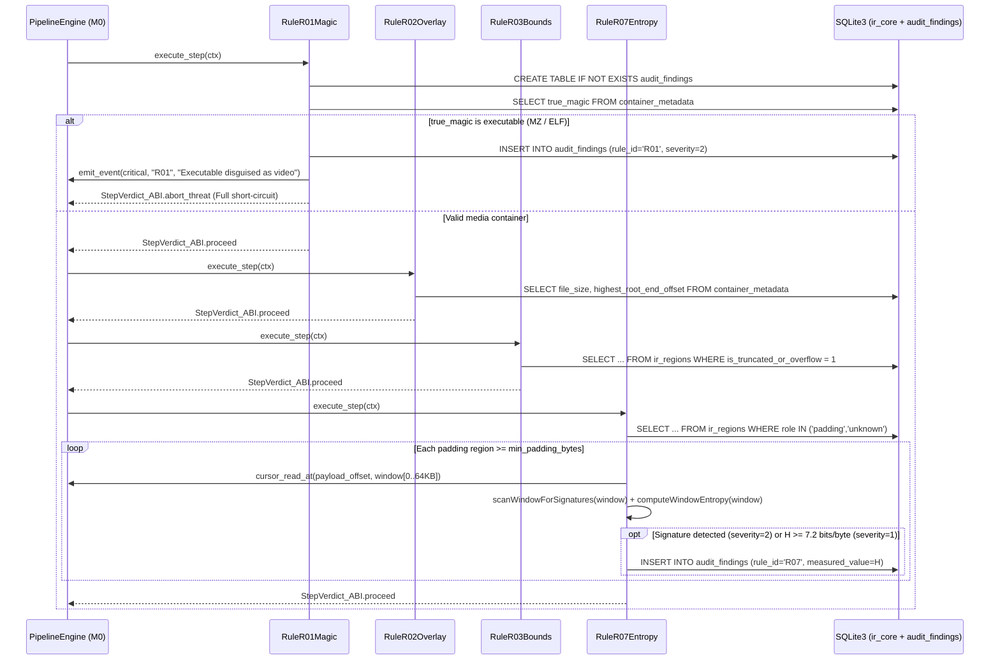

# Milestone M2 Specification: Structural and Heuristic Audit Sub-Pipeline (`R01`, `R02`, `R03`, `R07`) over SQLite

> **Global Directives:** See [`../AGENTS.md`](../AGENTS.md) before implementing this milestone.

---

## 1. Functional Scope and Compatibility Contracts

### Milestone Objective
Implement the first-line audit plugins (`M2`), compiled under `zig-out/lib/plugins/audit/`. This milestone introduces and owns the **`"audit_findings"` (`v1`)** SQLite schema domain, operating exclusively via parameterized SQL queries on the `"ir_core"` domain (`container_metadata` and `ir_regions`) generated by `M1` and targeted reads with `SafeCursor` for Shannon entropy calculation:
1. **`vidsec.m2.r01_magic` (`R01_MagicMismatch`):** Detects polyglot files or executables/scripts/compressed archives (`MZ`, `ELF`, `Mach-O`, `#!`, `ZIP/RAR`, `.m3u8`) disguised under a video extension.
2. **`vidsec.m2.r02_overlay` (`R02_TrailingData`):** Detects hidden data (*overlays*, such as `goloader` *file pumping* payloads) appended after the end of the last legitimate root region (`highest_root_end_offset < file_size`).
3. **`vidsec.m2.r03_bounds` (`R03_BoundsAnomaly`):** Detects truncated boxes or elements, or elements whose declared sizes overflow the boundary of their parent container (`is_truncated_or_overflow = 1`).
4. **`vidsec.m2.r07_entropy` (`R07_SuspiciousPadding` + Selective Signature Scanning):** Computes **Shannon entropy** ($H(X) \in [0.0, 8.0]$ bits/byte) across windows and runs a **lightweight binary signature scan (`SignatureScanner`)** exclusively over non-media regions with `role IN ('padding', 'unknown', 'metadata')` (`free`, `skip`, `uuid`, `Void`, `JUNK`, `udta`) and over *overlays* (`R02`), alerting on both encrypted/random payloads and executables or binaries (e.g., `MZ`, `ELF`, `Go buildinf:` from `goloader`) padded with zeros to evade entropy thresholds.

### Plugin Versioning and Dependency Contract (`VidsecPluginABI`)
```zig
const required_schemas = [_]abi.SchemaContract_ABI{
    .{ .domain = "ir_core", .version = 1, .writable = false },       // Read access to ir_regions / container_metadata
    .{ .domain = "audit_findings", .version = 1, .writable = true }, // M0 loads audit_findings_v1.sql and enables INSERT
};

const required_plugins = [_]abi.PluginDependency_ABI{
    .{ .plugin_id = "vidsec.m1.ir_builder", .min_version = .{ .major = 1, .minor = 0, .patch = 0 } },
};

// All M2 plugins (R01, R02, R03, R07) are symmetric and can be freely added or removed:
export const vidsec_plugin_descriptor = abi.VidsecPluginABI{
    .abi_version = abi.VIDSEC_ABI_VERSION,
    .plugin_id = "vidsec.m2.r01_magic",
    .plugin_version = .{ .major = 1, .minor = 0, .patch = 0 },
    .requires_schemas_ptr = &required_schemas,
    .requires_schemas_len = required_schemas.len,
    .requires_plugins_ptr = &required_plugins,
    .requires_plugins_len = required_plugins.len,
    .execute_step = &RuleR01Magic.execute,
};
```

---

## 2. Milestone UML Architecture (`classDiagram`)


---

## 3. Zig Type Contracts and SQLite Schema (`DDL / Queries`)

### 3.A. Types, Errors, Entropy, and Signature Scanner in Zig (`src/m2_audit/`)

```zig
const std = @import("std");
const abi = @import("../core/plugin_abi.zig");

pub const AuditSeverity = enum(u8) {
    info = 0,
    warning = 1,
    critical = 2,
};

pub const AuditFindingRow = struct {
    rule_id: [:0]const u8,
    severity: AuditSeverity,
    file_offset: u64,
    region_tag: [:0]const u8,
    measured_value: f64 = 0.0,
    message: [:0]const u8,
};

pub const SignatureMatch = struct {
    pattern_name: [:0]const u8, // E.g., "PE_DOS_STUB", "ELF_HEADER", "GO_BUILDINF", "SHELL_SCRIPT", "ARCHIVE_ZIP"
    relative_offset: usize,
};

/// Malware/executable patterns selectively searched in padding, metadata, or overlay regions.
/// Allows catching payloads (such as goloader) even if the attacker appends 0x00 blocks to lower average entropy.
pub const KNOWN_PAYLOAD_SIGNATURES = [_]struct { name: [:0]const u8, magic: []const u8 }{
    .{ .name = "PE_DOS_STUB", .magic = "This program cannot be run in DOS mode" },
    .{ .name = "PE_NT_HEADER", .magic = "PE\x00\x00" },
    .{ .name = "GO_BUILDINF", .magic = "\xff Go buildinf:" },
    .{ .name = "GO_RUNTIME_SYM", .magic = "runtime.main" },
    .{ .name = "ELF_HEADER", .magic = "\x7fELF" },
    .{ .name = "ARCHIVE_ZIP", .magic = "PK\x03\x04" },
    .{ .name = "ARCHIVE_RAR", .magic = "Rar!\x1a\x07" },
    .{ .name = "SCRIPT_POWERSHELL", .magic = "powershell" },
};

pub fn scanWindowForSignatures(buf: []const u8) ?SignatureMatch {
    for (KNOWN_PAYLOAD_SIGNATURES) |sig| {
        if (std.mem.indexOf(u8, buf, sig.magic)) |idx| {
            return .{ .pattern_name = sig.name, .relative_offset = idx };
        }
    }
    return null;
}

/// Computes Shannon entropy H(X) = - \sum P(b) * log2(P(b)) in bits per byte [0.0 .. 8.0].
pub fn computeWindowEntropy(buf: []const u8) f64 {
    if (buf.len == 0) return 0.0;
    var counts: [256]usize = [_]usize{0} ** 256;
    for (buf) |b| counts[b] += 1;

    const len_f: f64 = @floatFromInt(buf.len);
    var entropy: f64 = 0.0;
    for (counts) |c| {
        if (c > 0) {
            const p: f64 = @as(f64, @floatFromInt(c)) / len_f;
            entropy -= p * @log2(p);
        }
    }
    return entropy;
}
```

---

### 3.B. Produced SQLite Schema Contract and Queries (`"audit_findings"` `v1`)

#### 1. `audit_findings` Table DDL (`FindingsSqlHelper.ensureSchemaCreated`)
```sql
CREATE TABLE IF NOT EXISTS audit_findings (
    finding_id INTEGER PRIMARY KEY AUTOINCREMENT,
    rule_id TEXT NOT NULL,              -- "R01", "R02", "R03", "R07" (and "R04".."R06" in M3)
    severity INTEGER NOT NULL,          -- 0 = info, 1 = warning, 2 = critical
    file_offset INTEGER NOT NULL,
    region_tag TEXT NOT NULL,
    measured_value REAL NOT NULL DEFAULT 0.0,
    message TEXT NOT NULL
);

CREATE INDEX IF NOT EXISTS idx_audit_findings_severity ON audit_findings(severity);
CREATE INDEX IF NOT EXISTS idx_audit_findings_rule ON audit_findings(rule_id);
```

#### 2. Exact SQL Queries per Rule over `"ir_core"`
- **`R01_MagicMismatch`:**
  ```sql
  SELECT true_magic, true_magic_name, detected_format FROM container_metadata WHERE id = 1;
  ```
  - If `true_magic >= 10` (`pe_mz_executable`, `elf_executable`, `script_shebang`, etc.) or `detected_format == 0`: inserts a finding with `severity = 2 (critical)`, `rule_id = "R01"`, and returns `StepVerdict_ABI.abort_threat` (immediate short-circuit: a disguised executable never proceeds).
- **`R02_TrailingData`:**
  ```sql
  SELECT file_size, highest_root_end_offset FROM container_metadata WHERE id = 1;
  ```
  - If `file_size > highest_root_end_offset` and `highest_root_end_offset > 0`: computes `trailing_bytes = file_size - highest_root_end_offset`. If `trailing_bytes > max_allowed_trailing_bytes` (default `0` or `16` bytes configurable in YAML), reads the first `min(trailing_bytes, 65536)` bytes from `highest_root_end_offset` using `cursor_read_at`, computes its entropy, and inserts an `R02` finding (`severity = 2 (critical)` if it starts with `MZ`/`ELF` or exceeds `1024` bytes; `severity = 1 (warning)` if smaller).
- **`R03_BoundsAnomaly`:**
  ```sql
  SELECT tag_name, header_offset, declared_payload_size, parent_limit, depth
  FROM ir_regions
  WHERE is_truncated_or_overflow = 1
  ORDER BY header_offset ASC;
  ```
  - For each returned row, inserts an `R03` finding with `severity = 2 (critical)` detailing the arithmetic overflow against `parent_limit` (potential *Heap/Buffer Overflow* attempt in the demuxer).
- **`R07_SuspiciousPadding`:**
  ```sql
  SELECT tag_name, payload_offset, declared_payload_size, effective_end_offset
  FROM ir_regions
  WHERE role IN ('padding', 'unknown')
    AND (effective_end_offset - payload_offset) >= ?1
  ORDER BY payload_offset ASC;
  ```
  - Where `?1` is `min_padding_bytes` (default `256` bytes). For each region, reads sampling windows (`65536` bytes at the start, middle, and end of the region) using `ctx.cursor_read_at`, computes `H = computeWindowEntropy(slice)`, and invokes `scanWindowForSignatures(slice)`:
    - If `scanWindowForSignatures(slice)` returns a match (e.g., `"GO_BUILDINF"`, `"PE_DOS_STUB"`, `"ELF_HEADER"`): inserts an `R07` finding with `severity = 2 (critical)`, `file_offset = payload_offset + match.relative_offset`, and `measured_value = H` (detects malware hidden in `free`/`Void`/`JUNK` even when average entropy is low).
    - If no known signature is found but `H >= entropy_threshold` (default `7.2` bits/byte): inserts an `R07` finding with `severity = 1 (warning)` and `measured_value = H`.

---

## 4. Memory Model, Arenas, and SQLite Transactions

| Resource / Structure | Owner / Storage | Lifetime | Freed / Closed By |
| :--- | :--- | :--- | :--- |
| `audit_findings` table | `ctx.sqlite_db` | Entire pipeline execution. | `StateDatabase.deinit()` in `M0`. |
| Entropy window buffer (`64 KB`) in `R07` | Static stack buffer or local `ArenaAllocator` in `RuleR07Entropy.execute` | Only during `RuleR07Entropy.execute`. | Upon returning from `execute`. |
| `SELECT` and `INSERT` statements (`*sqlite3_stmt`) | Each plugin `R01`, `R02`, `R03`, `R07` | Only during its `execute_step` call. | `defer sqlite3_finalize(stmt)`. |

---

## 5. Algorithmic Flow (`sequenceDiagram`) and Edge Cases



### Mandatory Edge Cases Table
1. **Legitimate `free`/`Void` region filled with `0x00` or `0xFF`:** `computeWindowEntropy` returns `0.0` bits/byte ($< 7.2$), producing `0` false positives.
2. **10 GB `free` region in a crafted container:** `R07` bounds reads to sampling windows (start, middle, and end of the region, at most `3 * 64 KB = 192 KB` total) so analysis takes $< 1\text{ ms}$ and never reads 10 GB into RAM.
3. **Empty file (`file_size == 0`) or smaller than 8 bytes:** `R01` detects `true_magic == .unknown` and records a finding without division by zero.

---

## 6. Declaration in `configs/pipeline.yaml`

```yaml
plugins:
  - id: "vidsec.m2.r01_magic"
    path: "./zig-out/lib/plugins/audit/libr01_magic.so"
  - id: "vidsec.m2.r02_overlay"
    path: "./zig-out/lib/plugins/audit/libr02_overlay.so"
  - id: "vidsec.m2.r03_bounds"
    path: "./zig-out/lib/plugins/audit/libr03_bounds.so"
  - id: "vidsec.m2.r07_entropy"
    path: "./zig-out/lib/plugins/audit/libr07_entropy.so"

# Phase 2 subtree in pipeline.yaml:
- group: "Phase2_StructuralAndHeuristicAudit"
  policy: "run_all"
  steps:
    - group: "StructuralAudit"
      policy: "run_all"
      steps:
        - step: "CheckMagicMismatch"
          plugin: "vidsec.m2.r01_magic"
        - step: "CheckTrailingOverlay"
          plugin: "vidsec.m2.r02_overlay"
          params:
            max_allowed_trailing_bytes: "0"
        - step: "CheckBoundsAnomaly"
          plugin: "vidsec.m2.r03_bounds"
    - group: "HeuristicAudit"
      policy: "run_all"
      steps:
        - step: "CheckPaddingEntropy"
          plugin: "vidsec.m2.r07_entropy"
          params:
            min_padding_bytes: "64"
            entropy_threshold: "7.2"
```

---

## 7. Raw Binary Vectors and Acceptance Test Suite (`zig build test`)

### Test 1: Detection and Short-Circuit of Disguised Windows Executable (`MZ`) (`R01`)
```zig
test "M2.1: R01 detects PE MZ header disguised as MP4 and returns abort_threat" {
    const fake_mp4_exe = [_]u8{
        'M', 'Z', 0x90, 0x00, 0x03, 0x00, 0x00, 0x00,
        0x04, 0x00, 0x00, 0x00, 0xFF, 0xFF, 0x00, 0x00,
    };
    // After running M1 -> R01:
    // 1. The verdict returned by R01 is StepVerdict_ABI.abort_threat.
    // 2. SELECT rule_id, severity FROM audit_findings; -> ("R01", 2).
}
```

### Test 2: Detection of Overlay Injected at End of File (`R02`) and Overflow (`R03`)
```zig
test "M2.2: R02 detects trailing overlay after mdat and R03 detects overflowing child box" {
    // MP4 container where 'ftyp' (16B) + 'mdat' (16B) end at byte 32,
    // but the file is 48 bytes long (16 extra overlay bytes at the end).
    const mp4_with_overlay = [_]u8{
        0x00, 0x00, 0x00, 0x10, 'f', 't', 'y', 'p', 'i', 's', 'o', 'm', 0x00, 0x00, 0x00, 0x00,
        0x00, 0x00, 0x00, 0x10, 'm', 'd', 'a', 't', 0x01, 0x02, 0x03, 0x04, 0x05, 0x06, 0x07, 0x08,
        // Hidden overlay at offset 32..48:
        'M', 'Z', 0xFA, 0xCE, 0xDE, 0xAD, 0xBE, 0xEF, 0xCA, 0xFE, 0xBA, 0xBE, 0x11, 0x22, 0x33, 0x44,
    };
    // Verify in SQLite:
    // SELECT rule_id, file_offset, severity FROM audit_findings WHERE rule_id = 'R02';
    // -> ("R02", 32, 2)
}
```

### Test 3: Shannon Entropy and Signature Scanning in `free` Box (`R07`: Legitimate Zeros vs Encrypted Payload vs Low-Entropy Signature)
- Generates three MP4 buffers with a `264`-byte `free` box (`8B` header + `256B` payload):
  - **Buffer A (Clean):** All 256 bytes of `free` are `0x00`. Verifies `0` rows in `audit_findings`.
  - **Buffer B (Encrypted Payload):** The 256 bytes of `free` are the permutation `0x00..0xFF` ($H(X) = 8.0$ bits/byte). Verifies that `SELECT rule_id, severity, measured_value FROM audit_findings WHERE rule_id = 'R07'` returns `("R07", 1, 8.0)`.
  - **Buffer C (Entropy Evasion with `Go buildinf:` Signature):** All 256 bytes of `free` are `0x00` ($H(X) < 1.5$ bits/byte) except the first 16 bytes, which contain `"\xff Go buildinf:"`. Verifies that `SignatureScanner` detects it and inserts `("R07", 2, ...)` with critical severity (`2`).
