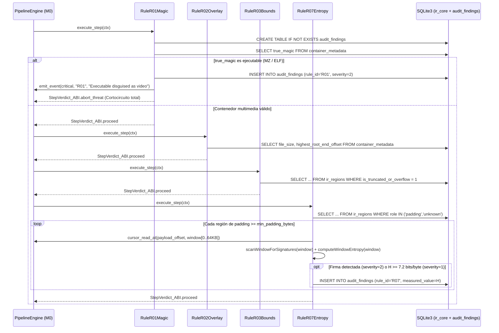

# Especificación de Hito M2: Sub-Pipeline de Auditoría Estructural y Heurística (`R01`, `R02`, `R03`, `R07`) sobre SQLite

> **Directivas Globales:** Ver [`../AGENTS.md`](../AGENTS.md) antes de implementar este hito.

---

## 1. Alcance Funcional y Contratos de Compatibilidad

### Objetivo del Hito
Implementar los plugins de auditoría de primera línea (`M2`), compilados bajo `zig-out/lib/plugins/audit/`. Este hito introduce y es propietario del dominio de esquema SQLite **`"audit_findings"` (`v1`)**, operando exclusivamente mediante consultas SQL parametrizadas sobre el dominio `"ir_core"` (`container_metadata` e `ir_regions`) generado por `M1` y lecturas puntuales con `SafeCursor` para el cálculo de entropía de Shannon:
1. **`vidsec.m2.r01_magic` (`R01_MagicMismatch`):** Detecta archivos poliglotos o ejecutables/scripts/archivos comprimidos (`MZ`, `ELF`, `Mach-O`, `#!`, `ZIP/RAR`, `.m3u8`) camuflados bajo extensión de vídeo.
2. **`vidsec.m2.r02_overlay` (`R02_TrailingData`):** Detecta datos ocultos (*overlays*, como el payload de *file pumping* de `goloader`) añadidos tras el final de la última región raíz legítima (`highest_root_end_offset < file_size`).
3. **`vidsec.m2.r03_bounds` (`R03_BoundsAnomaly`):** Detecta cajas o elementos truncados o cuyos tamaños declarados desbordan el límite de su contenedor padre (`is_truncated_or_overflow = 1`).
4. **`vidsec.m2.r07_entropy` (`R07_SuspiciousPadding` + Escaneo Selectivo de Firmas):** Calcula la **entropía de Shannon** ($H(X) \in [0.0, 8.0]$ bits/byte) por ventanas y ejecuta un **escaneo ligero de firmas binarias (`SignatureScanner`)** exclusivamente sobre las regiones no-multimedia con `role IN ('padding', 'unknown', 'metadata')` (`free`, `skip`, `uuid`, `Void`, `JUNK`, `udta`) y sobre los *overlays* (`R02`), alertando tanto ante payloads cifrados/aleatorios como ante ejecutables o binarios (ej. `MZ`, `ELF`, `Go buildinf:` de `goloader`) ocultos con relleno de ceros para evadir umbrales de entropía.

### Contrato de Versionado y Dependencias de los Plugins (`VidsecPluginABI`)
```zig
const required_schemas = [_]abi.SchemaContract_ABI{
    .{ .domain = "ir_core", .version = 1, .writable = false },       // Lectura sobre ir_regions / container_metadata
    .{ .domain = "audit_findings", .version = 1, .writable = true }, // M0 carga audit_findings_v1.sql y habilita INSERT
};

const required_plugins = [_]abi.PluginDependency_ABI{
    .{ .plugin_id = "vidsec.m1.ir_builder", .min_version = .{ .major = 1, .minor = 0, .patch = 0 } },
};

// Todos los plugins de M2 (R01, R02, R03, R07) son simétricos y pueden quitarse/ponerse libremente:
export const vidsec_plugin_descriptor = abi.VidsecPluginABI{
    .abi_version = abi.VIDSEC_ABI_VERSION,
    .plugin_id = "vidsec.m2.r01_magic",
    .plugin_version = .{ .major = 1, .minor = 0, .patch = 0 },
    .requires_schemas_ptr = &required_schemas,
    .requires_schemas_len = required_schemas.len,
    .requires_plugins_ptr = &required_plugins,
    .requires_plugins_len = required_plugins.len,
    .execute_step = &RuleR01Magic.execute,
};
```

---

## 2. Arquitectura UML del Hito (`classDiagram`)

```mermaid
classDiagram
    direction TB

    class VidsecPluginABI["src/core/plugin_abi.zig :: VidsecPluginABI"] {
        <<extern struct (C-ABI)>>
        +abi_version: u32
        +plugin_id: [*:0]const u8
        +plugin_version: SemVer_ABI
        +requires_schemas_ptr: ?[*]const SchemaContract_ABI
        +requires_schemas_len: usize
        +requires_plugins_ptr: ?[*]const PluginDependency_ABI
        +requires_plugins_len: usize
        +execute_step(ctx: *PipelineContext_ABI) callconv(.C) StepVerdict_ABI
    }

    class FindingsSqlHelper["src/m2_audit/findings_sql.zig :: FindingsSqlHelper"] {
        +ensureSchemaCreated(db: *sqlite3) SqlError!void
        +insertFinding(ctx: *PipelineContext_ABI, f: AuditFindingRow) SqlError!void
    }

    class ShannonEntropy["src/m2_audit/entropy.zig :: ShannonEntropy"] {
        +computeWindowEntropy(bytes: []const u8) f64
        +scanRegionEntropy(ctx: *PipelineContext_ABI, offset: u64, size: u64, max_window: usize) !f64
    }

    class SignatureScanner["src/m2_audit/signature_scanner.zig :: SignatureScanner"] {
        +scanWindowForSignatures(bytes: []const u8) ?SignatureMatch
    }

    class RuleR01Magic["src/m2_audit/r01_magic.zig :: RuleR01Magic"] {
        +execute(ctx: *PipelineContext_ABI) callconv(.C) StepVerdict_ABI
    }

    class RuleR02Overlay["src/m2_audit/r02_overlay.zig :: RuleR02Overlay"] {
        +execute(ctx: *PipelineContext_ABI) callconv(.C) StepVerdict_ABI
    }

    class RuleR03Bounds["src/m2_audit/r03_bounds.zig :: RuleR03Bounds"] {
        +execute(ctx: *PipelineContext_ABI) callconv(.C) StepVerdict_ABI
    }

    class RuleR07Entropy["src/m2_audit/r07_entropy.zig :: RuleR07Entropy"] {
        +execute(ctx: *PipelineContext_ABI) callconv(.C) StepVerdict_ABI
    }

    RuleR01Magic ..|> VidsecPluginABI
    RuleR02Overlay ..|> VidsecPluginABI
    RuleR03Bounds ..|> VidsecPluginABI
    RuleR07Entropy ..|> VidsecPluginABI
    RuleR01Magic --> FindingsSqlHelper : creates & inserts audit_findings
    RuleR02Overlay --> FindingsSqlHelper : inserts audit_findings
    RuleR02Overlay --> SignatureScanner : scans trailing overlay bytes
    RuleR03Bounds --> FindingsSqlHelper : inserts audit_findings
    RuleR07Entropy --> ShannonEntropy : computes H(X)
    RuleR07Entropy --> SignatureScanner : detects MZ/ELF/Go buildinf in padding
    RuleR07Entropy --> FindingsSqlHelper : inserts audit_findings
```



---

## 3. Contratos de Tipos en Zig y Esquema SQLite (`DDL / Queries`)

### 3.A. Tipos, Errores, Entropía y Escáner de Firmas en Zig (`src/m2_audit/`)

```zig
const std = @import("std");
const abi = @import("../core/plugin_abi.zig");

pub const AuditSeverity = enum(u8) {
    info = 0,
    warning = 1,
    critical = 2,
};

pub const AuditFindingRow = struct {
    rule_id: [:0]const u8,
    severity: AuditSeverity,
    file_offset: u64,
    region_tag: [:0]const u8,
    measured_value: f64 = 0.0,
    message: [:0]const u8,
};

pub const SignatureMatch = struct {
    pattern_name: [:0]const u8, // Ej: "PE_DOS_STUB", "ELF_HEADER", "GO_BUILDINF", "SHELL_SCRIPT", "ARCHIVE_ZIP"
    relative_offset: usize,
};

/// Patrones de malware/ejecutables buscados selectivamente en regiones de padding, metadatos u overlays.
/// Permite cazar payloads (como goloader) incluso si el atacante añade bloques de 0x00 para reducir la entropía media.
pub const KNOWN_PAYLOAD_SIGNATURES = [_]struct { name: [:0]const u8, magic: []const u8 }{
    .{ .name = "PE_DOS_STUB", .magic = "This program cannot be run in DOS mode" },
    .{ .name = "PE_NT_HEADER", .magic = "PE\x00\x00" },
    .{ .name = "GO_BUILDINF", .magic = "\xff Go buildinf:" },
    .{ .name = "GO_RUNTIME_SYM", .magic = "runtime.main" },
    .{ .name = "ELF_HEADER", .magic = "\x7fELF" },
    .{ .name = "ARCHIVE_ZIP", .magic = "PK\x03\x04" },
    .{ .name = "ARCHIVE_RAR", .magic = "Rar!\x1a\x07" },
    .{ .name = "SCRIPT_POWERSHELL", .magic = "powershell" },
};

pub fn scanWindowForSignatures(buf: []const u8) ?SignatureMatch {
    for (KNOWN_PAYLOAD_SIGNATURES) |sig| {
        if (std.mem.indexOf(u8, buf, sig.magic)) |idx| {
            return .{ .pattern_name = sig.name, .relative_offset = idx };
        }
    }
    return null;
}

/// Calcula la entropía de Shannon H(X) = - \sum P(b) * log2(P(b)) en bits por byte [0.0 .. 8.0].
pub fn computeWindowEntropy(buf: []const u8) f64 {
    if (buf.len == 0) return 0.0;
    var counts: [256]usize = [_]usize{0} ** 256;
    for (buf) |b| counts[b] += 1;

    const len_f: f64 = @floatFromInt(buf.len);
    var entropy: f64 = 0.0;
    for (counts) |c| {
        if (c > 0) {
            const p: f64 = @as(f64, @floatFromInt(c)) / len_f;
            entropy -= p * @log2(p);
        }
    }
    return entropy;
}
```

---

### 3.B. Contrato de Esquema SQLite Producido y Consultas (`"audit_findings"` `v1`)

#### 1. DDL de la Tabla `audit_findings` (`FindingsSqlHelper.ensureSchemaCreated`)
```sql
CREATE TABLE IF NOT EXISTS audit_findings (
    finding_id INTEGER PRIMARY KEY AUTOINCREMENT,
    rule_id TEXT NOT NULL,              -- "R01", "R02", "R03", "R07" (y "R04".."R06" en M3)
    severity INTEGER NOT NULL,          -- 0 = info, 1 = warning, 2 = critical
    file_offset INTEGER NOT NULL,
    region_tag TEXT NOT NULL,
    measured_value REAL NOT NULL DEFAULT 0.0,
    message TEXT NOT NULL
);

CREATE INDEX IF NOT EXISTS idx_audit_findings_severity ON audit_findings(severity);
CREATE INDEX IF NOT EXISTS idx_audit_findings_rule ON audit_findings(rule_id);
```

#### 2. Consultas SQL Exactas por Regla sobre `"ir_core"`
- **`R01_MagicMismatch`:**
  ```sql
  SELECT true_magic, true_magic_name, detected_format FROM container_metadata WHERE id = 1;
  ```
  - Si `true_magic >= 10` (`pe_mz_executable`, `elf_executable`, `script_shebang`, etc.) o `detected_format == 0`: inserta hallazgo con `severity = 2 (critical)`, `rule_id = "R01"`, y devuelve `StepVerdict_ABI.abort_threat` (cortocircuito inmediato: un ejecutable camuflado jamás sigue adelante).
- **`R02_TrailingData`:**
  ```sql
  SELECT file_size, highest_root_end_offset FROM container_metadata WHERE id = 1;
  ```
  - Si `file_size > highest_root_end_offset` y `highest_root_end_offset > 0`: calcula `trailing_bytes = file_size - highest_root_end_offset`. Si `trailing_bytes > max_allowed_trailing_bytes` (por defecto `0` o `16` bytes configurables en YAML), lee los primeros `min(trailing_bytes, 65536)` bytes desde `highest_root_end_offset` con `cursor_read_at`, calcula su entropía, e inserta hallazgo `R02` (`severity = 2 (critical)` si empieza por `MZ`/`ELF` o supera `1024` bytes; `severity = 1 (warning)` si es menor).
- **`R03_BoundsAnomaly`:**
  ```sql
  SELECT tag_name, header_offset, declared_payload_size, parent_limit, depth
  FROM ir_regions
  WHERE is_truncated_or_overflow = 1
  ORDER BY header_offset ASC;
  ```
  - Por cada fila devuelta, inserta un hallazgo `R03` con `severity = 2 (critical)` detallando el desbordamiento aritmético respecto a `parent_limit` (posible intento de *Heap/Buffer Overflow* en el demuxer).
- **`R07_SuspiciousPadding`:**
  ```sql
  SELECT tag_name, payload_offset, declared_payload_size, effective_end_offset
  FROM ir_regions
  WHERE role IN ('padding', 'unknown')
    AND (effective_end_offset - payload_offset) >= ?1
  ORDER BY payload_offset ASC;
  ```
  - Donde `?1` es `min_padding_bytes` (por defecto `256` bytes). Para cada región, lee ventanas de muestreo (`65536` bytes en inicio, mitad y final de la región) usando `ctx.cursor_read_at`, calcula `H = computeWindowEntropy(slice)` e invoca `scanWindowForSignatures(slice)`:
    - Si `scanWindowForSignatures(slice)` devuelve coincidencia (ej. `"GO_BUILDINF"`, `"PE_DOS_STUB"`, `"ELF_HEADER"`): inserta hallazgo `R07` con `severity = 2 (critical)`, `file_offset = payload_offset + match.relative_offset` y `measured_value = H` (detecta malware camuflado en `free`/`Void`/`JUNK` aunque tenga baja entropía media).
    - Si no hay firma conocida pero `H >= entropy_threshold` (por defecto `7.2` bits/byte): inserta hallazgo `R07` con `severity = 1 (warning)` y `measured_value = H`.

---

## 4. Modelo de Memoria, Arenas y Transacciones SQLite

| Recurso / Estructura | Propietario / Almacenamiento | Tiempo de Vida (Lifetime) | Quién libera / cierra |
| :--- | :--- | :--- | :--- |
| Tabla `audit_findings` | `ctx.sqlite_db` | Toda la ejecución del pipeline. | `StateDatabase.deinit()` en `M0`. |
| Buffer de ventana de entropía (`64 KB`) en `R07` | Buffer estático en pila o `ArenaAllocator` local de `RuleR07Entropy.execute` | Solo durante `RuleR07Entropy.execute`. | Al retornar de `execute`. |
| Sentencias `SELECT` y `INSERT` (`*sqlite3_stmt`) | Cada plugin `R01`, `R02`, `R03`, `R07` | Solo durante su llamada `execute_step`. | `defer sqlite3_finalize(stmt)`. |

---

## 5. Flujo Algorítmico (`sequenceDiagram`) y Casos Borde



### Tabla de Casos Borde (Edge Cases) Obligatorios
1. **Región `free`/`Void` rellena de `0x00` o `0xFF` legítima:** `computeWindowEntropy` devuelve `0.0` bits/byte ($< 7.2$), generando `0` falsos positivos.
2. **Región `free` de 10 GB en un contenedor manipulado:** `R07` acota la lectura a ventanas de muestreo (inicio, mitad y final de la región, máximo `3 * 64 KB = 192 KB` en total) para que el análisis tarde $< 1\text{ ms}$ y nunca lea 10 GB en RAM.
3. **Archivo vacío (`file_size == 0`) o menor de 8 bytes:** `R01` detecta `true_magic == .unknown` y registra hallazgo sin división por cero.

---

## 6. Declaración en `configs/pipeline.yaml`

```yaml
plugins:
  - id: "vidsec.m2.r01_magic"
    path: "./zig-out/lib/plugins/audit/libr01_magic.so"
  - id: "vidsec.m2.r02_overlay"
    path: "./zig-out/lib/plugins/audit/libr02_overlay.so"
  - id: "vidsec.m2.r03_bounds"
    path: "./zig-out/lib/plugins/audit/libr03_bounds.so"
  - id: "vidsec.m2.r07_entropy"
    path: "./zig-out/lib/plugins/audit/libr07_entropy.so"

# Sub-árbol de la Fase 2 en pipeline.yaml:
- group: "Phase2_StructuralAndHeuristicAudit"
  policy: "run_all"
  steps:
    - group: "StructuralAudit"
      policy: "run_all"
      steps:
        - step: "CheckMagicMismatch"
          plugin: "vidsec.m2.r01_magic"
        - step: "CheckTrailingOverlay"
          plugin: "vidsec.m2.r02_overlay"
          params:
            max_allowed_trailing_bytes: "0"
        - step: "CheckBoundsAnomaly"
          plugin: "vidsec.m2.r03_bounds"
    - group: "HeuristicAudit"
      policy: "run_all"
      steps:
        - step: "CheckPaddingEntropy"
          plugin: "vidsec.m2.r07_entropy"
          params:
            min_padding_bytes: "64"
            entropy_threshold: "7.2"
```

---

## 7. Vectores Binarios en Crudo y Suite de Tests de Aceptación (`zig build test`)

### Test 1: Detección y Cortocircuito de Ejecutable Windows (`MZ`) Camuflado (`R01`)
```zig
test "M2.1: R01 detects PE MZ header disguised as MP4 and returns abort_threat" {
    const fake_mp4_exe = [_]u8{
        'M', 'Z', 0x90, 0x00, 0x03, 0x00, 0x00, 0x00,
        0x04, 0x00, 0x00, 0x00, 0xFF, 0xFF, 0x00, 0x00,
    };
    // Tras ejecutar M1 -> R01:
    // 1. El veredicto devuelto por R01 es StepVerdict_ABI.abort_threat.
    // 2. SELECT rule_id, severity FROM audit_findings; -> ("R01", 2).
}
```

### Test 2: Detección de Overlay Inyectado al Final del Archivo (`R02`) y Desbordamiento (`R03`)
```zig
test "M2.2: R02 detects trailing overlay after mdat and R03 detects overflowing child box" {
    // Contenedor MP4 donde 'ftyp' (16B) + 'mdat' (16B) terminan en el byte 32,
    // pero el archivo mide 48 bytes (16 bytes extra de overlay al final).
    const mp4_with_overlay = [_]u8{
        0x00, 0x00, 0x00, 0x10, 'f', 't', 'y', 'p', 'i', 's', 'o', 'm', 0x00, 0x00, 0x00, 0x00,
        0x00, 0x00, 0x00, 0x10, 'm', 'd', 'a', 't', 0x01, 0x02, 0x03, 0x04, 0x05, 0x06, 0x07, 0x08,
        // Overlay oculto en offset 32..48:
        'M', 'Z', 0xFA, 0xCE, 0xDE, 0xAD, 0xBE, 0xEF, 0xCA, 0xFE, 0xBA, 0xBE, 0x11, 0x22, 0x33, 0x44,
    };
    // Verifica en SQLite:
    // SELECT rule_id, file_offset, severity FROM audit_findings WHERE rule_id = 'R02';
    // -> ("R02", 32, 2)
}
```

### Test 3: Entropía de Shannon y Escaneo de Firmas en Caja `free` (`R07`: Ceros Legítimos vs Payload Cifrado vs Firma con Baja Entropía)
- Genera tres buffers MP4 con una caja `free` de `264` bytes (`8B` cabecera + `256B` payload):
  - **Buffer A (Limpio):** Los 256 bytes de `free` son `0x00`. Verifica `0` filas en `audit_findings`.
  - **Buffer B (Payload Cifrado):** Los 256 bytes de `free` son la permutación `0x00..0xFF` ($H(X) = 8.0$ bits/byte). Verifica que `SELECT rule_id, severity, measured_value FROM audit_findings WHERE rule_id = 'R07'` devuelve `("R07", 1, 8.0)`.
  - **Buffer C (Evasión de Entropía con Firma `Go buildinf:`):** Los 256 bytes de `free` son todos `0x00` ($H(X) < 1.5$ bits/byte) salvo los primeros 16 bytes que contienen `"\xff Go buildinf:"`. Verifica que `SignatureScanner` lo detecta e inserta `("R07", 2, ...)` con severidad crítica (`2`).
