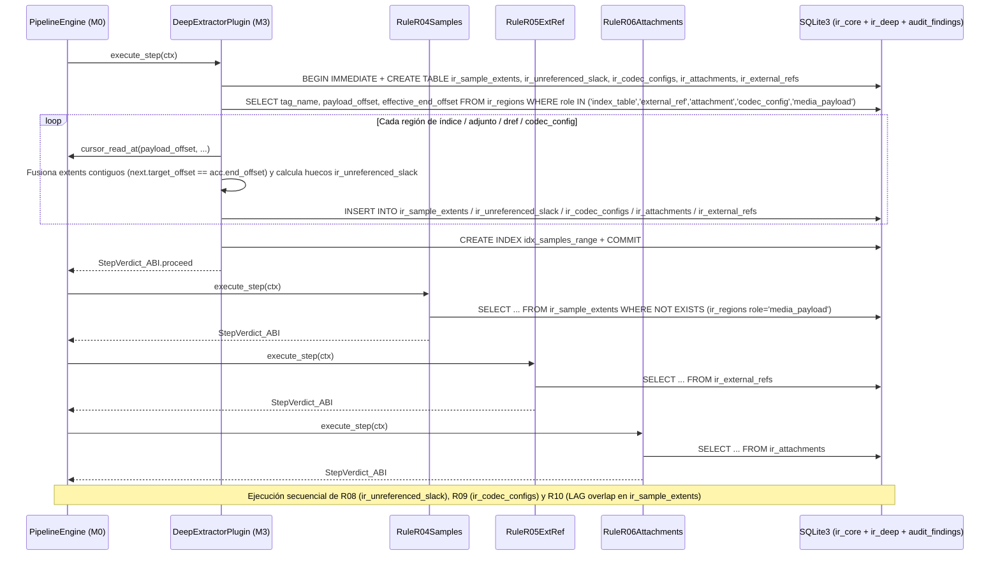

# Especificación de Hito M3: Inspección Profunda (`ir_deep`), Reglas `R04`–`R06` / `R08`–`R10` y 3er Driver (`RIFF / AVI`)

> **Directivas Globales:** Ver [`../AGENTS.md`](../AGENTS.md) antes de implementar este hito.

---

## 1. Alcance Funcional y Contratos de Compatibilidad

### Objetivo del Hito
Ampliar la capacidad de análisis de `vidsec` en dos ejes sin modificar una sola línea del motor (`M0`) ni de las reglas de `M2`:
1. **Crear el dominio de esquema SQLite `"ir_deep"` (`v1`)** mediante el plugin extractor `vidsec.m3.deep_extractor` (`libm3_deep_extractor.so`), que lee las regiones de `"ir_core"` (`index_table`, `attachment`, `external_ref`, `codec_config`, `media_payload`) y extrae a tablas relacionales indexadas:
   - `ir_sample_extents`: Punteros de muestras/frames desde `stsz` + `stco`/`co64` (MP4), `Cues` (MKV) e `idx1` (AVI).
   - `ir_unreferenced_slack`: Rangos de bytes dentro de regiones `role = 'media_payload'` (`mdat`, `LIST:movi`, `Cluster`) que **no están referenciados por ninguna muestra** (*slack space* donde un atacante puede esconder gigabytes de *file pumping* / ejecutables sin disparar `R02` ni `R07`).
   - `ir_codec_configs`: Parámetros de dimensiones y cabeceras de códec (`tkhd` vs `avcC`/`hvcC` SPS en MP4, `PixelWidth`/`Height` vs `CodecPrivate` en MKV, `strh` vs `strf` `BITMAPINFOHEADER` en AVI).
   - `ir_attachments`: Archivos incrustados en `Attachments`/`AttachedFile` (MKV), incluyendo sus primeros 16 *magic bytes* reales.
   - `ir_external_refs`: Referencias de red o sistema de archivos en `dref` (`url `/`urn ` en MP4) o `NextFilename` (MKV).
2. **Implementar las 6 reglas universales de integridad profunda** (bajo `zig-out/lib/plugins/audit/`):
   - **`vidsec.m3.r04_samples` (`R04_SampleTableOverflow`):** Verifica mediante consulta SQL cruzada que ningún frame en `ir_sample_extents` apunte fuera de las regiones con `role = 'media_payload'` (`mdat`, `Cluster`, `movi`).
   - **`vidsec.m3.r05_extref` (`R05_ExternalDataRef`):** Alerta ante cualquier URI externa en `ir_external_refs` (prevención de SSRF, robo de hashes NTLM por SMB `\\` o lectura de archivos locales `file://`).
   - **`vidsec.m3.r06_attachments` (`R06_EmbeddedAttachments`):** Inspecciona `ir_attachments` alertando sobre fuentes tipográficas (`.ttf`/`.otf`, superficie frecuente de exploits en `libass`/`freetype`) o ejecutables/scripts adjuntos.
   - **`vidsec.m3.r08_media_slack` (`R08_UnreferencedMediaSlack`):** Detecta regiones huérfanas o colas de *file pumping* dentro de `mdat`/`movi` (`ir_unreferenced_slack`), calcula su entropía de Shannon y busca firmas de malware (`MZ`, `ELF`, `Go buildinf:`).
   - **`vidsec.m3.r09_codec_config` (`R09_CodecConfigMismatch`):** Detecta discrepancias entre la resolución declarada en la pista (`tkhd`/`strh`) y la resolución real en el bitstream del códec (`avcC`/`hvcC` SPS o `strf`), así como cabeceras `avcC`/`hvcC` truncadas (vectores clásicos de *Heap Overflow* tipo *Stagefright*).
   - **`vidsec.m3.r10_sample_overlap` (`R10_SampleOverlap`):** Detecta mediante función ventana SQL (`LAG`) si distintos extents de muestras se solapan en el mismo rango físico de bytes (bombas de descompresión multimedia o tablas `stco` manipuladas).
3. **Añadir el 3er Driver de Formato (`RIFF / AVI` en `src/m1_parsers/drivers/riff.zig` + `configs/formats/riff.yaml`):** Demostrando que todas las reglas de `M2` (`R01`–`R03`, `R07`) y `M3` (`R04`–`R06`, `R08`–`R10`) funcionan automáticamente sobre contenedores `.avi` sin tocar el código de ninguna regla.

### Contrato de Versionado y Dependencias de los Plugins (`VidsecPluginABI`)
- **`vidsec.m3.deep_extractor`:**
  - `requires_schemas`: `"ir_core"` (`version = 1, writable = false`), `"ir_deep"` (`version = 1, writable = true` $\rightarrow$ `M0` aprovisiona `configs/schemas/ir_deep_v1.sql`)
  - `requires_plugins` (Hard Dependency): `"vidsec.m1.ir_builder"` ($\ge 1.0.0$)
- **`vidsec.m3.r04_samples`, `r05_extref`, `r06_attachments`, `r08_media_slack`, `r09_codec_config`, `r10_sample_overlap`:**
  - `requires_schemas`: `"ir_core"` (`v1, writable = false`), `"ir_deep"` (`v1, writable = false`), `"audit_findings"` (`v1, writable = true`)
  - `requires_plugins` (Hard Dependency): `"vidsec.m3.deep_extractor"` ($\ge 1.0.0$)
- *(Nota: para agrupar cajas hijas como `tkhd`, `avcC`, `stsz` y `stco` bajo una misma pista `trak` sin usar punteros de inodos, `DeepExtractorPlugin` utiliza la propiedad de **Nested Set Natural por offsets** documentada en [`ADR-006`](../ADR/ADR-006_on_demand_ddl_banks_and_hard_plugin_dependencies.md): `child.header_offset >= trak.payload_offset AND child.effective_end_offset <= trak.effective_end_offset`).*

---

## 2. Arquitectura UML del Hito (`classDiagram`)


---

## 3. Contratos de Tipos en Zig y Esquema SQLite (`DDL / Queries`)

### 3.A. Especificación del Driver `RIFF / AVI` (`src/m1_parsers/drivers/riff.zig`)
Un archivo `RIFF` (`.avi`, `.webp`) codifica cada bloque en **Little-Endian**:
- `[FourCC: 4B ASCII][Size: u32 Little-Endian (`readU32Le`)][Payload]`.
- Si el `FourCC` es `"RIFF"` o `"LIST"`, los **primeros 4 bytes de su payload** son el `list_type` (`"AVI "`, `"hdrl"`, `"strl"`, `"movi"`, `"INFO"`). `RiffDriver` concatena el identificador como `"RIFF:AVI "` o `"LIST:movi"` para consultarlo en `configs/formats/riff.yaml`.
- **Alineación a byte par (Word Boundary Padding):** En la especificación RIFF, si `declared_payload_size` es impar (`size % 2 == 1`), el siguiente chunk hermano comienza `1 byte` después (`effective_end_offset + 1`).

---

### 3.B. Banco DDL SQLite `"ir_deep"` (`configs/schemas/ir_deep_v1.sql`)

#### 1. DDL de las Tablas `"ir_deep"` (`DeepExtractorPlugin`)
```sql
-- 1. Extents de muestras/chunks apuntados por las tablas de índices (stco/co64+stsz, Cues, idx1)
CREATE TABLE IF NOT EXISTS ir_sample_extents (
    sample_id INTEGER PRIMARY KEY AUTOINCREMENT,
    track_id INTEGER NOT NULL,
    source_tag TEXT NOT NULL,           -- "stco", "co64", "Cues", "idx1"
    target_offset INTEGER NOT NULL,
    sample_size INTEGER NOT NULL,
    end_offset INTEGER NOT NULL,        -- target_offset + sample_size
    has_arith_overflow INTEGER NOT NULL -- 1 si target_offset + sample_size desborda u64
);
CREATE INDEX IF NOT EXISTS idx_samples_range ON ir_sample_extents(target_offset, end_offset);

-- 2. Archivos adjuntos incrustados en el contenedor (ej. Attachments en Matroska)
CREATE TABLE IF NOT EXISTS ir_attachments (
    attachment_id INTEGER PRIMARY KEY AUTOINCREMENT,
    filename TEXT NOT NULL,
    mime_type TEXT NOT NULL,
    file_offset INTEGER NOT NULL,
    byte_size INTEGER NOT NULL,
    magic_hex TEXT NOT NULL             -- Primeros 16 bytes del payload en Hex mayúsculas
);

-- 3. Referencias a URIs o archivos externos (dref url/urn en MP4, NextFilename en MKV)
CREATE TABLE IF NOT EXISTS ir_external_refs (
    ref_id INTEGER PRIMARY KEY AUTOINCREMENT,
    source_tag TEXT NOT NULL,
    uri TEXT NOT NULL,
    file_offset INTEGER NOT NULL
);

-- 4. Huecos o colas no referenciadas dentro de regiones media_payload (mdat / movi / Cluster)
CREATE TABLE IF NOT EXISTS ir_unreferenced_slack (
    slack_id INTEGER PRIMARY KEY AUTOINCREMENT,
    parent_region_id INTEGER NOT NULL,
    region_tag TEXT NOT NULL,           -- "mdat", "LIST:movi", etc.
    start_offset INTEGER NOT NULL,
    end_offset INTEGER NOT NULL,
    byte_size INTEGER NOT NULL          -- end_offset - start_offset
);

-- 5. Coherencia de dimensiones y cabeceras de configuración de códec (tkhd vs avcC/hvcC, strh vs strf)
CREATE TABLE IF NOT EXISTS ir_codec_configs (
    config_id INTEGER PRIMARY KEY AUTOINCREMENT,
    track_id INTEGER NOT NULL,
    codec_tag TEXT NOT NULL,            -- "avcC", "hvcC", "vpcC", "strf", "CodecPrivate"
    container_width INTEGER NOT NULL,   -- Ancho declarado en tkhd / strh / TrackVideo
    container_height INTEGER NOT NULL,  -- Alto declarado en tkhd / strh / TrackVideo
    bitstream_width INTEGER NOT NULL,   -- Ancho extraído de SPS (avcC/hvcC) o BITMAPINFOHEADER (strf)
    bitstream_height INTEGER NOT NULL,  -- Alto extraído de SPS o BITMAPINFOHEADER
    is_header_malformed INTEGER NOT NULL, -- 1 si la cabecera SPS/avcC está truncada o tiene nal_length_size inválido
    file_offset INTEGER NOT NULL
);
```

#### 2. Consultas SQL Exactas de las Reglas `R04`–`R06` y `R08`–`R10`

- **`R04_SampleTableOverflow` (`vidsec.m3.r04_samples`):**
  Encuentra cualquier muestra en `ir_sample_extents` que tenga desbordamiento aritmético o cuyo rango `[target_offset, end_offset]` **no esté contenido** dentro de ninguna región `role = 'media_payload'` (`mdat` en MP4, `Cluster` en MKV, `LIST:movi` en AVI):
  ```sql
  SELECT s.sample_id, s.track_id, s.source_tag, s.target_offset, s.sample_size, s.has_arith_overflow
  FROM ir_sample_extents s
  WHERE s.has_arith_overflow = 1
     OR NOT EXISTS (
         SELECT 1 FROM ir_regions r
         WHERE r.role = 'media_payload'
           AND s.target_offset >= r.payload_offset
           AND s.end_offset <= r.effective_end_offset
     )
  LIMIT 100;
  ```
  - Por cada fila devuelta, inserta en `audit_findings` un hallazgo `rule_id = "R04"`, `severity = 2 (critical)` (intento clásico de lectura/escritura fuera de límites en el demuxer al apuntar `stco`/`stsz` hacia las propias cabeceras o fuera del archivo).

- **`R05_ExternalDataRef` (`vidsec.m3.r05_extref`):**
  ```sql
  SELECT source_tag, uri, file_offset FROM ir_external_refs WHERE length(trim(uri)) > 0;
  ```
  - Inserta hallazgo `rule_id = "R05"`, `severity = 2 (critical)` si la URI comienza por `http://`, `https://`, `file://`, `\\` (UNC/SMB) o contiene `../` (*path traversal*).

- **`R06_EmbeddedAttachments` (`vidsec.m3.r06_attachments`):**
  ```sql
  SELECT filename, mime_type, file_offset, byte_size, magic_hex FROM ir_attachments;
  ```
  - Si `magic_hex` empieza por `"4D5A"` (`MZ`), `"7F454C46"` (`ELF`), `"504B0304"` (`ZIP`) $\rightarrow$ `severity = 2 (critical)`.
  - Si `magic_hex` empieza por `"00010000"` o `"4F54544F"` (`OTTO`, fuentes `.ttf`/`.otf`) $\rightarrow$ `severity = 1 (warning)` advirtiendo que el contenedor incluye fuentes tipográficas renderizables que serán eliminadas en la fase de sanitización (`M4`).

- **`R08_UnreferencedMediaSlack` (`vidsec.m3.r08_media_slack`):**
  Detecta *file pumping* o ejecutables inyectados dentro de `mdat`/`LIST:movi` en espacio que ninguna pista de audio/vídeo referencia en `ir_sample_extents`:
  ```sql
  SELECT slack_id, region_tag, start_offset, end_offset, byte_size
  FROM ir_unreferenced_slack
  WHERE byte_size >= ?1
  ORDER BY start_offset ASC;
  ```
  - Donde `?1` es `min_slack_bytes` (por defecto `4096` bytes). Para cada hueco no referenciado, lee ventanas de muestreo con `ctx.cursor_read_at`, calcula la entropía de Shannon $H(X)$ y ejecuta `scanWindowForSignatures`:
    - Si contiene una firma ejecutable (`MZ`, `ELF`, `Go buildinf:`, etc.) $\rightarrow$ inserta hallazgo `rule_id = "R08"`, `severity = 2 (critical)`.
    - Si supera el umbral de tamaño o tiene alta entropía ($H(X) \ge 7.2$) $\rightarrow$ inserta hallazgo `rule_id = "R08"`, `severity = 1 (warning)` (que será extraído a cuarentena y puesto a `0x00` por `M4`).

- **`R09_CodecConfigMismatch` (`vidsec.m3.r09_codec_config`):**
  Detecta intentos de *Heap Buffer Overflow* por discrepancia entre las dimensiones de pista y el SPS del códec o cabeceras corruptas:
  ```sql
  SELECT track_id, codec_tag, container_width, container_height, bitstream_width, bitstream_height, is_header_malformed, file_offset
  FROM ir_codec_configs
  WHERE is_header_malformed = 1
     OR (container_width > 0 AND bitstream_width > 0 AND container_width != bitstream_width)
     OR (container_height > 0 AND bitstream_height > 0 AND container_height != bitstream_height);
  ```
  - Si `is_header_malformed == 1` o `bitstream_width > container_width` / `bitstream_height > container_height` (el decodificador escribiría fuera del frame buffer reservado según `tkhd`) $\rightarrow$ inserta hallazgo `rule_id = "R09"`, `severity = 2 (critical)`.

- **`R10_SampleOverlap` (`vidsec.m3.r10_sample_overlap`):**
  Detecta mediante función ventana SQL (`LAG`) si dos extents de muestras se solapan en disco (`target_offset < prev_end_offset`), previniendo bombas de descompresión multimedia (*zip-bombs* de vídeo donde miles de frames apuntan al mismo bloque de `mdat`):
  ```sql
  SELECT sample_id, track_id, source_tag, target_offset, end_offset, prev_end_offset
  FROM (
      SELECT sample_id, track_id, source_tag, target_offset, end_offset,
             LAG(end_offset) OVER (ORDER BY target_offset ASC, end_offset ASC) AS prev_end_offset
      FROM ir_sample_extents
      WHERE has_arith_overflow = 0
  )
  WHERE prev_end_offset IS NOT NULL AND target_offset < prev_end_offset
  LIMIT 100;
  ```
  - Por cada solapamiento detectado, inserta hallazgo `rule_id = "R10"`, `severity = 2 (critical)`.

---

## 4. Modelo de Memoria, Arenas y Transacciones SQLite

| Recurso / Estructura | Propietario / Almacenamiento | Tiempo de Vida (Lifetime) | Quién libera / cierra |
| :--- | :--- | :--- | :--- |
| Tablas `ir_sample_extents`, `ir_unreferenced_slack`, `ir_codec_configs`, `ir_attachments`, `ir_external_refs` | `ctx.sqlite_db` | Toda la ejecución del pipeline. | `StateDatabase.deinit()` en `M0`. |
| Cursores y buffers de parseo de `stsz`/`stco`/`avcC` | `ArenaAllocator` local de `DeepExtractorPlugin.execute` | Solo durante `DeepExtractorPlugin.execute`. | `defer local_arena.deinit()`. |

### Límites Duros contra DoS y Optimización de Inserción en `ir_sample_extents`
1. **Validación Física Previa (`MAX_SAMPLES_PER_TRACK: u32 = 2_000_000`):**
   - Si una caja `stsz` o `stco` fraudulenta declara `sample_count = 0xFFFFFFFF` (4.000 millones de muestras en un archivo de 1 MB), antes de iterar se comprueba con aritmética segura (`std.math.mul`) que la tabla declarada cabe físicamente dentro de `declared_payload_size` (`sample_count * 4 <= declared_payload_size` en `stco`/`stsz`, o `chunk_count * 8 <= declared_payload_size` en `co64`). Si no cabe o supera `MAX_SAMPLES_PER_TRACK`, se aborta la extracción de esa tabla y se inserta un registro con `has_arith_overflow = 1` para que `R04` dispare un hallazgo crítico (`severity = 2`).
2. **Coalescencia en Streaming de Muestras Contiguas (*Run-Length Extent Merging*):**
   - En un contenedor legítimo, miles de muestras consecutivas dentro de un mismo *chunk* (`stsc` + `stco`/`co64`) o *Cluster* son adyacentes en disco (`next.target_offset == current.end_offset`).
   - Dado que la condición geométrica de `R04` ($\text{target\_offset} \ge \text{payload\_offset} \land \text{end\_offset} \le \text{effective\_end\_offset}$) es convexa sobre intervalos contiguos, un intervalo fusionado $[A, C]$ está íntegramente contenido en una región `media_payload` **si y solo si** los sub-intervalos adyacentes $[A, B]$ y $[B, C]$ lo están.
   - Por tanto, `DeepExtractorPlugin` mantiene el último `SampleExtent` en un acumulador local antes de hacer `sqlite3_step`: si la siguiente muestra del mismo `track_id` y `source_tag` no tiene desbordamiento (`has_arith_overflow == 0`) y cumple `next.target_offset == acc.end_offset`, fusiona ambas en memoria (`acc.sample_size += next.sample_size`, `acc.end_offset = next.end_offset`) y solo ejecuta el `INSERT` en `ir_sample_extents` cuando hay un salto de offset o cambia el chunk/track. Esto reduce vídeos de 1.000.000 de fotogramas a unos pocos miles de filas en SQLite sin perder exactitud en `R04`.
3. **Creación Diferida del Índice `idx_samples_range`:**
   - `DeepExtractorPlugin` crea primero la tabla `ir_sample_extents` sin índices, ejecuta todos los `INSERT` dentro de `BEGIN IMMEDIATE TRANSACTION;`, y ejecuta `CREATE INDEX IF NOT EXISTS idx_samples_range ON ir_sample_extents(target_offset, end_offset);` **justo antes del `COMMIT;`**.

---

## 5. Flujo Algorítmico (`sequenceDiagram`) y Casos Borde



---

## 6. Gramática Declarativa de `RIFF / AVI` (`configs/formats/riff.yaml`) y `pipeline.yaml`

### 6.1. `configs/formats/riff.yaml`
```yaml
format: "riff"
tags:
  - tag: "RIFF:AVI "
    name: "AviRootContainer"
    role: "container"
    container: "true"
  - tag: "LIST:hdrl"
    name: "AviHeaderList"
    role: "container"
    container: "true"
  - tag: "LIST:strl"
    name: "AviStreamList"
    role: "container"
    container: "true"
  - tag: "avih"
    name: "MainAviHeader"
    role: "metadata"
    container: "false"
  - tag: "strh"
    name: "StreamHeader"
    role: "metadata"
    container: "false"
  - tag: "strf"
    name: "StreamFormat"
    role: "codec_config"
    container: "false"
  - tag: "LIST:movi"
    name: "AviMovieDataList"
    role: "media_payload"
    container: "false"
  - tag: "idx1"
    name: "AviOldIndex"
    role: "index_table"
    container: "false"
  - tag: "JUNK"
    name: "AviJunkPadding"
    role: "padding"
    container: "false"
```

---

## 7. Vectores Binarios en Crudo y Suite de Tests de Aceptación (`zig build test`)

### Test 1: Detección de Puntero de Muestra Fuera de `mdat` (`R04_SampleTableOverflow`)
```zig
test "M3.1: R04 catches stco chunk offset pointing outside mdat media_payload" {
    // Micro-MP4 donde 'mdat' está en [64..80], pero la caja 'stco' declara 1 chunk apuntando al offset 99999 (fuera del archivo)
    // y 'stsz' declara 1 muestra de tamaño 512.
    // Verifica que tras ejecutar M1 -> DeepExtractor -> R04:
    // SELECT rule_id, severity, file_offset FROM audit_findings WHERE rule_id = 'R04';
    // devuelve 1 fila con severity = 2 (critical) y target_offset = 99999.
}
```

### Test 2: Detección de Referencia Externa SSRF en `dref` (`R05`) y Adjunto en MKV (`R06`)
- **Vector `dref`:** Caja `dref` con entrada `url ` (`flags = 0x000000` = no auto-contenida) con string `"http://evil.example.com/track.mp4\x00"`. Verifica que `R05` inserta hallazgo `critical` en `audit_findings`.
- **Vector MKV `AttachedFile` (`0x61A7`):** Con `FileName` (`0x466E`) = `"exploit.ttf"`, `FileMimeType` (`0x4660`) = `"font/ttf"` y `FileData` (`0x465C`) empezando por `0x00, 0x01, 0x00, 0x00`. Verifica que `R06` inserta hallazgo `warning` en `audit_findings`.

### Test 3: Validación Multi-Formato con Contenedor `RIFF / AVI`
```zig
test "M3.3: RiffDriver parses Little-Endian AVI container and M2/M3 rules work unmodified" {
    const avi_with_junk = [_]u8{
        'R', 'I', 'F', 'F', 0x24, 0x00, 0x00, 0x00, 'A', 'V', 'I', ' ',
        // Chunk JUNK (size = 8 LE, role = padding)
        'J', 'U', 'N', 'K', 0x08, 0x00, 0x00, 0x00, 0x00, 0x00, 0x00, 0x00, 0x00, 0x00, 0x00, 0x00,
        // LIST movi (size = 8 LE, role = media_payload)
        'L', 'I', 'S', 'T', 0x08, 0x00, 0x00, 0x00, 'm', 'o', 'v', 'i', 0xAA, 0xBB, 0xCC, 0xDD,
    };
    // Verifica en SQLite que ir_regions contiene "RIFF:AVI " (container), "JUNK" (padding) y "LIST:movi" (media_payload).
}
```

### Test 4: Detección de *Slack Space* Oculto en `mdat` (`R08`), Discrepancia de Resolución SPS (`R09`) y Muestras Solapadas (`R10`)
- **`M3.4a (R08_UnreferencedMediaSlack)`:** Contenedor MP4 donde `mdat` mide `8192` bytes, pero `stco`+`stsz` solo referencian los primeros `64` bytes y el resto (`8128` bytes dentro de `mdat`) contiene la firma `"\\xff Go buildinf:"` + relleno aleatorio. Verifica que `ir_unreferenced_slack` registra el hueco `[payload_offset + 64 .. effective_end_offset]` y `R08` inserta un hallazgo `critical` en `audit_findings`.
- **`M3.4b (R09_CodecConfigMismatch)`:** Contenedor donde `tkhd` declara `320x240` pero el SPS de `avcC` declara `4096x2160`. Verifica que `R09` inserta hallazgo `critical` (`severity = 2`).
- **`M3.4c (R10_SampleOverlap)`:** Caja `stco` con dos entradas apuntando al mismo offset dentro de `mdat`. Verifica que la consulta `LAG()` de `R10` detecta el solapamiento e inserta hallazgo `critical`.
