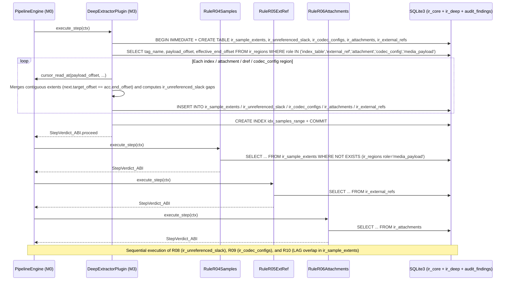

# Milestone M3 Specification: Deep Inspection (`ir_deep`), Rules `R04`–`R06` / `R08`–`R10`, and 3rd Driver (`RIFF / AVI`)

> **Global Directives:** See [`../AGENTS.md`](../AGENTS.md) before implementing this milestone.

---

## 1. Functional Scope and Compatibility Contracts

### Milestone Objective
Extend `vidsec`'s analysis capabilities along two axes without modifying a single line of the engine (`M0`) or the `M2` rules:
1. **Create the `"ir_deep"` (`v1`) SQLite schema domain** via the extractor plugin `vidsec.m3.deep_extractor` (`libm3_deep_extractor.so`), which reads regions from `"ir_core"` (`index_table`, `attachment`, `external_ref`, `codec_config`, `media_payload`) and extracts them into indexed relational tables:
   - `ir_sample_extents`: Sample/frame pointers from `stsz` + `stco`/`co64` (MP4), `Cues` (MKV), and `idx1` (AVI).
   - `ir_unreferenced_slack`: Byte ranges inside `role = 'media_payload'` regions (`mdat`, `LIST:movi`, `Cluster`) that **are not referenced by any sample** (*slack space* where an attacker can hide gigabytes of *file pumping* / executables without triggering `R02` or `R07`).
   - `ir_codec_configs`: Dimension parameters and codec headers (`tkhd` vs `avcC`/`hvcC` SPS in MP4, `PixelWidth`/`Height` vs `CodecPrivate` in MKV, `strh` vs `strf` `BITMAPINFOHEADER` in AVI).
   - `ir_attachments`: Files embedded in `Attachments`/`AttachedFile` (MKV), including their first 16 actual *magic bytes*.
   - `ir_external_refs`: Network or filesystem references in `dref` (`url `/`urn ` in MP4) or `NextFilename` (MKV).
2. **Implement the 6 universal deep-integrity rules** (under `zig-out/lib/plugins/audit/`):
   - **`vidsec.m3.r04_samples` (`R04_SampleTableOverflow`):** Verifies via cross-table SQL query that no frame in `ir_sample_extents` points outside regions with `role = 'media_payload'` (`mdat`, `Cluster`, `movi`).
   - **`vidsec.m3.r05_extref` (`R05_ExternalDataRef`):** Alerts on any external URI in `ir_external_refs` (prevents SSRF, NTLM hash theft via SMB `\\`, or local file reads via `file://`).
   - **`vidsec.m3.r06_attachments` (`R06_EmbeddedAttachments`):** Inspects `ir_attachments`, alerting on font files (`.ttf`/`.otf`, a frequent exploit surface in `libass`/`freetype`) or attached executables/scripts.
   - **`vidsec.m3.r08_media_slack` (`R08_UnreferencedMediaSlack`):** Detects orphaned regions or *file pumping* tails inside `mdat`/`movi` (`ir_unreferenced_slack`), computes their Shannon entropy, and scans for malware signatures (`MZ`, `ELF`, `Go buildinf:`).
   - **`vidsec.m3.r09_codec_config` (`R09_CodecConfigMismatch`):** Detects discrepancies between the resolution declared in the track (`tkhd`/`strh`) and the actual resolution in the codec bitstream (`avcC`/`hvcC` SPS or `strf`), as well as truncated `avcC`/`hvcC` headers (classic *Stagefright*-style *Heap Overflow* vectors).
   - **`vidsec.m3.r10_sample_overlap` (`R10_SampleOverlap`):** Uses an SQL window function (`LAG`) to detect whether distinct sample extents overlap on the same physical byte range (media decompression bombs or tampered `stco` tables).
3. **Add the 3rd Format Driver (`RIFF / AVI` in `src/m1_parsers/drivers/riff.zig` + `configs/formats/riff.yaml`):** Demonstrating that all `M2` (`R01`–`R03`, `R07`) and `M3` (`R04`–`R06`, `R08`–`R10`) rules work automatically on `.avi` containers without touching any rule's code.

### Plugin Versioning and Dependency Contract (`VidsecPluginABI`)
- **`vidsec.m3.deep_extractor`:**
  - `requires_schemas`: `"ir_core"` (`version = 1, writable = false`), `"ir_deep"` (`version = 1, writable = true` $\rightarrow$ `M0` provisions `configs/schemas/ir_deep_v1.sql`)
  - `requires_plugins` (Hard Dependency): `"vidsec.m1.ir_builder"` ($\ge 1.0.0$)
- **`vidsec.m3.r04_samples`, `r05_extref`, `r06_attachments`, `r08_media_slack`, `r09_codec_config`, `r10_sample_overlap`:**
  - `requires_schemas`: `"ir_core"` (`v1, writable = false`), `"ir_deep"` (`v1, writable = false`), `"audit_findings"` (`v1, writable = true`)
  - `requires_plugins` (Hard Dependency): `"vidsec.m3.deep_extractor"` ($\ge 1.0.0$)
- *(Note: to group child boxes such as `tkhd`, `avcC`, `stsz`, and `stco` under the same `trak` track without using inode pointers, `DeepExtractorPlugin` uses the **Offset-Based Natural Nested Set** property documented in [`ADR-006`](../ADR/ADR-006_on_demand_ddl_banks_and_hard_plugin_dependencies.md): `child.header_offset >= trak.payload_offset AND child.effective_end_offset <= trak.effective_end_offset`).*

---

## 2. Milestone UML Architecture (`classDiagram`)

```mermaid
classDiagram
    direction TB

    class DeepExtractorPlugin["src/m3_deep/deep_extractor.zig :: DeepExtractorPlugin"] {
        +execute(ctx: *PipelineContext_ABI) callconv(.C) StepVerdict_ABI
        +extractIsobmffTables(ctx: *PipelineContext_ABI, db: *sqlite3) !void
        +extractEbmlAttachmentsAndCues(ctx: *PipelineContext_ABI, db: *sqlite3) !void
        +extractRiffIdx1(ctx: *PipelineContext_ABI, db: *sqlite3) !void
    }

    class RiffDriver["src/m1_parsers/drivers/riff.zig :: RiffDriver"] {
        +walkChunks(cursor: *SafeCursor, grammar: *const FormatGrammar, cfg: WalkLimits, writer: *IrSqlWriter) DriverError!void
    }

    class RuleR04Samples["src/m3_deep/r04_samples.zig :: RuleR04Samples"] {
        +execute(ctx: *PipelineContext_ABI) callconv(.C) StepVerdict_ABI
    }

    class RuleR05ExtRef["src/m3_deep/r05_extref.zig :: RuleR05ExtRef"] {
        +execute(ctx: *PipelineContext_ABI) callconv(.C) StepVerdict_ABI
    }

    class RuleR06Attachments["src/m3_deep/r06_attachments.zig :: RuleR06Attachments"] {
        +execute(ctx: *PipelineContext_ABI) callconv(.C) StepVerdict_ABI
    }

    class RuleR08MediaSlack["src/m3_deep/r08_media_slack.zig :: RuleR08MediaSlack"] {
        +execute(ctx: *PipelineContext_ABI) callconv(.C) StepVerdict_ABI
    }

    class RuleR09CodecConfig["src/m3_deep/r09_codec_config.zig :: RuleR09CodecConfig"] {
        +execute(ctx: *PipelineContext_ABI) callconv(.C) StepVerdict_ABI
    }

    class RuleR10SampleOverlap["src/m3_deep/r10_sample_overlap.zig :: RuleR10SampleOverlap"] {
        +execute(ctx: *PipelineContext_ABI) callconv(.C) StepVerdict_ABI
    }

    RiffDriver ..|> FormatDriver : implements Little-Endian RIFF/LIST
    DeepExtractorPlugin ..|> VidsecPluginABI : produces "ir_deep" v1
    RuleR04Samples ..|> VidsecPluginABI : queries ir_sample_extents vs ir_regions
    RuleR05ExtRef ..|> VidsecPluginABI : queries ir_external_refs
    RuleR06Attachments ..|> VidsecPluginABI : queries ir_attachments
    RuleR08MediaSlack ..|> VidsecPluginABI : queries ir_unreferenced_slack + scans entropy/sigs
    RuleR09CodecConfig ..|> VidsecPluginABI : queries ir_codec_configs
    RuleR10SampleOverlap ..|> VidsecPluginABI : queries overlapping ir_sample_extents
```



---

## 3. Zig Type Contracts and SQLite Schema (`DDL / Queries`)

### 3.A. `RIFF / AVI` Driver Specification (`src/m1_parsers/drivers/riff.zig`)
A `RIFF` file (`.avi`, `.webp`) encodes each block in **Little-Endian**:
- `[FourCC: 4B ASCII][Size: u32 Little-Endian (`readU32Le`)][Payload]`.
- If the `FourCC` is `"RIFF"` or `"LIST"`, the **first 4 bytes of its payload** are the `list_type` (`"AVI "`, `"hdrl"`, `"strl"`, `"movi"`, `"INFO"`). `RiffDriver` concatenates the identifier as `"RIFF:AVI "` or `"LIST:movi"` to look it up in `configs/formats/riff.yaml`.
- **Even-Byte Alignment (Word Boundary Padding):** In the RIFF specification, if `declared_payload_size` is odd (`size % 2 == 1`), the next sibling chunk starts `1 byte` later (`effective_end_offset + 1`).

---

### 3.B. `"ir_deep"` SQLite DDL Bank (`configs/schemas/ir_deep_v1.sql`)

#### 1. `"ir_deep"` Tables DDL (`DeepExtractorPlugin`)
```sql
-- 1. Sample/chunk extents pointed to by index tables (stco/co64+stsz, Cues, idx1)
CREATE TABLE IF NOT EXISTS ir_sample_extents (
    sample_id INTEGER PRIMARY KEY AUTOINCREMENT,
    track_id INTEGER NOT NULL,
    source_tag TEXT NOT NULL,           -- "stco", "co64", "Cues", "idx1"
    target_offset INTEGER NOT NULL,
    sample_size INTEGER NOT NULL,
    end_offset INTEGER NOT NULL,        -- target_offset + sample_size
    has_arith_overflow INTEGER NOT NULL -- 1 if target_offset + sample_size overflows u64
);
CREATE INDEX IF NOT EXISTS idx_samples_range ON ir_sample_extents(target_offset, end_offset);

-- 2. Attachments embedded in the container (e.g., Attachments in Matroska)
CREATE TABLE IF NOT EXISTS ir_attachments (
    attachment_id INTEGER PRIMARY KEY AUTOINCREMENT,
    filename TEXT NOT NULL,
    mime_type TEXT NOT NULL,
    file_offset INTEGER NOT NULL,
    byte_size INTEGER NOT NULL,
    magic_hex TEXT NOT NULL             -- First 16 bytes of the payload in uppercase Hex
);

-- 3. References to external URIs or files (dref url/urn in MP4, NextFilename in MKV)
CREATE TABLE IF NOT EXISTS ir_external_refs (
    ref_id INTEGER PRIMARY KEY AUTOINCREMENT,
    source_tag TEXT NOT NULL,
    uri TEXT NOT NULL,
    file_offset INTEGER NOT NULL
);

-- 4. Unreferenced gaps or tails inside media_payload regions (mdat / movi / Cluster)
CREATE TABLE IF NOT EXISTS ir_unreferenced_slack (
    slack_id INTEGER PRIMARY KEY AUTOINCREMENT,
    parent_region_id INTEGER NOT NULL,
    region_tag TEXT NOT NULL,           -- "mdat", "LIST:movi", etc.
    start_offset INTEGER NOT NULL,
    end_offset INTEGER NOT NULL,
    byte_size INTEGER NOT NULL          -- end_offset - start_offset
);

-- 5. Dimension consistency and codec configuration headers (tkhd vs avcC/hvcC, strh vs strf)
CREATE TABLE IF NOT EXISTS ir_codec_configs (
    config_id INTEGER PRIMARY KEY AUTOINCREMENT,
    track_id INTEGER NOT NULL,
    codec_tag TEXT NOT NULL,            -- "avcC", "hvcC", "vpcC", "strf", "CodecPrivate"
    container_width INTEGER NOT NULL,   -- Width declared in tkhd / strh / TrackVideo
    container_height INTEGER NOT NULL,  -- Height declared in tkhd / strh / TrackVideo
    bitstream_width INTEGER NOT NULL,   -- Width extracted from SPS (avcC/hvcC) or BITMAPINFOHEADER (strf)
    bitstream_height INTEGER NOT NULL,  -- Height extracted from SPS or BITMAPINFOHEADER
    is_header_malformed INTEGER NOT NULL, -- 1 if SPS/avcC header is truncated or has invalid nal_length_size
    file_offset INTEGER NOT NULL
);
```

#### 2. Exact SQL Queries for Rules `R04`–`R06` and `R08`–`R10`

- **`R04_SampleTableOverflow` (`vidsec.m3.r04_samples`):**
  Finds any sample in `ir_sample_extents` that has arithmetic overflow or whose `[target_offset, end_offset]` range **is not contained** within any `role = 'media_payload'` region (`mdat` in MP4, `Cluster` in MKV, `LIST:movi` in AVI):
  ```sql
  SELECT s.sample_id, s.track_id, s.source_tag, s.target_offset, s.sample_size, s.has_arith_overflow
  FROM ir_sample_extents s
  WHERE s.has_arith_overflow = 1
     OR NOT EXISTS (
         SELECT 1 FROM ir_regions r
         WHERE r.role = 'media_payload'
           AND s.target_offset >= r.payload_offset
           AND s.end_offset <= r.effective_end_offset
     )
  LIMIT 100;
  ```
  - For each returned row, inserts a finding into `audit_findings` with `rule_id = "R04"`, `severity = 2 (critical)` (classic out-of-bounds read/write attempt in the demuxer by pointing `stco`/`stsz` at the headers themselves or outside the file).

- **`R05_ExternalDataRef` (`vidsec.m3.r05_extref`):**
  ```sql
  SELECT source_tag, uri, file_offset FROM ir_external_refs WHERE length(trim(uri)) > 0;
  ```
  - Inserts a finding with `rule_id = "R05"`, `severity = 2 (critical)` if the URI starts with `http://`, `https://`, `file://`, `\\` (UNC/SMB), or contains `../` (*path traversal*).

- **`R06_EmbeddedAttachments` (`vidsec.m3.r06_attachments`):**
  ```sql
  SELECT filename, mime_type, file_offset, byte_size, magic_hex FROM ir_attachments;
  ```
  - If `magic_hex` starts with `"4D5A"` (`MZ`), `"7F454C46"` (`ELF`), or `"504B0304"` (`ZIP`) $\rightarrow$ `severity = 2 (critical)`.
  - If `magic_hex` starts with `"00010000"` or `"4F54544F"` (`OTTO`, `.ttf`/`.otf` fonts) $\rightarrow$ `severity = 1 (warning)` warning that the container includes renderable fonts that will be stripped in the sanitization phase (`M4`).

- **`R08_UnreferencedMediaSlack` (`vidsec.m3.r08_media_slack`):**
  Detects *file pumping* or executables injected inside `mdat`/`LIST:movi` in space that no audio/video track references in `ir_sample_extents`:
  ```sql
  SELECT slack_id, region_tag, start_offset, end_offset, byte_size
  FROM ir_unreferenced_slack
  WHERE byte_size >= ?1
  ORDER BY start_offset ASC;
  ```
  - Where `?1` is `min_slack_bytes` (default `4096` bytes). For each unreferenced gap, reads sampling windows with `ctx.cursor_read_at`, computes Shannon entropy $H(X)$, and runs `scanWindowForSignatures`:
    - If it contains an executable signature (`MZ`, `ELF`, `Go buildinf:`, etc.) $\rightarrow$ inserts a finding with `rule_id = "R08"`, `severity = 2 (critical)`.
    - If it exceeds the size threshold or has high entropy ($H(X) \ge 7.2$) $\rightarrow$ inserts a finding with `rule_id = "R08"`, `severity = 1 (warning)` (which will be extracted to quarantine and zeroed out with `0x00` by `M4`).

- **`R09_CodecConfigMismatch` (`vidsec.m3.r09_codec_config`):**
  Detects *Heap Buffer Overflow* attempts via mismatch between track dimensions and codec SPS or corrupted headers:
  ```sql
  SELECT track_id, codec_tag, container_width, container_height, bitstream_width, bitstream_height, is_header_malformed, file_offset
  FROM ir_codec_configs
  WHERE is_header_malformed = 1
     OR (container_width > 0 AND bitstream_width > 0 AND container_width != bitstream_width)
     OR (container_height > 0 AND bitstream_height > 0 AND container_height != bitstream_height);
  ```
  - If `is_header_malformed == 1` or `bitstream_width > container_width` / `bitstream_height > container_height` (the decoder would write outside the frame buffer allocated according to `tkhd`) $\rightarrow$ inserts a finding with `rule_id = "R09"`, `severity = 2 (critical)`.

- **`R10_SampleOverlap` (`vidsec.m3.r10_sample_overlap`):**
  Uses an SQL window function (`LAG`) to detect whether two sample extents overlap on disk (`target_offset < prev_end_offset`), preventing media decompression bombs (video *zip-bombs* where thousands of frames point to the same `mdat` block):
  ```sql
  SELECT sample_id, track_id, source_tag, target_offset, end_offset, prev_end_offset
  FROM (
      SELECT sample_id, track_id, source_tag, target_offset, end_offset,
             LAG(end_offset) OVER (ORDER BY target_offset ASC, end_offset ASC) AS prev_end_offset
      FROM ir_sample_extents
      WHERE has_arith_overflow = 0
  )
  WHERE prev_end_offset IS NOT NULL AND target_offset < prev_end_offset
  LIMIT 100;
  ```
  - For each detected overlap, inserts a finding with `rule_id = "R10"`, `severity = 2 (critical)`.

---

## 4. Memory Model, Arenas, and SQLite Transactions

| Resource / Structure | Owner / Storage | Lifetime | Freed / Closed By |
| :--- | :--- | :--- | :--- |
| Tables `ir_sample_extents`, `ir_unreferenced_slack`, `ir_codec_configs`, `ir_attachments`, `ir_external_refs` | `ctx.sqlite_db` | Entire pipeline execution. | `StateDatabase.deinit()` in `M0`. |
| Parsing cursors and buffers for `stsz`/`stco`/`avcC` | Local `ArenaAllocator` in `DeepExtractorPlugin.execute` | Only during `DeepExtractorPlugin.execute`. | `defer local_arena.deinit()`. |

### Hard DoS Limits and Insertion Optimization in `ir_sample_extents`
1. **Pre-Iteration Physical Validation (`MAX_SAMPLES_PER_TRACK: u32 = 2_000_000`):**
   - If a fraudulent `stsz` or `stco` box declares `sample_count = 0xFFFFFFFF` (4 billion samples in a 1 MB file), before iterating, safe arithmetic (`std.math.mul`) verifies that the declared table physically fits within `declared_payload_size` (`sample_count * 4 <= declared_payload_size` in `stco`/`stsz`, or `chunk_count * 8 <= declared_payload_size` in `co64`). If it does not fit or exceeds `MAX_SAMPLES_PER_TRACK`, extraction of that table is aborted and a record with `has_arith_overflow = 1` is inserted so `R04` triggers a critical finding (`severity = 2`).
2. **Streaming Coalescing of Contiguous Samples (*Run-Length Extent Merging*):**
   - In a legitimate container, thousands of consecutive samples within the same *chunk* (`stsc` + `stco`/`co64`) or *Cluster* are adjacent on disk (`next.target_offset == current.end_offset`).
   - Because the geometric condition of `R04` ($\text{target\_offset} \ge \text{payload\_offset} \land \text{end\_offset} \le \text{effective\_end\_offset}$) is convex over contiguous intervals, a merged interval $[A, C]$ is fully contained in a `media_payload` region **if and only if** the adjacent sub-intervals $[A, B]$ and $[B, C]$ are.
   - Therefore, `DeepExtractorPlugin` keeps the last `SampleExtent` in a local accumulator before calling `sqlite3_step`: if the next sample of the same `track_id` and `source_tag` has no overflow (`has_arith_overflow == 0`) and satisfies `next.target_offset == acc.end_offset`, it merges both in memory (`acc.sample_size += next.sample_size`, `acc.end_offset = next.end_offset`) and only executes `INSERT` into `ir_sample_extents` when there is an offset jump or the chunk/track changes. This reduces 1,000,000-frame videos to a few thousand SQLite rows without losing accuracy in `R04`.
3. **Deferred Creation of Index `idx_samples_range`:**
   - `DeepExtractorPlugin` first creates the `ir_sample_extents` table without indexes, executes all `INSERT`s inside `BEGIN IMMEDIATE TRANSACTION;`, and runs `CREATE INDEX IF NOT EXISTS idx_samples_range ON ir_sample_extents(target_offset, end_offset);` **right before `COMMIT;`**.

---

## 5. Algorithmic Flow (`sequenceDiagram`) and Edge Cases



---

## 6. Declarative Grammar for `RIFF / AVI` (`configs/formats/riff.yaml`) and `pipeline.yaml`

### 6.1. `configs/formats/riff.yaml`
```yaml
format: "riff"
tags:
  - tag: "RIFF:AVI "
    name: "AviRootContainer"
    role: "container"
    container: "true"
  - tag: "LIST:hdrl"
    name: "AviHeaderList"
    role: "container"
    container: "true"
  - tag: "LIST:strl"
    name: "AviStreamList"
    role: "container"
    container: "true"
  - tag: "avih"
    name: "MainAviHeader"
    role: "metadata"
    container: "false"
  - tag: "strh"
    name: "StreamHeader"
    role: "metadata"
    container: "false"
  - tag: "strf"
    name: "StreamFormat"
    role: "codec_config"
    container: "false"
  - tag: "LIST:movi"
    name: "AviMovieDataList"
    role: "media_payload"
    container: "false"
  - tag: "idx1"
    name: "AviOldIndex"
    role: "index_table"
    container: "false"
  - tag: "JUNK"
    name: "AviJunkPadding"
    role: "padding"
    container: "false"
```

---

## 7. Raw Binary Vectors and Acceptance Test Suite (`zig build test`)

### Test 1: Detection of Sample Pointer Outside `mdat` (`R04_SampleTableOverflow`)
```zig
test "M3.1: R04 catches stco chunk offset pointing outside mdat media_payload" {
    // Micro-MP4 where 'mdat' is at [64..80], but the 'stco' box declares 1 chunk pointing to offset 99999 (outside the file)
    // and 'stsz' declares 1 sample of size 512.
    // Verifies that after running M1 -> DeepExtractor -> R04:
    // SELECT rule_id, severity, file_offset FROM audit_findings WHERE rule_id = 'R04';
    // returns 1 row with severity = 2 (critical) and target_offset = 99999.
}
```

### Test 2: Detection of SSRF External Reference in `dref` (`R05`) and Attachment in MKV (`R06`)
- **`dref` vector:** `dref` box with `url ` entry (`flags = 0x000000` = not self-contained) containing string `"http://evil.example.com/track.mp4\x00"`. Verifies that `R05` inserts a `critical` finding into `audit_findings`.
- **MKV `AttachedFile` (`0x61A7`) vector:** With `FileName` (`0x466E`) = `"exploit.ttf"`, `FileMimeType` (`0x4660`) = `"font/ttf"`, and `FileData` (`0x465C`) starting with `0x00, 0x01, 0x00, 0x00`. Verifies that `R06` inserts a `warning` finding into `audit_findings`.

### Test 3: Multi-Format Validation with `RIFF / AVI` Container
```zig
test "M3.3: RiffDriver parses Little-Endian AVI container and M2/M3 rules work unmodified" {
    const avi_with_junk = [_]u8{
        'R', 'I', 'F', 'F', 0x24, 0x00, 0x00, 0x00, 'A', 'V', 'I', ' ',
        // JUNK chunk (size = 8 LE, role = padding)
        'J', 'U', 'N', 'K', 0x08, 0x00, 0x00, 0x00, 0x00, 0x00, 0x00, 0x00, 0x00, 0x00, 0x00, 0x00,
        // LIST movi (size = 8 LE, role = media_payload)
        'L', 'I', 'S', 'T', 0x08, 0x00, 0x00, 0x00, 'm', 'o', 'v', 'i', 0xAA, 0xBB, 0xCC, 0xDD,
    };
    // Verifies in SQLite that ir_regions contains "RIFF:AVI " (container), "JUNK" (padding), and "LIST:movi" (media_payload).
}
```

### Test 4: Detection of Hidden *Slack Space* in `mdat` (`R08`), SPS Resolution Mismatch (`R09`), and Overlapping Samples (`R10`)
- **`M3.4a (R08_UnreferencedMediaSlack)`:** MP4 container where `mdat` is `8192` bytes, but `stco`+`stsz` only reference the first `64` bytes and the remainder (`8128` bytes inside `mdat`) contains the `"\\xff Go buildinf:"` signature + random padding. Verifies that `ir_unreferenced_slack` records the gap `[payload_offset + 64 .. effective_end_offset]` and `R08` inserts a `critical` finding into `audit_findings`.
- **`M3.4b (R09_CodecConfigMismatch)`:** Container where `tkhd` declares `320x240` but the `avcC` SPS declares `4096x2160`. Verifies that `R09` inserts a `critical` finding (`severity = 2`).
- **`M3.4c (R10_SampleOverlap)`:** `stco` box with two entries pointing to the same offset inside `mdat`. Verifies that `R10`'s `LAG()` query detects the overlap and inserts a `critical` finding.
