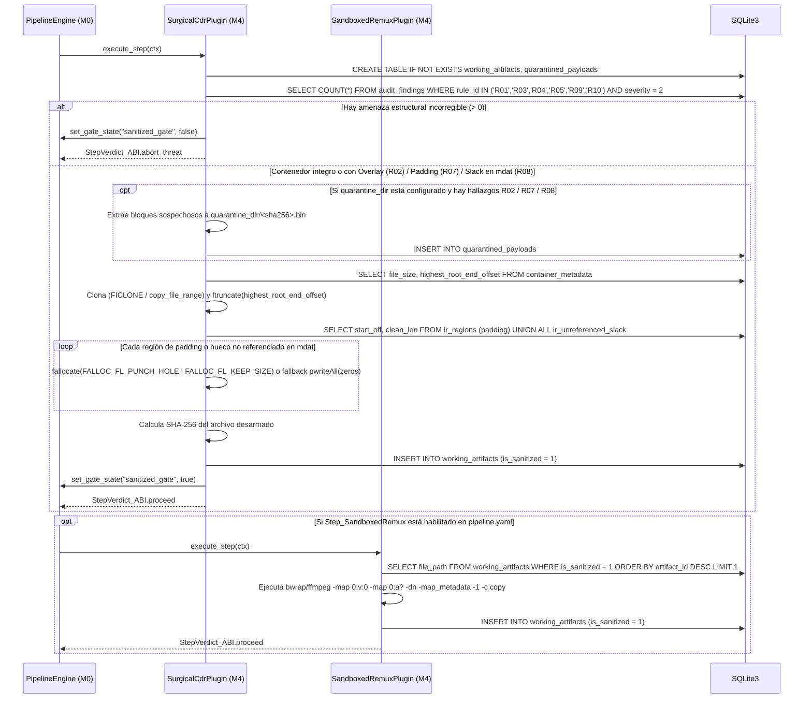

# Especificación de Hito M4: Sanitizador CDR (`working_artifacts`), Remux Aislado y Compuerta de Seguridad (`sanitized_gate`)

> **Directivas Globales:** Ver [`../AGENTS.md`](../AGENTS.md) antes de implementar este hito.

---

## 1. Alcance Funcional y Contratos de Compatibilidad

### Objetivo del Hito
Implementar la **Macro-Fase de Sanitización, Carving Forense y Desarme de Contenido (CDR)** (`M4`), compilada como plugins bajo `zig-out/lib/plugins/sanitizers/`. Esta fase actúa como la **compuerta de seguridad (*Security Gate*)** que extrae muestras forenses a cuarentena y transforma un contenedor potencialmente peligroso en un archivo limpio y certificado antes de permitir cualquier procesamiento multimedia en `M5`:
1. **Crear el dominio de esquema SQLite `"working_artifacts"` (`v1`)**, compuesto por dos tablas:
   - `working_artifacts`: Registra con trazabilidad criptográfica (`SHA-256`) cada archivo intermedio limpio generado a partir del original.
   - `quarantined_payloads`: Registra las muestras forenses extraídas (*carved*) antes de la neutralización (*overlays* de `R02`, cajas `free`/`Void`/`JUNK` sospechosas de `R07` o *slack space* en `mdat` de `R08`).
2. **`vidsec.m4.surgical_cdr` (`Step_NeutralizePadding`):**
   - Comprueba primero en `audit_findings` si existe algún hallazgo estructural irrecuperable (`R01_MagicMismatch`, `R03_BoundsAnomaly`, `R04_SampleTableOverflow`, `R05_ExternalDataRef`, `R09_CodecConfigMismatch` o `R10_SampleOverlap` con `severity = 2`). Si el archivo es un ejecutable o tiene tablas de muestras/SPS corruptas, aborta inmediatamente (`StepVerdict_ABI.abort_threat`) y **mantiene cerrada** la compuerta `"sanitized_gate"`.
   - **Carving Forense Automático a Cuarentena (`quarantine_dir`):** Si el contenedor presenta *overlays* al final (`R02`), regiones de *padding* sospechosas (`R07`) o *slack space* no referenciado dentro de `mdat` (`R08`), y se ha configurado `quarantine_dir`, extrae cada bloque sospechoso a un archivo `.bin` aislado en cuarentena (calculando su `SHA-256`) y lo registra en `quarantined_payloads` para su posterior análisis en Ghidra/radare2/YARA.
   - **Neutralización Quirúrgica:** Clona el contenedor a un archivo de trabajo temporal, **trunca físicamente** el archivo en `highest_root_end_offset` (eliminando cualquier *overlay* pegado al final) y **sobrescribe con `0x00`** tanto el payload de todas las regiones con `role = 'padding'` como todos los huecos `ir_unreferenced_slack` dentro de `mdat`, sin alterar las cabeceras ni desplazar los offsets de `stco`/`co64`.
3. **`vidsec.m4.sandbox_remux` (`Step_SandboxedRemux`):**
   - Ejecuta una reconstrucción limpia en lista blanca invocando `ffmpeg` (encapsulado opcionalmente en `bwrap` — *Bubblewrap* sin red `--unshare-net` y con sistema de archivos en solo lectura salvo el archivo de salida) copiando únicamente los flujos elementales de vídeo y audio (`-map 0:v:0 -map 0:a? -dn -map_metadata -1 -map_chapters -1 -c copy`), purgando todas las fuentes `.ttf`/`.otf` adjuntas (`R06`), referencias `dref` (`R05`) y metadatos.
4. **Apertura de la Compuerta `"sanitized_gate"`:**
   - Una vez verificado que el archivo de salida existe, tiene cabecera válida y tamaño $> 0$, registra la fila en `working_artifacts` con `is_sanitized = 1` e invoca `ctx.set_gate_state(ctx.opaque_host_ctx, "sanitized_gate", true)`.

### Contrato de Versionado y Dependencias de los Plugins (`VidsecPluginABI`)
```zig
const required_schemas = [_]abi.SchemaContract_ABI{
    .{ .domain = "ir_core", .version = 1, .writable = false },
    .{ .domain = "ir_deep", .version = 1, .writable = false },         // M0 aprovisiona ir_deep_v1.sql (incluso si M3 fue omitido!)
    .{ .domain = "audit_findings", .version = 1, .writable = false },
    .{ .domain = "working_artifacts", .version = 1, .writable = true }, // M0 aprovisiona working_artifacts_v1.sql con escritura
};

// Hard Dependency SOLO sobre M1 (M3 es Soft Dependency: si se omite M3, ir_unreferenced_slack existe vacía con 0 filas):
const required_plugins = [_]abi.PluginDependency_ABI{
    .{ .plugin_id = "vidsec.m1.ir_builder", .min_version = .{ .major = 1, .minor = 0, .patch = 0 } },
};

export const vidsec_plugin_descriptor = abi.VidsecPluginABI{
    .abi_version = abi.VIDSEC_ABI_VERSION,
    .plugin_id = "vidsec.m4.surgical_cdr",
    .plugin_version = .{ .major = 1, .minor = 0, .patch = 0 },
    .requires_schemas_ptr = &required_schemas,
    .requires_schemas_len = required_schemas.len,
    .requires_plugins_ptr = &required_plugins,
    .requires_plugins_len = required_plugins.len,
    .execute_step = &SurgicalCdrPlugin.execute,
};
```

---

## 2. Arquitectura UML del Hito (`classDiagram`)


---

## 3. Contratos de Tipos en Zig y Esquema SQLite (`DDL / Queries`)

### 3.A. Tipos y Estructuras en Zig (`src/m4_cdr/artifacts_sql.zig`)

```zig
const std = @import("std");

pub const SANITIZED_GATE_NAME = "sanitized_gate";

pub const WorkingArtifactRow = struct {
    step_name: []const u8,
    plugin_id: []const u8,
    file_path: []const u8,
    byte_size: u64,
    sha256_hex: [64]u8,
    zeroed_regions_count: u32 = 0,
    truncated_bytes: u64 = 0,
    is_sanitized: bool,
};

pub const QuarantinedPayloadRow = struct {
    source_rule_id: []const u8,     // "R02", "R07", "R08"
    region_tag: []const u8,         // "overlay", "free", "Void", "JUNK", "mdat_slack"
    original_offset: u64,
    byte_size: u64,
    sha256_hex: [64]u8,
    quarantine_file_path: []const u8,
};
```

---

### 3.B. Banco DDL SQLite `"working_artifacts"` (`configs/schemas/working_artifacts_v1.sql`)

#### 1. DDL de las Tablas `working_artifacts` y `quarantined_payloads`
```sql
CREATE TABLE IF NOT EXISTS working_artifacts (
    artifact_id INTEGER PRIMARY KEY AUTOINCREMENT,
    step_name TEXT NOT NULL,
    plugin_id TEXT NOT NULL,
    file_path TEXT NOT NULL,
    byte_size INTEGER NOT NULL,
    sha256_hex TEXT NOT NULL,
    zeroed_regions_count INTEGER NOT NULL DEFAULT 0,
    truncated_bytes INTEGER NOT NULL DEFAULT 0,
    is_sanitized INTEGER NOT NULL DEFAULT 0     -- 1 = apto para procesamiento en M5
);
CREATE INDEX IF NOT EXISTS idx_artifacts_sanitized ON working_artifacts(artifact_id DESC) WHERE is_sanitized = 1;

CREATE TABLE IF NOT EXISTS quarantined_payloads (
    quarantine_id INTEGER PRIMARY KEY AUTOINCREMENT,
    source_rule_id TEXT NOT NULL,               -- "R02" (overlay), "R07" (padding), "R08" (mdat slack)
    region_tag TEXT NOT NULL,
    original_offset INTEGER NOT NULL,
    byte_size INTEGER NOT NULL,
    sha256_hex TEXT NOT NULL,
    quarantine_file_path TEXT NOT NULL          -- Archivo .bin aislado para análisis forense
);
```

#### 2. Consultas SQL de Control, Carving Forense y Coordenadas CDR
- **Comprobación de amenazas estructurales no sanitizables en modo quirúrgico (`hasUnrecoverableThreat`):**
  ```sql
  SELECT COUNT(*) FROM audit_findings
  WHERE rule_id IN ('R01', 'R03', 'R04', 'R05', 'R09', 'R10') AND severity = 2;
  ```
  - Si devuelve `> 0`: el contenedor es un ejecutable (`R01`), tiene tamaños de cajas corruptos (`R03`), punteros de frames fuera de límites (`R04`), referencias externas (`R05`), dimensiones de SPS maliciosas (`R09`) o muestras solapadas (`R10`). En ese caso, `SurgicalCdrPlugin` cierra `"sanitized_gate"` (`false`) y devuelve `StepVerdict_ABI.abort_threat`.
  - *(Nota: Los hallazgos `R02` de overlay al final, `R07` de padding sospechoso y `R08` de slack space dentro de `mdat` **sí son neutralizables** por `SurgicalCdrPlugin`: primero se extraen a `quarantined_payloads` si `quarantine_dir` está activo, y a continuación se eliminan al truncar en `highest_root_end_offset` y poner a `0x00` los payloads de `role = 'padding'` e `ir_unreferenced_slack`).*
- **Obtención de Regiones `.padding` y Huecos `ir_unreferenced_slack` a Neutralizar (`zeroOutPaddingAndSlackRegions`):**
  ```sql
  SELECT payload_offset AS start_off, (effective_end_offset - payload_offset) AS clean_len
  FROM ir_regions
  WHERE role = 'padding' AND effective_end_offset > payload_offset
  UNION ALL
  SELECT start_offset AS start_off, byte_size AS clean_len
  FROM ir_unreferenced_slack
  WHERE byte_size > 0
  ORDER BY start_off ASC;
  ```

---

## 4. Modelo de Memoria, Archivos Temporales y Subprocesos

| Recurso / Estructura | Propietario / Almacenamiento | Tiempo de Vida (Lifetime) | Quién libera / cierra |
| :--- | :--- | :--- | :--- |
| Registro de rutas y hashes (`working_artifacts`) | `ctx.sqlite_db` | Toda la ejecución del pipeline. | `StateDatabase.deinit()` en `M0`. |
| Buffer de copia y puesta a cero (`64 KB`) | Buffer en pila `[65536]u8` en `SurgicalCdrPlugin` | Durante `SurgicalCdrPlugin.execute`. | Automático al salir de la función. |
| Proceso hijo `std.process.Child` (`bwrap` / `ffmpeg`) | `ArenaAllocator` local de `SandboxedRemuxPlugin` | Durante `SandboxedRemuxPlugin.execute`. | `child.wait()` / `child.kill()` antes de retornar. |

---

## 5. Flujo Algorítmico (`sequenceDiagram`) y Casos Borde



### Tabla de Casos Borde (Edge Cases) e Invariantes de Rendimiento (`ADR-004`)
1. **Clonado Copy-on-Write (`FICLONE` / `copy_file_range`) y *Sparse Hole Punching* (`fallocate`):**
   - En `copyAndTruncateToRootEnd`, `SurgicalCdrPlugin` intenta primero `ioctl(dst_fd, FICLONE, src_fd)` (clonado instantáneo $O(1)$ en `Btrfs`/`XFS`/`ZFS`), con fallback a `copy_file_range` en el kernel y truncado exacto con `ftruncate(dst_fd, highest_root_end_offset)`.
   - En `zeroOutPaddingAndSlackRegions`, para cada intervalo `[start_off, start_off + clean_len)` con `clean_len >= 4096`, invoca `fallocate(dst_fd, FALLOC_FL_PUNCH_HOLE | FALLOC_FL_KEEP_SIZE, start_off, clean_len)` (con fallback automático a `pwriteAll(zeros)` si el sistema de archivos devuelve `EOPNOTSUPP` o para bloques $< 4096\text{ bytes}$). Esto libera los bloques físicos en microsegundos reduciendo archivos inflados de gigabytes a pocos kilobytes reales en disco mientras el kernel devuelve `0x00` determinista al leer esos rangos.
2. **Preservación de Offsets de Frames en `SurgicalCdrPlugin`:** Al sobrescribir con `0x00` (o perforar un *sparse hole* con `FALLOC_FL_KEEP_SIZE`) únicamente desde `payload_offset` hasta `effective_end_offset` de una caja `free`/`Void`/`JUNK` o de un hueco `ir_unreferenced_slack`, la cabecera de la caja (`header_offset..payload_offset`) permanece intacta y ningún byte posterior del archivo cambia de posición, por lo que las tablas `stco`/`co64` del MP4 siguen siendo 100% válidas sin necesidad de recalcular índices.
3. **Prevención de Inyección de Comandos en `SandboxedRemuxPlugin`:** `std.process.Child.init(argv, alloc)` se invoca pasando un slice de argumentos separados (`&.{ "ffmpeg", "-nostdin", "-y", "-i", in_path, ... }`), **jamás** a través de `sh -c`.

---

## 6. Declaración en `configs/pipeline.yaml`

```yaml
plugins:
  - id: "vidsec.m4.surgical_cdr"
    path: "./zig-out/lib/plugins/sanitizers/libm4_surgical_cdr.so"
  - id: "vidsec.m4.sandbox_remux"
    path: "./zig-out/lib/plugins/sanitizers/libm4_sandbox_remux.so"

# Grupo de Sanitización en pipeline.yaml:
- group: "Phase3_SanitizationGate"
  policy: "run_all"
  steps:
    - step: "SurgicalZeroAndTruncate"
      plugin: "vidsec.m4.surgical_cdr"
      params:
        work_dir: "/tmp/vidsec_work"
        quarantine_dir: "/tmp/vidsec_quarantine"
```

---

## 7. Vectores Binarios en Crudo y Suite de Tests de Aceptación (`zig build test`)

### Test 1: Carving Forense a Cuarentena y Neutralización Quirúrgica (`R02` + `R07` + `R08`)
```zig
test "M4.1: SurgicalCdrPlugin carves suspicious payloads to quarantine, truncates overlay, zeroes free & mdat slack, and opens sanitized_gate" {
    // 1. Entrada: MP4 de 80 bytes:
    //    - [0..16]: 'ftyp'
    //    - [16..48]: 'free' (8B header + 24B de bytes pseudo-aleatorios 0xAA..0xFF)
    //    - [48..64]: 'mdat' (8B header + 8B de datos de vídeo 0x11..0x88)
    //    - [64..80]: 16 bytes de Overlay malicioso ('M','Z',...)
    // 2. Ejecutar M1 -> M2 -> M3 -> SurgicalCdrPlugin (M4) con quarantine_dir activo.
    // 3. Aserciones sobre quarantined_payloads:
    //    - Se han extraído los archivos .bin del overlay [64..80] y del payload de 'free' [24..48] con su SHA-256 exacto.
    // 4. Aserciones sobre el archivo limpio registrado en working_artifacts:
    //    - byte_size == 64 (los 16 bytes de overlay en [64..80] fueron truncados).
    //    - Los bytes [16..24] siguen siendo la cabecera "\x00\x00\x00\x20free".
    //    - Los bytes [24..48] (payload de 'free') son ahora todos 0x00.
    //    - Los bytes [56..64] (payload de 'mdat') permanecen intactos (0x11..0x88).
    //    - En SQLite: SELECT is_open FROM pipeline_gates WHERE gate_name = 'sanitized_gate' -> 1.
    // 5. Al volver a pasar M1 -> M2 -> M3 sobre el archivo limpio, audit_findings tiene 0 filas.
}
```

### Test 2: Bloqueo de `sanitized_gate` ante Contenedor con `R01` o `R04` Crítico
- Ejecuta `SurgicalCdrPlugin` cuando `audit_findings` contiene un hallazgo `R04` (`severity = 2`).
- Verifica que devuelve `StepVerdict_ABI.abort_threat`, no genera ningún archivo en `working_artifacts` y deja `sanitized_gate` cerrada (`0`).
