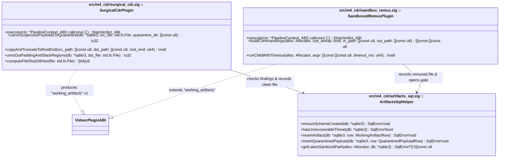
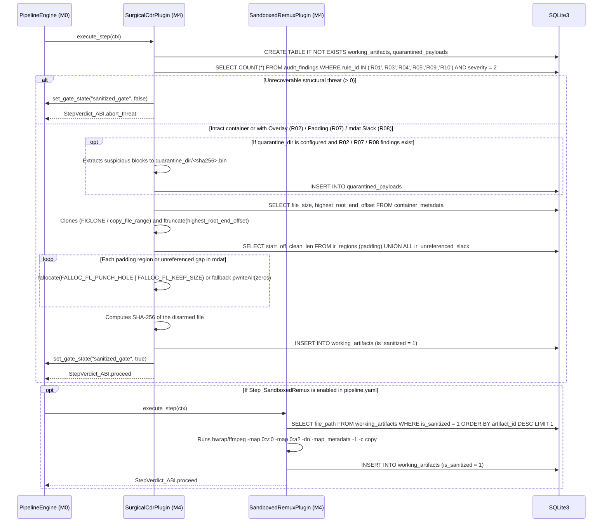

# Milestone M4 Specification: CDR Sanitizer (`working_artifacts`), Sandboxed Remux, and Security Gate (`sanitized_gate`)

> **Global Directives:** See [`../AGENTS.md`](../AGENTS.md) before implementing this milestone.

---

## 1. Functional Scope and Compatibility Contracts

### Milestone Objective
Implement the **Sanitization, Forensic Carving, and Content Disarm & Reconstruction (CDR) Macro-Phase** (`M4`), compiled as plugins under `zig-out/lib/plugins/sanitizers/`. This phase acts as the **Security Gate** that extracts forensic samples into quarantine and transforms a potentially dangerous container into a clean, certified file before allowing any multimedia processing in `M5`:
1. **Create the `"working_artifacts"` (`v1`) SQLite schema domain**, composed of two tables:
   - `working_artifacts`: Records each clean intermediate file generated from the original with cryptographic traceability (`SHA-256`).
   - `quarantined_payloads`: Records forensic samples carved before neutralization (`R02` overlays, suspicious `R07` `free`/`Void`/`JUNK` boxes, or `R08` slack space inside `mdat`).
2. **`vidsec.m4.surgical_cdr` (`Step_NeutralizePadding`):**
   - First checks `audit_findings` for any unrecoverable structural finding (`R01_MagicMismatch`, `R03_BoundsAnomaly`, `R04_SampleTableOverflow`, `R05_ExternalDataRef`, `R09_CodecConfigMismatch`, or `R10_SampleOverlap` with `severity = 2`). If the file is an executable or has corrupted sample tables or SPS, it aborts immediately (`StepVerdict_ABI.abort_threat`) and **keeps** the `"sanitized_gate"` **closed**.
   - **Automatic Forensic Carving to Quarantine (`quarantine_dir`):** If the container has trailing overlays (`R02`), suspicious padding regions (`R07`), or unreferenced slack space inside `mdat` (`R08`), and `quarantine_dir` is configured, it extracts each suspicious block to an isolated `.bin` file in quarantine (computing its `SHA-256`) and records it in `quarantined_payloads` for later analysis in Ghidra/radare2/YARA.
   - **Surgical Neutralization:** Clones the container to a temporary working file, **physically truncates** the file at `highest_root_end_offset` (removing any appended overlay), and **overwrites with `0x00`** both the payload of all regions with `role = 'padding'` and all `ir_unreferenced_slack` gaps inside `mdat`, without altering headers or shifting `stco`/`co64` offsets.
3. **`vidsec.m4.sandbox_remux` (`Step_SandboxedRemux`):**
   - Executes a clean allowlisted reconstruction by invoking `ffmpeg` (optionally encapsulated in `bwrap` — Bubblewrap with no network `--unshare-net` and a read-only filesystem except for the output file), copying only video and audio elementary streams (`-map 0:v:0 -map 0:a? -dn -map_metadata -1 -map_chapters -1 -c copy`), stripping all attached `.ttf`/`.otf` fonts (`R06`), `dref` references (`R05`), and metadata.
4. **Opening the `"sanitized_gate"` Gate:**
   - Once verified that the output file exists, has a valid header, and has size $> 0$, it inserts the row into `working_artifacts` with `is_sanitized = 1` and invokes `ctx.set_gate_state(ctx.opaque_host_ctx, "sanitized_gate", true)`.

### Plugin Versioning and Dependency Contract (`VidsecPluginABI`)
```zig
const required_schemas = [_]abi.SchemaContract_ABI{
    .{ .domain = "ir_core", .version = 1, .writable = false },
    .{ .domain = "ir_deep", .version = 1, .writable = false },         // M0 provisions ir_deep_v1.sql (even if M3 was skipped!)
    .{ .domain = "audit_findings", .version = 1, .writable = false },
    .{ .domain = "working_artifacts", .version = 1, .writable = true }, // M0 provisions working_artifacts_v1.sql with write access
};

// Hard Dependency ONLY on M1 (M3 is a Soft Dependency: if M3 is skipped, ir_unreferenced_slack exists empty with 0 rows):
const required_plugins = [_]abi.PluginDependency_ABI{
    .{ .plugin_id = "vidsec.m1.ir_builder", .min_version = .{ .major = 1, .minor = 0, .patch = 0 } },
};

export const vidsec_plugin_descriptor = abi.VidsecPluginABI{
    .abi_version = abi.VIDSEC_ABI_VERSION,
    .plugin_id = "vidsec.m4.surgical_cdr",
    .plugin_version = .{ .major = 1, .minor = 0, .patch = 0 },
    .requires_schemas_ptr = &required_schemas,
    .requires_schemas_len = required_schemas.len,
    .requires_plugins_ptr = &required_plugins,
    .requires_plugins_len = required_plugins.len,
    .execute_step = &SurgicalCdrPlugin.execute,
};
```

---

## 2. Milestone UML Architecture (`classDiagram`)



---

## 3. Zig Type Contracts and SQLite Schema (`DDL / Queries`)

### 3.A. Zig Types and Structs (`src/m4_cdr/artifacts_sql.zig`)

```zig
const std = @import("std");

pub const SANITIZED_GATE_NAME = "sanitized_gate";

pub const WorkingArtifactRow = struct {
    step_name: []const u8,
    plugin_id: []const u8,
    file_path: []const u8,
    byte_size: u64,
    sha256_hex: [64]u8,
    zeroed_regions_count: u32 = 0,
    truncated_bytes: u64 = 0,
    is_sanitized: bool,
};

pub const QuarantinedPayloadRow = struct {
    source_rule_id: []const u8,     // "R02", "R07", "R08"
    region_tag: []const u8,         // "overlay", "free", "Void", "JUNK", "mdat_slack"
    original_offset: u64,
    byte_size: u64,
    sha256_hex: [64]u8,
    quarantine_file_path: []const u8,
};
```

---

### 3.B. SQLite DDL Bank `"working_artifacts"` (`configs/schemas/working_artifacts_v1.sql`)

#### 1. DDL for `working_artifacts` and `quarantined_payloads` Tables
```sql
CREATE TABLE IF NOT EXISTS working_artifacts (
    artifact_id INTEGER PRIMARY KEY AUTOINCREMENT,
    step_name TEXT NOT NULL,
    plugin_id TEXT NOT NULL,
    file_path TEXT NOT NULL,
    byte_size INTEGER NOT NULL,
    sha256_hex TEXT NOT NULL,
    zeroed_regions_count INTEGER NOT NULL DEFAULT 0,
    truncated_bytes INTEGER NOT NULL DEFAULT 0,
    is_sanitized INTEGER NOT NULL DEFAULT 0     -- 1 = ready for processing in M5
);
CREATE INDEX IF NOT EXISTS idx_artifacts_sanitized ON working_artifacts(artifact_id DESC) WHERE is_sanitized = 1;

CREATE TABLE IF NOT EXISTS quarantined_payloads (
    quarantine_id INTEGER PRIMARY KEY AUTOINCREMENT,
    source_rule_id TEXT NOT NULL,               -- "R02" (overlay), "R07" (padding), "R08" (mdat slack)
    region_tag TEXT NOT NULL,
    original_offset INTEGER NOT NULL,
    byte_size INTEGER NOT NULL,
    sha256_hex TEXT NOT NULL,
    quarantine_file_path TEXT NOT NULL          -- Isolated .bin file for forensic analysis
);
```

#### 2. Control, Forensic Carving, and CDR Coordinate SQL Queries
- **Check for structural threats that cannot be sanitized in surgical mode (`hasUnrecoverableThreat`):**
  ```sql
  SELECT COUNT(*) FROM audit_findings
  WHERE rule_id IN ('R01', 'R03', 'R04', 'R05', 'R09', 'R10') AND severity = 2;
  ```
  - If it returns `> 0`: the container is an executable (`R01`), has corrupted box sizes (`R03`), out-of-bounds frame pointers (`R04`), external references (`R05`), malicious SPS dimensions (`R09`), or overlapping samples (`R10`). In that case, `SurgicalCdrPlugin` closes `"sanitized_gate"` (`false`) and returns `StepVerdict_ABI.abort_threat`.
  - *(Note: Findings `R02` trailing overlay, `R07` suspicious padding, and `R08` slack space inside `mdat` **are neutralizable** by `SurgicalCdrPlugin`: first they are extracted to `quarantined_payloads` if `quarantine_dir` is active, and then they are eliminated by truncating at `highest_root_end_offset` and zeroing out `0x00` across `role = 'padding'` payloads and `ir_unreferenced_slack`.)*
- **Retrieve `.padding` Regions and `ir_unreferenced_slack` Gaps to Neutralize (`zeroOutPaddingAndSlackRegions`):**
  ```sql
  SELECT payload_offset AS start_off, (effective_end_offset - payload_offset) AS clean_len
  FROM ir_regions
  WHERE role = 'padding' AND effective_end_offset > payload_offset
  UNION ALL
  SELECT start_offset AS start_off, byte_size AS clean_len
  FROM ir_unreferenced_slack
  WHERE byte_size > 0
  ORDER BY start_off ASC;
  ```

---

## 4. Memory Model, Temporary Files, and Subprocesses

| Resource / Structure | Owner / Storage | Lifetime | Who Frees / Closes |
| :--- | :--- | :--- | :--- |
| Path and hash registry (`working_artifacts`) | `ctx.sqlite_db` | Entire pipeline execution. | `StateDatabase.deinit()` in `M0`. |
| Copy and zeroing buffer (`64 KB`) | Stack buffer `[65536]u8` in `SurgicalCdrPlugin` | During `SurgicalCdrPlugin.execute`. | Automatic upon function return. |
| Child process `std.process.Child` (`bwrap` / `ffmpeg`) | Local `ArenaAllocator` in `SandboxedRemuxPlugin` | During `SandboxedRemuxPlugin.execute`. | `child.wait()` / `child.kill()` before returning. |

---

## 5. Algorithmic Flow (`sequenceDiagram`) and Edge Cases



### Edge Cases and Performance Invariants Table (`ADR-004`)
1. **Copy-on-Write Cloning (`FICLONE` / `copy_file_range`) and Sparse Hole Punching (`fallocate`):**
   - In `copyAndTruncateToRootEnd`, `SurgicalCdrPlugin` first attempts `ioctl(dst_fd, FICLONE, src_fd)` ($O(1)$ instant cloning on `Btrfs`/`XFS`/`ZFS`), falling back to in-kernel `copy_file_range` and exact truncation via `ftruncate(dst_fd, highest_root_end_offset)`.
   - In `zeroOutPaddingAndSlackRegions`, for each interval `[start_off, start_off + clean_len)` with `clean_len >= 4096`, it invokes `fallocate(dst_fd, FALLOC_FL_PUNCH_HOLE | FALLOC_FL_KEEP_SIZE, start_off, clean_len)` (with automatic fallback to `pwriteAll(zeros)` if the filesystem returns `EOPNOTSUPP` or for blocks $< 4096\text{ bytes}$). This frees physical blocks in microseconds, shrinking multi-gigabyte bloated files down to a few real kilobytes on disk while the kernel deterministically returns `0x00` when reading those ranges.
2. **Frame Offset Preservation in `SurgicalCdrPlugin`:** By overwriting with `0x00` (or punching a sparse hole with `FALLOC_FL_KEEP_SIZE`) strictly from `payload_offset` to `effective_end_offset` of a `free`/`Void`/`JUNK` box or an `ir_unreferenced_slack` gap, the box header (`header_offset..payload_offset`) remains intact and no subsequent byte in the file shifts position, keeping MP4 `stco`/`co64` tables 100% valid without needing to recalculate indices.
3. **Command Injection Prevention in `SandboxedRemuxPlugin`:** `std.process.Child.init(argv, alloc)` is invoked by passing a slice of separate arguments (`&.{ "ffmpeg", "-nostdin", "-y", "-i", in_path, ... }`), **never** via `sh -c`.

---

## 6. Declaration in `configs/pipeline.yaml`

```yaml
plugins:
  - id: "vidsec.m4.surgical_cdr"
    path: "./zig-out/lib/plugins/sanitizers/libm4_surgical_cdr.so"
  - id: "vidsec.m4.sandbox_remux"
    path: "./zig-out/lib/plugins/sanitizers/libm4_sandbox_remux.so"

# Sanitization Group in pipeline.yaml:
- group: "Phase3_SanitizationGate"
  policy: "run_all"
  steps:
    - step: "SurgicalZeroAndTruncate"
      plugin: "vidsec.m4.surgical_cdr"
      params:
        work_dir: "/tmp/vidsec_work"
        quarantine_dir: "/tmp/vidsec_quarantine"
```

---

## 7. Raw Binary Vectors and Acceptance Test Suite (`zig build test`)

### Test 1: Forensic Carving to Quarantine and Surgical Neutralization (`R02` + `R07` + `R08`)
```zig
test "M4.1: SurgicalCdrPlugin carves suspicious payloads to quarantine, truncates overlay, zeroes free & mdat slack, and opens sanitized_gate" {
    // 1. Input: 80-byte MP4:
    //    - [0..16]: 'ftyp'
    //    - [16..48]: 'free' (8B header + 24B of pseudo-random bytes 0xAA..0xFF)
    //    - [48..64]: 'mdat' (8B header + 8B of video data 0x11..0x88)
    //    - [64..80]: 16 bytes of malicious Overlay ('M','Z',...)
    // 2. Run M1 -> M2 -> M3 -> SurgicalCdrPlugin (M4) with quarantine_dir enabled.
    // 3. Assertions on quarantined_payloads:
    //    - .bin files for the overlay [64..80] and the 'free' payload [24..48] were extracted with their exact SHA-256.
    // 4. Assertions on the clean file recorded in working_artifacts:
    //    - byte_size == 64 (the 16 overlay bytes at [64..80] were truncated).
    //    - Bytes [16..24] remain the header "\x00\x00\x00\x20free".
    //    - Bytes [24..48] ('free' payload) are now all 0x00.
    //    - Bytes [56..64] ('mdat' payload) remain intact (0x11..0x88).
    //    - In SQLite: SELECT is_open FROM pipeline_gates WHERE gate_name = 'sanitized_gate' -> 1.
    // 5. Re-running M1 -> M2 -> M3 on the clean file yields 0 rows in audit_findings.
}
```

### Test 2: Blocking `sanitized_gate` on Container with Critical `R01` or `R04`
- Runs `SurgicalCdrPlugin` when `audit_findings` contains an `R04` finding (`severity = 2`).
- Verifies that it returns `StepVerdict_ABI.abort_threat`, generates no file in `working_artifacts`, and leaves `sanitized_gate` closed (`0`).
