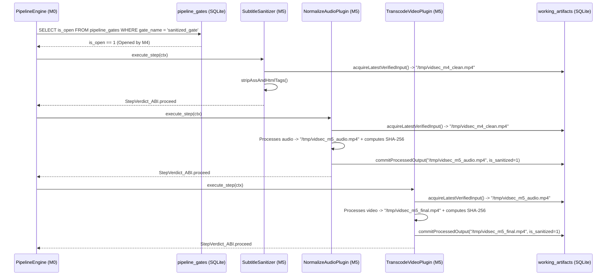

# Milestone M5 Specification: Post-Sanitization Multimedia Processing Pipeline and Docker Container

> **Global Directives:** See [`../AGENTS.md`](../AGENTS.md) before implementing this milestone.

---

## 1. Functional Scope and Compatibility Contracts

### Milestone Objective
Implement the **Post-Sanitization Multimedia Processing Macro-Phase (`M5`)**, compiled as chainable plugins under `zig-out/lib/plugins/processors/`, together with final **Docker** packaging (`Dockerfile`).
`M5` plugins execute within a `StageGroup` guarded by `require_gate: "sanitized_gate"` and operate **exclusively on the chain of verified artifacts in the SQLite `working_artifacts` table** (they never read the original `ctx.input_path_ptr`):
1. **`vidsec.m5.sanitize_subtitles` (`Step_SanitizeSubtitles`):** Extracts subtitles or processes text tracks by stripping any executable/renderable formatting tags (ASS/SSA `{\...}`, HTML `<script>`, ``, `<font>`), producing a strict UTF-8 plain-text `.srt`.
2. **`vidsec.m5.normalize_audio` (`Step_NormalizeAudio`):** Chains loudness normalization (`EBU R128` / `loudnorm`) and optional audio re-encoding (`AAC` / `Opus`), generating a new link in `working_artifacts`.
3. **`vidsec.m5.transcode_video` (`Step_TranscodeVideo`):** Applies YAML-configurable video transformation (resolution scaling, `H.264` / `HEVC` / `AV1` re-encoding, CRF/preset), taking the latest artifact from `working_artifacts` as input and registering the newly produced file.
4. **`vidsec.m5.extract_thumbnails` (`Step_ExtractThumbnails`) and Final Export (`Step_ExportFinal`):** Generates derivatives (thumbnails/contact sheet and atomic copy to the final destination) while leaving full `SHA-256` hash traceability in SQLite.

### Plugin Versioning and Dependency Contract (`VidsecPluginABI`)
```zig
const required_schemas = [_]abi.SchemaContract_ABI{
    .{ .domain = "working_artifacts", .version = 1, .writable = true }, // Reads the latest artifact and appends the new link
};

export const vidsec_plugin_descriptor = abi.VidsecPluginABI{
    .abi_version = abi.VIDSEC_ABI_VERSION,
    .plugin_id = "vidsec.m5.normalize_audio",
    .plugin_version = .{ .major = 1, .minor = 0, .patch = 0 },
    .requires_schemas_ptr = &required_schemas,
    .requires_schemas_len = required_schemas.len,
    .requires_plugins_ptr = null, // Guarded by require_gate: "sanitized_gate" in pipeline.yaml
    .requires_plugins_len = 0,
    .execute_step = &NormalizeAudioPlugin.execute,
};
```

---

## 2. Milestone UML Architecture (`classDiagram`)


---

## 3. Zig Type Contracts and SQLite Schema (`DDL / Queries`)

### 3.A. Zig Types and Validation Rules (`src/m5_processors/artifact_chain.zig`)

```zig
const std = @import("std");

pub const ChainError = error{
    NoSanitizedArtifactAvailable,
    ArtifactHashMismatch,
    InvalidProcessingParam,
    SubprocessFailed,
    SqliteError,
    OutOfMemory,
};

pub const VerifiedArtifact = struct {
    artifact_id: i64,
    file_path: [:0]const u8,
    byte_size: u64,
    sha256_hex: [64]u8,
};

/// Strips any ASS/SSA override tags `{\...}` and any HTML tags `<...>` from subtitles in memory.
pub fn stripAssAndHtmlTags(alloc: std.mem.Allocator, input: []const u8) ![]u8;
```

---

### 3.B. SQLite Chaining Queries (`"working_artifacts"` `v1`)

1. **Acquiring the Latest Verified Link (`acquireLatestVerifiedInput`):**
   Each `M5` step obtains its input file by running:
   ```sql
   SELECT artifact_id, file_path, byte_size, sha256_hex
   FROM working_artifacts
   WHERE is_sanitized = 1
   ORDER BY artifact_id DESC
   LIMIT 1;
   ```
   - If no row is returned: returns `error.NoSanitizedArtifactAvailable` and `StepVerdict_ABI.step_error`.
   - Before processing it, verifies that the on-disk size matches `byte_size` (and optionally its `sha256_hex`), ensuring no external process modified the temporary file between steps (*TOCTOU attack prevention*).

2. **Recording the New Processed Link (`commitProcessedOutput`):**
   When a step transforms the video (e.g., `NormalizeAudio` produces `step2_audio.mp4` and then `TranscodeVideo` takes `step2_audio.mp4` and produces `step3_hevc.mp4`), it computes the `SHA-256` of the new file and inserts a new row into `working_artifacts` with `is_sanitized = 1`, automatically making it the input for the next step in the chain.

---

## 4. Memory Model, Arenas, and Parameter Safety

| Resource / Structure | Owner / Storage | Lifetime | Who Frees / Closes |
| :--- | :--- | :--- | :--- |
| Chained artifact history (`working_artifacts`) | `ctx.sqlite_db` | Entire pipeline execution. | `StateDatabase.deinit()` in `M0`. |
| Construction of `argv` slices and SRT cleanup buffers | Local `ArenaAllocator` of each `M5` plugin | Only during `execute_step`. | `defer local_arena.deinit()`. |

### Allowlist Validation of YAML Parameters Before Invoking Subprocesses
To prevent a misconfigured parameter in `pipeline.yaml` from injecting arbitrary flags into `ffmpeg`:
- `codec`: Only values from a strict allowlist are accepted (`"libx264"`, `"libx265"`, `"libsvtav1"`, `"copy"`).
- `crf`: Must parse with `std.fmt.parseUnsigned(u8, crf_str, 10)` and be within the range `0..51`.
- `target_lufs`: Must parse with `std.fmt.parseFloat(f32, lufs_str)` and be within the range `-70.0 .. -5.0`.

---

## 5. Algorithmic Flow (`sequenceDiagram`) and Edge Cases



---

## 6. Declaration in `configs/pipeline.yaml` and Deployment `Dockerfile`

### 6.1. Post-Processing Sub-tree in `configs/pipeline.yaml`
```yaml
plugins:
  - id: "vidsec.m5.sanitize_subtitles"
    path: "./zig-out/lib/plugins/processors/libm5_subtitles.so"
  - id: "vidsec.m5.normalize_audio"
    path: "./zig-out/lib/plugins/processors/libm5_audio.so"
  - id: "vidsec.m5.transcode_video"
    path: "./zig-out/lib/plugins/processors/libm5_video.so"
  - id: "vidsec.m5.extract_thumbnails"
    path: "./zig-out/lib/plugins/processors/libm5_thumbnails.so"

# Macro-Phase 4 Group in pipeline.yaml:
- group: "Phase4_PostSanitizationProcessing"
  policy: "run_all"
  require_gate: "sanitized_gate"
  steps:
    - step: "SanitizeSubtitlesText"
      plugin: "vidsec.m5.sanitize_subtitles"
    - step: "NormalizeAudioEBU"
      plugin: "vidsec.m5.normalize_audio"
      params:
        target_lufs: "-14.0"
    - step: "TranscodeVideoStream"
      plugin: "vidsec.m5.transcode_video"
      params:
        codec: "libx264"
        crf: "23"
    - step: "GeneratePreviewThumbnails"
      plugin: "vidsec.m5.extract_thumbnails"
      params:
        interval_sec: "60"
```

### 6.2. Multi-Stage `Dockerfile` for Production
The repository includes a 2-stage `Dockerfile` at the root:
1. **`builder` stage (`alpine` + `zig` + `sqlite-dev`):** Runs `zig build -Doptimize=ReleaseSafe` and `zig build test` (the image build fails if any `M0`–`M5` unit test fails).
2. **`runtime` stage (`debian:bookworm-slim` or `alpine` without compilers):** Installs only `libsqlite3`, `ffmpeg`, and `bubblewrap`, copies `/app/vidsec`, `/app/plugins/{parsers,audit,sanitizers,processors}/*.so` with `0555` permissions (non-writable), and `/app/configs/`, and runs under an unprivileged user (`USER vidsec`).

---

## 7. Test Vectors and Acceptance Suite (`zig build test`)

### Test 1: Subtitle Sanitization (`stripAssAndHtmlTags`)
```zig
test "M5.1: SubtitleSanitizer strips ASS override blocks and HTML tags while preserving dialogue" {
    const dirty_sub = "{\\an8\\pos(100,200)}<script>alert(1)</script><b>Hola</b> {\\c&HFF0000&}mundo!";
    const clean = try stripAssAndHtmlTags(std.testing.allocator, dirty_sub);
    defer std.testing.allocator.free(clean);
    try std.testing.expectEqualStrings("alert(1)Hola mundo!", clean);
}
```

### Test 2: Traceable Chaining in `working_artifacts` and TOCTOU Verification (`SHA-256`)
- Inserts an initial `M4`-certified artifact into `working_artifacts` (`artifact_id = 1`, `/tmp/test_step1.mp4`).
- Runs two chained `M5` steps:
  1. Verifies that Step 1 acquires `artifact_id = 1` and records `artifact_id = 2` (`/tmp/test_step2.mp4`).
  2. Verifies that Step 2 automatically acquires `artifact_id = 2` (`/tmp/test_step2.mp4`) as its input.
  3. Modifies one byte in `/tmp/test_step2.mp4` behind SQLite's back and verifies that `acquireLatestVerifiedInput` detects the `SHA-256` mismatch and returns `error.ArtifactHashMismatch`.

### Test 3: End-to-End Integration (`M0` $\rightarrow$ `M1` $\rightarrow$ `M2` $\rightarrow$ `M3` $\rightarrow$ `M4` $\rightarrow$ `M5`)
- Runs the full pipeline defined in `configs/pipeline.yaml` on the MP4 vector with an overlay and a `free` box:
  - Verifies that `M1` populates `ir_regions`.
  - Verifies that `M2` detects the overlay (`R02`).
  - Verifies that `M4` truncates the overlay, zeroes out `free`, records the clean file in `working_artifacts`, and opens `"sanitized_gate"`.
  - Verifies that `M5` runs strictly on the clean file from `M4` and leaves a complete trace in `pipeline_trace`.
