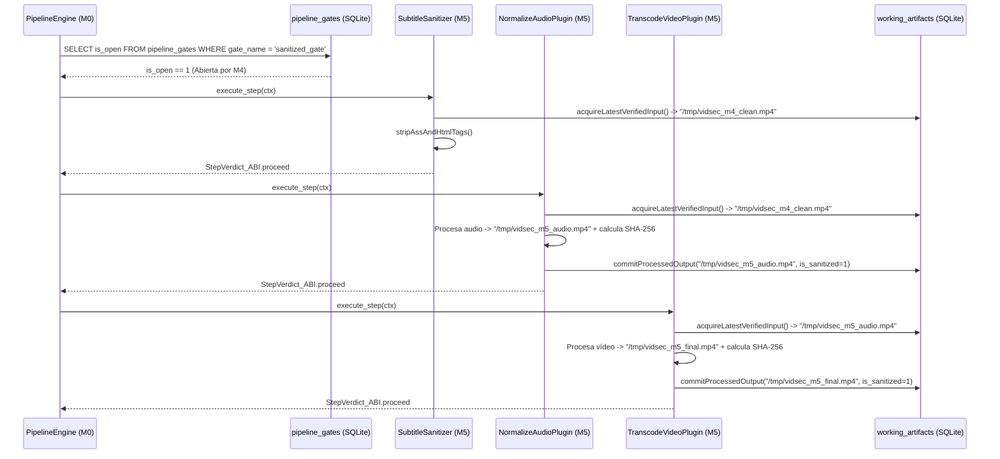

# Especificación de Hito M5: Pipeline de Procesamiento Multimedia Post-Sanitización y Contenedor Docker

> **Directivas Globales:** Ver [`../AGENTS.md`](../AGENTS.md) antes de implementar este hito.

---

## 1. Alcance Funcional y Contratos de Compatibilidad

### Objetivo del Hito
Implementar la **Macro-Fase de Procesamiento Multimedia Post-Sanitización (`M5`)**, compilada como plugins encadenables bajo `zig-out/lib/plugins/processors/`, junto con el empaquetado final en **Docker** (`Dockerfile`).
Los plugins de `M5` se ejecutan dentro de un `StageGroup` protegido por `require_gate: "sanitized_gate"` y operan **exclusivamente sobre la cadena de artefactos verificados en la tabla SQLite `working_artifacts`** (nunca leen `ctx.input_path_ptr` original):
1. **`vidsec.m5.sanitize_subtitles` (`Step_SanitizeSubtitles`):** Extrae subtítulos o procesa pistas de texto eliminando cualquier etiqueta de formato ejecutable/renderizable (`{\...}` de ASS/SSA, `<script>`, ``, `<font>` HTML), produciendo un `.srt` en texto plano UTF-8 estricto.
2. **`vidsec.m5.normalize_audio` (`Step_NormalizeAudio`):** Encadena la normalización de sonoridad (`EBU R128` / `loudnorm`) y recodificación opcional de audio (`AAC` / `Opus`) generando un nuevo eslabón en `working_artifacts`.
3. **`vidsec.m5.transcode_video` (`Step_TranscodeVideo`):** Aplica transformación de vídeo configurable por YAML (escalado de resolución, recodificación `H.264` / `HEVC` / `AV1`, CRF/preset) tomando como entrada el último artefacto de `working_artifacts` y registrando el nuevo archivo resultante.
4. **`vidsec.m5.extract_thumbnails` (`Step_ExtractThumbnails`) y Exportación Final (`Step_ExportFinal`):** Genera derivados (miniaturas/hoja de contactos y copia atómica al destino final) dejando trazabilidad completa de hashes `SHA-256` en SQLite.

### Contrato de Versionado y Dependencias de los Plugins (`VidsecPluginABI`)
```zig
const required_schemas = [_]abi.SchemaContract_ABI{
    .{ .domain = "working_artifacts", .version = 1, .writable = true }, // Lee el último artefacto y añade el nuevo eslabón
};

export const vidsec_plugin_descriptor = abi.VidsecPluginABI{
    .abi_version = abi.VIDSEC_ABI_VERSION,
    .plugin_id = "vidsec.m5.normalize_audio",
    .plugin_version = .{ .major = 1, .minor = 0, .patch = 0 },
    .requires_schemas_ptr = &required_schemas,
    .requires_schemas_len = required_schemas.len,
    .requires_plugins_ptr = null, // Protegido por require_gate: "sanitized_gate" en pipeline.yaml
    .requires_plugins_len = 0,
    .execute_step = &NormalizeAudioPlugin.execute,
};
```

---

## 2. Arquitectura UML del Hito (`classDiagram`)

```mermaid
classDiagram
    direction TB

    class ArtifactChainManager["src/m5_processors/artifact_chain.zig :: ArtifactChainManager"] {
        +acquireLatestVerifiedInput(alloc: Allocator, db: *sqlite3) ChainError!VerifiedArtifact
        +commitProcessedOutput(db: *sqlite3, step_name: []const u8, plugin_id: []const u8, out_path: []const u8) ChainError!void
    }

    class SubtitleSanitizer["src/m5_processors/subtitles.zig :: SubtitleSanitizer"] {
        +stripAssAndHtmlTags(alloc: Allocator, raw_sub_text: []const u8) ![]u8
        +execute(ctx: *PipelineContext_ABI) callconv(.C) StepVerdict_ABI
    }

    class NormalizeAudioPlugin["src/m5_processors/normalize_audio.zig :: NormalizeAudioPlugin"] {
        +buildFfmpegAudioArgs(alloc: Allocator, in_path: []const u8, out_path: []const u8, target_lufs: []const u8) ![]const []const u8
        +execute(ctx: *PipelineContext_ABI) callconv(.C) StepVerdict_ABI
    }

    class TranscodeVideoPlugin["src/m5_processors/transcode_video.zig :: TranscodeVideoPlugin"] {
        +buildFfmpegVideoArgs(alloc: Allocator, in_path: []const u8, out_path: []const u8, codec: []const u8, crf: []const u8) ![]const []const u8
        +execute(ctx: *PipelineContext_ABI) callconv(.C) StepVerdict_ABI
    }

    class ExtractThumbnailsPlugin["src/m5_processors/thumbnails.zig :: ExtractThumbnailsPlugin"] {
        +execute(ctx: *PipelineContext_ABI) callconv(.C) StepVerdict_ABI
    }

    SubtitleSanitizer ..|> VidsecPluginABI
    NormalizeAudioPlugin ..|> VidsecPluginABI
    TranscodeVideoPlugin ..|> VidsecPluginABI
    ExtractThumbnailsPlugin ..|> VidsecPluginABI
    SubtitleSanitizer --> ArtifactChainManager : reads & appends working_artifacts
    NormalizeAudioPlugin --> ArtifactChainManager : reads & appends working_artifacts
    TranscodeVideoPlugin --> ArtifactChainManager : reads & appends working_artifacts
    ExtractThumbnailsPlugin --> ArtifactChainManager : reads latest artifact
```



---

## 3. Contratos de Tipos en Zig y Esquema SQLite (`DDL / Queries`)

### 3.A. Tipos y Reglas de Validación en Zig (`src/m5_processors/artifact_chain.zig`)

```zig
const std = @import("std");

pub const ChainError = error{
    NoSanitizedArtifactAvailable,
    ArtifactHashMismatch,
    InvalidProcessingParam,
    SubprocessFailed,
    SqliteError,
    OutOfMemory,
};

pub const VerifiedArtifact = struct {
    artifact_id: i64,
    file_path: [:0]const u8,
    byte_size: u64,
    sha256_hex: [64]u8,
};

/// Purga en memoria cualquier etiqueta de estilo ASS/SSA `{\...}` y cualquier tag HTML `<...>` de subtítulos.
pub fn stripAssAndHtmlTags(alloc: std.mem.Allocator, input: []const u8) ![]u8;
```

---

### 3.B. Consultas SQLite de Encadenamiento (`"working_artifacts"` `v1`)

1. **Adquisición del Último Eslabón Verificado (`acquireLatestVerifiedInput`):**
   Cada paso de `M5` obtiene su archivo de entrada ejecutando:
   ```sql
   SELECT artifact_id, file_path, byte_size, sha256_hex
   FROM working_artifacts
   WHERE is_sanitized = 1
   ORDER BY artifact_id DESC
   LIMIT 1;
   ```
   - Si no devuelve ninguna fila: devuelve `error.NoSanitizedArtifactAvailable` y `StepVerdict_ABI.step_error`.
   - Antes de procesarlo, verifica que el tamaño en disco coincide con `byte_size` (y opcionalmente su `sha256_hex`), garantizando que ningún proceso externo modificó el archivo temporal entre pasos (*prevención de ataques TOCTOU*).

2. **Registro del Nuevo Eslabón Procesado (`commitProcessedOutput`):**
   Cuando un paso transforma el vídeo (ej. `NormalizeAudio` genera `step2_audio.mp4` y luego `TranscodeVideo` toma `step2_audio.mp4` y genera `step3_hevc.mp4`), calcula el `SHA-256` del nuevo archivo e inserta una nueva fila en `working_artifacts` con `is_sanitized = 1`, convirtiéndolo automáticamente en la entrada del siguiente paso de la cadena.

---

## 4. Modelo de Memoria, Arenas y Seguridad de Parámetros

| Recurso / Estructura | Propietario / Almacenamiento | Tiempo de Vida (Lifetime) | Quién libera / cierra |
| :--- | :--- | :--- | :--- |
| Historial de artefactos encadenados (`working_artifacts`) | `ctx.sqlite_db` | Toda la ejecución del pipeline. | `StateDatabase.deinit()` en `M0`. |
| Construcción de slices `argv` y buffers de limpieza SRT | `ArenaAllocator` local de cada plugin `M5` | Solo durante `execute_step`. | `defer local_arena.deinit()`. |

### Validación en Lista Blanca de Parámetros YAML antes de Invocar Subprocesos
Para impedir que un parámetro mal configurado en `pipeline.yaml` inyecte flags arbitrarios en `ffmpeg`:
- `codec`: Solo se aceptan valores de una lista blanca estricta (`"libx264"`, `"libx265"`, `"libsvtav1"`, `"copy"`).
- `crf`: Debe parsearse con `std.fmt.parseUnsigned(u8, crf_str, 10)` y estar en el rango `0..51`.
- `target_lufs`: Debe parsearse con `std.fmt.parseFloat(f32, lufs_str)` y estar en el rango `-70.0 .. -5.0`.

---

## 5. Flujo Algorítmico (`sequenceDiagram`) y Casos Borde



---

## 6. Declaración en `configs/pipeline.yaml` y `Dockerfile` de Despliegue

### 6.1. Sub-árbol de Post-Procesamiento en `configs/pipeline.yaml`
```yaml
plugins:
  - id: "vidsec.m5.sanitize_subtitles"
    path: "./zig-out/lib/plugins/processors/libm5_subtitles.so"
  - id: "vidsec.m5.normalize_audio"
    path: "./zig-out/lib/plugins/processors/libm5_audio.so"
  - id: "vidsec.m5.transcode_video"
    path: "./zig-out/lib/plugins/processors/libm5_video.so"
  - id: "vidsec.m5.extract_thumbnails"
    path: "./zig-out/lib/plugins/processors/libm5_thumbnails.so"

# Grupo de la Macro-Fase 4 en pipeline.yaml:
- group: "Phase4_PostSanitizationProcessing"
  policy: "run_all"
  require_gate: "sanitized_gate"
  steps:
    - step: "SanitizeSubtitlesText"
      plugin: "vidsec.m5.sanitize_subtitles"
    - step: "NormalizeAudioEBU"
      plugin: "vidsec.m5.normalize_audio"
      params:
        target_lufs: "-14.0"
    - step: "TranscodeVideoStream"
      plugin: "vidsec.m5.transcode_video"
      params:
        codec: "libx264"
        crf: "23"
    - step: "GeneratePreviewThumbnails"
      plugin: "vidsec.m5.extract_thumbnails"
      params:
        interval_sec: "60"
```

### 6.2. `Dockerfile` Multi-Stage para Producción
El repositorio incluye en la raíz un `Dockerfile` de 2 etapas:
1. **Stage `builder` (`alpine` + `zig` + `sqlite-dev`):** Ejecuta `zig build -Doptimize=ReleaseSafe` y `zig build test` (el build de la imagen falla si algún test unitario de `M0`–`M5` no pasa).
2. **Stage `runtime` (`debian:bookworm-slim` o `alpine` sin compiladores):** Instala únicamente `libsqlite3`, `ffmpeg` y `bubblewrap`, copia `/app/vidsec`, `/app/plugins/{parsers,audit,sanitizers,processors}/*.so` con permisos `0555` (no escribibles) y `/app/configs/`, y ejecuta bajo un usuario sin privilegios (`USER vidsec`).

---

## 7. Vectores de Prueba y Suite de Aceptación (`zig build test`)

### Test 1: Sanitización de Subtítulos (`stripAssAndHtmlTags`)
```zig
test "M5.1: SubtitleSanitizer strips ASS override blocks and HTML tags while preserving dialogue" {
    const dirty_sub = "{\\an8\\pos(100,200)}<script>alert(1)</script><b>Hola</b> {\\c&HFF0000&}mundo!";
    const clean = try stripAssAndHtmlTags(std.testing.allocator, dirty_sub);
    defer std.testing.allocator.free(clean);
    try std.testing.expectEqualStrings("alert(1)Hola mundo!", clean);
}
```

### Test 2: Encadenamiento Trazable en `working_artifacts` y Verificación TOCTOU (`SHA-256`)
- Inserta en `working_artifacts` un artefacto inicial certificado por `M4` (`artifact_id = 1`, `/tmp/test_step1.mp4`).
- Ejecuta dos steps encadenados de `M5`:
  1. Verifica que el Paso 1 adquiere `artifact_id = 1` y registra `artifact_id = 2` (`/tmp/test_step2.mp4`).
  2. Verifica que el Paso 2 adquiere automáticamente `artifact_id = 2` (`/tmp/test_step2.mp4`) como su entrada.
  3. Modifica un byte en `/tmp/test_step2.mp4` a espaldas de SQLite y verifica que `acquireLatestVerifiedInput` detecta la discrepancia de `SHA-256` y devuelve `error.ArtifactHashMismatch`.

### Test 3: Integración Extremo a Extremo (`M0` $\rightarrow$ `M1` $\rightarrow$ `M2` $\rightarrow$ `M3` $\rightarrow$ `M4` $\rightarrow$ `M5`)
- Ejecuta el pipeline completo definido en `configs/pipeline.yaml` sobre el vector MP4 con *overlay* y caja `free`:
  - Verifica que `M1` puebla `ir_regions`.
  - Verifica que `M2` detecta el *overlay* (`R02`).
  - Verifica que `M4` trunca el *overlay*, pone a cero `free`, registra el archivo limpio en `working_artifacts` y abre `"sanitized_gate"`.
  - Verifica que `M5` se ejecuta únicamente sobre el archivo limpio de `M4` y deja la traza completa en `pipeline_trace`.
