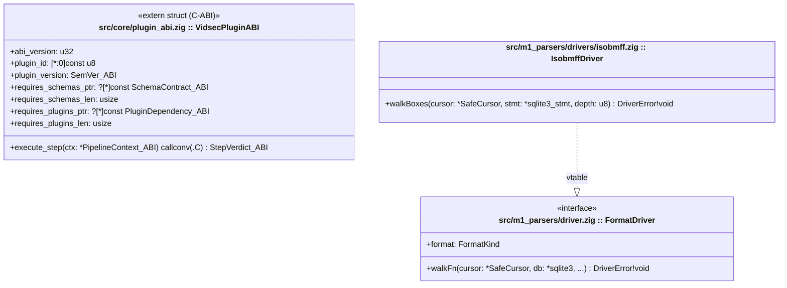

# Plantilla Estándar de Especificación de Hito (`MILESTONE_TEMPLATE.md`)

> [!IMPORTANT]
> **Propósito de este documento:**
> Esta plantilla define la estructura **obligatoria** que seguirán los documentos `M0` a `M5` dentro de `/home/ubuntu/.gemini/antigravity/scratch/vidsec/specs/`.
> Cada hito se diseña como un **paquete modular e independiente** que se enchufa al motor (`M0`) y opera contra la base de datos de estado e IR en **SQLite**, permitiendo que un agente de codificación (Gemini, Claude, etc.) implemente y verifique cada hito de forma autónoma con `zig build test`.

---

## Estructura Obligatoria de cada Documento `M[0-5]_*.md`

> [!NOTE]
> Las directivas globales del compilador Zig, uso seguro de SQLite (`prepared statements` y transacciones), matriz de versionado en 3 niveles y prohibición de `@panic`/`unreachable` están centralizadas en [`../AGENTS.md`](../AGENTS.md) y no se repiten en cada hito.

---

### 1. Alcance Funcional y Contratos de Compatibilidad
*Resumen directo de qué construye este hito, las tablas SQLite que produce o consume y su contrato de versiones.*

- **Objetivo del Hito (1 párrafo):** Qué capacidad aporta este paquete al ecosistema de `vidsec`.
- **Contrato de Versionado y Dependencias del Plugin (`VidsecPluginABI`):**
  - `abi_version`: `1`
  - `plugin_version`: `SemVer_ABI` (ej. `1.0.0`)
  - `requires_schemas_ptr` / `requires_schemas_len`: Slice de bancos DDL SQLite `SchemaContract_ABI` (`domain`, `version`, `writable`) que `M0` aprovisiona desde `configs/schemas/<domain>_v<version>.sql` al cargar el plugin.
  - `requires_plugins_ptr` / `requires_plugins_len`: Slice de *Hard Dependencies* `PluginDependency_ABI` (`plugin_id`, `min_version`) que deben ejecutarse antes en el pipeline (o vacío si el plugin es autónomo).

---

### 2. Arquitectura UML del Hito (`classDiagram`)
*Diagrama de Clases UML adaptado a Zig (donde cada archivo `.zig` es un `struct`/módulo). El título de cada nodo indica su ruta (`ruta/modulo.zig :: StructName`), mostrando de un vistazo los módulos del hito, sus campos, métodos y su interacción con `PipelineContext_ABI` / `sqlite3`.*



---

### 3. Contratos de Tipos en Zig y Esquema SQLite (`DDL / Queries`)
*El corazón de la especificación. Se divide en dos subsecciones obligatorias:*

#### 3.A. Tipos, Errores y Firmas Públicas en Zig
- **`Error Sets` explícitos** (`DriverError`, `SqliteError`, etc.).
- **Estructuras de datos (`struct` / `extern struct`)** y descriptores `export const vidsec_plugin_descriptor`.

#### 3.B. Contrato de Esquema SQLite Requerido / Producido (`SQL Schema & Queries`)
- **Tablas e Índices Creados o Modificados (`CREATE TABLE`, `CREATE INDEX`):** Definición SQL exacta con tipos (`INTEGER`, `TEXT`, `BLOB`, `REAL`) y restricciones.
- **Consultas o Inserciones Estándar (`Prepared Statements`):** Las consultas SQL parametrizadas (`?1`, `?2`) que ejecuta cada step de este hito sobre la base de datos SQLite compartida.

---

### 4. Modelo de Memoria, Arenas y Transacciones SQLite
*Fija las reglas de propiedad (ownership) de memoria y el ciclo de vida de las sentencias SQLite.*

| Recurso / Estructura | Propietario / Almacenamiento | Tiempo de Vida (Lifetime) | Quién libera / cierra |
| :--- | :--- | :--- | :--- |
| Representación Intermedia (`ir_*`), Hallazgos (`audit_findings`) y Artefactos (`working_artifacts`) | Base de datos `sqlite3*` (`:memory:` o archivo `.sqlite`) | Toda la ejecución del pipeline sobre el archivo actual. | `PipelineContext.deinit()` en `M0` (`sqlite3_close_v2`). |
| Sentencias preparadas (`*sqlite3_stmt`) de un Step | Plugin en ejecución | Solo durante la llamada a `execute_step`. | `defer sqlite3_finalize(stmt)` antes de salir de `execute_step`. |
| Buffers temporales de lectura (`SafeCursor`) | `ArenaAllocator` local del Step o pila `[4096]u8` | Solo durante `execute_step`. | `defer local_arena.deinit()`. |

- **Constantes de protección contra DoS (Hard Limits):**
  - Ej.: `MAX_BOX_DEPTH = 32`, `MAX_IR_REGIONS = 250_000`, `SQLITE_BATCH_COMMIT_SIZE = 10_000`.

---

### 5. Flujo Algorítmico (`sequenceDiagram`) y Casos Borde
*Combina un diagrama de secuencia UML para visualizar la interacción dinámica entre el plugin, `SafeCursor` y `SQLite` con una tabla de casos borde obligatorios.*

1. **Diagrama de Secuencia (`sequenceDiagram`) y flujo paso a paso:**
   ```mermaid
   sequenceDiagram
       participant Host as PipelineEngine (M0)
       participant Plugin as Step Plugin (.so)
       participant Cursor as SafeCursor
       participant DB as SQLite3 (:memory: / WAL)

       Host->>Plugin: execute_step(ctx_abi)
       Plugin->>DB: BEGIN IMMEDIATE TRANSACTION
       Plugin->>DB: sqlite3_prepare_v2("INSERT INTO ir_regions ...")
       loop Cada caja del contenedor
           Plugin->>Cursor: readU32Be() + readFourCC()
           Plugin->>DB: sqlite3_bind_* + sqlite3_step() + sqlite3_reset()
       end
       Plugin->>DB: sqlite3_finalize(stmt) + COMMIT
       Plugin-->>Host: StepVerdict_ABI.proceed
   ```
2. **Tabla de Casos Borde (Edge Cases) obligatorios:**
   - Casos límite binarios del formato y manejo de errores de SQLite (`SQLITE_BUSY`, `SQLITE_CONSTRAINT`, rollback de transacción ante error).

---

### 6. Declaración en `pipeline.yaml` y Configuración Opcional del Plugin
*Muestra cómo se registra el plugin en el array `plugins:` (con su ruta `.so`, restricción de versión opcional y archivo `config:` opcional) y cómo se invoca en el árbol `pipeline:`.*

---

### 7. Vectores Binarios en Crudo y Suite de Tests de Aceptación (`zig build test`)
*Proporciona micro-contenedores binarios codificados como arrays de bytes en Zig (`[_]u8{ ... }`) y las consultas SQL de verificación para que los tests del hito sean 100% autónomos.*

- **Test Vector 1 (Caso Limpio / Happy Path):** Bytes hexadecimales exactos + verificación mediante `SELECT COUNT(*) FROM ...` en SQLite.
- **Test Vector 2 (Caso Malicioso / Exploit Sintético):** Bytes hexadecimales exactos con la anomalía inyectada + verificación del registro en la tabla `audit_findings`.
- **Checklist de Verificación Autónoma:**
  1. `zig build` compila con 0 errores y 0 warnings.
  2. `zig build test` pasa el 100% de los tests sin fugas en `std.testing.allocator` ni sentencias SQLite sin finalizar (`sqlite3_next_stmt == null`).
