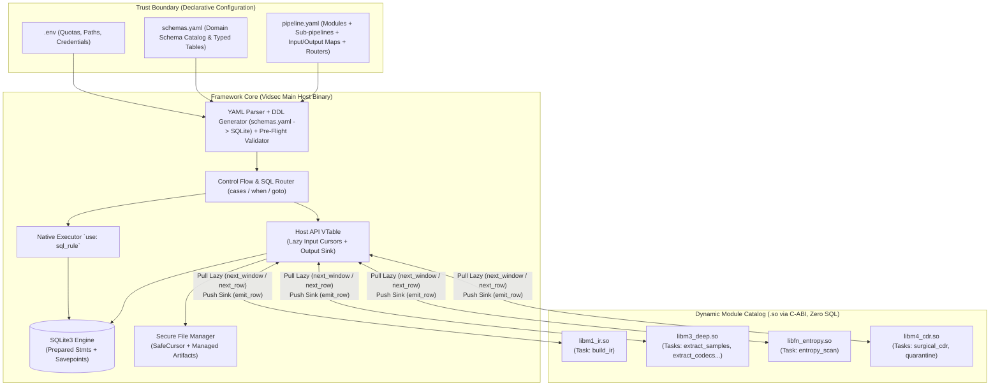
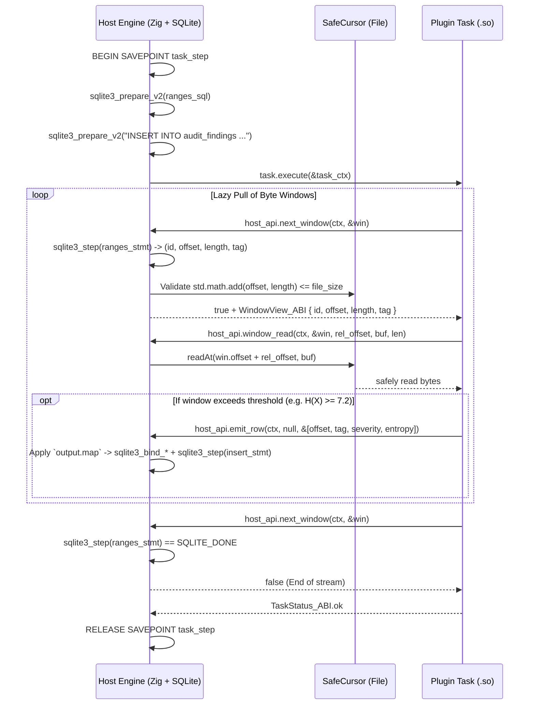

# Core Framework Specification (`vidsec v2`)

## 1. Architectural Vision and Principles

In `vidsec v2`, the architecture is strictly decoupled into two distinct planes:
1. **The Framework Core (Host Runtime):** The sole owner of execution state, the embedded **SQLite3** database, filesystem storage, schema validation (`schema.sql` / `schemas.yaml`), and declarative orchestration (`pipeline.yaml` + `.env`).
2. **Task Module Plugins (`.so` loaded via C-ABI):** Pure dynamic computation libraries that are **100% SQL-free and agnostic of the underlying operating system**. They do not link against `libsqlite3`, never receive `*sqlite3` pointers, and never open filesystem paths directly.



### Key Architectural Advantages over `v1`:
* **Zero SQL in Plugins:** No plugin constructs or executes SQL statements. The Host executes input queries (`ranges_sql`, `sql`) and feeds records **lazily element-by-element** (via pull iterators wrapping `sqlite3_step()`). Upon emitting results (`emit_row`), the Host applies output mappings (`output.map` / `output.tables`) and inserts into SQLite using prepared statements inside a transaction savepoint.
* **No Shared `libsqlite3.so` Linkage in Plugins:** Because the `*sqlite3` pointer never crosses the `dlopen` ABI boundary, mutex corruption and global SQLite allocator clashes are physically eliminated.
* **Pure Reusability via `pipeline.yaml`:** A single native Zig function (such as `entropy_scan`) can audit padding (`R07`), container overlays (`R02`), or file slack space (`R08`) simply by altering the input `ranges_sql` query and `output.map` in YAML.
* **Relational Rules without Native Code (`use: sql_rule`):** Any integrity or forensic check expressible as a `SELECT` query over the IR (`R01`, `R03`, `R04`, `R05`, `R06`, `R09`, `R10`) executes natively inside the engine without compiling a dedicated `.so` plugin.

---

## 2. Declarative Specification (`schemas.yaml`, `pipeline.yaml`, and `.env`)

### 2.1. Domain Schema Catalog (`schemas.yaml`)
Rather than maintaining raw `.sql` files or hardcoding table structures inside plugins, `schemas.yaml` declares **domain entity schemas** (`ir_core`, `ir_deep`, `audit`, etc.) using **exclusively the 5 primitive C-ABI types**, which map 1:1 to SQLite (`STRICT` mode):
- `int64` $\rightarrow$ `INTEGER`
- `float64` $\rightarrow$ `REAL`
- `bool` $\rightarrow$ `INTEGER` (`0` or `1`)
- `text` $\rightarrow$ `TEXT`
- `blob` $\rightarrow$ `BLOB`

```yaml
version: 2

schemas:
  ir_core:
    container_metadata:
      columns:
        file_size:        { type: int64 }
        detected_format:  { type: int64 }
        true_magic:       { type: int64 }
        true_magic_name:  { type: text }
        highest_root_end: { type: int64 }

    ir_regions:
      columns:
        region_id:                { type: int64, pk: true }
        parent_region_id:         { type: int64, nullable: true, ref: ir_regions.region_id }
        tag_name:                 { type: text }
        role:                     { type: text }
        header_offset:            { type: int64 }
        payload_offset:           { type: int64 }
        effective_end_offset:     { type: int64 }
        is_truncated_or_overflow: { type: bool, default: false }
      indexes: [role, tag_name]

  audit:
    audit_findings:
      columns:
        finding_id:     { type: int64, pk: true }
        rule_id:        { type: text }
        severity:       { type: int64 }
        file_offset:    { type: int64 }
        region_tag:     { type: text, nullable: true }
        measured_value: { type: float64, nullable: true }
        message:        { type: text, nullable: true }
      indexes: [rule_id, severity]
```

### 2.2. Environment Interpolation and `pipeline.yaml` Header
`pipeline.yaml` references `schemas.yaml` and supports environment variable interpolation using `${VAR}` or `${VAR:-default}`:

```yaml
version: 2

# Global engine settings and .env injection
engine:
  schemas: "./configs/schemas.yaml"
  db_mode: "${VIDSEC_DB_MODE:-memory}"          # "memory" | "wal_file"
  db_busy_timeout_ms: "${VIDSEC_DB_TIMEOUT:-5000}"
  max_task_memory_mb: "${VIDSEC_MAX_MEM_MB:-256}"
  allowed_dirs:
    quarantine: "${VIDSEC_QUARANTINE_DIR:-/var/vidsec/quarantine}"
    work: "${VIDSEC_WORK_DIR:-/tmp/vidsec_work}"

# 1. Dynamic module catalog (.so)
# A module may expose 1 default task or multiple tasks (invoked as module/task)
modules:
  ir_builder:   { path: "./plugins/libm1_ir.so" }
  deep_extract: { path: "./plugins/libm3_deep.so" }
  entropy_scan: { path: "./plugins/libfn_entropy.so" }
  quarantine:   { path: "./plugins/libfn_quarantine.so" }
  surgical_cdr: { path: "./plugins/libm4_cdr.so" }
```

### 2.3. Pipeline Grammar: `task` (`input.map` / `output.map` symmetry) and `router`
The `pipelines:` block defines a dictionary of named sub-pipelines. Execution always starts at sub-pipeline `main`. Each entry in `steps:` is one of two types:

#### A) Execution Step (`task`)
In both `input` and `output`, steps can operate at the **full domain schema level** (`schema: ir_core`, ideal for broad lowering tasks like `ir_builder`) or at the **table mapping level (`table`/`into` + `map`)**:
* When an `input` declares `table` + `filter` + `map: { plugin_field: col_expr }`, the Framework automatically synthesizes the SQL query:
  `SELECT <col_expr> AS <plugin_field>, ... FROM <table> WHERE <filter>`.

```yaml
      - task: <step_identifier>
        use: <module_name> | <module_name>/<task_name> | sql_rule
        # Only for `use: sql_rule`:
        query: "<Read-only SQL SELECT>"
        # Host-managed inputs (optional based on task signature):
        input:
          stream:
            from: file | <artifact_id>
          # Option A: Byte windows mapped declaratively from a table
          windows:
            from: file | <artifact_id>
            table: ir_regions
            filter: "role IN ('padding', 'unknown', 'metadata') AND (effective_end_offset - payload_offset) >= 64"
            map:
              id: region_id
              offset: payload_offset
              length: "effective_end_offset - payload_offset"
              tag: tag_name
          # Option B: Row cursor mapped declaratively from a table
          <cursor_name>:
            table: audit_findings
            filter: "severity = 2"
            map:
              rule: rule_id
              offset: file_offset
              detail: message
        # Scalar parameters injected via ABI (optional):
        params:
          entropy_threshold: 7.2
          quarantine_dir: "${VIDSEC_QUARANTINE_DIR}/rejected"
        # Output persistence rules managed by the Host (optional):
        output:
          # Mode 1: Domain schema dump (e.g. `ir_builder` -> `schema: ir_core`)
          schema: ir_core
          # Mode 2: Insert/Upsert into target table with `map` projection
          into: audit_findings
          mode: insert # "insert" (default) | "upsert" | "update"
          key: finding_id # Required only if mode == "update" or "upsert"
          map:
            rule_id: "'R07'"           # Constant literal string
            file_offset: offset        # Emitted `offset` field
            region_tag: tag            # Emitted `tag` field
            severity: severity         # Emitted `severity` field
            measured_value: entropy    # Emitted `entropy` field
          # If the task produces a new mutated/clean file:
          artifact: sanitized_video
```

#### B) Conditional Router (`router`)
Evaluates read-only SQL queries sequentially. The first `when` condition returning at least one row (`sqlite3_step() == SQLITE_ROW`) branches execution to `goto`. If none match, execution branches to `default` (or halts if omitted).

```yaml
      - router: triage_gate
        cases:
          - when: "SELECT 1 FROM audit_findings WHERE rule_id = 'R01' AND severity = 2"
            goto: quarantine_full_file
        default: deep_audit_flow
```

---

## 3. Lazy Data Model and C-ABI Contract (`src/core/plugin_abi.zig`)

### 3.1. Zero-RAM-Blowup Lazy Pipeline (*Pull Input* / *Push Output*)
Because SQLite is embedded directly within the process, the Framework uses native prepared cursors (`sqlite3_stmt`) to stream records into plugins without materializing multi-gigabyte collections in RAM:



### 3.2. C-ABI Binary Structures (`callconv(.C)`)

```zig
pub const VIDSEC_ABI_VERSION: u32 = 2;

pub const SemVer_ABI = extern struct {
    major: u16,
    minor: u16,
    patch: u16,
};

pub const ValueTag_ABI = enum(u32) {
    null_val = 0,
    int64 = 1,
    float64 = 2,
    boolean = 3,
    text = 4,
    blob = 5,
};

pub const ValuePayload_ABI = extern union {
    int64: i64,
    float64: f64,
    boolean: bool,
    slice: extern struct {
        ptr: [*]const u8,
        len: usize,
    },
};

/// Universal typed value for input columns, parameters, and output fields.
pub const Value_ABI = extern struct {
    tag: ValueTag_ABI,
    payload: ValuePayload_ABI,
};

/// Named field tuple emitted by plugin or returned from an input row cursor.
pub const NamedField_ABI = extern struct {
    name_ptr: [*:0]const u8,
    value: Value_ABI,
};

/// View of a bounded byte window produced by `input.windows`.
pub const WindowView_ABI = extern struct {
    window_id: i64,
    file_offset: u64,
    byte_length: u64,
    tag_ptr: [*]const u8,
    tag_len: usize,
};

/// View of a row emitted by `input.<name>.sql`.
pub const RowView_ABI = extern struct {
    fields_ptr: [*]const NamedField_ABI,
    fields_len: usize,
};

pub const HostError_ABI = enum(u32) {
    ok = 0,
    end_of_stream = 1,
    out_of_bounds = 2,
    invalid_argument = 3,
    io_error = 4,
    db_constraint_error = 5,
    permission_denied = 6,
    out_of_memory = 7,
};

pub const TaskStatus_ABI = enum(u32) {
    ok = 0,                  // Advances to next step after RELEASE SAVEPOINT
    recoverable_warning = 1, // Logs warning in trace JSON and proceeds
    halt_pipeline = 2,       // Commits changes (RELEASE SAVEPOINT) and cleanly terminates pipeline
    fatal_error = 3,         // Rolls back step changes (ROLLBACK TO SAVEPOINT) and aborts
};

/// Host services Virtual Table (VTable). Plugins interact with the outside world
/// EXCLUSIVELY by invoking these function pointers.
pub const HostApiVTable_ABI = extern struct {
    // --- 1. Raw Stream Input (`input.stream`) ---
    stream_size: *const fn (ctx: *TaskContext_ABI) callconv(.C) u64,
    stream_read_at: *const fn (
        ctx: *TaskContext_ABI,
        offset: u64,
        dest_ptr: [*]u8,
        len: usize,
    ) callconv(.C) HostError_ABI,

    // --- 2. Lazy Window Iterator (`input.windows`) ---
    next_window: *const fn (
        ctx: *TaskContext_ABI,
        out_window: *WindowView_ABI,
    ) callconv(.C) HostError_ABI,

    window_read_at: *const fn (
        ctx: *TaskContext_ABI,
        window: *const WindowView_ABI,
        relative_offset: u64,
        dest_ptr: [*]u8,
        len: usize,
    ) callconv(.C) HostError_ABI,

    // --- 3. Lazy Row Cursor Iterator (`input.<cursor_name>.sql`) ---
    next_row: *const fn (
        ctx: *TaskContext_ABI,
        cursor_name: [*:0]const u8,
        out_row: *RowView_ABI,
    ) callconv(.C) HostError_ABI,

    // --- 4. Task Parameters (`params:`) ---
    get_param: *const fn (
        ctx: *TaskContext_ABI,
        key: [*:0]const u8,
        out_val: *Value_ABI,
    ) callconv(.C) HostError_ABI,

    // --- 5. Data Output Sink (`output.into` / `output.tables`) ---
    emit_row: *const fn (
        ctx: *TaskContext_ABI,
        channel_name: ?[*:0]const u8,
        fields_ptr: [*]const NamedField_ABI,
        fields_len: usize,
    ) callconv(.C) HostError_ABI,

    // --- 6. Safe File Operations for CDR / Quarantine ---
    artifact_zero_range: *const fn (
        ctx: *TaskContext_ABI,
        offset: u64,
        length: u64,
    ) callconv(.C) HostError_ABI,

    artifact_truncate: *const fn (
        ctx: *TaskContext_ABI,
        new_size: u64,
    ) callconv(.C) HostError_ABI,

    carve_to_quarantine: *const fn (
        ctx: *TaskContext_ABI,
        offset: u64,
        length: u64,
        reason_tag: [*:0]const u8,
        out_sha256_hex: *[64]u8,
    ) callconv(.C) HostError_ABI,

    // --- 7. Observability and Logging ---
    log_event: *const fn (
        ctx: *TaskContext_ABI,
        level: u8, // 0=debug, 1=info, 2=warn, 3=error
        message_ptr: [*]const u8,
        message_len: usize,
    ) callconv(.C) void,
};

/// Opaque context delivered to every task invocation.
pub const TaskContext_ABI = extern struct {
    abi_version: u32 = VIDSEC_ABI_VERSION,
    opaque_host_state: *anyopaque,
    host: *const HostApiVTable_ABI,
};

/// Individual descriptor for a task registered inside a plugin.
pub const TaskDescriptor_ABI = extern struct {
    task_name: [*:0]const u8,
    description: [*:0]const u8,
    output_fields_ptr: ?[*]const [*:0]const u8 = null,
    output_fields_len: usize = 0,
    execute: *const fn (ctx: *TaskContext_ABI) callconv(.C) TaskStatus_ABI,
};

/// Manifest symbol exported by each `.so` via `vidsec_module_manifest`.
pub const ModuleManifest_ABI = extern struct {
    abi_version: u32 = VIDSEC_ABI_VERSION,
    module_name: [*:0]const u8,
    module_version: SemVer_ABI,
    tasks_ptr: [*]const TaskDescriptor_ABI,
    tasks_len: usize,
};
```

---

## 4. Internal Framework Architecture (`classDiagram`)

```mermaid
classDiagram
    direction TB

    class EnvInterpolator["src/core/env.zig :: EnvInterpolator"] {
        +vars: StringHashMapUnmanaged~[]const u8~
        +loadDotEnv(allocator: Allocator, path: []const u8) !void
        +interpolate(arena: Allocator, raw: []const u8) ![]const u8
    }

    class SafeCursor["src/core/io_cursor.zig :: SafeCursor"] {
        +file_size: u64
        +pos: u64
        +limit_stack: [32]u64
        +depth: u8
        +readAt(offset: u64, dest: []u8) CursorError!void
        +readWindowAt(win_offset: u64, win_len: u64, rel_offset: u64, dest: []u8) CursorError!void
    }

    class SchemaCatalog["src/core/schema_catalog.zig :: SchemaCatalog"] {
        +domains: StringHashMapUnmanaged~DomainSchema~
        +parseYaml(arena: Allocator, yaml_src: []const u8) !SchemaCatalog
        +emitSqliteDdl(allocator: Allocator) ![:0]const u8
        +compileInputSelect(allocator: Allocator, spec: InputTableSpec) ![:0]const u8
        +compileOutputMutation(allocator: Allocator, spec: OutputSpec) ![:0]const u8
    }

    class PipelineConfig["src/core/yaml_config.zig :: PipelineConfig"] {
        +schemas_path: []const u8
        +modules: StringHashMapUnmanaged~ModuleDecl~
        +pipelines: StringHashMapUnmanaged~SubPipeline~
        +parse(arena: Allocator, yaml_src: []const u8, env: *const EnvInterpolator) !PipelineConfig
    }

    class ModuleLoader["src/core/module_loader.zig :: ModuleLoader"] {
        +loaded_modules: StringHashMapUnmanaged~LoadedModule~
        +loadAll(modules: StringHashMapUnmanaged~ModuleDecl~) !void
        +resolveTask(use_spec: []const u8) !*const TaskDescriptor_ABI
    }

    class SqliteRuntime["src/core/sqlite_runtime.zig :: SqliteRuntime"] {
        +db: *sqlite3
        +initWithCatalog(db_path: ?[:0]const u8, catalog: *const SchemaCatalog) !SqliteRuntime
        +validateReadOnlyQuery(sql: [:0]const u8) !void
        +prepareStatement(sql: [:0]const u8) !*sqlite3_stmt
        +executeSqlRule(query: [:0]const u8, target_table: []const u8) !usize
        +evaluateRouterWhen(when_sql: [:0]const u8) !bool
    }

    class HostExecutionContext["src/core/host_context.zig :: HostExecutionContext"] {
        +runtime: *SqliteRuntime
        +active_cursor: *SafeCursor
        +ranges_stmt: ?*sqlite3_stmt
        +row_cursors: StringHashMapUnmanaged~*sqlite3_stmt~
        +output_stmts: StringHashMapUnmanaged~PreparedOutputSink~
        +params: StringHashMapUnmanaged~Value_ABI~
        +vtable: HostApiVTable_ABI
    }

    class PipelineEngine["src/core/engine.zig :: PipelineEngine"] {
        +config: PipelineConfig
        +catalog: SchemaCatalog
        +loader: ModuleLoader
        +db_runtime: SqliteRuntime
        +preflightValidate() !void
        +runFile(input_path: []const u8) !ExecutionSummary
    }

    PipelineEngine *-- PipelineConfig
    PipelineEngine *-- SchemaCatalog
    PipelineEngine *-- ModuleLoader
    PipelineEngine *-- SqliteRuntime
    PipelineEngine *-- ExecutionTracer
    PipelineEngine ..> HostExecutionContext : instantiates per task
    HostExecutionContext --> SafeCursor
    HostExecutionContext --> SqliteRuntime
```



### 4.1. Modular YAML Decoding Architecture (Avoiding God Modules)
Following patterns established in Docker Compose (`compose-go`), YAML parsing is split across two decoupled layers operating in ephemeral arena memory:
1. **Syntactic AST Layer (`src/core/yaml/ast.zig` + `env.zig`):** Parses arbitrary YAML into an immutable `YamlNode` tree while expanding `${VAR:-default}` expressions on the fly.
2. **Domain Decoders (`src/core/yaml/loaders/`):**
   - `schema_loader.zig`: Converts schema YAML nodes into `SchemaCatalog`.
   - `module_decl_loader.zig`: Decodes the `modules:` map.
   - `input_loader.zig` & `output_loader.zig`: Decodes input streams, windows, cursors, and output routing specs.
   - `step_loader.zig`: Assembles executable `task`, `sql_rule`, and `router` steps.
   - Once compiled into native Zig structures (`PipelineConfig` + `SchemaCatalog`), the AST `ArenaAllocator` is freed entirely before video processing begins.

---

## 5. Framework Security Guarantees (Pre-Flight and Runtime Validation)

The Framework enforces **five automated security boundaries**:

### 1. Schema Compilation and Pre-Flight SQL Validation
Before reading any media file:
1. Translates `schemas.yaml` into strict SQLite DDL (`CREATE TABLE ... STRICT;`).
2. Synthesizes input queries (`SELECT <expr> AS <plugin_field> FROM <table> WHERE <filter>`) and validates them using `sqlite3_prepare_v2`.
3. Verifies via `sqlite3_stmt_readonly(stmt) == 1` that no input query, `sql_rule`, or `router.when` expression can mutate database state (blocking harmful `DROP`, `DELETE`, `INSERT`, or `PRAGMA` injections).
4. Pre-compiles parameterized mutation statements (`INSERT INTO ... VALUES (...)`), validating all target columns against `schemas.yaml` and checking emitted fields against `TaskDescriptor_ABI.output_fields_ptr`.

### 2. Acyclic Router Graph Validation
During pre-flight validation, constructs the directed graph of sub-pipeline transitions (`router.cases.goto` and `router.default`) and verifies:
* All destination labels exist within `pipelines:`.
* **The sub-pipeline graph contains no cycles** (using Depth-First Search with three-color node marking), guaranteeing finite execution termination.

### 3. File Isolation and Safe Bounds Arithmetic in `window_read_at`
* Plugins never hold raw OS file descriptors or path strings.
* When `next_window` extracts `(id, offset, length, tag)`, the Host checks `std.math.add(u64, offset, length) <= file_size`.
* When a plugin calls `window_read_at(ctx, &win, rel_offset, dest_ptr, len)`, the Host validates `rel_offset + len <= win.byte_length`, making out-of-bounds reading physically impossible.

### 4. Step Transactional Atomicity (`SAVEPOINT`) and Output-Less Tasks
Every task step executes within an isolated `SAVEPOINT step_<task_name>;`:
* Tasks with no `output:` block act as controlled sinks (e.g. `quarantine` via `carve_to_quarantine` returning `halt_pipeline`).
* On `ok` or `recoverable_warning`, the Host executes `RELEASE SAVEPOINT`.
* On `halt_pipeline`, the Host executes `RELEASE SAVEPOINT` (retaining audit and quarantine records) and halts pipeline execution cleanly.
* On `fatal_error`, the Host executes `ROLLBACK TO SAVEPOINT`, keeping database state consistent.

### 5. Plugin Module Permission Verification
When loading `.so` libraries declared in `modules:`, `ModuleLoader` executes `fstat` and rejects libraries (`error.InsecureModulePermissions`) with group- or world-writable bits (`mode & 0o022 != 0`).

---

## 6. Observability and Interactive Control (Runtime / Post-Mortem / GUI)

To avoid polluting or slowing down the pipeline database (which is reserved exclusively for domain tables defined in `schemas.yaml`), logging and telemetry are handled out-of-band:

### 6.1. Structured Trace File (`../zig-out/out/trace.jsonl`)
The `ExecutionTracer` component (`src/core/tracer.zig`) serializes execution lifecycle events into a separate JSONL file:
* **`step_start` / `step_end`:** Sequence, sub-pipeline, task name, status (`TaskStatus_ABI`), elapsed microseconds, lazy rows pulled, and rows emitted.
* **`task_log`:** Messages emitted by plugins via `host.log_event` with associated timestamps.
* **`router_decision`:** Which `router.when` branch evaluated to true and which sub-pipeline was targeted.

### 6.2. Interactive Step-by-Step Control (Runtime Hooks for Debuggers and GUI)
Breakpoints and single-stepping are **decoupled from `pipeline.yaml`** and managed dynamically via `DebugController`:
* **Live Execution (CLI / GUI):** A GUI or `--step` / `--break-at` CLI flag registers callbacks with `DebugController`. The engine pauses execution between steps (immediately after releasing the step savepoint), allowing interactive state inspection before stepping, resuming, or aborting.
* **Post-Mortem Triage:** Combining the JSONL trace file with WAL snapshots allows full offline time-travel debugging.
