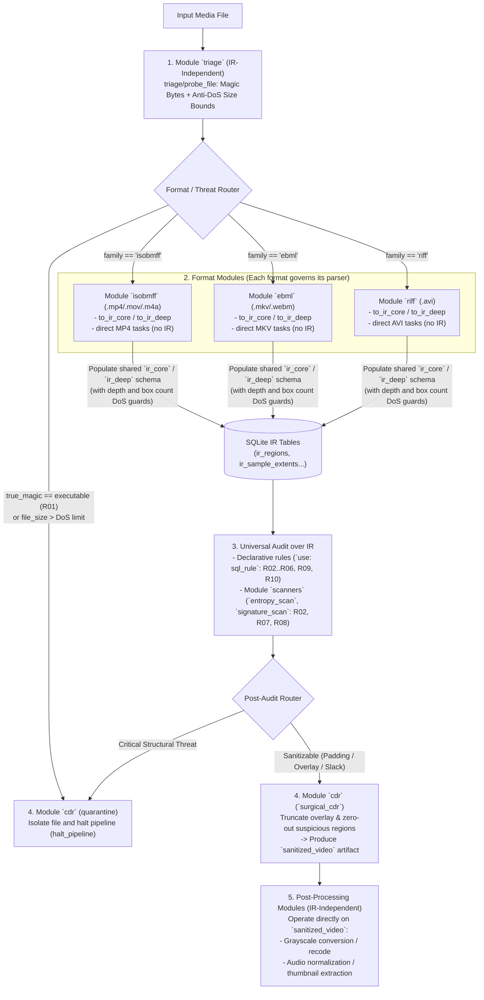

# Plugin and Task Catalog Architecture (`vidsec v2`)

## 1. Plugin Design Philosophy in `v2`

In `vidsec v2`, the framework engine **does not mandate the use of the Intermediate Representation (IR)**. The architecture establishes an open plugin ecosystem accommodating two distinct operational paradigms:

1. **Unified IR-Based Flow (Multi-Format Forensic Antivirus):**
   - Each container family (`isobmff`, `ebml`, `riff`) implements its own lowering parser targeting the common `ir_core` / `ir_deep` schema (leveraging a shared compile-time helper library `src/sdk/ir_contract.zig` to eliminate boilerplate).
   - Once mapped to the relational IR, declarative SQL rules (`use: sql_rule`), byte scanners (`entropy_scan`, `signature_scan`), and content disarm tools (`surgical_cdr`) operate in a manner **100% format-agnostic**.
2. **Direct / IR-Independent Flow (Pre-Triage and Format-Specific Transforms):**
   - Tasks operating directly against the input byte stream without instantiating or querying the IR: ranging from **initial pre-triage** (magic bytes inspection, anti-DoS size enforcement) to **format-specific binary manipulations** (e.g. reordering the `moov` atom in MP4s) and **multimedia post-processing filters** (e.g. grayscale conversion, audio normalization, subtitle stripping).



---

## 2. Dynamic Module Catalog (`.so`) and Task Signatures

### Category 1: Pre-Triage and Anti-DoS Gatekeeping (`libtriage.so`)
Completely independent of the IR. Acts as an ultra-fast first line of defense (executing in sub-millisecond time by sampling only file headers and filesystem metadata).

| Task (`module/task`) | Inputs | Params | Output | Responsibility |
| :--- | :--- | :--- | :--- | :--- |
| `triage/probe_file` | `stream: { from: file }` | `max_file_size_mb`, `strict_extension` | Table `file_triage` (`file_size`, `detected_family`, `true_magic_kind`, `true_magic_name`, `exceeds_size_limit`) | Identifies genuine container signatures (*magic bytes*), distinguishing valid media (`isobmff`, `ebml`, `riff`) from disguised executables (`MZ`, `ELF`, `Mach-O`, `ZIP`, scripts $\rightarrow$ `R01`) and enforcing anti-DoS size limits. |

---

### Category 2: Format Plugins and IR Lowering (`libisobmff.so`, `libebml.so`, `libriff.so` + IR SDK)

To maintain a uniform interface across formats, a shared compile-time package (**`src/sdk/ir_emitter.zig`**) provides helpers for emitting records into `ir_core` and `ir_deep` schemas via `host.emit_row`. However, **each format resides in its own isolated plugin**, governing its parser and exposing specialized tasks:

#### A) Anti-DoS Safeguards in Format Walkers
When traversing atoms (`ISOBMFF`), elements (`EBML`), or chunks (`RIFF`), each parser enforces three resource-exhaustion firewalls (*Parser DoS*):
1. **`max_depth` (default `32`):** Prevents stack overflow / infinite recursion from maliciously nested hierarchies (*Box Nesting Bombs*).
2. **`max_regions` (default `250_000`):** Blocks *Box Flooding* (files packing millions of empty 8-byte boxes designed to exhaust CPU and memory).
3. **`max_samples` (default `5_000_000`):** Limits sample table entries processed in forged `stsz`/`stco` tables.

#### B) Format Plugin Task Interface (`isobmff`, `ebml`, `riff`)

Because format plugins can **produce the IR (`to_ir_*`)**, **consume the IR (`from_ir`)**, or **manipulate native containers directly**, physical compaction and format conversion (*trans-muxing* from MKV to MP4 or vice versa) execute **100% in native Zig without external dependencies like FFmpeg**:

| Task (`<format>/<task>`) | Uses IR? | Inputs | Output | Description |
| :--- | :---: | :--- | :--- | :--- |
| `<format>/to_ir_core` | **Yes** (Frontend $\rightarrow$ `ir_core`) | `stream: { from: file }` | `schema: ir_core` (`ir_regions`, `container_stats`) | Traverses container region trees, computing parent boundaries, `highest_root_end` (for `R02`), and arithmetic overflows (`is_truncated_or_overflow` for `R03`). |
| `<format>/to_ir_deep` | **Yes** (`ir_core` $\rightarrow$ `ir_deep`) | `stream` + index regions from `ir_regions` | `schema: ir_deep` (`ir_sample_extents`, `ir_unreferenced_slack`, `ir_codec_configs`, `ir_attachments`, `ir_external_refs`) | Deep sample table parsing (`stbl` in MP4, `Cues` in MKV, `idx1` in AVI), unreferenced slack calculation inside `mdat`/`movi` (`R08`), codec config SPS validation (`R09`), attachments (`R06`), and external references (`R05`). |
| `<format>/from_ir` | **Yes** (Backend `ir_deep` $\rightarrow$ Clean Container) | `stream: { from: file }`, tables `ir_sample_extents` & `ir_codec_configs` | `artifact: rebuilt_container` | **Reconstruction / Native Trans-Muxing without FFmpeg:** Constructs a clean container from scratch by copying only legitimate sample extents and codec parameters from the IR. Enables surgical sanitization and native format conversion (e.g. `ebml/to_ir_*` $\rightarrow$ `isobmff/from_ir`). |
| `<format>/compact` *(Direct format task)* | **No** (or hybrid) | `stream: { from: sanitized_video }` | `artifact: compacted_video` | **Native Size Reduction without FFmpeg:** Strips padding boxes (`free`/`skip`/`Void`/`JUNK`), non-essential metadata, and slack space, shifting sample payloads and recalculating offset tables (`stco`/`co64`) natively. |
| `isobmff/faststart` *(Direct format task)* | **No** | `stream: { from: sanitized_video }` | `artifact: faststart_mp4` | Specialized MP4/M4A task operating directly on container bytes without the IR (relocating the `moov` atom to the head of the file for web streaming). |

---

### Category 3: Heuristic Byte Scanners (`libbyte_scanners.so`)
Pure byte analysis tasks agnostic of video container formats or calling rules. They consume lazy window iterators (`input.windows`) configured via YAML:

| Task (`scanners/<task>`) | Inputs | Params | Emitted Fields (`emit_row`) | Forensic Antivirus Use Case |
| :--- | :--- | :--- | :--- | :--- |
| `scanners/entropy_scan` | `windows` (`id`, `offset`, `length`, `tag`) | `entropy_threshold` (e.g. `7.2`) | `window_id`, `offset`, `length`, `tag`, `entropy`, `severity` | Instantiated via YAML to audit padding boxes (`R07`), trailing overlays beyond the last root box (`R02`), or unreferenced holes in `mdat` (`R08`). |
| `scanners/signature_scan` | `windows` (`id`, `offset`, `length`, `tag`) | `scan_step_bytes` | `window_id`, `offset`, `match_offset`, `tag`, `sig_name`, `severity` | Hunts executable headers (`MZ`, `ELF`, Mach-O, scripts, `Go buildinf:`) concealed within padding or slack space even when zero-padded (`0x00`) to evade entropy thresholds. |

> [!NOTE]
> **What about the remaining rules (`R01`, `R03`, `R04`, `R05`, `R06`, `R09`, `R10`)?**
> Because data is already structured in `file_triage`, `ir_core`, and `ir_deep`, they require no `.so` plugins: they execute directly in `pipeline.yaml` via `use: sql_rule` (including overlapping sample bomb detection `R10` using `LAG()` in SQL).

---

### Category 4: Mitigation, Quarantine, and Surgical CDR (`libcdr.so`)

| Task (`cdr/<task>`) | Inputs | Params | Output / Effect | Description |
| :--- | :--- | :--- | :--- | :--- |
| `cdr/quarantine_file` | `stream: { from: file }`, cursor `findings` | `quarantine_dir` | No `output:` table (Returns `halt_pipeline`) | Copies the malicious file and its findings manifest to quarantine storage and halts pipeline execution cleanly. |
| `cdr/surgical_cdr` | `stream: { from: file }`, `windows` (neutralization targets), `truncate_at` | `carve_evidence: true` | `artifact: sanitized_video` (+ optional table `carved_evidence`) | Clones the file safely using Copy-on-Write (CoW), carves suspicious windows (`R02`, `R07`, `R08`) to quarantine (`carve_to_quarantine`), zeroes payload bytes (`artifact_zero_range`) to maintain exact `stco`/`co64` offsets, and truncates trailing overlays (`artifact_truncate`). |

---

### Category 5: Media Cleaning and Post-Processing (`libmedia_ops.so` — Optional)
Tasks designed to execute **downstream of sanitization** (or in dedicated media processing pipelines), operating directly on clean artifacts (`from: sanitized_video`) **without requiring the IR**:

| Task (`media_ops/<task>`) | Inputs | Params | Output | Description |
| :--- | :--- | :--- | :--- | :--- |
| `media_ops/video_filter` | `stream: { from: sanitized_video }` | `filter: "grayscale" \| "scale"`, `codec: "libx264"`, `crf: 23` | `artifact: processed_video` | Applies visual transformations (e.g. converting video to black-and-white or scaling) in an isolated network-sandboxed process. |
| `media_ops/clean_subtitles` | `stream: { from: sanitized_video }` | `strip_html: true`, `strip_ass_tags: true` | `artifact: clean_srt` | Extracts subtitle tracks and purges ASS/SSA style tags and HTML exploits targeted at media players. |
| `media_ops/remux_streams` | `stream: { from: sanitized_video }` | `keep_attachments: false`, `strip_metadata: true` | `artifact: remuxed_video` | Re-packages elementary video and audio streams, stripping residual metadata, chapters, and embedded font attachments. |

---

## 3. Comprehensive `pipeline.yaml` Example: Triage, Format Plugins, IR, CDR, and Post-Processing

```yaml
version: 2

engine:
  schemas: "./configs/schemas.yaml"
  trace_file: "./logs/trace.jsonl"

modules:
  triage:    { path: "./plugins/libtriage.so" }
  isobmff:   { path: "./plugins/libisobmff.so" }
  ebml:      { path: "./plugins/libebml.so" }
  riff:      { path: "./plugins/libriff.so" }
  scanners:  { path: "./plugins/libbyte_scanners.so" }
  cdr:       { path: "./plugins/libcdr.so" }
  media_ops: { path: "./plugins/libmedia_ops.so" }

pipelines:
  # 1. PRE-TRIAGE (IR-Independent: Magic Bytes + Anti-DoS Size Guards)
  main:
    steps:
      - task: initial_probe
        use: triage/probe_file
        input:
          stream: { from: file }
        params:
          max_file_size_mb: 4096
        output:
          into: file_triage
          map:
            file_size: file_size
            detected_family: detected_family
            true_magic_kind: true_magic_kind
            true_magic_name: true_magic_name
            exceeds_size_limit: exceeds_size_limit

      - task: check_r01_and_dos_size
        use: sql_rule
        query: |
          SELECT 'R01' AS rule_id, 2 AS severity, 0 AS file_offset, true_magic_name AS region_tag,
                 'Spoofed executable or unsupported format' AS message
          FROM file_triage WHERE true_magic_kind >= 10 OR detected_family = 'unknown'
          UNION ALL
          SELECT 'DOS_SIZE', 2, 0, 'FILE', 'File exceeds maximum allowed size'
          FROM file_triage WHERE exceeds_size_limit = 1
        output:
          into: audit_findings

      # Routing to format-specific lowering plugins (or quarantine on triage failure)
      - router: dispatch_by_format
        cases:
          - when: "SELECT 1 FROM audit_findings WHERE severity = 2"
            goto: quarantine_flow
          - when: "SELECT 1 FROM file_triage WHERE detected_family = 'isobmff'"
            goto: parse_isobmff
          - when: "SELECT 1 FROM file_triage WHERE detected_family = 'ebml'"
            goto: parse_ebml
          - when: "SELECT 1 FROM file_triage WHERE detected_family = 'riff'"
            goto: parse_riff
        default: quarantine_flow

  # 2. FORMAT LOWERING TO IR (Each plugin enforces its anti-DoS depth/region limits)
  parse_isobmff:
    steps:
      - task: mp4_to_ir_core
        use: isobmff/to_ir_core
        input: { stream: { from: file } }
        params: { max_depth: 32, max_regions: 250000 }
        output: { schema: ir_core }
      - task: mp4_to_ir_deep
        use: isobmff/to_ir_deep
        input: { stream: { from: file } }
        params: { max_samples: 5000000 }
        output: { schema: ir_deep }
      - router: to_common_audit
        cases: []
        default: common_ir_audit

  parse_ebml:
    steps:
      - task: mkv_to_ir_core
        use: ebml/to_ir_core
        input: { stream: { from: file } }
        params: { max_depth: 32, max_regions: 250000 }
        output: { schema: ir_core }
      - task: mkv_to_ir_deep
        use: ebml/to_ir_deep
        input: { stream: { from: file } }
        output: { schema: ir_deep }
      - router: to_common_audit
        cases: []
        default: common_ir_audit

  parse_riff:
    steps:
      - task: avi_to_ir_core
        use: riff/to_ir_core
        input: { stream: { from: file } }
        params: { max_depth: 32, max_regions: 250000 }
        output: { schema: ir_core }
      - task: avi_to_ir_deep
        use: riff/to_ir_deep
        input: { stream: { from: file } }
        output: { schema: ir_deep }
      - router: to_common_audit
        cases: []
        default: common_ir_audit

  # 3. UNIVERSAL AUDIT OVER IR
  common_ir_audit:
    steps:
      - task: structural_sql_rules
        use: sql_rule
        query: |
          SELECT 'R03' AS rule_id, 2 AS severity, header_offset AS file_offset, tag_name AS region_tag,
                 'Region overflows parent bounds' AS message
          FROM ir_regions WHERE is_truncated_or_overflow = 1
          UNION ALL
          SELECT 'R10', 2, target_offset, source_tag, 'Overlapping sample extents (Decompression Bomb)'
          FROM (
            SELECT target_offset, source_tag,
                   LAG(end_offset) OVER (ORDER BY target_offset) AS prev_end
            FROM ir_sample_extents
          ) WHERE prev_end IS NOT NULL AND target_offset < prev_end
        output:
          into: audit_findings

      - task: scan_padding_entropy_r07
        use: scanners/entropy_scan
        input:
          windows:
            from: file
            table: ir_regions
            filter: "role IN ('padding', 'unknown') AND (effective_end_offset - payload_offset) >= 64"
            map:
              id: region_id
              offset: payload_offset
              length: "effective_end_offset - payload_offset"
              tag: tag_name
        params:
          entropy_threshold: 7.2
        output:
          into: audit_findings
          map:
            rule_id: "'R07'"
            file_offset: offset
            region_tag: tag
            severity: severity
            measured_value: entropy

      - router: post_audit_decision
        cases:
          - when: "SELECT 1 FROM audit_findings WHERE rule_id IN ('R03', 'R04', 'R05', 'R09', 'R10') AND severity = 2"
            goto: quarantine_flow
        default: sanitize_and_postprocess

  # 4. SURGICAL SANITIZATION AND POST-PROCESSING (Post-processing runs on sanitized file without IR)
  sanitize_and_postprocess:
    steps:
      - task: neutralize_padding_and_overlay
        use: cdr/surgical_cdr
        input:
          stream: { from: file }
          windows:
            from: file
            table: ir_regions
            filter: "role = 'padding'"
            map:
              id: region_id
              offset: payload_offset
              length: "effective_end_offset - payload_offset"
              tag: tag_name
        output:
          artifact: sanitized_video

      # IR-independent task on sanitized video:
      - task: convert_to_grayscale
        use: media_ops/video_filter
        input:
          stream: { from: sanitized_video }
        params:
          filter: "grayscale"
        output:
          artifact: final_video

  quarantine_flow:
    steps:
      - task: isolate_threat
        use: cdr/quarantine_file
        input:
          stream: { from: file }
          findings:
            table: audit_findings
            filter: "severity = 2"
            map: { rule_id: rule_id, offset: file_offset, message: message }
        params:
          quarantine_dir: "/var/vidsec/quarantine"
```
