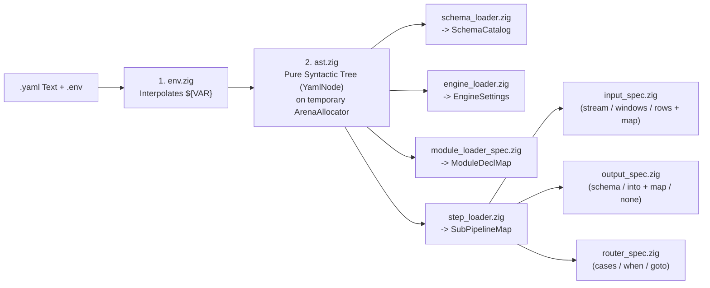

# Declarative Configuration Reference (`schemas.yaml`, `pipeline.yaml`, and `.env`)

This document specifies the complete grammar of configuration files in `vidsec v2`, all capabilities expressible via YAML, and the modular Zig decoding architecture designed to avoid a monolithic *God Module*.

---

## 1. Environment Variable Interpolation (`.env`)

Before parsing scalar values in `pipeline.yaml`, the environment preprocessor (`src/core/yaml/env.zig`) resolves variables from `.env` files or the operating system environment:
* `${VAR_NAME}`: Replaced by the variable value; fails at pre-flight (`error.MissingRequiredEnvVar`) if undefined.
* `${VAR_NAME:-default_value}`: Replaced by the variable value, or falls back to `default_value` if undefined.

Example `.env`:
```dotenv
VIDSEC_DB_MODE=memory
VIDSEC_DB_TIMEOUT=5000
VIDSEC_MAX_MEM_MB=256
VIDSEC_QUARANTINE_DIR=/var/vidsec/quarantine
VIDSEC_WORK_DIR=/tmp/vidsec_work
```

---

## 2. Specification of `schemas.yaml` (Domain Schema Catalog)

The `schemas.yaml` file defines the shared relational structure consumed by pipeline tasks. It maintains a **1:1 bijection with C-ABI types (`ValueTag_ABI`) and SQLite `STRICT` mode**, eliminating complex runtime type conversions.

### 2.1. Supported Column Types and Modifiers

| Type in `schemas.yaml` | Type in C-ABI (`ValueTag_ABI`) | Type in SQLite (`STRICT`) | Description |
| :--- | :--- | :--- | :--- |
| `int64` | `.int64` (`i64`) | `INTEGER` | Signed 64-bit integers (offsets, sizes, IDs, severities). |
| `float64` | `.float64` (`f64`) | `REAL` | IEEE-754 64-bit floating point (entropy, metrics, ratios). |
| `bool` | `.boolean` (`bool`) | `INTEGER` | Boolean (`0` or `1`, with `CHECK (col IN (0, 1))`). |
| `text` | `.text` (`[]const u8`) | `TEXT` | Validated UTF-8 string. |
| `blob` | `.blob` (`[]const u8`) | `BLOB` | Arbitrary raw byte sequence. |

**Column Attributes:**
* `type` *(mandatory)*: `int64` | `float64` | `bool` | `text` | `blob`.
* `pk` *(optional, bool)*: If `true`, generates a `PRIMARY KEY` (for `int64`, acts as an autoincrementing `ROWID` alias in SQLite).
* `nullable` *(optional, bool)*: Defaults to `false` (all columns are `NOT NULL` unless explicitly marked `nullable: true`).
* `default` *(optional, literal)*: Default value for the column (`0`, `false`, `'unknown'`).
* `ref` *(optional, `<table_name>.<column_name>`)*: Foreign key reference (`REFERENCES <table>(<column>)`).

**Table Attributes:**
* `columns`: Dictionary of column definitions.
* `indexes` *(optional)*: List of index definitions (columns, unique, expressions, where).
* `primary_key` *(optional)*: Explicit single or composite primary key `[<col1>, <col2>]`.
* `unique_keys` *(optional)*: List of composite unique constraints.
* `checks` *(optional)*: Table-level `CHECK` expressions.
* `seeds` *(optional, list of mappings)*: Initial static rows for lookup and enum tables (`- { col1: val1, col2: val2 }`). Every column name must exist in `columns`.

### 2.2. Complete `schemas.yaml` Example

```yaml
version: 2

schemas:
  # Domain 1: Structural Intermediate Representation (Basic ContainerIR)
  ir_core:
    container_metadata:
      columns:
        file_size:        { type: int64 }
        detected_format:  { type: int64 }
        true_magic:       { type: int64 }
        true_magic_name:  { type: text }
        highest_root_end: { type: int64 }

    ir_regions:
      columns:
        region_id:                { type: int64, pk: true }
        parent_region_id:         { type: int64, nullable: true, ref: ir_regions.region_id }
        tag_name:                 { type: text }
        role:                     { type: text }
        header_offset:            { type: int64 }
        payload_offset:           { type: int64 }
        effective_end_offset:     { type: int64 }
        is_truncated_or_overflow: { type: bool, default: false }
      indexes:
        - role
        - tag_name

  # Domain 2: Forensic Security Findings and Quarantine
  audit:
    audit_findings:
      columns:
        finding_id:     { type: int64, pk: true }
        rule_id:        { type: text }
        severity:       { type: int64 }
        file_offset:    { type: int64 }
        region_tag:     { type: text, nullable: true }
        measured_value: { type: float64, nullable: true }
        message:        { type: text, nullable: true }
      indexes:
        - rule_id
        - severity
```

---

## 3. Specification of `pipeline.yaml`

The `pipeline.yaml` definition contains three top-level blocks: `engine`, `modules`, and `pipelines`.

### 3.1. `engine` and `modules` Blocks

```yaml
version: 2

engine:
  schemas: "./configs/schemas.yaml"
  trace_file: "${VIDSEC_TRACE_FILE:-./logs/trace.jsonl}"
  db_mode: "${VIDSEC_DB_MODE:-memory}"          # "memory" | "wal_file"
  db_busy_timeout_ms: "${VIDSEC_DB_TIMEOUT:-5000}"
  max_task_memory_mb: "${VIDSEC_MAX_MEM_MB:-256}"
  allowed_dirs:
    quarantine: "${VIDSEC_QUARANTINE_DIR:-/var/vidsec/quarantine}"
    work: "${VIDSEC_WORK_DIR:-/tmp/vidsec_work}"

modules:
  ir_builder:     { path: "./plugins/libm1_ir.so" }
  deep_extract:   { path: "./plugins/libm3_deep.so" }
  byte_scanners:  { path: "./plugins/libfn_scanners.so" } # Houses tasks e.g. `entropy_scan` and `sig_scan`
  quarantine:     { path: "./plugins/libfn_quarantine.so" }
  surgical_cdr:   { path: "./plugins/libm4_cdr.so" }
```

**Module Reference Syntax in `use:`:**
1. `use: sql_rule`: Built-in declarative SQL executor (requires no external `.so`).
2. `use: <module_name>`: Invokes the default task (`tasks_ptr[0]`) from the module `.so` (e.g. `use: ir_builder`).
3. `use: <module_name>/<task_name>`: Invokes a specific named task from a multi-task module (e.g. `use: byte_scanners/entropy_scan`).

---

### 3.2. Five Canonical Step Patterns (`steps`) in `pipelines:`

#### Pattern 1: Full Domain Schema Producer (`output.schema`)
Designed for IR lowering tasks (`ir_builder`, `deep_extract`) that emit records into multiple tables across a domain schema defined in `schemas.yaml` without manual column-by-column mapping:

```yaml
      - task: build_ir
        use: ir_builder
        input:
          stream: { from: file }
        output:
          schema: ir_core
```

#### Pattern 2: Pure Declarative SQL Rule (`use: sql_rule`)
Executes a read-only `SELECT` query across existing tables and inserts the resulting rows into the table specified in `output.into`:

```yaml
      - task: check_magic_and_bounds
        use: sql_rule
        query: |
          SELECT 'R01' AS rule_id, 2 AS severity, 0 AS file_offset, true_magic_name AS region_tag,
                 'Executable or unknown format disguised as video' AS message
          FROM container_metadata WHERE true_magic >= 10 OR detected_format = 0
          UNION ALL
          SELECT 'R03', 2, header_offset, tag_name, 'Region overflows parent limit'
          FROM ir_regions WHERE is_truncated_or_overflow = 1
        output:
          into: audit_findings
```

#### Pattern 3: Generic Task with Symmetric Declarative Mapping (`input.map` + `output.map`)
Allows re-using generic functions (such as `entropy_scan`) without writing SQL in task inputs. The engine compiles `table` + `filter` + `map` into `SELECT <expr> AS <plugin_field> FROM <table> WHERE <filter>` and delivers windows lazily:

```yaml
      - task: scan_padding_r07
        use: byte_scanners/entropy_scan
        input:
          windows:
            from: file
            table: ir_regions
            filter: "role IN ('padding', 'unknown', 'metadata') AND (effective_end_offset - payload_offset) >= 64"
            map:
              id: region_id
              offset: payload_offset
              length: "effective_end_offset - payload_offset"
              tag: tag_name
        params:
          entropy_threshold: 7.2
        output:
          into: audit_findings
          map:
            rule_id: "'R07'"           # Literal constant string
            file_offset: offset        # Field emitted by the plugin
            region_tag: tag
            severity: severity
            measured_value: entropy
```

#### Pattern 4: Output-Less Sink Task (Controlled Side-Effect / Pipeline Halt)
The `output:` block is **optional**. Tasks such as `move_to_quarantine` consume file streams and findings, carve payloads to disk, and return `TaskStatus_ABI.halt_pipeline` to cleanly stop execution:

```yaml
      - task: move_to_quarantine
        use: quarantine
        input:
          stream: { from: file }
          findings:
            table: audit_findings
            filter: "severity = 2"
            map:
              rule_id: rule_id
              offset: file_offset
              message: message
        params:
          quarantine_dir: "${VIDSEC_QUARANTINE_DIR}/rejected"
        # No `output:` block (clean terminal sink)
```

#### Pattern 5: Conditional Router (`router`)
Branches execution between sub-pipelines by evaluating SQL conditions sequentially:

```yaml
      - router: triage_gate
        cases:
          - when: "SELECT 1 FROM audit_findings WHERE rule_id = 'R01' AND severity = 2"
            goto: quarantine_full_file
        default: deep_audit_flow
```

---

## 4. Modular YAML Decoding Architecture in Zig (Avoiding God Modules)

Following Docker Compose (`compose-go`) architectural patterns, YAML parsing is split across small, single-responsibility loaders under `src/core/yaml/`:



| Zig Submodule (`src/core/yaml/`) | Single Responsibility |
| :--- | :--- |
| `env.zig` | Loads `.env` and expands `${VAR}` / `${VAR:-default}` over an `ArenaAllocator`. |
| `ast.zig` | Converts raw YAML text into generic `YamlNode` elements (`map`, `seq`, `scalar`) with line/column tracking for compiler-grade error reporting. Free of Vidsec domain knowledge. |
| `loaders/schema_loader.zig` | Traverses the `schemas.yaml` AST, validates the 5 primitive types, and constructs `SchemaCatalog`. |
| `loaders/input_spec.zig` | Decodes `input:` (`stream`, `windows`, table cursors with `filter` and `map`) and generates `InputSpec`. |
| `loaders/output_spec.zig` | Decodes optional `output:` structures (`schema:`, or `into:` + `mode:` + `map:` + `artifact:`). |
| `loaders/step_loader.zig` | Decodes `steps:` list entries, discriminating between `task:` and `router:` step definitions. |
