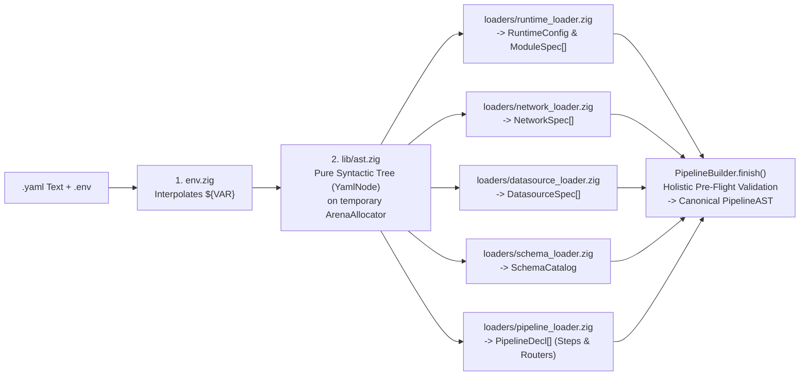

# Unified Declarative Specification (`v2/yaml_reference.md`)

This document serves as the **Master Specification Aggregator** for `flowdata` / `vidsec v2`. It defines how the six top-level sections of `pipeline.yaml` compose together, how external modularization (`$ref`) splits configurations across files, and how the modular Zig YAML decoder (`src/yaml/`) compiles them into the canonical `PipelineAST`.

For the in-depth formal specification of each individual subsystem, consult its dedicated document in [`docs/v2/specs/`](./specs/README.md):

| Top-Level Block | Dedicated Specification | Core Responsibility |
| :--- | :--- | :--- |
| **`runtime:` & `.env`** | **[`v2/specs/runtime.md`](./specs/runtime.md)** | Worker thread budgets (`workers`), default network isolation (`default_network`), memory envelopes, and `.env` variable expansion. |
| **`modules:`** | **[`v2/specs/runtime.md`](./specs/runtime.md#3-dynamic-module-catalog-modules)** | Registration of C-ABI native plugins (`.so` / `.dylib`) and pre-flight permission verification. |
| **`networks:`** | **[`v2/specs/networks.md`](./specs/networks.md)** | Reactive L4/L7 Virtual Network Adapters (`none`, `ingress_only`, `egress`, `sinkhole`), L7 ACLs, Anti-SSRF, connection pooling, TCP window backpressure, Token Bucket rate-limiting, multi-proxy balancing, DoH/DNS, and Wireshark `.pcapng` persistence. |
| **`datasources:`** | **[`v2/specs/datasources.md`](./specs/datasources.md)** | Polymorphic storage backends (`memory`, `sqlite`, `file_store`, `amqp`). |
| **`pipelines:`** | **[`v2/specs/pipeline_and_tasks.md`](./specs/pipeline_and_tasks.md)** | DAG orchestration via pure Black Box `steps` (`uses`, `inputs` stream algebra, `where`, `network`, `concurrency`, `outputs`) and $O(1)$ `router` nodes. |
| **`components.schemas:`** | **[`v2/specs/schemas.md`](./specs/schemas.md)** | Unified 1:1 C-ABI $\leftrightarrow$ SQLite `STRICT` type system, relational primary/foreign keys, indexes, seed catalogs, and inline step schemas. |

---

## 1. Document Anatomy (`pipeline.yaml`)

A complete `flowdata` / `vidsec v2` pipeline document follows a strict, declarative top-down hierarchy inspired by **Docker Compose** ([`dsl_and_cli_rationale.md`](./specs/dsl_and_cli_rationale.md)):

```
pipeline.yaml
├── version: 2
├── runtime:             # Global execution budget & defaults  -> specs/runtime.md
├── modules:             # Dynamic C-ABI plugin catalog (.so)  -> specs/runtime.md
├── networks:            # Virtual L4/L7 network adapters      -> specs/networks.md
├── datasources:         # Storage & memory repositories       -> specs/datasources.md
├── pipelines:           # Execution graphs (main + sub-flows) -> specs/pipeline_and_tasks.md
│   └── <pipeline_id>:
│       └── steps:       # Task steps & conditional routers
└── components:
    └── schemas:         # Canonical relational/memory schemas -> specs/schemas.md
```

### Multi-File Modularization (`$ref`)
Any top-level catalog (`networks:`, `datasources:`, `modules:`, or `components.schemas:`) can be kept inline in a single self-contained `pipeline.yaml` or factored out into dedicated YAML files via `$ref`:

```yaml
version: 2

runtime:
  workers: "${VIDSEC_WORKERS:-auto}"
  default_network: isolated

networks:
  $ref: "./configs/networks.yaml"

datasources:
  $ref: "./configs/datasources.yaml"

modules:
  $ref: "./configs/modules.yaml"

components:
  schemas:
    $ref: "./configs/schemas.yaml"

pipelines:
  main:
    steps:
      # ...
```

---

## 2. Complete End-to-End Unified Example

The following canonical configuration illustrates how **all six specifications** (`runtime`, `modules`, `networks`, `datasources`, `pipelines`, and `components.schemas`) interact in a single coherent pipeline—combining controlled L7 API egress (rate-limited, proxy-balanced, and captured to Wireshark `.pcapng`), parallel page ingestion, air-gapped archive packaging, and virtual sinkhole security detonation:

```yaml
version: 2

# =============================================================================
# 1. RUNTIME & GLOBAL DEFAULTS (See: v2/specs/runtime.md)
# =============================================================================
runtime:
  workers: "${VIDSEC_WORKERS:-auto}"
  default_network: isolated
  max_task_memory_mb: 512
  trace_file: "./logs/trace.jsonl"

# =============================================================================
# 2. DYNAMIC MODULE CATALOG (See: v2/specs/runtime.md)
# =============================================================================
modules:
  mangadex: { path: "./plugins/libmangadex.so" }
  archiver: { path: "./plugins/libarchiver.so" }
  sandbox:  { path: "./plugins/libsandbox.so" }

# =============================================================================
# 3. REACTIVE VIRTUAL NETWORK ADAPTERS (See: v2/specs/networks.md)
# =============================================================================
networks:
  # Air-gapped default for pure computation steps
  isolated:
    driver: none

  # Inbound-only adapter for local stream/webhook consumers
  broker_ingress:
    driver: ingress_only

  # Controlled L4/L7 Egress adapter for MangaDex API & @Home CDN
  api_egress:
    driver: egress
    policy:
      block_private_ranges: true
      allow_rules:
        - schemes: [https]
          hosts: ["api.mangadex.org", "uploads.mangadex.org"]
          ports: [443]
          operations: [GET]
          resources: ["/manga/*", "/chapter/*", "/at-home/server/*", "/covers/*"]
        - schemes: [https]
          hosts: ["*.mangadex.network"]
          ports: [443]
          operations: [GET]
          resources: ["/data/*", "/data-saver/*"]

    pool:
      max_connections: 32
      max_pending_acquires: 128
      acquire_timeout_ms: 2000
      alpn: [h2, http1_1]

    timeouts:
      connect_ms: 3000
      tls_handshake_ms: 3000
      read_idle_ms: 10000
      write_idle_ms: 5000

    backpressure:
      bind_tcp_window: true
      so_rcvbuf_bytes: 262144
      max_buffer_memory_mb: 64

    rate_limit:
      requests_per_second: 5
      burst: 5
      max_inflight: 8
      respect_retry_after: true

    proxies:
      strategy: round_robin # round_robin | weighted | failover | least_latency | sticky_host | random
      health_check_interval_ms: 15000
      circuit_breaker:
        failure_threshold: 3
        cooldown_ms: 30000
        half_open_max_calls: 2
        failover_on_status: [403, 429, 502, 503, 504]
      endpoints:
        - url: "http://proxy-eu-1.internal:8080"
          weight: 3
        - url: "http://proxy-eu-2.internal:8080"
          weight: 3
        - url: "socks5://proxy-backup.internal:1080"
          weight: 1

    dns:
      doh_endpoint: "https://1.1.1.1/dns-query"
      min_ttl_sec: 60
      max_ttl_sec: 3600
      stale_while_revalidate_sec: 120

    routes:
      - match_host: "*.mangadex.network"
        proxy_strategy: least_latency
        rate_limit:
          requests_per_second: 20
          burst: 10

    capture:
      enabled: true
      format: pcapng
      path: "./logs/mangadex_egress.pcapng"
      snaplen: 4096
      include_tls_keys: true

  # Virtual sinkhole adapter for offline detonation & telemetry
  virtual_tap:
    driver: sinkhole
    subnet: "10.254.0.0/24"
    capture_protocols: [dns, http, smb, tcp, udp]
    emulate_responses: false
    isolation: runtime
    capture:
      enabled: true
      format: pcapng
      path: "./logs/sinkhole_detonation.pcapng"
      snaplen: 65535
      include_tls_keys: true

# =============================================================================
# 4. STORAGE DATASOURCES (See: v2/specs/datasources.md)
# =============================================================================
datasources:
  pipeline_memory:
    type: memory
  state_db:
    type: sqlite
    path: "${VIDSEC_DB_PATH:-./pipeline_state.db}"
  cbz_store:
    type: file_store
    directory: "./downloads/cbz/"

# =============================================================================
# 5. PIPELINE EXECUTION GRAPH (See: v2/specs/pipeline_and_tasks.md)
# =============================================================================
pipelines:
  main:
    steps:
      # Step 1: Fetch chapter feed (1 -> N expansion, governed by api_egress)
      - id: fetch_chapters
        uses: mangadex/fetch_feed
        network: api_egress
        params:
          manga_id: "a96676e5-8ae2-425e-b549-7f15dd34a6d8"
          translated_language: "es"
        outputs:
          chapters:
            from: chapters
            schema: components/schemas/chapter_meta
            datasource: pipeline_memory

      # Step 2: Resolve MangaDex@Home server nodes (lifted element-by-element)
      - id: resolve_pages
        uses: mangadex/resolve_at_home
        network: api_egress
        inputs:
          chapter: fetch_chapters.chapters
        outputs:
          page_tasks:
            from: pages
            datasource: pipeline_memory

      # Step 3: Download page images in parallel (governed by *.mangadex.network route)
      - id: download_pages
        uses: mangadex/download_page
        network: api_egress
        concurrency: 8
        inputs:
          page: resolve_pages.page_tasks
        outputs:
          raw_images:
            from: image
            datasource: pipeline_memory

      # Step 4: Pure offline CBZ bundling (N -> 1 aggregation, air-gapped)
      - id: package_cbz
        uses: archiver/bundle_cbz
        network: isolated
        inputs:
          images: download_pages.raw_images
        outputs:
          cbz_archive:
            from: archive
            datasource: cbz_store

      # Step 5: Verify generated archive inside the virtual sinkhole tap
      - id: verify_archive
        uses: sandbox/inspect_payload
        network: virtual_tap
        inputs:
          payload: package_cbz.cbz_archive
        outputs:
          net_events:
            from: network.captured_events
            schema: components/schemas/network_event
            datasource: pipeline_memory

      # Router branching in O(1) from RAM
      - router: check_unexpected_egress
        cases:
          - when: "count(verify_archive.net_events) > 0"
            goto: quarantine_flow
        default: finalize_flow

  quarantine_flow:
    steps: []

  finalize_flow:
    steps: []

# =============================================================================
# 6. CANONICAL ENTITY SCHEMAS (See: v2/specs/schemas.md)
# =============================================================================
components:
  schemas:
    chapter_meta:
      primary_key: chapter_id
      columns:
        chapter_id: { type: text, pk: true }
        volume:     { type: text, nullable: true }
        chapter:    { type: text, nullable: true }
        title:      { type: text, nullable: true }
        pages:      { type: int64 }

    network_event:
      primary_key: event_id
      columns:
        event_id:    { type: int64, pk: true }
        step_id:     { type: text }
        timestamp:   { type: int64 }
        protocol:    { type: text }
        http_method: { type: text, nullable: true }
        dst_host:    { type: text }
        dst_port:    { type: int64 }
        uri_path:    { type: text, nullable: true }
        proxy_used:  { type: text, nullable: true }
        status_code: { type: int64, nullable: true }
        latency_ms:  { type: int64, nullable: true }
        verdict:     { type: text }
```

---

## 3. Modular YAML Decoding Architecture in Zig (`src/yaml/`)

Just as the specification documentation is split into single-responsibility modules under `docs/v2/specs/`, the Zig parser (`src/yaml/`) decomposes YAML loading into isolated, single-responsibility loaders:


