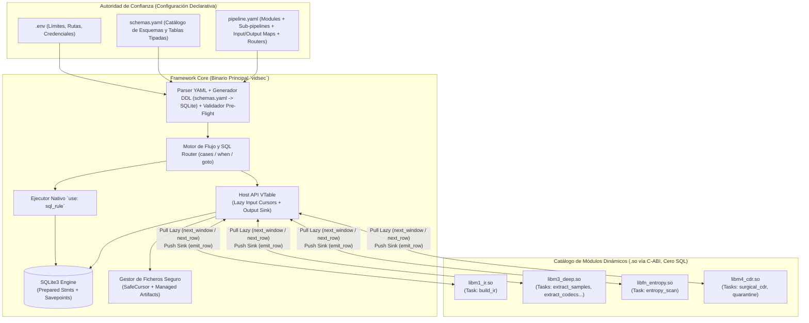
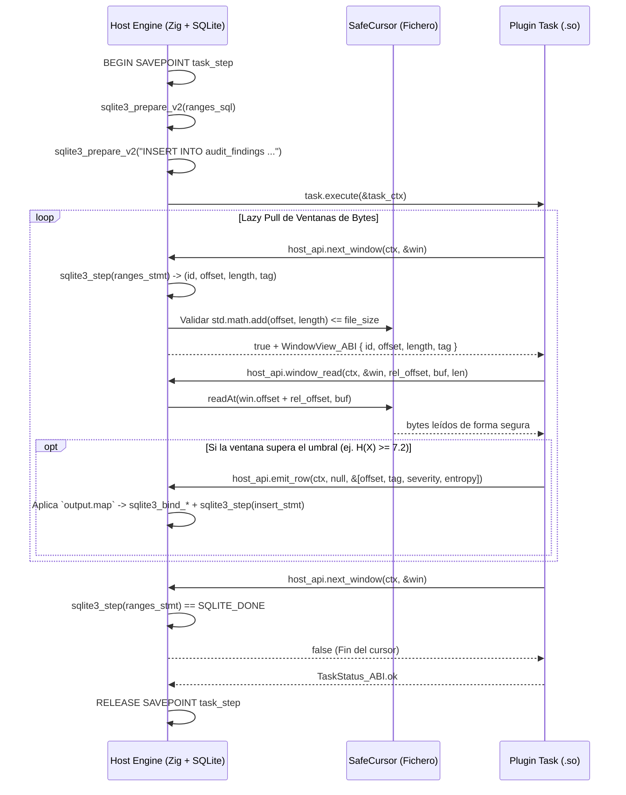

# Especificación del Framework Core (`vidsec v2`)

## 1. Visión y Principios Arquitectónicos

En `vidsec v2`, el sistema se divide estrictamente en dos planos desacoplados:
1. **El Framework Core (Host Runtime):** Es el único propietario del estado, de la base de datos **SQLite3**, del sistema de ficheros, de la validación de esquemas (`schema.sql`) y del flujo de ejecución declarativo (`pipeline.yaml` + `.env`).
2. **Los Plugins de Tareas (`.so` cargados vía C-ABI):** Son librerías dinámicas de cómputo **100% libres de SQL y agnósticas del sistema subyacente**. No enlazan `libsqlite3`, no reciben punteros `*sqlite3` y no abren rutas del sistema de ficheros directamente.



### Ventajas Clave frente a `v1`
- **Cero SQL en los Plugins:** Ningún plugin concatena ni ejecuta SQL. El Host ejecuta las consultas de entrada (`ranges_sql`, `sql`) y entrega los datos **poco a poco de forma *lazy*** (mediante iteradores *pull* sobre `sqlite3_step()`). Al emitir resultados (`emit_row`), el Host aplica el mapeo (`output.map` / `output.tables`) e inserta en SQLite usando sentencias preparadas dentro de una transacción.
- **Sin enlace compartido de `libsqlite3.so` en plugins:** Al no cruzar el puntero `*sqlite3` la frontera `dlopen`, desaparece el riesgo de corrupción de mutexes o asignadores globales de SQLite.
- **Reutilización pura desde `pipeline.yaml`:** Una misma función en Zig (como `entropy_scan`) sirve para auditar *padding* (`R07`), *overlays* (`R02`) o *slack space* (`R08`) cambiando únicamente la consulta `ranges_sql` y el `output.map` en el YAML.
- **Reglas relacionales sin código nativo (`use: sql_rule`):** Cualquier comprobación expresable como un `SELECT` sobre el IR (`R01`, `R03`, `R04`, `R05`, `R06`, `R09`, `R10`) la ejecuta directamente el motor sin necesidad de compilar un plugin `.so`.

---

## 2. Especificación Declarativa (`schemas.yaml`, `pipeline.yaml` y `.env`)

### 2.1. Catálogo de Esquemas Reutilizables (`schemas.yaml`)
En lugar de mantener ficheros `.sql` manuales o acoplar las tablas en el código de los plugins, `schemas.yaml` declara los **esquemas de dominio** (`ir_core`, `ir_deep`, `audit`, etc.) usando **únicamente los 5 tipos primitivos de la C-ABI**, que tienen correspondencia 1:1 directa con SQLite (`STRICT`):
- `int64` $\rightarrow$ `INTEGER`
- `float64` $\rightarrow$ `REAL`
- `bool` $\rightarrow$ `INTEGER` (`0` o `1`)
- `text` $\rightarrow$ `TEXT`
- `blob` $\rightarrow$ `BLOB`

```yaml
version: 2

schemas:
  ir_core:
    container_metadata:
      columns:
        file_size:        { type: int64 }
        detected_format:  { type: int64 }
        true_magic:       { type: int64 }
        true_magic_name:  { type: text }
        highest_root_end: { type: int64 }

    ir_regions:
      columns:
        region_id:                { type: int64, pk: true }
        parent_region_id:         { type: int64, nullable: true, ref: ir_regions.region_id }
        tag_name:                 { type: text }
        role:                     { type: text }
        header_offset:            { type: int64 }
        payload_offset:           { type: int64 }
        effective_end_offset:     { type: int64 }
        is_truncated_or_overflow: { type: bool, default: false }
      indexes: [role, tag_name]

  audit:
    audit_findings:
      columns:
        finding_id:     { type: int64, pk: true }
        rule_id:        { type: text }
        severity:       { type: int64 }
        file_offset:    { type: int64 }
        region_tag:     { type: text, nullable: true }
        measured_value: { type: float64, nullable: true }
        message:        { type: text, nullable: true }
      indexes: [rule_id, severity]
```

### 2.2. Interpolación de `.env` y Cabecera de `pipeline.yaml`
El archivo `pipeline.yaml` referencia `schemas.yaml` y permite interpolar variables de entorno o del archivo `.env` mediante la sintaxis `${VAR}` o `${VAR:-valor_por_defecto}`:

```yaml
version: 2

# Configuración global del motor e inyección desde .env
engine:
  schemas: "./configs/schemas.yaml"
  db_mode: "${VIDSEC_DB_MODE:-memory}"          # "memory" | "wal_file"
  db_busy_timeout_ms: "${VIDSEC_DB_TIMEOUT:-5000}"
  max_task_memory_mb: "${VIDSEC_MAX_MEM_MB:-256}"
  allowed_dirs:
    quarantine: "${VIDSEC_QUARANTINE_DIR:-/var/vidsec/quarantine}"
    work: "${VIDSEC_WORK_DIR:-/tmp/vidsec_work}"

# 1. Catálogo de módulos disponibles (.so)
# Un módulo puede exponer 1 tarea por defecto o múltiples tareas (invocadas como modulo/tarea)
modules:
  ir_builder:   { path: "./plugins/libm1_ir.so" }
  deep_extract: { path: "./plugins/libm3_deep.so" }
  entropy_scan: { path: "./plugins/libfn_entropy.so" }
  quarantine:   { path: "./plugins/libfn_quarantine.so" }
  surgical_cdr: { path: "./plugins/libm4_cdr.so" }
```

### 2.3. Gramática de `pipelines`, `task` (Simetría `input.map` / `output.map`) y `router`
El bloque `pipelines:` define un mapa de sub-pipelines nombrados. La ejecución comienza siempre en el sub-pipeline `main`. Cada entrada dentro de `steps:` es de uno de estos dos tipos:

#### A) Paso de Ejecución (`task`)
Tanto en `input` como en `output`, el usuario puede trabajar a **nivel de esquema completo** (`schema: ir_core`, ideal para transformadores complejos como `ir_builder` o `deep_extract`) o a **nivel de tabla con mapeo explícito (`table`/`into` + `map`)** sin escribir sentencias `SELECT` en los inputs:
- Cuando un `input` declara `table` + `filter` + `map: { campo_plugin: expr_columna }`, el Framework compila automáticamente la consulta:
  `SELECT <expr_columna> AS <campo_plugin>, ... FROM <table> WHERE <filter>`.

```yaml
      - task: <identificador_unico_del_paso>
        use: <module_name> | <module_name>/<task_name> | sql_rule
        # Solo para `use: sql_rule`:
        query: "<SELECT SQL de solo lectura>"
        # Entradas gestionadas por el Host (opcional según la tarea):
        input:
          stream:
            from: file | <artifact_id>
          # Opción A: Ventanas de bytes mapeadas declarativamente desde una tabla
          windows:
            from: file | <artifact_id>
            table: ir_regions
            filter: "role IN ('padding', 'unknown', 'metadata') AND (effective_end_offset - payload_offset) >= 64"
            map:
              id: region_id
              offset: payload_offset
              length: "effective_end_offset - payload_offset"
              tag: tag_name
          # Opción B: Cursor de filas mapeado declarativamente desde una tabla
          <cursor_name>:
            table: audit_findings
            filter: "severity = 2"
            map:
              rule: rule_id
              offset: file_offset
              detail: message
        # Parámetros escalares inyectados a la tarea por ABI (opcional):
        params:
          entropy_threshold: 7.2
          quarantine_dir: "${VIDSEC_QUARANTINE_DIR}/rejected"
        # Reglas de persistencia de salida gestionadas por el Host (opcional):
        output:
          # Modo 1: Volcado de esquema de dominio completo (ej. `ir_builder` -> `schema: ir_core`)
          schema: ir_core
          # Modo 2: Inserción/Actualización en una tabla destino con proyección `map`
          into: audit_findings
          mode: insert # "insert" (por defecto) | "upsert" | "update"
          key: finding_id # Requerido solo si mode == "update" o "upsert"
          map:
            rule_id: "'R07'"           # Literal constante (entre comillas simples)
            file_offset: offset        # Campo `offset` emitido por el plugin en `emit_row`
            region_tag: tag            # Campo `tag` emitido por el plugin
            severity: severity         # Campo `severity` emitido por el plugin
            measured_value: entropy    # Campo `entropy` emitido por el plugin
          # Si la tarea genera un nuevo fichero limpio o transformado:
          artifact: sanitized_video
```

#### B) Enrutador Condicional (`router`)
Evalúa consultas SQL de solo lectura en orden. La primera cláusula `when` cuya consulta devuelva al menos una fila (`sqlite3_step() == SQLITE_ROW`) transfiere el control al sub-pipeline indicado en `goto`. Si ninguna coincide, salta a `default` (o finaliza el pipeline si `default: exit` u omitido).

```yaml
      - router: triage_gate
        cases:
          - when: "SELECT 1 FROM audit_findings WHERE rule_id = 'R01' AND severity = 2"
            goto: quarantine_full_file
        default: deep_audit_flow
```

---

## 3. Modelo de Datos Lazy y Contrato C-ABI (`src/core/plugin_abi.zig`)

### 3.1. Flujo Lazy (*Pull Input* / *Push Output*) sin sobrecarga en RAM
Al ser SQLite una base de datos embebida en el mismo proceso, el Framework aprovecha los cursores nativos (`sqlite3_stmt`) para alimentar a los plugins elemento a elemento sin materializar vectores gigantes en memoria:



### 3.2. Estructuras Exactas de la C-ABI (`callconv(.C)`)

```zig
pub const VIDSEC_ABI_VERSION: u32 = 2;

pub const SemVer_ABI = extern struct {
    major: u16,
    minor: u16,
    patch: u16,
};

pub const ValueTag_ABI = enum(u32) {
    null_val = 0,
    int64 = 1,
    float64 = 2,
    boolean = 3,
    text = 4,
    blob = 5,
};

pub const ValuePayload_ABI = extern union {
    int64: i64,
    float64: f64,
    boolean: bool,
    slice: extern struct {
        ptr: [*]const u8,
        len: usize,
    },
};

/// Valor tipado universal para columnas de entrada, parámetros y campos de salida.
pub const Value_ABI = extern struct {
    tag: ValueTag_ABI,
    payload: ValuePayload_ABI,
};

/// Par (nombre_campo, valor) emitido por el plugin o leído de una fila de entrada.
pub const NamedField_ABI = extern struct {
    name_ptr: [*:0]const u8,
    value: Value_ABI,
};

/// Vista de una ventana acotada de bytes producida por `input.windows.ranges_sql`.
pub const WindowView_ABI = extern struct {
    window_id: i64,
    file_offset: u64,
    byte_length: u64,
    tag_ptr: [*]const u8,
    tag_len: usize,
};

/// Vista de una fila producida por un cursor `input.<name>.sql`.
pub const RowView_ABI = extern struct {
    fields_ptr: [*]const NamedField_ABI,
    fields_len: usize,
};

pub const HostError_ABI = enum(u32) {
    ok = 0,
    end_of_stream = 1,
    out_of_bounds = 2,
    invalid_argument = 3,
    io_error = 4,
    db_constraint_error = 5,
    permission_denied = 6,
    out_of_memory = 7,
};

pub const TaskStatus_ABI = enum(u32) {
    ok = 0,                  // Continúa al siguiente paso tras RELEASE SAVEPOINT
    recoverable_warning = 1, // Registra advertencia en el trace JSON y continúa
    halt_pipeline = 2,       // Confirma cambios (RELEASE SAVEPOINT) y detiene limpiamente el pipeline (ej. tras cuarentena)
    fatal_error = 3,         // Deshace cambios del paso (ROLLBACK TO SAVEPOINT) y aborta la ejecución
};

/// Tabla de servicios del Host (VTable). El plugin interactúa con el exterior
/// ÚNICAMENTE invocando estos punteros a función.
pub const HostApiVTable_ABI = extern struct {
    // --- 1. Entrada de Stream Crudo (`input.stream`) ---
    stream_size: *const fn (ctx: *TaskContext_ABI) callconv(.C) u64,
    stream_read_at: *const fn (
        ctx: *TaskContext_ABI,
        offset: u64,
        dest_ptr: [*]u8,
        len: usize,
    ) callconv(.C) HostError_ABI,

    // --- 2. Iterador Lazy de Ventanas (`input.windows`) ---
    next_window: *const fn (
        ctx: *TaskContext_ABI,
        out_window: *WindowView_ABI,
    ) callconv(.C) HostError_ABI,

    window_read_at: *const fn (
        ctx: *TaskContext_ABI,
        window: *const WindowView_ABI,
        relative_offset: u64,
        dest_ptr: [*]u8,
        len: usize,
    ) callconv(.C) HostError_ABI,

    // --- 3. Iterador Lazy de Cursores de Filas (`input.<cursor_name>.sql`) ---
    next_row: *const fn (
        ctx: *TaskContext_ABI,
        cursor_name: [*:0]const u8,
        out_row: *RowView_ABI,
    ) callconv(.C) HostError_ABI,

    // --- 4. Parámetros de Tarea (`params:`) ---
    get_param: *const fn (
        ctx: *TaskContext_ABI,
        key: [*:0]const u8,
        out_val: *Value_ABI,
    ) callconv(.C) HostError_ABI,

    // --- 5. Sink de Salida de Datos (`output.into` / `output.tables`) ---
    /// Emite una tupla de campos.
    /// - Si la tarea escribe en una única tabla (`output.into`), `channel_name` puede ser `null`.
    /// - Si la tarea escribe en múltiples tablas (`output.tables: [container_metadata, ir_regions]`),
    ///   `channel_name` indica la tabla/canal destino (ej. "ir_regions").
    emit_row: *const fn (
        ctx: *TaskContext_ABI,
        channel_name: ?[*:0]const u8,
        fields_ptr: [*]const NamedField_ABI,
        fields_len: usize,
    ) callconv(.C) HostError_ABI,

    // --- 6. Operaciones Seguras de Fichero para CDR / Cuarentena ---
    /// Solicita al Host clonar el stream de entrada actual a un artefacto de trabajo mutable
    /// (usando CoW `FICLONE` si el FS lo soporta) y truncarlo o sobreescribir rangos con ceros.
    artifact_zero_range: *const fn (
        ctx: *TaskContext_ABI,
        offset: u64,
        length: u64,
    ) callconv(.C) HostError_ABI,

    artifact_truncate: *const fn (
        ctx: *TaskContext_ABI,
        new_size: u64,
    ) callconv(.C) HostError_ABI,

    /// Extrae un rango de bytes del stream de entrada a un fichero gestionado dentro del
    /// directorio de cuarentena autorizado y devuelve su hash SHA-256 hex (64 bytes).
    carve_to_quarantine: *const fn (
        ctx: *TaskContext_ABI,
        offset: u64,
        length: u64,
        reason_tag: [*:0]const u8,
        out_sha256_hex: *[64]u8,
    ) callconv(.C) HostError_ABI,

    // --- 7. Observabilidad y Logs ---
    log_event: *const fn (
        ctx: *TaskContext_ABI,
        level: u8, // 0=debug, 1=info, 2=warn, 3=error
        message_ptr: [*]const u8,
        message_len: usize,
    ) callconv(.C) void,
};

/// Contexto opaco entregado a cada invocación de tarea.
pub const TaskContext_ABI = extern struct {
    abi_version: u32 = VIDSEC_ABI_VERSION,
    opaque_host_state: *anyopaque,
    host: *const HostApiVTable_ABI,
};

/// Descriptor individual de una tarea dentro de un plugin.
pub const TaskDescriptor_ABI = extern struct {
    task_name: [*:0]const u8,
    description: [*:0]const u8,
    /// Nombres de los campos que esta tarea puede emitir en `emit_row` (para validación pre-flight).
    output_fields_ptr: ?[*]const [*:0]const u8 = null,
    output_fields_len: usize = 0,
    execute: *const fn (ctx: *TaskContext_ABI) callconv(.C) TaskStatus_ABI,
};

/// Manifiesto exportado por cada librería `.so` mediante el símbolo `vidsec_module_manifest`.
pub const ModuleManifest_ABI = extern struct {
    abi_version: u32 = VIDSEC_ABI_VERSION,
    module_name: [*:0]const u8,
    module_version: SemVer_ABI,
    /// Catálogo de 1..N tareas contenidas en este `.so`.
    /// Si `tasks_len == 1` (o cuando en el YAML se invoca `use: <module>`),
    /// el motor selecciona `tasks_ptr[0]` por defecto; si se invoca `use: <module>/<task>`,
    /// busca el `TaskDescriptor_ABI` cuyo `task_name` coincida.
    tasks_ptr: [*]const TaskDescriptor_ABI,
    tasks_len: usize,
};
```

---

## 4. Arquitectura Interna del Framework (`classDiagram`)

```mermaid
classDiagram
    direction TB

    class EnvInterpolator["src/core/env.zig :: EnvInterpolator"] {
        +vars: StringHashMapUnmanaged~[]const u8~
        +loadDotEnv(allocator: Allocator, path: []const u8) !void
        +interpolate(arena: Allocator, raw: []const u8) ![]const u8
    }

    class SafeCursor["src/core/io_cursor.zig :: SafeCursor"] {
        +file_size: u64
        +pos: u64
        +limit_stack: [32]u64
        +depth: u8
        +readAt(offset: u64, dest: []u8) CursorError!void
        +readWindowAt(win_offset: u64, win_len: u64, rel_offset: u64, dest: []u8) CursorError!void
    }

    class SchemaCatalog["src/core/schema_catalog.zig :: SchemaCatalog"] {
        +domains: StringHashMapUnmanaged~DomainSchema~
        +parseYaml(arena: Allocator, yaml_src: []const u8) !SchemaCatalog
        +emitSqliteDdl(allocator: Allocator) ![:0]const u8
        +compileInputSelect(allocator: Allocator, spec: InputTableSpec) ![:0]const u8
        +compileOutputMutation(allocator: Allocator, spec: OutputSpec) ![:0]const u8
    }

    class PipelineConfig["src/core/yaml_config.zig :: PipelineConfig"] {
        +schemas_path: []const u8
        +modules: StringHashMapUnmanaged~ModuleDecl~
        +pipelines: StringHashMapUnmanaged~SubPipeline~
        +parse(arena: Allocator, yaml_src: []const u8, env: *const EnvInterpolator) !PipelineConfig
    }

    class ModuleLoader["src/core/module_loader.zig :: ModuleLoader"] {
        +loaded_modules: StringHashMapUnmanaged~LoadedModule~
        +loadAll(modules: StringHashMapUnmanaged~ModuleDecl~) !void
        +resolveTask(use_spec: []const u8) !*const TaskDescriptor_ABI
    }

    class SqliteRuntime["src/core/sqlite_runtime.zig :: SqliteRuntime"] {
        +db: *sqlite3
        +initWithCatalog(db_path: ?[:0]const u8, catalog: *const SchemaCatalog) !SqliteRuntime
        +validateReadOnlyQuery(sql: [:0]const u8) !void
        +prepareStatement(sql: [:0]const u8) !*sqlite3_stmt
        +executeSqlRule(query: [:0]const u8, target_table: []const u8) !usize
        +evaluateRouterWhen(when_sql: [:0]const u8) !bool
    }

    class HostExecutionContext["src/core/host_context.zig :: HostExecutionContext"] {
        +runtime: *SqliteRuntime
        +active_cursor: *SafeCursor
        +ranges_stmt: ?*sqlite3_stmt
        +row_cursors: StringHashMapUnmanaged~*sqlite3_stmt~
        +output_stmts: StringHashMapUnmanaged~PreparedOutputSink~
        +params: StringHashMapUnmanaged~Value_ABI~
        +vtable: HostApiVTable_ABI
    }

    class PipelineEngine["src/core/engine.zig :: PipelineEngine"] {
        +config: PipelineConfig
        +catalog: SchemaCatalog
        +loader: ModuleLoader
        +db_runtime: SqliteRuntime
        +preflightValidate() !void
        +runFile(input_path: []const u8) !ExecutionSummary
    }

    PipelineEngine *-- PipelineConfig
    PipelineEngine *-- SchemaCatalog
    PipelineEngine *-- ModuleLoader
    PipelineEngine *-- SqliteRuntime
    PipelineEngine *-- ExecutionTracer
    PipelineEngine ..> HostExecutionContext : instantiates per task
    HostExecutionContext --> SafeCursor
    HostExecutionContext --> SqliteRuntime
```



### 4.1. Arquitectura Modular de Decodificación YAML (Sin *God Module*)
Al igual que proyectos como `compose-go` en Docker Compose, el parseo y validación de `.yaml` no reside en un único módulo monolítico, sino que se divide en dos capas independientes con memoria efímera (`ArenaAllocator`):
1. **Capa Sintáctica (`src/core/yaml/ast.zig` + `env.zig`):**
   - Parsea cualquier texto YAML a un árbol ligero e inmutable de nodos `YamlNode` (`map`, `seq`, `scalar`) interpolando al vuelo las expresiones `${VAR:-default}` desde `.env`.
2. **Decodificadores de Dominio Desacoplados (`src/core/yaml/loaders/`):**
   - `schema_loader.zig`: Consume un `YamlNode` de `schemas.yaml` y construye `SchemaCatalog`.
   - `module_decl_loader.zig`: Decodifica exclusivamente la sección `modules:`.
   - `input_loader.zig` y `output_loader.zig`: Decodifican los contratos de `stream`, `windows`, cursores con `map` y salidas opcionales (`output:` puede omitirse en tareas sumidero como `quarantine`).
   - `step_loader.zig`: Ensambla los pasos `task`, `sql_rule` y `router`.
   - Una vez validados y compilados los planes en estructuras nativas Zig (`PipelineConfig` + `SchemaCatalog`), el `ArenaAllocator` del AST YAML se libera íntegramente antes de procesar ningún vídeo.

---

## 5. Garantías de Seguridad del Framework (Validación Pre-Flight y Runtime)

El Framework aplica **cinco barreras de seguridad automáticas** para garantizar que ni un archivo de vídeo malicioso ni un plugin con bugs pueda comprometer el sistema o corromper la base de datos:

### 1. Compilación de `schemas.yaml` y Validación en Seco (*Pre-Flight SQL Validation*)
Antes de abrir ningún archivo multimedia:
1. El motor parsea `schemas.yaml` (`SchemaCatalog`), traduce los tipos primitivos (`int64`, `float64`, `bool`, `text`, `blob`) y referencias (`ref: tabla.col`) a sentencias `CREATE TABLE ... STRICT;` e inicializa SQLite en memoria o WAL.
2. Para cada bloque `input` declarativo (`table` + `filter` + `map`), `SchemaCatalog.compileInputSelect` sintetiza la consulta `SELECT <expr> AS <plugin_field> FROM <table> WHERE <filter>` y la compila con `sqlite3_prepare_v2`.
3. Verifica mediante `sqlite3_stmt_readonly(stmt) == 1` que **ninguna consulta generada de entrada, `sql_rule` o condición `when` de un `router` pueda modificar la base de datos** (impidiendo inyecciones de `DROP`, `DELETE`, `INSERT` o `PRAGMA` dañinos en los filtros).
4. Pre-compila las sentencias parametrizadas `INSERT INTO <tabla> (...) VALUES (?1, ?2, ...)` (o `UPDATE`/`UPSERT`) correspondientes a los bloques `output.schema` y `output.into` + `output.map` (cuando el paso define `output:`), comprobando que todas las tablas y columnas existan en `schemas.yaml` y que los campos referenciados coincidan con `TaskDescriptor_ABI.output_fields_ptr`.

### 2. Validación de Grafo Acíclico en Routers (`goto`)
Durante el *pre-flight*, el motor construye el grafo dirigido de saltos entre sub-pipelines (`router.cases.goto` y `router.default`) y verifica:
- Que todo destino `goto` o `default` exista en el mapa `pipelines:`.
- Que **no existan ciclos** en las transiciones entre sub-pipelines (algoritmo DFS con coloreado de nodos `white/gray/black`), garantizando terminación en tiempo finito.

### 3. Aislamiento de Ficheros y Aritmética Segura en `window_read_at`
- Los plugins no reciben rutas ni descriptores `fd` del sistema operativo.
- Cuando `next_window` lee `(id, offset, length, tag)` desde la consulta de entrada, el Host comprueba con `std.math.add(u64, offset, length)` que la ventana completa esté dentro de `[0, file_size]`.
- Cuando el plugin invoca `window_read_at(ctx, &win, rel_offset, dest_ptr, len)`, el Host verifica que `rel_offset + len <= win.byte_length`, haciendo físicamente imposible que una tarea lea un solo byte fuera de las regiones autorizadas por su paso en el YAML.

### 4. Atomicidad Transaccional por Paso (`SAVEPOINT`) y Tareas sin Output / Cortocircuito
Cada vez que el motor inicia un paso `task`:
- Abre un `SAVEPOINT step_<task_name>;` en SQLite.
- Una tarea puede **no declarar bloque `output:`** si su propósito es actuar como sumidero o efecto lateral controlado (ej. `move_to_quarantine` usando `carve_to_quarantine` y devolviendo `TaskStatus_ABI.halt_pipeline`).
- Si la tarea devuelve `ok` o `recoverable_warning`, el Host ejecuta `RELEASE SAVEPOINT` y pasa al siguiente paso.
- Si la tarea devuelve `halt_pipeline`, el Host ejecuta `RELEASE SAVEPOINT` (persistiendo cualquier hallazgo o registro de cuarentena) y detiene limpiamente la ejecución del pipeline actual.
- Si la tarea devuelve `fatal_error` o se produce un error en el `OutputSink`, el Host ejecuta `ROLLBACK TO SAVEPOINT step_<task_name>;` dejando la base de datos en un estado consistente.

### 5. Verificación de Permisos de Módulos `.so`
Al cargar cada ruta declarada en `modules:`, `ModuleLoader` realiza `fstat` sobre el archivo `.so` y rechaza su carga (`error.InsecureModulePermissions`) si tiene bits de escritura para grupo u otros (`mode & 0o022 != 0`).

---

## 6. Observabilidad en Fichero JSON y Control de Ejecución (Runtime / Post-Mortem / GUI)

Para no sobrecargar ni contaminar la base de datos SQLite del pipeline (que se reserva estrictamente para las tablas de dominio definidas en `schemas.yaml`), toda la telemetría, logging y control de pausas se gestiona fuera de SQLite:

### 6.1. Trazabilidad y Logging en Fichero Estructurado (`../zig-out/out/trace.jsonl` / `.json`)
El componente `ExecutionTracer` (`src/core/tracer.zig`) vuelca en un fichero JSON independiente (configurable en `engine.trace_file` o vía CLI `--trace-out <ruta.jsonl>`) cada evento del ciclo de vida:
- **`step_start` / `step_end`**: Secuencia, sub-pipeline activo, nombre de la tarea, estado devuelto (`TaskStatus_ABI`), duración en microsegundos (`elapsed_us`), número de ventanas/filas leídas en los cursores *lazy* y número de filas emitidas en `emit_row`.
- **`task_log`**: Mensajes emitidos por los plugins a través de `host.log_event(ctx, level, msg_ptr, msg_len)` con su timestamp y paso asociado.
- **`router_decision`**: Qué cláusula `when` del `router` devolvió verdadero y a qué sub-pipeline (`goto` o `default`) saltó el motor.

Este fichero JSON permite realizar **análisis post-ejecución** completo para detectar bugs, cuellos de botella o decisiones de enrutamiento inesperadas sin necesidad de consultar SQLite.

### 6.2. Control de Pausa y Ejecución Step-by-Step (Runtime Hooks para Debugger / GUI)
Los puntos de interrupción (*breakpoints*) y el avance paso a paso **no forman parte del `pipeline.yaml`** (manteniendo el YAML limpio de detalles de depuración), sino que se inyectan en el motor a través de un controlador de ejecución (`DebugController` en `PipelineEngine`):
- **Durante la ejecución (CLI / GUI):** Una interfaz gráfica o el modo depuración de la CLI (`--step` o `--break-at <task_or_router_name>`) registra un callback en `DebugController`. El motor pausa la ejecución entre pasos (justo tras cerrar el `SAVEPOINT` del paso anterior), permitiendo a la GUI o al desarrollador inspeccionar el fichero de traza JSON y consultar en vivo el estado de las tablas SQLite antes de ordenar `step_next`, `continue` o `abort`.
- **Análisis Posterior:** Combinando el fichero de traza JSON con el volcado opcional de la base de datos en disco (`db_mode: "wal_file"`), cualquier ejecución puede auditarse a posteriori paso por paso.
