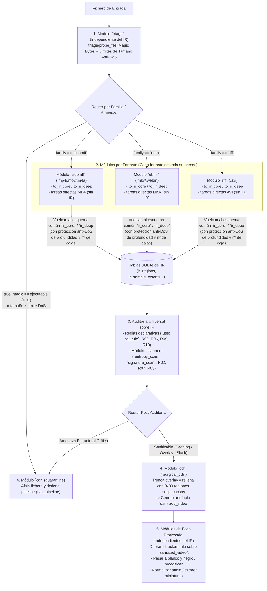

# Arquitectura del Catálogo de Plugins y Tareas (`vidsec v2`)

## 1. Filosofía de Diseño de Plugins en `v2`

En `vidsec v2`, el motor (`framework`) **no impone el uso de la Representación Intermedia (IR)**. El sistema se concibe como un ecosistema abierto de plugins donde conviven dos modos de trabajo:

1. **Flujo basado en IR Unificado (Antivirus Multi-Formato):**
   - Cada familia de contenedor (`isobmff`, `ebml`, `riff`) implementa su propio traductor hacia el esquema común `ir_core` / `ir_deep` (apoyándose en una librería helper estática común `src/sdk/ir_contract.zig` para no repetir las estructuras de emisión).
   - Una vez proyectado el contenedor al IR en SQLite, todas las reglas SQL (`sql_rule`), escáneres de bytes (`entropy_scan`, `signature_scan`) y sanitizadores quirúrgicos (`surgical_cdr`) operan de forma 100% agnóstica al formato original.
2. **Flujo Directo / Independiente del IR (Pre-Triage y Post-Procesado Específico):**
   - Tareas que operan directamente sobre el stream del archivo sin construir ni consultar el IR: desde el **pre-triage inicial** (detección de *magic bytes* y límites de tamaño anti-DoS) hasta **transformaciones específicas de un formato** (ej. reordenar el átomo `moov` en un MP4) o **filtros de post-procesado multimedia** (ej. pasar un vídeo a blanco y negro, normalizar audio o limpiar subtítulos).



---

## 2. Catálogo de Módulos (`.so`) y sus Tareas

### Categoría 1: Pre-Triage y Defensa Inicial Anti-DoS (`libtriage.so`)
Completamente independiente del IR. Es la primera barrera ultrarrápida (ejecutada en microsegundos leyendo solo la cabecera del archivo y su tamaño en disco).

| Tarea (`module/task`) | Inputs | Params | Output | Responsabilidad |
| :--- | :--- | :--- | :--- | :--- |
| `triage/probe_file` | `stream: { from: file }` | `max_file_size_mb`, `strict_extension` | Tabla `file_triage` (`file_size`, `detected_family`, `true_magic_kind`, `true_magic_name`, ` exceeds_size_limit`) | Identifica la firma real (*magic bytes*) distinguiendo contenedores legítimos (`isobmff`, `ebml`, `riff`) de ejecutables/archivos camuflados (`MZ`, `ELF`, `Mach-O`, `ZIP`, scripts $\rightarrow$ `R01`) y verifica que el tamaño físico no viole los límites anti-DoS. |

---

### Categoría 2: Plugins de Formato y Construcción del IR (`libisobmff.so`, `libebml.so`, `libriff.so` + SDK IR)

Para mantener una interfaz de datos única cuando se desea usar el IR, existe un paquete ligero compartido en tiempo de compilación (**`src/sdk/ir_emitter.zig`**) que define los helpers para emitir filas hacia los esquemas `ir_core` e `ir_deep` a través de `host.emit_row`. Sin embargo, **cada formato vive en su propio plugin** y decide cómo recorrer su estructura binaria y qué tareas adicionales ofrecer:

#### A) Protección Anti-DoS Integrada en los Walkers de Formato
Al recorrer cajas (`ISOBMFF`), elementos (`EBML`) o chunks (`RIFF`), cada driver aplica tres cortafuegos contra ataques de agotamiento de recursos (*Parser DoS*):
1. **`max_depth` (por defecto `32`):** Evita *Stack Overflow* / recursión infinita mediante árboles de cajas maliciosamente anidados (*Box Nesting Bombs*).
2. **`max_regions` (por defecto `250_000`):** Evita *Box Flooding* (archivos con millones de cajas vacías de 8 bytes diseñadas para agotar CPU y memoria).
3. **`max_samples` (por defecto `5_000_000`):** Limita el número de entradas procesadas en tablas `stsz`/`stco` falsificadas.

#### B) Tareas Expuestas por cada Plugin de Formato (`isobmff`, `ebml`, `riff`)

Gracias a que cada plugin de formato puede tanto **producir el IR (`to_ir_*`)** como **consumir el IR (`from_ir`)** o **operar directamente sobre el contenedor nativo**, es posible realizar compactación física (reducción de tamaño eliminando *padding*/*slack*/adjuntos) y conversión entre formatos (*trans-muxing* de MKV a MP4 o viceversa) **100% en Zig nativo sin depender de herramientas externas como `ffmpeg`**:

| Tarea (`<formato>/<tarea>`) | ¿Usa el IR? | Inputs | Output | Descripción |
| :--- | :---: | :--- | :--- | :--- |
| `<formato>/to_ir_core` | **Sí** (Frontend $\rightarrow$ `ir_core`) | `stream: { from: file }` | `schema: ir_core` (`ir_regions`, `container_stats`) | Navega el árbol superficial de regiones del contenedor, calculando límites de padres, `highest_root_end` (para `R02`) y desbordamientos aritméticos (`is_truncated_or_overflow` para `R03`). |
| `<formato>/to_ir_deep` | **Sí** (`ir_core` $\rightarrow$ `ir_deep`) | `stream` + regiones de índice de `ir_regions` | `schema: ir_deep` (`ir_sample_extents`, `ir_unreferenced_slack`, `ir_codec_configs`, `ir_attachments`, `ir_external_refs`) | Parseo profundo de tablas de muestras (`stbl` en MP4/M4A, `Cues` en MKV, `idx1` en AVI), cálculo de *slack space* huérfano dentro de `mdat`/`movi` (`R08`), validación de SPS `avcC`/`hvcC` vs pista (`R09`), adjuntos (`R06`) y referencias externas (`R05`). |
| `<formato>/from_ir` | **Sí** (Backend `ir_deep` $\rightarrow$ Contenedor limpio) | `stream: { from: file }`, tablas `ir_sample_extents` e `ir_codec_configs` | `artifact: rebuilt_container` | **Reconstrucción / Conversión entre Formatos sin FFmpeg:** Construye desde cero un contenedor limpio en el formato `<formato>` copiando únicamente los *extents* de muestras legítimas y configuraciones de códec del IR. Permite tanto sanitización por reconstrucción (eliminando físicamente el peso de *padding*, *slack* y adjuntos) como *trans-muxing* nativo (ej. `ebml/to_ir_*` $\rightarrow$ `isobmff/from_ir`). |
| `<formato>/compact` *(Directo sobre formato)* | **No** (o híbrido) | `stream: { from: sanitized_video }` | `artifact: compacted_video` | **Reducción de tamaño nativa sin FFmpeg:** Purga cajas de *padding* (`free`/`skip`/`Void`/`JUNK`), metadatos no esenciales y *slack*, desplazando los paquetes y recalculando las tablas de offsets (`stco`/`co64`) nativamente. |
| `isobmff/faststart` *(Directo sobre formato)* | **No** | `stream: { from: sanitized_video }` | `artifact: faststart_mp4` | Tarea específica de formato MP4/M4A que opera directamente sobre el binario sin usar el IR (reubica el átomo `moov` al inicio para streaming). |

---

### Categoría 3: Análisis Heurístico sobre Ventanas de Bytes (`libbyte_scanners.so`)
Funciones puras de análisis de bytes que no conocen ni qué formato de vídeo se está analizando ni qué regla de negocio las invoca. Reciben un iterador *lazy* de ventanas (`input.windows`) desde el YAML:

| Tarea (`scanners/<tarea>`) | Inputs | Params | Campos Emitidos (`emit_row`) | Reutilización en el Antivirus |
| :--- | :--- | :--- | :--- | :--- |
| `scanners/entropy_scan` | `windows` (`id`, `offset`, `length`, `tag`) | `entropy_threshold` (ej. `7.2`) | `window_id`, `offset`, `length`, `tag`, `entropy`, `severity` | Se instancia en el YAML para auditar cajas de *padding* (`R07`), *trailing overlays* tras la última caja raíz (`R02`) o huecos no referenciados en `mdat` (`R08`). |
| `scanners/signature_scan` | `windows` (`id`, `offset`, `length`, `tag`) | `scan_step_bytes` | `window_id`, `offset`, `match_offset`, `tag`, `sig_name`, `severity` | Caza cabeceras ejecutables (`MZ`, `ELF`, `Mach-O`, scripts, `Go buildinf:`) ocultas dentro de regiones de *padding* o *slack space* incluso cuando el atacante rellena con ceros (`0x00`) para burlar el umbral de entropía. |

> [!NOTE]
> **¿Y el resto de reglas (`R01`, `R03`, `R04`, `R05`, `R06`, `R09`, `R10`)?**
> Al estar la información ya estructurada en `file_triage`, `ir_core` e `ir_deep`, no requieren plugins `.so`: se ejecutan directamente en `pipeline.yaml` mediante `use: sql_rule` (incluyendo la detección de bombas de solapamiento de muestras `R10` mediante `LAG()` en SQL).

---

### Categoría 4: Mitigación, Cuarentena y Sanitización CDR (`libcdr.so`)

| Tarea (`cdr/<tarea>`) | Inputs | Params | Output / Efecto | Descripción |
| :--- | :--- | :--- | :--- | :--- |
| `cdr/quarantine_file` | `stream: { from: file }`, cursor `findings` | `quarantine_dir` | Sin tabla `output:` (Devuelve `halt_pipeline`) | Copia el archivo malicioso y su resumen de hallazgos al directorio de cuarentena y detiene limpiamente la ejecución del pipeline. |
| `cdr/surgical_cdr` | `stream: { from: file }`, `windows` (rangos a neutralizar), `truncate_at` | `carve_evidence: true` | `artifact: sanitized_video` (+ tabla opcional `carved_evidence`) | Clona el archivo de forma segura (CoW), extrae a cuarentena (`carve_to_quarantine`) las ventanas sospechosas (`R02`, `R07`, `R08`), las sobrescribe con `0x00` (`artifact_zero_range`) manteniendo intactos los offsets de `stco`/`co64`, y trunca cualquier *overlay* al final del contenedor (`artifact_truncate`). |

---

### Categoría 5: Limpieza y Post-Procesamiento Multimedia (`libmedia_ops.so` — Opcional / No Prioritario)
Tareas pensadas para ejecutarse **después de la sanitización** (o en pipelines de transformación multimedia puros), operando directamente sobre el artefacto limpio (`from: sanitized_video`) **sin depender del IR**:

| Tarea (`media_ops/<tarea>`) | Inputs | Params | Output | Descripción |
| :--- | :--- | :--- | :--- | :--- |
| `media_ops/video_filter` | `stream: { from: sanitized_video }` | `filter: "grayscale" \| "scale"`, `codec: "libx264"`, `crf: 23` | `artifact: processed_video` | Aplica transformaciones visuales (como pasar el vídeo a blanco y negro o reescalar) invocando el motor de filtrado/transcodificación en un entorno aislado sin red. |
| `media_ops/clean_subtitles` | `stream: { from: sanitized_video }` | `strip_html: true`, `strip_ass_tags: true` | `artifact: clean_srt` | Extrae subtítulos y purga etiquetas de estilo ASS/SSA y HTML potencialmente explotables en reproductores. |
| `media_ops/remux_streams` | `stream: { from: sanitized_video }` | `keep_attachments: false`, `strip_metadata: true` | `artifact: remuxed_video` | Re-empaqueta exclusivamente las pistas elementales de vídeo y audio descartando cualquier metadato residual, capítulos o fuentes tipográficas adjuntas. |

---

## 3. Ejemplo de `pipeline.yaml` Unificando Triage, Plugins de Formato, IR, CDR y Post-Procesado

Este ejemplo muestra cómo el `router` conecta el pre-triage independiente del IR con cada plugin de formato (`isobmff`, `ebml`, `riff`), ejecuta las reglas sobre el IR unificado, sanitiza el archivo y finalmente le aplica una tarea de post-procesado (pasar a blanco y negro) independiente del IR:

```yaml
version: 2

engine:
  schemas: "./configs/schemas.yaml"
  trace_file: "./logs/trace.jsonl"

modules:
  triage:    { path: "./plugins/libtriage.so" }
  isobmff:   { path: "./plugins/libisobmff.so" }
  ebml:      { path: "./plugins/libebml.so" }
  riff:      { path: "./plugins/libriff.so" }
  scanners:  { path: "./plugins/libbyte_scanners.so" }
  cdr:       { path: "./plugins/libcdr.so" }
  media_ops: { path: "./plugins/libmedia_ops.so" }

pipelines:
  # 1. PRE-TRIAGE (Independiente del IR: Magic Bytes + Anti-DoS de tamaño)
  main:
    steps:
      - task: initial_probe
        use: triage/probe_file
        input:
          stream: { from: file }
        params:
          max_file_size_mb: 4096
        output:
          into: file_triage
          map:
            file_size: file_size
            detected_family: detected_family
            true_magic_kind: true_magic_kind
            true_magic_name: true_magic_name
            exceeds_size_limit: exceeds_size_limit

      - task: check_r01_and_dos_size
        use: sql_rule
        query: |
          SELECT 'R01' AS rule_id, 2 AS severity, 0 AS file_offset, true_magic_name AS region_tag,
                 'Spoofed executable or unsupported format' AS message
          FROM file_triage WHERE true_magic_kind >= 10 OR detected_family = 'unknown'
          UNION ALL
          SELECT 'DOS_SIZE', 2, 0, 'FILE', 'File exceeds maximum allowed size'
          FROM file_triage WHERE exceeds_size_limit = 1
        output:
          into: audit_findings

      # Enrutamiento hacia el plugin específico de cada formato (o a cuarentena si falló el triage)
      - router: dispatch_by_format
        cases:
          - when: "SELECT 1 FROM audit_findings WHERE severity = 2"
            goto: quarantine_flow
          - when: "SELECT 1 FROM file_triage WHERE detected_family = 'isobmff'"
            goto: parse_isobmff
          - when: "SELECT 1 FROM file_triage WHERE detected_family = 'ebml'"
            goto: parse_ebml
          - when: "SELECT 1 FROM file_triage WHERE detected_family = 'riff'"
            goto: parse_riff
        default: quarantine_flow

  # 2. EXTRACCIÓN AL IR POR FORMATO (Cada plugin maneja su formato con límites anti-DoS)
  parse_isobmff:
    steps:
      - task: mp4_to_ir_core
        use: isobmff/to_ir_core
        input: { stream: { from: file } }
        params: { max_depth: 32, max_regions: 250000 }
        output: { schema: ir_core }
      - task: mp4_to_ir_deep
        use: isobmff/to_ir_deep
        input: { stream: { from: file } }
        params: { max_samples: 5000000 }
        output: { schema: ir_deep }
      - router: to_common_audit
        cases: []
        default: common_ir_audit

  parse_ebml:
    steps:
      - task: mkv_to_ir_core
        use: ebml/to_ir_core
        input: { stream: { from: file } }
        params: { max_depth: 32, max_regions: 250000 }
        output: { schema: ir_core }
      - task: mkv_to_ir_deep
        use: ebml/to_ir_deep
        input: { stream: { from: file } }
        output: { schema: ir_deep }
      - router: to_common_audit
        cases: []
        default: common_ir_audit

  parse_riff:
    steps:
      - task: avi_to_ir_core
        use: riff/to_ir_core
        input: { stream: { from: file } }
        params: { max_depth: 32, max_regions: 250000 }
        output: { schema: ir_core }
      - task: avi_to_ir_deep
        use: riff/to_ir_deep
        input: { stream: { from: file } }
        output: { schema: ir_deep }
      - router: to_common_audit
        cases: []
        default: common_ir_audit

  # 3. AUDITORÍA UNIVERSAL SOBRE EL IR
  common_ir_audit:
    steps:
      - task: structural_sql_rules
        use: sql_rule
        query: |
          SELECT 'R03' AS rule_id, 2 AS severity, header_offset AS file_offset, tag_name AS region_tag,
                 'Region overflows parent bounds' AS message
          FROM ir_regions WHERE is_truncated_or_overflow = 1
          UNION ALL
          SELECT 'R10', 2, target_offset, source_tag, 'Overlapping sample extents (Decompression Bomb)'
          FROM (
            SELECT target_offset, source_tag,
                   LAG(end_offset) OVER (ORDER BY target_offset) AS prev_end
            FROM ir_sample_extents
          ) WHERE prev_end IS NOT NULL AND target_offset < prev_end
        output:
          into: audit_findings

      - task: scan_padding_entropy_r07
        use: scanners/entropy_scan
        input:
          windows:
            from: file
            table: ir_regions
            filter: "role IN ('padding', 'unknown') AND (effective_end_offset - payload_offset) >= 64"
            map:
              id: region_id
              offset: payload_offset
              length: "effective_end_offset - payload_offset"
              tag: tag_name
        params:
          entropy_threshold: 7.2
        output:
          into: audit_findings
          map:
            rule_id: "'R07'"
            file_offset: offset
            region_tag: tag
            severity: severity
            measured_value: entropy

      - router: post_audit_decision
        cases:
          - when: "SELECT 1 FROM audit_findings WHERE rule_id IN ('R03', 'R04', 'R05', 'R09', 'R10') AND severity = 2"
            goto: quarantine_flow
        default: sanitize_and_postprocess

  # 4. SANITIZACIÓN Y POST-PROCESADO (Post-procesado opera sobre el fichero limpio sin usar el IR)
  sanitize_and_postprocess:
    steps:
      - task: neutralize_padding_and_overlay
        use: cdr/surgical_cdr
        input:
          stream: { from: file }
          windows:
            from: file
            table: ir_regions
            filter: "role = 'padding'"
            map:
              id: region_id
              offset: payload_offset
              length: "effective_end_offset - payload_offset"
              tag: tag_name
        output:
          artifact: sanitized_video

      # Tarea independiente del IR sobre el vídeo ya limpio:
      - task: convert_to_grayscale
        use: media_ops/video_filter
        input:
          stream: { from: sanitized_video }
        params:
          filter: "grayscale"
        output:
          artifact: final_video

  quarantine_flow:
    steps:
      - task: isolate_threat
        use: cdr/quarantine_file
        input:
          stream: { from: file }
          findings:
            table: audit_findings
            filter: "severity = 2"
            map: { rule_id: rule_id, offset: file_offset, message: message }
        params:
          quarantine_dir: "/var/vidsec/quarantine"
```
