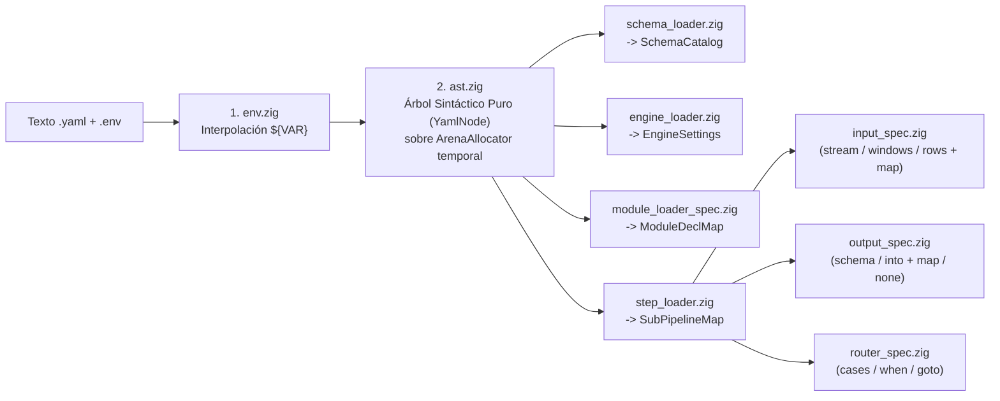

# Referencia de Configuración Declarativa (`schemas.yaml`, `pipeline.yaml` y `.env`)

Este documento especifica la gramática completa de los archivos de configuración de `vidsec v2`, todas las capacidades expresables desde YAML y la arquitectura modular con la que el motor las decodifica en memoria en Zig evitando un *God Module*.

---

## 1. Interpolación de Variables (`.env`)

Antes de interpretar los valores escalares de `pipeline.yaml`, el preprocesador de entorno (`src/core/yaml/env.zig`) resuelve variables procedentes del archivo `.env` o del entorno del proceso:
- `${NOMBRE_VAR}`: Sustituye por el valor de la variable; falla en *pre-flight* (`error.MissingRequiredEnvVar`) si no está definida.
- `${NOMBRE_VAR:-valor_por_defecto}`: Sustituye por el valor de la variable o usa `valor_por_defecto` si no está definida.

Ejemplo de `.env`:
```dotenv
VIDSEC_DB_MODE=memory
VIDSEC_DB_TIMEOUT=5000
VIDSEC_MAX_MEM_MB=256
VIDSEC_QUARANTINE_DIR=/var/vidsec/quarantine
VIDSEC_WORK_DIR=/tmp/vidsec_work
```

---

## 2. Especificación de `schemas.yaml` (Catálogo de Esquemas de Dominio)

El archivo `schemas.yaml` define la estructura relacional compartida por las tareas del pipeline. Está diseñado con una **biyección 1:1 con los tipos de la C-ABI (`ValueTag_ABI`) y SQLite `STRICT`**, evitando conversiones complejas de tipos.

### 2.1. Tipos de Columna y Modificadores Soportados

| Tipo en `schemas.yaml` | Tipo en C-ABI (`ValueTag_ABI`) | Tipo en SQLite (`STRICT`) | Descripción |
| :--- | :--- | :--- | :--- |
| `int64` | `.int64` (`i64`) | `INTEGER` | Enteros con signo de 64 bits (offsets, tamaños, IDs, severidades). |
| `float64` | `.float64` (`f64`) | `REAL` | Coma flotante IEEE-754 de 64 bits (entropía, métricas, ratios). |
| `bool` | `.boolean` (`bool`) | `INTEGER` | Booleano (`0` o `1`, con restricción `CHECK (col IN (0, 1))`). |
| `text` | `.text` (`[]const u8`) | `TEXT` | Cadena UTF-8 validada. |
| `blob` | `.blob` (`[]const u8`) | `BLOB` | Secuencia de bytes crudos arbitrarios. |

**Propiedades de cada columna:**
- `type` *(obligatorio)*: `int64` | `float64` | `bool` | `text` | `blob`.
- `pk` *(opcional, bool)*: Si es `true`, genera `PRIMARY KEY` (en `int64`, alias de `ROWID` autoincremental en SQLite).
- `nullable` *(opcional, bool)*: Por defecto `false` (toda columna es `NOT NULL` salvo que se indique `nullable: true`).
- `default` *(opcional, literal)*: Valor por defecto de la columna (`0`, `false`, `'unknown'`).
- `ref` *(opcional, `<tabla>.<columna>`)*: Clave foránea simple (`REFERENCES <tabla>(<columna>)`).

### 2.2. Ejemplo Completo de `schemas.yaml`

```yaml
version: 2

schemas:
  # Dominio 1: Representación Intermedia Estructural (ContainerIR Básico)
  ir_core:
    container_metadata:
      columns:
        file_size:        { type: int64 }
        detected_format:  { type: int64 }
        true_magic:       { type: int64 }
        true_magic_name:  { type: text }
        highest_root_end: { type: int64 }

    ir_regions:
      columns:
        region_id:                { type: int64, pk: true }
        parent_region_id:         { type: int64, nullable: true, ref: ir_regions.region_id }
        tag_name:                 { type: text }
        role:                     { type: text }
        header_offset:            { type: int64 }
        payload_offset:           { type: int64 }
        effective_end_offset:     { type: int64 }
        is_truncated_or_overflow: { type: bool, default: false }
      indexes:
        - role
        - tag_name

  # Dominio 2: Hallazgos de Seguridad y Cuarentena
  audit:
    audit_findings:
      columns:
        finding_id:     { type: int64, pk: true }
        rule_id:        { type: text }
        severity:       { type: int64 }
        file_offset:    { type: int64 }
        region_tag:     { type: text, nullable: true }
        measured_value: { type: float64, nullable: true }
        message:        { type: text, nullable: true }
      indexes:
        - rule_id
        - severity
```

---

## 3. Especificación de `pipeline.yaml`

El archivo `pipeline.yaml` se divide en 3 bloques de nivel superior: `engine`, `modules` y `pipelines`.

### 3.1. Bloque `engine` y Bloque `modules`

```yaml
version: 2

engine:
  schemas: "./configs/schemas.yaml"
  trace_file: "${VIDSEC_TRACE_FILE:-./logs/trace.jsonl}"
  db_mode: "${VIDSEC_DB_MODE:-memory}"          # "memory" | "wal_file"
  db_busy_timeout_ms: "${VIDSEC_DB_TIMEOUT:-5000}"
  max_task_memory_mb: "${VIDSEC_MAX_MEM_MB:-256}"
  allowed_dirs:
    quarantine: "${VIDSEC_QUARANTINE_DIR:-/var/vidsec/quarantine}"
    work: "${VIDSEC_WORK_DIR:-/tmp/vidsec_work}"

modules:
  ir_builder:     { path: "./plugins/libm1_ir.so" }
  deep_extract:   { path: "./plugins/libm3_deep.so" }
  byte_scanners:  { path: "./plugins/libfn_scanners.so" } # Contiene ej. `entropy_scan` y `sig_scan`
  quarantine:     { path: "./plugins/libfn_quarantine.so" }
  surgical_cdr:   { path: "./plugins/libm4_cdr.so" }
```

**Formas de referenciar un módulo en `use:`:**
1. `use: sql_rule`: Ejecutor SQL declarativo integrado en el motor (no requiere `.so`).
2. `use: <module_name>`: Invoca la tarea por defecto (`tasks_ptr[0]`) del módulo `.so` (ej. `use: ir_builder`).
3. `use: <module_name>/<task_name>`: Invoca una tarea específica dentro de un plugin multi-tarea (ej. `use: byte_scanners/entropy_scan`).

---

### 3.2. Los 5 Patrones de Paso (`steps`) en `pipelines:`

#### Patrón 1: Tarea Productora de Esquema Completo (`output.schema`)
Pensada para constructores de IR (`ir_builder`, `deep_extract`) que emiten registros hacia múltiples tablas de un dominio definido en `schemas.yaml` sin necesidad de mapear columna a columna en `pipeline.yaml`:

```yaml
      - task: build_ir
        use: ir_builder
        input:
          stream: { from: file }
        output:
          schema: ir_core
```

#### Patrón 2: Regla Declarativa Pura en SQL (`use: sql_rule`)
Ejecuta un `SELECT` de solo lectura sobre las tablas existentes y vuelca las filas resultantes en la tabla indicada en `output.into`:

```yaml
      - task: check_magic_and_bounds
        use: sql_rule
        query: |
          SELECT 'R01' AS rule_id, 2 AS severity, 0 AS file_offset, true_magic_name AS region_tag,
                 'Executable or unknown format disguised as video' AS message
          FROM container_metadata WHERE true_magic >= 10 OR detected_format = 0
          UNION ALL
          SELECT 'R03', 2, header_offset, tag_name, 'Region overflows parent limit'
          FROM ir_regions WHERE is_truncated_or_overflow = 1
        output:
          into: audit_findings
```

#### Patrón 3: Tarea Genérica con Mapeo Declarativo Simétrico (`input.map` + `output.map`)
Permite reutilizar funciones genéricas (como `entropy_scan`) sin escribir SQL en los inputs. El motor traduce `table` + `filter` + `map` en un `SELECT <expr> AS <campo_plugin> FROM <table> WHERE <filter>` y entrega las ventanas de forma *lazy*:

```yaml
      - task: scan_padding_r07
        use: byte_scanners/entropy_scan
        input:
          windows:
            from: file
            table: ir_regions
            filter: "role IN ('padding', 'unknown', 'metadata') AND (effective_end_offset - payload_offset) >= 64"
            map:
              id: region_id
              offset: payload_offset
              length: "effective_end_offset - payload_offset"
              tag: tag_name
        params:
          entropy_threshold: 7.2
        output:
          into: audit_findings
          map:
            rule_id: "'R07'"           # Literal constante (entre comillas simples)
            file_offset: offset        # Campo emitido por el plugin
            region_tag: tag
            severity: severity
            measured_value: entropy
```

#### Patrón 4: Tarea Sumidero sin `output:` (Efecto Lateral / Parada del Pipeline)
El bloque `output:` es **opcional**. Tareas como `move_to_quarantine` consumen el stream y los hallazgos, extraen el archivo a cuarentena y pueden devolver `TaskStatus_ABI.halt_pipeline` para detener limpiamente el pipeline:

```yaml
      - task: move_to_quarantine
        use: quarantine
        input:
          stream: { from: file }
          findings:
            table: audit_findings
            filter: "severity = 2"
            map:
              rule_id: rule_id
              offset: file_offset
              message: message
        params:
          quarantine_dir: "${VIDSEC_QUARANTINE_DIR}/rejected"
        # Sin bloque `output:` (o solo registro interno en cuarentena)
```

#### Patrón 5: Enrutador Condicional (`router`)
Bifurca la ejecución entre sub-pipelines evaluando consultas SQL en orden:

```yaml
      - router: triage_gate
        cases:
          - when: "SELECT 1 FROM audit_findings WHERE rule_id = 'R01' AND severity = 2"
            goto: quarantine_full_file
        default: deep_audit_flow
```

---

## 4. Arquitectura de Decodificación YAML en Zig (Sin *God Module*)

Para evitar que el parser de YAML se convierta en un módulo monolítico acoplado a todas las estructuras del motor (al estilo de la separación modular de `compose-go`), la carga se divide en paquetes pequeños con responsabilidad única bajo `src/core/yaml/`:



| Submódulo Zig (`src/core/yaml/`) | Responsabilidad Única |
| :--- | :--- |
| `env.zig` | Carga `.env` y expande `${VAR}` / `${VAR:-default}` sobre un `ArenaAllocator`. |
| `ast.zig` | Convierte texto YAML en nodos genéricos `YamlNode` (`map`, `seq`, `scalar`) con línea/columna para mensajes de error claros. No conoce nada del dominio de `vidsec`. |
| `loaders/schema_loader.zig` | Recorre el `YamlNode` de `schemas.yaml`, valida los 5 tipos primitivos y construye `SchemaCatalog`. |
| `loaders/input_spec.zig` | Decodifica `input:` (`stream`, `windows`, cursores de tabla con `filter` y `map`) y genera la estructura `InputSpec`. |
| `loaders/output_spec.zig` | Decodifica `output:` opcional (`schema:` o `into:` + `mode:` + `map:` + `artifact:`). |
| `loaders/step_loader.zig` | Decodifica cada ítem de `steps:` discriminando si contiene la clave `task:` o `router:`. |
